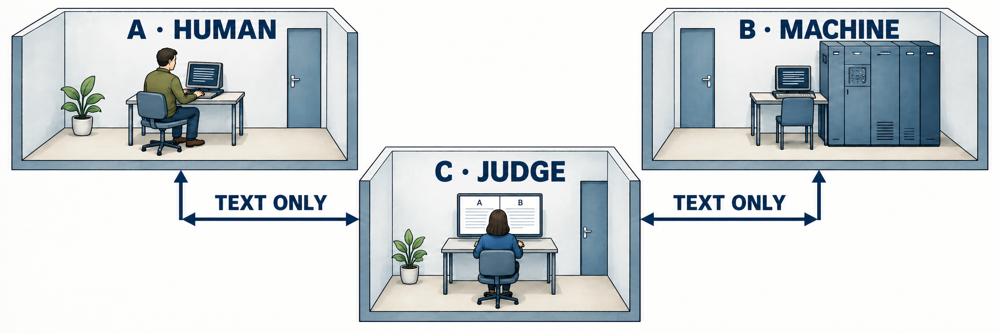
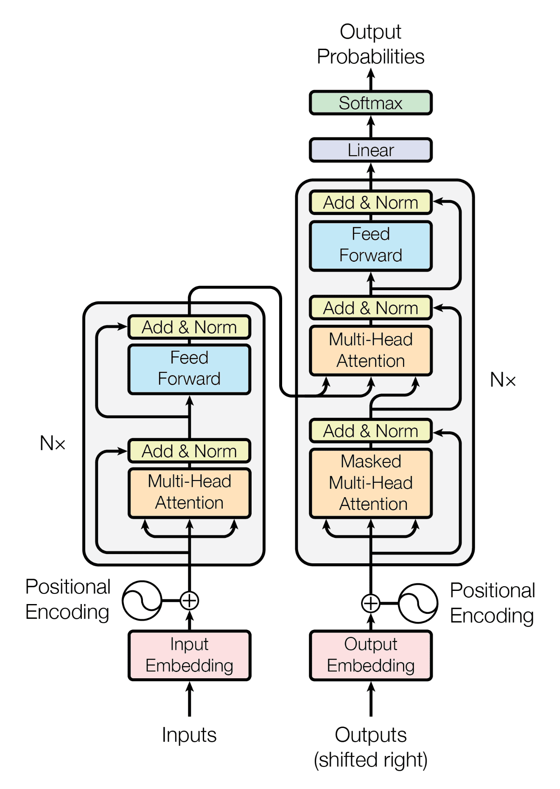
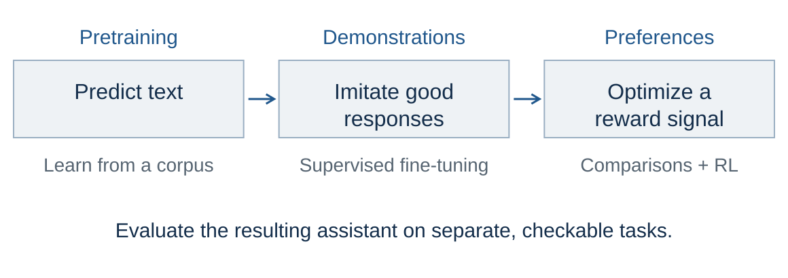
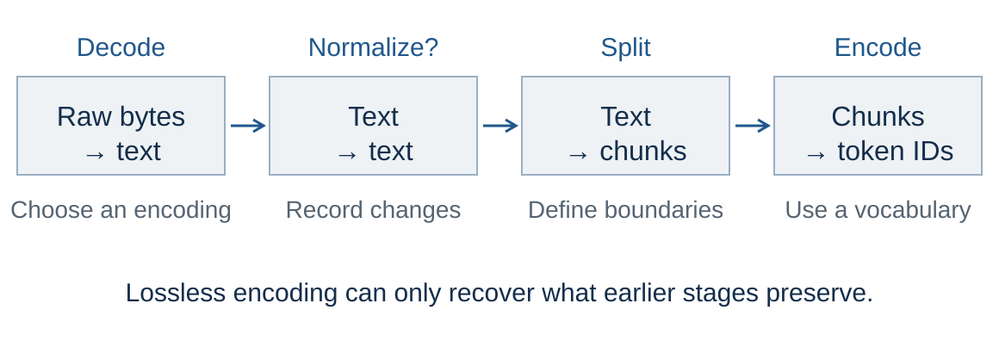
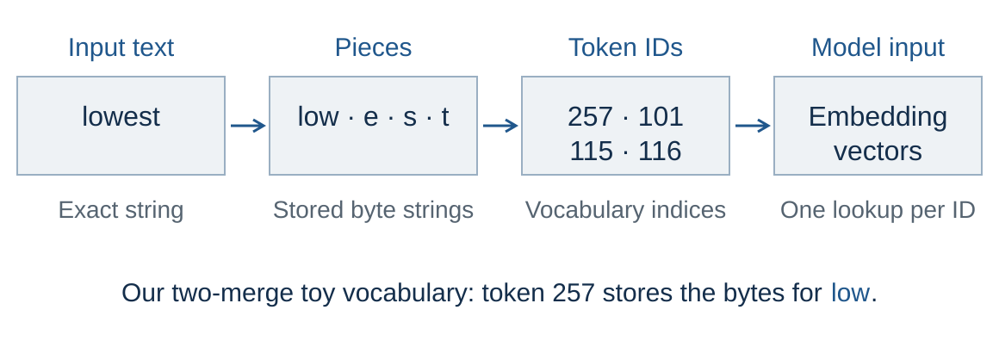

<!-- .slide: class="title-slide" id="title" -->

<p class="eyebrow">CS40008.01</p>

# 导论与词元化

<p class="subtitle">第 01 讲 – NLP 与大语言模型导论</p>

<p class="byline">Baojian Zhou<br>数据科学学院<br>复旦大学<br>2026 年 9 月 9 日</p>

Note:
询问学生：他们认为模型如何表示一个中文句子。

---

<!-- .slide: id="about-me" -->

## 关于我

<p><strong>邮箱：</strong> <a href="mailto:bjzhou@fudan.edu.cn">bjzhou@fudan.edu.cn</a></p>
<p><strong>课程网站：</strong> <a href="https://baojian.github.io/llm-26-fall/">baojian.github.io/llm-26-fall/</a></p>
<p><strong>课程 GitHub：</strong> <a href="https://github.com/baojian/llm-26-fall">github.com/baojian/llm-26-fall</a></p>
<p><strong>办公室：</strong> Francis and Rose Yuen Campus，C611</p>
<p><strong>办公时间：</strong> 周一 14:00–15:30</p>

Note:
自我介绍，并邀请学生参加办公时间。课程微信群二维码在所有学生加入后已移除。联系方式：复旦春季第 01 讲，https://baojian.github.io/llm-26/slides/lecture-01-slides/index.html#/1。办公时间与课程链接：2026 年秋季课程页面，../../index.html。

---

<!-- .slide: class="outline-slide" id="outline-overview" -->

## 大纲

<ul class="outline-topics">
<li aria-current="step">课程概览</li>
<li>NLP 与大语言模型的发展</li>
<li>文本预处理基础</li>
<li>文本词元化</li>
</ul>

Note:
第 1 课时，第 0–25 分钟：课程概览。把四个主题读一遍。共有三个 45 分钟的授课课时，课间休息在这 135 分钟之外。在每次主题转换时回到这份大纲。资料来源：复旦春季第 01 讲的四部分结构，https://baojian.github.io/llm-26/slides/lecture-01-slides/。

---

<!-- .slide: id="nlp-and-llms" -->

## NLP、大语言模型与本课程

**自然语言处理（NLP）：**用于分析和生成人类语言的计算方法。

**大语言模型（LLM）：**从文本中学习语言规律、并支持众多 NLP 任务的大型神经模型。

**本课程：**理解语言模型的工作原理，构建小型模型，并通过受控实验评估它们。

Note:
将 NLP 介绍为一个领域，将大语言模型介绍为该领域中使用的一类模型。NLP 包括翻译、分类、问答等任务。大语言模型只是应用的一个组件；在示例中我们将区分模型、工具和接口。在介绍今天的词元化目标之前，先讲清这个贯穿全课程的宗旨。背景资料：Jurafsky 和 Martin 第 1 章导论与 1.1 节，https://web.stanford.edu/~jurafsky/slp3/1.pdf （2026 年 8 月 19 日草稿）。课程范围与学习方法：../../index.html#overview。

---

<!-- .slide: id="course-topics" -->

## 我们将涵盖的内容

**基础：**文本预处理与词元化；n-gram 模型；词嵌入；神经语言模型；自注意力；Transformer。

**训练与评估：**预训练与微调；数据质量；算力预算；评估与基准测试。

**应用与前沿：**提示与上下文学习；对齐与安全；高效推理；扩散语言模型；推理与智能体。

课程顺序与实践内容见[每周安排](../../index.html#schedule)。

Note:
改编自春季第 01 讲幻灯片 15：https://baojian.github.io/llm-26/slides/lecture-01-slides/index.html#/15。秋季日程确定了实际的范围与时间安排：../../index.html#schedule。Word2vec 提供了一个嵌入示例；RNN/LSTM 建模简要引出对注意力的需求。数据、算力、检索和实验设计都是秋季课程的明确组成部分。这张主题图为前面那张课程逻辑幻灯片给出了具体主题。在这张图上花约 45 秒；学生可以在课后回看每周安排。

---

<!-- .slide: id="course-work" -->

## 课程作业与考核

构建小型模型、运行实验，并完成一个课程项目。

| 考核 | 权重 |
| :--- | ---: |
| 小测 | 10% |
| 作业 | 45% |
| 个人课程项目 | 45% |

A1 将于**第 2 周**发布。详情见[课程页面](../../index.html#assessment)。

Note:
区分今天的不计分实践与计分作业。课程网站是当前考核规则的权威来源。不要照搬斯坦福的课业量或上一学期的截止日期。把可复现的小型实验与个人项目联系起来。这是春季第 01 讲幻灯片 17 的秋季对应版本，原片打开了早期课程页面：https://baojian.github.io/llm-26/slides/lecture-01-slides/index.html#/17。所展示的权重与个人项目遵循 ../../index.html#assessment。

---

<!-- .slide: id="learning-strategy" -->

## 如何有效学习本课程

- **线性代数：**向量、矩阵与张量形状。
- **概率与机器学习：**分布、损失与优化。
- **Python：**使用 NumPy、PyTorch 和 Transformers 练习。
- **沟通表达：**在个人作业中解释证据与决策。

**阅读 → 实现 → 实验 → 解释。**

勤加练习。验证结果，并探究失败原因。

Note:
改编自春季第 01 讲幻灯片 19：https://baojian.github.io/llm-26/slides/lecture-01-slides/index.html#/19。把先修知识与下一个实验联系起来：查看张量或文本表示，实现一个小型案例，改变一个因素，然后解释结果。秋季先修要求与学习期望见 ../../index.html#overview。秋季项目为个人书面提交，因此沟通表达指清晰的实验记录与解释，而不是春季团队的展示要求。课程 AI 政策允许在实践作业中借助 AI，但要求学生验证结果并解释自己的决策；完整政策见 ../../index.html#policies。

---

<!-- .slide: id="survey" -->

## 你使用的大语言模型应用

日常生活中你最常使用哪些应用？

在[第一讲调查问卷](https://github.com/baojian/llm-26-fall/issues/6)中勾选**所有适用项**。

按照 issue 中的指引，通过一个 pull request 提交你的回答。

> 你通常让这些应用做什么？

Note:
当众举出两三个例子。说明一个应用可能组合了模型、搜索、工具和接口。在此介绍 GitHub 工作流；学生可以在课后完成 PR。不要把这节课花在调试个人账号上。

---

<!-- .slide: id="notebook-demo" -->

## 示例：一个 Qwen 语言模型

> Fudan University is located in which city? Answer with one word.

<a href="../shared/notebook.html?lecture=lecture-01">打开课堂 notebook</a> → **一个提示，一个回答**。

1. 预测答案。
2. 用已安装的 Qwen 模型运行该单元格。
3. 查看答案、词元计数和停止原因。

<div class="answer fragment"><p>预期城市：<strong>上海</strong>。将回答与事实对照核查。</p></div>

Note:
一分钟；课前准备好调用。使用共享启动器，它会打开学生的工作副本并保留答案。notebook 提供了确切的提示和请求设置。使用已经安装好的 Qwen3 标签；不要把课堂时间花在下载上。思考（thinking）和模型规模比较是 notebook 中可选的后续内容。词元计数包含模型提示的格式化，而不仅仅是对所显示词语的计数。原始提示：春季幻灯片 5，https://baojian.github.io/llm-26/slides/lecture-01-slides/index.html#/5；API：https://docs.ollama.com/api/generate。

课前在课程仓库运行 git pull 以获取更新。Notebook 启动器会在 workspace/ 下打开个人副本，并保留已保存的学生作业。设置命令和完整资源清单仍在 notebook 中。

---

<!-- .slide: class="exercise" id="exercise-01" -->

## 任务 1：情感分析

<p class="exercise-meta">练习 E01 · 5 分钟 · Notebook E01</p>

1. “Nice and compact to carry!”
2. “The camera is small and light; I avoid carrying bulky cameras.”
3. “The camera feels flimsy, plastic, and very light.”

“light”是褒义吗？先预测标签，再与 Ollama 的结果比较。

<div class="answer fragment"><p>预期：正面、正面、负面。</p> <p> 周围的词改变了“light”的含义。</p></div>

Note:
留出一分钟个人标注，两分钟运行 notebook E01，两分钟比较。这些是上一版复旦课程中相机评论的精简版本；notebook 保留了完整评论文本。预期标签是针对这些示例的人工判断，并非保证的模型输出。讨论任何不一致之处。

---

<!-- .slide: class="exercise" id="exercise-02" -->

## 任务 2：机器翻译

<p class="exercise-meta">练习 E02 · 3 分钟 · Notebook E02 · 历史示例</p>

<div class="columns">
<div>
<h3>A：数字与日期</h3>
<blockquote><p>Google Translate支持249种语言。日均用户超过2亿人，2016年4月总用户数超过5亿人，每天翻译超过1000亿个单词。</p></blockquote>
</div>
<div>
<h3>B：定义与预测</h3>
<blockquote><p>人工智能亦称智械、机器智能，指由人制造出来的机器所表现出来的智能。……常态预测则认为人类的很多职业也逐渐被其取代。</p></blockquote>
</div>
</div>

Note:
留出一分钟预测 A 的数量，一分钟运行 Notebook E02，一分钟比较。学生应写下四个英文数量和日期，然后指出模型输出中任何被改动或遗漏的信息。One 亿 is 100 million，所以 2亿 是 200 million，5亿 是 500 million，1000亿 是 100 billion。保留“over”、以天为单位的计量，以及附在总用户数上的 2016 年 4 月这一日期。如果 Ollama 不可用，就按这些检查点比较学生的翻译。A 是原始来源中完整的 Google Translate 段落；这些是历史的原始统计数据，并非当前情况说明书。B 节选自原始的 AI 定义段落，并标注了省略处。两段完整文字都保留在 notebook 现有的翻译单元格中。时间允许时，把 B 作为后续比较：既要保留机器智能的定义，也要保留关于职业的最后预测。翻译出该预测并不等于确立其真实性。保持模型与解码设置固定。资料来源：https://baojian.github.io/llm-26/slides/lecture-01-slides/index.html#/7。

---

<!-- .slide: id="example-article-blog" -->

## 任务 3：你能识别作者吗？

<div class="columns">
<div>
<h3>A · 效率博客</h3>
<blockquote><p>In order to get something done, maybe we need to think less. Seems counter-intuitive, but I believe sometimes our thoughts can get in the way of the creative process.</p></blockquote>
</div>
<div>
<h3>B · 新闻文章</h3>
<blockquote><p>After two days of intense debate, the United Methodist Church has agreed to a historic split — one that is expected to end in the creation of a new denomination…</p></blockquote>
</div>
</div>

人类还是机器？什么证据支持你的猜测？

<div class="answer fragment"><p>春季幻灯片将<strong>两段都归于 GPT-3</strong>。仅凭流畅性无法验证作者身份或事实。</p></div>

Note:
一分钟。这些节选自 notebook 中的完整段落，并非本节课中生成的输出。在揭晓来源归属之前，让学生先独立猜测。归属由春季幻灯片提供；新闻风格的文本是一个历史生成示例，并非经过核实的报道。课后阅读 notebook 中更长的节选。这引出了图灵的操作性问题以及针对具体任务评估的需求。资料来源：https://baojian.github.io/llm-26/slides/lecture-01-slides/index.html#/8。B 中省略的部分有明确标注；A 是前两个完整句子。这次投票不计分，且与 E01–E06 分开。

---

<!-- .slide: id="example-vision-big-data" -->

## 任务 4：图像理解

<div class="columns">
<div>

</div>
<div>
<p><strong>提示：</strong>用一段话描述这张图像。</p>
<p><strong>可见内容：</strong>标签、标志、连接线。</p>
<p><strong>推断内容：</strong>这些连接可能意味着什么。</p>
<p><a href="assets/vision-big-data.png" target="_blank" rel="noopener">打开全尺寸图像</a>，然后在 Notebook 中运行任务 4。</p>
</div>
</div>

Note:
将这幅大数据示意图作为任务 4 的唯一示例。让学生先识别可见的标签、标志和连接线，然后再比较 notebook 中预先准备好的 Qwen3-VL 回答。这是一幅概念示意图，不是实测图表。标志之间相连并不意味着存在数据共享或商业关系。资料来源：春季幻灯片 9，https://baojian.github.io/llm-26/slides/lecture-01-slides/index.html#/9；素材出处：assets/README.md。

---

<!-- .slide: id="example-text-to-image" -->

## 任务 5：文本 → 图像

**Stable Diffusion**

> a watercolor painting of a university campus gate at sunset, people fully clothed, family-friendly

打开 Notebook 中可选的**文本 → 图像：Stable Diffusion**部分。

保持提示固定；改变随机种子并比较生成的图像。

<p class="caption">原始演示设置：30 步，引导强度 7.5。</p>

Note:
从原始 sd-demo.html iframe 恢复确切的提示，该演示使用 Stable Diffusion 1.5。可选的 notebook 单元格使用已准备好的本地检查点，不会下载模型权重。课前准备好多模态软件包和检查点；图像生成为可选内容。将生成的图像标识为模型输出，并比较每一张是否遵循提示。资料来源：https://baojian.github.io/llm-26/slides/lecture-01-slides/index.html#/10 及 https://baojian.github.io/llm-26/slides/lecture-01-slides/sd-demo.html。

---

<!-- .slide: id="example-video-johannesburg" -->

## 任务 5：文本 → 视频 —— 约翰内斯堡

**Prompt:** a woman wearing purple overalls and cowboy boots taking a pleasant stroll in Johannesburg South Africa during a beautiful sunset

<video class="animation" src="assets/text-to-video-johannesburg.mp4" poster="assets/text-to-video-johannesburg-poster.jpg" controls playsinline preload="metadata" aria-label="原始生成视频示例：一名女子在日落时分于户外漫步。"></video>

<p class="caption">播放该片段。将人物、服装、场景和光照与提示进行比较。</p>

Note:
这一原始片段托管在本地。让学生指出一个与提示相符的细节和一个局限。看似真实的场景并不能证明该地真实存在。播放为手动操作；海报帧在一秒处截取，并会出现在打印版中。原始提示与片段：https://baojian.github.io/llm-26/slides/lecture-01-slides/index.html#/11。来源未指明视频生成模型。媒体出处：assets/README.md。

---

<!-- .slide: id="course-website" -->

## 课程网站与 GPU 资源

<div class="columns">
<div>
<h3>课程网站</h3>
<p><a href="https://baojian.github.io/llm-26-fall/">baojian.github.io/llm-26-fall/</a></p>
<ul>
<li>每周安排、幻灯片与 notebook。</li>
<li>作业、项目与评分。</li>
<li>课程政策与学习资源。</li>
</ul>
</div>
<div>
<h3>复旦 Qizhi GPU 平台</h3>
<p><a href="http://qz.cfff.fudan.edu.cn/" target="_blank" rel="noopener noreferrer">qz.cfff.fudan.edu.cn</a></p>
<ul>
<li>通过 <a href="https://cfff.fudan.edu.cn/home" target="_blank" rel="noopener noreferrer">复旦 CFFF</a> 注册。</li>
<li>用于课程作业与项目的 GPU 训练和推理。</li>
<li>每位学生的 GPU 预算：见项目手册。</li>
</ul>
</div>
</div>

**将两个网站加入书签并查看更新。**

Note:
约一分钟。打开课程网站，指出日程、考核、政策和资源。然后介绍 http://qz.cfff.fudan.edu.cn/ 作为学生可使用的复旦 Qizhi GPU 平台。注册从 https://cfff.fudan.edu.cn/home 开始。遵循课程在 ../../index.html#resources 的算力指引：每位学生的 GPU 和 AI 工具预算将在项目手册中说明；具体模型规模与运行预算以教学团队试点为准。课上展示平台的登录入口，并在可用时说明课程配额。第 01 讲核心的预处理和 BPE 练习在本地运行，无需 GPU。回到幻灯片，介绍 NLP 与大语言模型的发展。平台链接经授课教师确认；复旦关于教学算力支持的介绍：https://ai3.fudan.edu.cn/info/1050/2364.htm （2025 年 11 月 26 日）。

---

<!-- .slide: class="outline-slide" id="outline-development" -->

## 大纲

<ul class="outline-topics">
<li>课程概览</li>
<li aria-current="step">NLP 与大语言模型的发展</li>
<li>文本预处理基础</li>
<li>文本词元化</li>
</ul>

Note:
第 1 课时，第 25–45 分钟。十页历史内容之后是三页 2026 年 9 月的更新：当前模型、Terminal-Bench Science 和 Navier–Stokes 公告。历史页面约花 14 分钟，更新部分花六分钟。日期用于标识所选论文；较老的方法继续并存。Navier–Stokes 讨论结束后进行第一次休息。

---

<!-- .slide: id="early-nlp" -->

## 1949 · 翻译作为一个计算问题

**Warren Weaver：**利用上下文、统计规律以及解码类比来研究翻译。

<div class="columns">
<div><h3>任务</h3><p>源句 → 目标句</p><p>财经报告中的“bank”</p></div>
<div><h3>障碍</h3><p>词语之间并非一一对应。</p><p>河流旁边的“bank”</p></div>
</div>

> 周围的文本有助于确定想要表达的含义。

<p class="source">Weaver，《<em>Translation</em>》（1949 年），关于上下文与密码学的讨论。</p>

Note:
1.5 分钟。以 E02 中的一个具体任务开启这条时间线。Weaver 1949 年 7 月 15 日的备忘录引用了他 1947 年 3 月致 Norbert Wiener 的信，但这是两个不同的日期。bank 的例子是新的教学示例，并非引语。Weaver 讨论了多种可能含义以及周围词语的作用。他的密码学类比激发了研究；但并不意味着语言是一种简单的替换密码。资料来源：https://mt-archive.net/Weaver-1949.pdf，第 5–6 页及关于上下文的讨论。改编自春季幻灯片 23。

---

<!-- .slide: id="turing-test" -->

## 1950 · 图灵测试



裁判看得到回答，却看不到回答由谁产生。

<p class="caption">简化的机器对人类版本 · AI 生成的概念示意图。</p>

Note:
2 分钟。询问为什么交流通道必须隐藏面孔和声音，以及谁拥有哪些信息。观众看得到示意图中的身份；裁判看不到。图灵原始的模仿游戏以一个男人、一个女人和一名询问者开始，然后追问当机器替换其中一名参与者时会有什么变化。这是大家熟悉的、简化的机器对人类改编版，并非对历史测试的逐字复原。结果取决于裁判、指令、时长和参与者。不要把它解读为意识或通用能力的证明。资料来源：Turing（1950），Computing Machinery and Intelligence，第 1–2 节，https://doi.org/10.1093/mind/LIX.236.433；可访问的论文：https://www.csee.umbc.edu/courses/471/papers/turing.pdf。示意图出处与提示词：assets/image-prompts.md。

---

<!-- .slide: id="turing-evidence" -->

## 1950 · 令人信服的回答与正确答案

<div class="columns">
<div>

</div>
<div>
<h3>图灵的算术示例</h3>
<p>问题：<strong>34,957 + 70,764</strong></p>
<p>论文中的回答：<strong>105,621</strong></p>
<div class="answer fragment"><p>正确的和：<strong>105,721</strong>。</p><p>一个有用的助手应当优化什么？</p></div>
</div>
</div>

<p class="caption">Turing（1950），§2 · AI 生成示意图；数值示例来自该论文。</p>

Note:
1.5 分钟。给观众一点时间核对这个和。论文中的示例回答出现在约 30 秒的停顿之后，并带有 100 的误差。图灵讨论的是对人类行为的模仿；我们的课程还需要可独立核查的表现。把这与翻译数字和作者身份投票联系起来。类人错误不是计算器的目标。该图像是示意性场景，不是档案照片。资料来源：Turing（1950），第 2 节，https://www.csee.umbc.edu/courses/471/papers/turing.pdf。没有声称任何数值模型结果。请学生举出一种超越“听起来像人”的评估。

---

<!-- .slide: id="rules-and-statistics" -->

## 1960 年代–1990 年代 · 规则与统计学习

| 方法 | 行为由什么提供？ |
| :--- | :--- |
| 规则；ELIZA（1966） | 手写的模式与回答模板 |
| 统计翻译（1990） | 从语料库估计的翻译概率与语言概率 |

**玩具规则：**“I need X” → “Why do you need X?”

从示例中学习扩大了覆盖面。未见短语仍然困难。

<p class="source">Weizenbaum (1966); Brown et al. (1990).</p>

Note:
2 分钟。用这个玩具规则解释一句看似有回应能力的话如何能由模式变换产生；它不是引用的 ELIZA 输出。ELIZA 的 DOCTOR 脚本使用分解与重组规则，而不是大型预训练神经模型。统计机器翻译从对齐的双语文本估计模型，并用概率为候选翻译打分。这些方法并存；这条时间线并不声称基于规则的系统在 1990 年消失了。资料来源：Weizenbaum，https://doi.org/10.1145/365153.365168；Brown et al.，A Statistical Approach to Machine Translation，https://aclanthology.org/J90-2002/，第 1–2 节。这以学生能识别的机制扩展了春季从规则到统计的时间线。

---

<!-- .slide: id="development" -->

## 2003–2014 · 学习表示

| 里程碑 | 改变了什么？ |
| :--- | :--- |
| 神经语言模型 · 2003 | 共同学习词向量与预测 |
| Word2vec · 2013 | 从词语上下文中学习可复用的向量 |
| 序列到序列 · 2014 | 联合学习编码器与解码器 |

相似的上下文可以共享统计上的支撑。

固定的句子向量可能丢失翻译所需的细节。

<p class="source">Bengio et al. (2003); Mikolov et al. (2013); Sutskever et al. (2014).</p>

Note:
2 分钟。向量是学习到的数值表示，不是词典释义。相关的词会因其训练上下文而获得相似表示，但邻近性并不是通用的同义词检验标准。Bengio 等人共同学习分布式词表示与语言模型。Word2vec 提供了高效的表示学习目标。2014 年的 seq2seq 模型使用 LSTM；LSTM 论文本身发表于 1997 年。固定长度编码引出了下一张幻灯片的注意力机制。资料来源：https://www.jmlr.org/papers/v3/bengio03a.html；https://arxiv.org/abs/1301.3781；https://arxiv.org/abs/1409.3215；LSTM：https://doi.org/10.1162/neco.1997.9.8.1735。这些是所选论文的日期，并非所有神经 NLP 的起始日期。

---

<!-- .slide: id="milestones" -->

## 2014–2017 · 注意力与 Transformer

<div class="columns">
<div>
<a href="assets/transformer-architecture.png" target="_blank" rel="noopener"></a>
</div>
<div>
<p><strong>2014 / 2015 · 翻译注意力</strong><br>在生成每个输出时查阅相关的源语位置。</p>
<p><strong>2017 · Transformer</strong><br>在主序列架构中使用不带循环的注意力。</p>
<p>训练时可以并行处理各个词元位置。</p>
</div>
</div>

<p class="caption">Bahdanau et al. (2014 preprint; ICLR 2015); Vaswani et al. (2017), Figure 1.</p>

Note:
2.5 分钟。借助前面的翻译任务：生成一个英文数量时，解码器需要相关的中文词和数字。注意力在 Transformer 之前就已出现。原始 Transformer 同时具有编码器和解码器；GPT 风格模型通常使用因果解码器。这里的并行处理描述的是在已知目标下的训练，而不是同时生成每一个词元。之所以需要位置信息，是因为仅凭注意力并不强加序列顺序。在这一导论课上不必解释每个方框；指向输入、注意力和输出即可。资料来源：https://arxiv.org/abs/1409.0473，第 2–3 节；https://arxiv.org/abs/1706.03762，第 1、3 节及图 1。该图沿用自春季幻灯片。

---

<!-- .slide: id="pretraining" -->

## 2018 · 一次预训练，适配众多任务

| | BERT | GPT |
| :--- | :--- | :--- |
| 主要文本目标 | 预测被遮蔽的词元 | 预测下一词元 |
| 可用上下文 | 遮蔽处两侧 | 更早的词元 |
| 示例 | The camera is [MASK]. | The camera is … |

**预训练：**在面向具体任务的适配之前从文本中学习。

**微调：**为下游任务更新这些权重。

<p class="source">Devlin et al. (2018 preprint); Radford et al. (2018).</p>

Note:
2 分钟。省略号和 [MASK] 是示意性显示，并非某个具体字符串经过验证的词元化结果。BERT 在原始论文中还使用下一句预测目标，因此表格有意说的是主要文本目标。将为每个任务准备的监督标签与从文本本身构造的目标进行对比。原始 BERT 和 GPT 都通过微调来适配预训练参数。BERT 的论文于 2018 年发布，2019 年在 NAACL 发表。资料来源：https://arxiv.org/abs/1810.04805，第 3.1–3.2 节；Radford et al.，Improving Language Understanding by Generative Pre-Training，https://cdn.openai.com/research-covers/language-unsupervised/language_understanding_paper.pdf，第 2–3 节。

---

<!-- .slide: id="in-context-learning" -->

## 2020 · 在提示中指定任务

**GPT-3：**示例可以在推理时指定任务。

```text
Review: easy to carry   Label: positive
Review: feels flimsy   Label: negative
Review: sharp photos   Label:
```

<div class="fragment"><p>这个玩具示例中的预期续写：<strong>positive</strong>。</p></div>

上下文发生变化；模型权重保持固定。

<p class="source">Brown et al. (2020), GPT-3 · 其最大模型有 175B 个参数。</p>

Note:
2 分钟。将此与 E01 直接联系；这是一个新的示意性提示，并非记录在案的 GPT-3 输出。论文考察了零样本、单样本和少样本提示，且不进行针对任务的梯度更新。上下文中更多示例会消耗词元，可能有所帮助，但不保证改善任务。区分模型的预训练与其推理时的使用。资料来源：https://arxiv.org/abs/2005.14165，第 2 节及图 2.1。175B 这一数字指该论文评估的最大模型，并非所有大语言模型的要求。提问：再加入一条评论会不会更新权重？不会。

---

<!-- .slide: id="instruction-tuning" -->

## 2022 · 训练模型遵循指令



训练目标改变了学生在聊天中看到的行为。

<p class="caption">InstructGPT 工作流程，简化自 Ouyang et al. (2022), Figure 2.</p>

Note:
2 分钟。仅凭预训练学到的是续写行为。InstructGPT 首先使用人工示例进行监督微调，然后利用比较结果训练奖励模型，最后使用该奖励进行策略优化。该图将比较、奖励模型和策略优化步骤压缩为一个阶段；用口头方式解释它们，但不要暗示人工评分者会在推理时为每个词元打分。ChatGPT 在 2022 年末让广大用户接触到对话式交互，但它是一个应用和产品，并非整套算法的名字。偏好奖励是一种代理指标；它不保证真实性。资料来源：https://arxiv.org/abs/2203.02155，第 3 节及图 2；https://openai.com/index/chatgpt/。

---

<!-- .slide: id="llm-landscape" -->

## 2023–2025 · 开放、推理与工具

| 方向 | 示例 | 新的课程问题 |
| :--- | :--- | :--- |
| 可获取的模型权重 | LLaMA · 2023 | 我们能否在本地运行并检查模型？ |
| 使用工具的系统 | ReAct · 2023 | 外部观察能否改善回答？ |
| 推理后训练 | DeepSeek-R1 · 2025 | 额外计算能否改善经核查的答案？ |

权重、训练数据、代码和许可是不同的产物。

<p class="caption">截至 2025 年所选的历史里程碑；不对当前模型排名。</p>

Note:
1 分钟。把这段历史与我们的 notebook 联系起来：学生可以运行现有模型，同时自己实现更小的组件。LLaMA 2023 在其原始访问条件下向研究者发布权重；避免把那次发布称为不受限制的开源。DeepSeek-R1 报告了用于推理的强化学习并发布模型；任务表现仍需外部核查，生成的推理内容属于模型输出。ReAct 让推理、动作与来自环境的观察交替进行；工具使用是一种系统设计，而不只是更长的回答。ReAct 的预印本是 2022 年 10 月，会议论文发表于 ICLR 2023；表格按方向分组，而不是按这一时期内的时间排序。资料来源：https://arxiv.org/abs/2302.13971；https://arxiv.org/abs/2501.12948；https://arxiv.org/abs/2210.03629。春季的 2019–2024 时间线仍作为 assets/llm-timeline-2019-2024.png 保留在 notebook 历史指南中。继续进入 2026 年 9 月的模型与研究示例。

---

<!-- .slide: id="models-2026" -->

## 2026 · 值得关注的模型

| 开发者 | 模型 / 系列 | 与本课程的联系 |
| :--- | :--- | :--- |
| Anthropic | [Claude Fable 5.1](https://platform.claude.com/docs/en/models/fable-5-1/overview) | 推理与智能体相关内容 |
| OpenAI | [GPT-6 Astra](https://developers.openai.com/api/docs/models/gpt-6-astra) | 编程、研究、计算机使用 |
| Z.ai | [GLM-5.3](https://huggingface.co/zai-org/GLM-5.3) | 后训练与模型权重 |
| Alibaba | [Qwen3.8](https://qwen.ai/blog?id=qwen3.8-flash-next) | 高效多模态架构 |
| Moonshot AI | [Kimi K3](https://github.com/MoonshotAI/Kimi-K3) | 多模态推理与智能体 |
| DeepSeek | [DeepSeek-V4-Pro](https://huggingface.co/deepseek-ai/DeepSeek-V4-Pro) | 长上下文效率与推理 |

<p class="caption">所选示例 · 2026 年 9 月 9 日。</p>

Note:
1 分钟。GPT-6 Astra 是模型名；ChatGPT 是提供模型的应用。这些是值得关注的示例，并非排名。Claude Fable 5.1 于 9 月 1 日发布；GPT-6 Astra 于 9 月 3 日宣布。GLM-5.3 的模型卡将其相对 GLM-5.2 的变化归于后训练，并按其自身许可提供权重。Qwen3.8 表示一个系列；所链接的 8 月 26 日发布是 Qwen3.8-Flash-Next，具有已发布的权重和混合注意力架构。资料来源（核查于 2026 年 9 月 9 日）：https://platform.claude.com/docs/en/models/fable-5-1/overview；https://developers.openai.com/api/docs/models/gpt-6-astra；https://openai.com/index/gpt-6-astra/；https://huggingface.co/zai-org/GLM-5.3；https://qwen.ai/blog?id=qwen3.8-flash-next。把这个问题与下一张幻灯片的研究基准联系起来。

Kimi K3 的官方仓库描述了原生视觉、推理和智能体能力：https://github.com/MoonshotAI/Kimi-K3。DeepSeek-V4-Pro 的模型卡描述了其为高效长上下文设计的注意力机制：https://huggingface.co/deepseek-ai/DeepSeek-V4-Pro。其 8 月 13 日的正式版更新报告了智能体改进和可配置的推理力度：https://api-docs.deepseek.com/news/news260813/。阅读结果时，模型修订版本与评估条件很重要。

---

<!-- .slide: id="terminal-bench-science" -->

## 2026 · Terminal-Bench Science

**AI 智能体能否完成真实的研究工作流？**

- 0.1 版本中横跨五个科学领域的 **70 个任务**。
- 智能体使用终端；针对具体任务的测试检查其输出。
- 在 [Fable 5.1](https://www.anthropic.com/claude-fable-and-mythos-5-1) 和 [GPT-6 Astra](https://openai.com/index/gpt-6-astra/) 评估中报告。

[关注排行榜并探索这些任务](https://www.terminal-bench-science.ai/)。

<p class="caption">选择一个任务：什么才算一个成功的结果？</p>

Note:
2 分钟。0.1 版本涵盖生命科学、物理科学、地球科学、数学科学和工程科学。其 8 月 27 日的公告描述了研究工作流以及对产物可复现的检查：https://www.terminal-bench-science.ai/announcement。所链接的发布公告报告了评估结果：https://www.anthropic.com/claude-fable-and-mythos-5-1 和 https://openai.com/index/gpt-6-astra/。仅凭模型名并不能确定评估方式：比较分数前，要检查智能体软件、工具、任务版本和试验条件。邀请学生关注该项目，阅读某个任务的说明与测试，并把一个观察带到课堂。这是邀请，而不是额外的计分作业。Notebook 链接包含仓库和贡献指南。资料来源核查于 2026 年 9 月 9 日。

---

<!-- .slide: id="navier-stokes-2026" -->

## 2026 · AI 与 Navier–Stokes 问题

**9 月 8 日：OpenAI 报告了一个千禧年大奖难题的解决方案。**

| 问题 | 光滑的流体运动会发展出奇点吗？ |
| :--- | :--- |
| 报告的结果 | 在光滑外力作用的三维流中发生有限时间爆炸 |
| 公开证据 | [研究论文](https://cdn.openai.com/pdf/32d9f210-8b73-45e0-91bc-82a30aef8a9a/navier-stokes.pdf) 和 [Lean 形式化](https://github.com/openai/NavierStokesAndEuler) |

一个内部模型、数千个智能体以及计算工具。

<p class="caption">9 月 9 日快照：<a href="https://www.claymath.org/millennium/navier-stokes-equation/">Clay 研究所仍将该问题列为未解</a>；独立评估至关重要。</p>

Note:
3 分钟，然后休息。把奇点解释为速度在有限时间内无限增长。论文的定理 1.1 声称在光滑外力和有限动能下发生爆炸，回应了 Clay 表述中的 C 和 D 两个备选问题。OpenAI 9 月 8 日的报告将这一搜索归于一个比 GPT-6 Astra 更强的内部模型，成功的小组中约有 10,000 个智能体：https://openai.com/index/navier-stokes-solution/。公开的 Lean 仓库使审查成为可能；但仅凭其存在既不能确立独立的接受，也不能说明每个定义都与预期问题相符。截至 9 月 9 日核查，Clay 的页面仍显示“Unsolved”。把它作为一个有可检查证据的、被报告出来的解决方案呈现。授课教师的新闻指针是 https://x.com/i/trending/2097205038976524548；课堂上使用原始论文和仓库。该基准衡量的是研究工作流；而本公告涉及一个被提出的新数学结果。

---

<!-- .slide: class="outline-slide" id="outline-preprocessing" -->

## 大纲

<ul class="outline-topics">
<li>课程概览</li>
<li>NLP 与大语言模型的发展</li>
<li aria-current="step">文本预处理基础</li>
<li>文本词元化</li>
</ul>

Note:
第 2 课时，第 0–25 分钟。查看来源与信息损失，通过 P01 复习正则表达式基础，然后通过 E03 串联码点与 UTF-8。使用 notebook 查看输出并展开讨论；不要把它变成一堂完整的正则表达式语言教程。

---

<!-- .slide: id="text-sources" -->

## 语料库反映其来源

| 来源 | 有用信号 | 应检查什么 |
| :--- | :--- | :--- |
| 书籍与文章 | 长篇散文 | 主题与语言覆盖 |
| 论坛与评论 | 非正式语言 | 重复内容、上下文、个人信息 |
| 代码与文档 | 结构化文本 | 语言、版本、格式 |

我们的课堂语料库很小，且是合成的。

真实数据的决策会影响分词器学到的内容。

Note:
1 分钟。恢复春季“Text Data: Sources & Coverage”主题。语料库是文本的集合；来源在风格、主题、质量和覆盖面上各有不同。检查样本文档，而不是假定一个有名有姓的来源一律高质量。模型报告中的来源列表并不是完整的训练语料库。在学习词表之前，将评估文本分开。E06 将使训练语言的影响可度量。资料来源：春季幻灯片 29，https://baojian.github.io/llm-26/slides/lecture-01-slides/；源代码部分 Text Data: Sources & Coverage。不断言任何有名模型存在未记录的训练数据清单。

---

<!-- .slide: id="preprocessing-pipeline" -->

## 文本处理流水线



在每个阶段：什么被保留下来？什么可以被恢复？

Note:
1 分钟。使用 UTF-8 等编码解码字节；审慎选择规范化；定义边界；然后应用学习到的词表。有些实现会合并这些阶段，有些则省略规范化或预分词。对文本进行规范化的分词器可以重构规范化后的文本，但无法重构原始表示。该图区分的是概念上的职责，而不是规定一种通用的软件架构。资料来源：Python Unicode HOWTO，https://docs.python.org/3/howto/unicode.html；SentencePiece，https://aclanthology.org/D18-2012/，第 3 节；春季预处理/词元化部分。

---

<!-- .slide: id="preprocessing" -->

## 保留你打算建模的文本

```python
text = "Hello,  世界!\n🙂"
print(repr(text))
print(repr(text.lower().strip()))
```

空格、标点、大小写和换行都可能携带信息。

审慎选择规范化并将其记录在案。

Note:
逗号后有两个空格，表情符号前有一个换行。小写化把 H 变成 h；strip 只移除两端的空白，不移除内部空格或换行。无损分词器应当能与其输入完整往返（round-trip）。规范化分词器可能只能恢复规范化后的输入。Python Unicode HOWTO：https://docs.python.org/3/howto/unicode.html。

---

<!-- .slide: id="language-ambiguity" -->

## 文本处理需要任务上下文

| 输入 | 一种破坏性的捷径 |
| :--- | :--- |
| “The camera is **not** good.” | 移除“not”会改变情感 |
| <code>US</code> 和 <code>us</code> | 小写化消除了一种区别 |
| <code>3.14</code> | 丢弃标点会改变一个数字 |
| Python 缩进 | 合并空格可能改变一个程序 |

对一个任务有用的变换可能损害另一个任务。

Note:
1 分钟。回扣 E01。旧课程中的歧义与杂乱文本示例促使人们做出任务感知的决策；它们移到了这里，以便十页历史都能按历史发展顺序呈现。把望远镜、戒烟、中文的冬天/夏天以及 penny/world-peace 示例保留在 notebook 中供讨论。这四个新的变换示例是可独立核查的教学案例，并非关于模型失败的实证断言。删除标点或停用词可能适用于一个定义严谨的信息检索基线，但并不是通用的大语言模型预处理配方。

---

<!-- .slide: id="regex-basics" -->

## 正则表达式：字符选择

| 模式 | 含义 | 匹配示例 |
| :--- | :--- | :--- |
| <code>[wW]oodchuck</code> | 集合中的一个字符 | woodchuck, Woodchuck |
| <code>[A-Z]</code> | 一个 ASCII 大写字母 | A, B, Z |
| <code>[^0-9]</code> | 此范围之外的一个字符 | A、空格、你 |
| <code>cat&#124;dog</code> | 任一备选项 | cat, dog |

使用 Python 原始字符串，例如 <code>r"[wW]oodchuck"</code>。

Note:
1.5 分钟。从春季正则幻灯片恢复字符类、范围、取反和择一。[^0-9] 还匹配空白和标点；它不是字母检测器。脱字符只有在其特殊的首位时才对字符类取反。[A-Z] 是 ASCII 范围，不是所有 Unicode 大写字母。择一在备选项之间选择；竖线旁的空格是字面字符，除非详细模式（verbose mode）规则另有规定。资料来源：https://docs.python.org/3/library/re.html，Regular Expression Syntax；春季幻灯片 RE：disjunctions、negation 和 more disjunction。

---

<!-- .slide: id="regex-repetition" -->

## 正则表达式：重复

| 模式 | 含义 | 匹配示例 |
| :--- | :--- | :--- |
| <code>colou?r</code> | 零个或一个 <code>u</code> | color, colour |
| <code>oh*</code> | 零个或多个 <code>h</code> | o, oh, ohh |
| <code>oh+</code> | 一个或多个 <code>h</code> | oh, ohh |
| <code>beg.n</code> | 一个字符，默认情况下不包括换行符 | begin, begun |

<code>re.search</code> 找到第一个匹配；<code>re.findall</code> 收集所有匹配。

Note:
1.5 分钟。模式要保持足够短以便检查。量词作用于其前面的项。在 Python 默认设置下，点号排除换行符；DOTALL 会改变这一点。search 返回一个 Match 或 None，而 findall 返回匹配结果，并在使用捕获组时有特殊的返回行为。我们的练习使用非捕获组以保留完整匹配。资料来源：https://docs.python.org/3/library/re.html，语法及 search/findall API；改编自春季 RE：? * + .。

---

<!-- .slide: class="exercise" id="regex-practice" -->

## 这个单词模式丢弃了什么？

<p class="exercise-meta">实践 P01 · 2 分钟 · Notebook P01</p>

```python
import re
text = "Senjō 3 can't 你好🙂"
pattern = r"[A-Za-z]+(?:'[A-Za-z]+)?"
print(re.findall(pattern, text))
```

预测输出。你能重建出确切的输入吗？

<div class="answer fragment"><p><code>['Senj', "can't"]</code><br>重音符号、数字、中文、表情符号和空格都丢失了。</p></div>

Note:
两分钟的练习：30 秒预测，30 秒运行 P01，一分钟解释被丢弃的信息。[A-Za-z] 排除了 ō；非捕获组允许一个撇号后接 ASCII 字母。这是一个提取器，不是无损分词器。春季的 Valkyria 完整段落保留在扩展 notebook 中。将模式替换为 Unicode \w+ 会保留更多字母，但仍会省略空格/标点，也不会进行语言学意义上的中文分词。资料来源：Spring Task – Tokenization with Regular Expression；Python re 文档。预期结果已在课堂 notebook 中核查。

---

<!-- .slide: id="regex-preserving" -->

## 在保留输入的同时切分

```python
import re
text = "Senjō 3 can't 你好🙂"
chunks = re.findall(r"\s+|\w+|[^\w\s]", text)
print(chunks)
assert "".join(chunks) == text
```

该模式覆盖空白、词字符以及其他一切字符。

保留文本并不意味着词边界正确。

Note:
1.5 分钟。这个示意性 Python 模式能切分整个字符串，因为它的备选项覆盖所有字符，包括通过 \s 覆盖换行符。它把撇号单独保留，并把你好保持在一起。Unicode \w 包含字母数字字符和下划线；它不是一个分词模型，组合附加符号也可能成为单独的块。展示无损断言，然后追问所得的块是否是中文词。生产环境的预分词器使用不同模式；notebook 不做任何兼容性声明。资料来源：Python re 文档，\s、\w 和 findall。

---

<!-- .slide: id="bytes" -->

## 码点与 UTF-8 字节

<div class="columns">
<div>
<h3>不同的计量</h3>
<p>Unicode 码点标识一个字符的值。</p>
<p>UTF-8 使用一个或多个字节对该值进行编码。</p>
</div>
<div>
<table>
<thead><tr><th>文本</th><th class="num">码点</th><th class="num">字节</th></tr></thead>
<tbody>
<tr><td><code>hello</code></td><td class="num">5</td><td class="num">5</td></tr>
<tr><td><code>你好</code></td><td class="num">2</td><td class="num">6</td></tr>
<tr><td><code>🙂</code></td><td class="num">1</td><td class="num">4</td></tr>
</tbody>
</table>
</div>
</div>

<p class="source">这些计数使用所示的确切字符串。一个可见符号可能包含多个码点。</p>

Note:
Python 的 len 对这些字符串按码点计数。JavaScript 的 string.length 按 UTF-16 码元计数，因此现场演示使用 Array.from。

---

<!-- .slide: id="browser-demo" -->

## 探究这些计数

<form class="demo-form" id="utf8-demo">
<label for="demo-text">试试英文、中文或表情符号</label>
<input id="demo-text" type="text" value="你好🙂" maxlength="48" autocomplete="off" spellcheck="false">
<button type="button" id="demo-reset">重置示例</button>
</form>

<div class="demo-result" aria-live="polite">
<p><strong id="point-count">3</strong> 个 Unicode 码点</p>
<p><strong id="byte-count">10</strong> 个 UTF-8 字节</p>
</div>

<p class="caption">试试一个空格、一行数字或一个带重音的字母。解释每一次变化。</p>

Note:
这个演示完全在浏览器中运行。输入不会离开本页面。
对于分解式重音，将预组合的 é 与 e 后接组合尖音符的形式进行比较。

---

<!-- .slide: class="exercise" id="exercise-03" -->

## 相同外观，不同字符串

<p class="exercise-meta">练习 E03 · 3 分钟 · Notebook E03</p>

比较 <code>"é"</code>、<code>"e\u0301"</code> 和 <code>"你好🙂"</code>。

预测码点数与 UTF-8 字节数。检查往返过程。

<div class="answer fragment">
<p>码点 / UTF-8 字节：<strong>1 / 2、2 / 3、3 / 10。</strong></p>
<p><code>e\u0301</code> 存储的是 <code>e</code> (U+0065) + 一个组合尖音符 (U+0301)。它们共同显示为 <code>é</code>：<strong>一个可见符号，两个码点。</strong></p>
</div>

Note:
第二个显示的字符串包含 e 后接 U+0301 COMBINING ACUTE ACCENT。Python 的 len 计为两个码点；UTF-8 使用三个字节。NFC 规范化使这两个带重音的字符串相等，但会改变原始码点序列。让学生先预测，再运行 E03。

---

<!-- .slide: id="normalization" -->

## 规范化改变表示

| 操作 | 变化前 → 变化后 |
| :--- | :--- |
| NFC：规范组合 | <code>e + ◌́</code> → <code>é</code> |
| NFKC：兼容性规范化 | <code>Ａ</code> → <code>A</code> |
| 小写化 | <code>US</code> → <code>us</code> |

NFC 和 NFKC 并不意味着“移除所有重音”。

说明往返恢复的是**原始**文本还是**规范化后**的文本。

Note:
E03 之后的一分钟。当存在规范组合时，NFC 可以将基础字母与组合重音组合起来。NFKC 还可以折叠兼容性区别，例如全角拉丁字母 Ａ。小写化是一个独立操作，不是一种 Unicode 规范化形式。规范化器可能把不同输入映射为同一个结果，因此其输出不必能识别原始码点序列。资料来源：Unicode Standard Annex #15，https://www.unicode.org/reports/tr15/，第 1.1–1.2 节；Python unicodedata。Notebook 运行这些示例并检查相等性。

---

<!-- .slide: id="byte-roundtrip" -->

## 完整的 UTF-8 往返

```python
text = "你好🙂"
ids = list(text.encode("utf-8"))
restored = bytes(ids).decode("utf-8")
assert restored == text
```

一个词元可能只包含一个 UTF-8 字符的一部分。

在解码完整文本**之前**，先拼接各词元的字节。

Note:
一个字节有 256 种可能取值。来自“你”的单个字节本身不是合法的 UTF-8；严格解码应当失败，而不是静默替换它。notebook 演示了这一失败以及成功的完整往返。资料来源：Python Unicode HOWTO 和 CS336 第 1 讲字节分词器。

---

<!-- .slide: class="outline-slide" id="outline-tokenization" -->

## 大纲

<ul class="outline-topics">
<li>课程概览</li>
<li>NLP 与大语言模型的发展</li>
<li>文本预处理基础</li>
<li aria-current="step">文本词元化</li>
</ul>

Note:
第 2 课时，第 25–45 分钟。把词元与下一词元预测联系起来，比较基本单位，然后在 low/lower 上追踪 BPE 以及重叠练习 E04。P02 用时两分钟；E04 用时四分钟。学完词表后停下来进行第二次休息。

---

<!-- .slide: id="representation" -->

## 词元把文本与模型连接起来



词元 ID 是**某一个特定词表**中的索引。

Note:
1.5 分钟。预览我们将要构建的结果。我们的两次合并分词器会把 lowest 编码为 [257,101,115,116]。嵌入查找把每个 ID 映射为一个学习到的向量；图中有意不给出编造的学习值。词元 ID 没有内在的数值含义：ID 257 在语义上并不比 ID 101 更大。解码操作拼接存储的字节并重构成文本。不要把这些玩具 ID 传入 Qwen；它的分词器与嵌入必须一致。资料来源：春季对词元化学习者/切分器的区分以及 CS336 第 1 讲分词器接口。该图是可编辑的教学示意图。

---

<!-- .slide: id="next-token" -->

## 语言模型预测下一词元

提示：“Fudan University is located in …”

模型为可能的**下一词元**赋予概率。

$$p_\theta(t_1,\ldots,t_L)=\prod_{i=1}^{L}p_\theta(t_i\mid t_{<i})$$

选择一个词元，追加它，然后重复。

Note:
CS336 第 1 讲 intro_to_tokenization()（本地 lecture_01.py 第 579–588 行，https://cs336.stanford.edu/lectures/?trace=lecture_01 ）将语言模型定义为词元序列上的一个分布。此处的公式用概率链式法则展开这一定义。该公式是自回归分解，而不是假设词元相互独立；theta 表示学习到的参数。“Shanghai”是预期答案，但在检查分词器之前不要断言它是一个词元。生成只是语言模型的一种用途，并非所有 NLP 系统的定义。提示改变上下文，微调改变权重，使用工具的智能体则把模型包裹在一个更大的系统中。保留前面关于预测/正确性的教训：用带预期答案的留出集进行测试；概率和生成的思考内容都不能保证正确性。可选的 notebook 对数概率实验将该公式与实际输出联系起来。

---

<!-- .slide: id="tokenizer-choices" -->

## 选择基本单位

| 单位 | 优点 | 局限 |
| :--- | :--- | :--- |
| 词 | 熟悉的单位 | 未见词；切分选择 |
| 码点 | 简单的字符表示 | 字母表庞大；生僻字符 |
| 字节 | 只有 256 个基础条目 | 序列较长 |
| 学习到的子词 | 高频片段变得简短 | 依赖训练数据与规则 |

Note:
改编自 CS336 第 1 讲对字符、字节、词和 BPE 的比较。学习到的字符词表可能存在未知字符；直接使用 Unicode 标量值可避免这一点，但会产生稀疏的 ID 空间。中文词无法可靠地靠空格分隔。BPE 是学习子词的一种方式，并非唯一算法。

---

<!-- .slide: class="exercise" id="word-types" -->

## 词元与类型取决于规则

<p class="exercise-meta">实践 P02 · 2 分钟 · Notebook P02</p>

玩具文本：**“low low lower”**

使用以空格分隔的词，计数：

- **词元：**所有词的出现。
- **类型：**不同的词形。

<div class="answer fragment"><p><strong>3 个词元；2 种类型。</strong> 在字节层面，同一文本有 <strong>13 个词元</strong>，包含空格。</p></div>

Note:
30 秒定义，30 秒预测，一分钟运行并比较。Python split 产生 ['low','low','lower']；集合有两个值。UTF-8 长度为 3+1+3+1+5=13。token 一词被重载使用：语料库中的词出现与大语言模型的子词/字节单位不可互换。词表是指定词元化方案下类型的集合。这促使我们在给出语料库或上下文长度时报告所用规则。资料来源：春季词元化与 notebook 的词表增长部分；Jurafsky and Martin，Words and Tokens。预期回答在 P02 中核查。

---

<!-- .slide: id="subword-motivation" -->

## 为什么使用子词？

| 整词词表 | 可复用片段 |
| :--- | :--- |
| <code>low</code> | <code>low</code> |
| <code>lower</code> | <code>low</code> + <code>er</code> |
| 未见的 <code>lowest</code> | <code>low</code> + <code>est</code> |

高频片段可以在新词形之间共享。

<p class="caption">示意性切分。学习到的片段取决于训练语料库与算法。</p>

Note:
1 分钟。这展示的是春季子词幻灯片中的动机，并非我们后面那个两次合并字节分词器的确切词表——后者有 low，但没有 est 或 er。在那个分词器中，lowest 变为 low,e,s,t。子词是统计性片段，不必是语言学上的语素。全覆盖的基础字节为合法 UTF-8 文本提供了兜底；任意的字符–子词词表并不自动保证覆盖。资料来源：Sennrich et al. (2016)，第 3 节，https://aclanthology.org/P16-1162/。

---

<!-- .slide: id="bpe" -->

## 字节对编码

1. 从较小的单位开始：在我们的实现中是字节。
2. 统计训练语料库中相邻的词元对。
3. 将最高频的词元对作为一个新词表条目加入。
4. 替换它的所有出现并重复。

保存**有序的合并规则**和**词表**。

Note:
改编自 CS336 第 1 讲和 Sennrich et al. 2016 第 3.2 节，../../papers/2016-acl-sennrich-neural-machine-translation-rare-words-subword-units.pdf。我们的字节词表不同于论文中基于字符、感知词边界的算法。没有合并跨越我们的输入序列边界。当达到合并预算或不存在任何词元对时停止。

---

<!-- .slide: id="pair-counts" -->

## 统计词元对，包括频次

玩具训练语料库：**`low` × 5、`lower` × 2**。从各自独立的字节序列开始。

| 词元对 | 在 `low` × 5 中 | 在 `lower` × 2 中 | 总计 |
| :--- | ---: | ---: | ---: |
| `l o` | 5 | 2 | 7 |
| `o w` | 5 | 2 | 7 |
| `w e` | 0 | 2 | 2 |
| `e r` | 0 | 2 | 2 |

平局规则：选择词元 ID 对最小的一个。

Note:
在每个序列内统计词元对，并按其频次加权；不使用词尾标记。ASCII 基础 ID 为 l=108、o=111、w=119、e=101、r=114。最大计数为七；(108,111) 胜过 (111,119)。只打破最大值上的平局，而不是所有词元对。确定性的平局使课程可复现；生产实现可能选择不同规则。

---

<!-- .slide: id="bpe-live" -->

## BPE：检查每个训练步骤

<p id="bpe-step" aria-live="polite">初始语料库 · 25 个词元</p>

<table>
<thead><tr><th>文本 × 频次</th><th>当前片段</th></tr></thead>
<tbody id="bpe-corpus"><tr><td>low × 5</td><td><code>l · o · w</code></td></tr><tr><td>lower × 2</td><td><code>l · o · w · e · r</code></td></tr></tbody>
</table>

<p id="bpe-next">下一步：l + o · 计数 7</p>

<div class="demo-form">
<button id="bpe-advance" type="button">下一次合并</button>
<button id="bpe-reset" type="button">重置 BPE</button>
<button id="bpe-overlap" type="button">重叠示例</button>
</div>

<p class="caption">统计每一个相邻词元对。从左到右替换互不重叠的出现。</p>

Note:
2 分钟。初始的 low/lower 语料库与 notebook 一致。点击两次“下一次合并”：加权总数变为 18 和 11，新 ID 为 256=lo 和 257=low。演示在两次合并的教学预算处停止。重置会回到原始的 low 语料库。E04 之后，用“重叠示例”展示 aaab×2 和 ab×1：获胜词元对 aa 的计数为 4，但只有两处不重叠替换，因此总数从 10 降为 8。所渲染的数据来自与 notebook 相同的算法和平局规则，并非预先写好的显示状态。PDF 显示初始的演算示例；下一张幻灯片记录所得的两个阶段。资料来源：春季 BPE in Action；我们的语料库和确定性字节 ID 遵循课堂 notebook。

---

<!-- .slide: class="exercise" id="exercise-04" -->

## 统计重叠；应用一次合并

<p class="exercise-meta">练习 E04 · 4 分钟 · Notebook E04</p>

| 初始序列 | 频次 |
| :--- | ---: |
| `a a a b` | 2 |
| `a b` | 1 |

哪个词元对获胜？一次合并移除多少个词元？

<div class="answer fragment"><p><code>a a</code>：4 次出现；<code>a b</code>：3 次。<br>从左到右替换：<code>aa a b</code>。总词元数：10 → 8。</p></div>

Note:
一分钟计数，一分钟提出替换方案，两分钟在 notebook 中检查。词元对计数包含重叠的 aa 位置，但替换时不能共享一个 a。获胜的计数 4 并不意味着四次替换：在加权语料库中只有两处。E04 的预期输出是 10，然后是 8。

---

<!-- .slide: id="results" -->

## 两次合并后的序列长度

| 阶段 | `low` 的序列 | `lower` 的序列 | 总词元数 |
| :--- | :--- | :--- | ---: |
| 初始 | `l o w` | `l o w e r` | 25 |
| 合并 `l o` | `lo w` | `lo w e r` | 18 |
| 合并 `lo w` | `low` | `low e r` | 11 |

<p class="caption">总数按 <code>low</code> 权重 5、<code>lower</code> 权重 2 计算。</p>

这个示例衡量的是训练语料库上的序列长度。

Note:
把总数验证为 5*3+2*5、5*2+2*4 和 5*1+2*3。
追问：要在未见文本上评估一个分词器，还需要什么额外证据。

---

<!-- .slide: id="learned-vocabulary" -->

## 学习到的词表

| 词元 ID | 存储的字节 | 学习来源 |
| :--- | :--- | :--- |
| 0–255 | 每一种可能的字节 | 初始词表 |
| 256 | `b"lo"` | `(108, 111)` |
| 257 | `b"low"` | `(256, 119)` |

两次合并之后：**258 个条目**。

模型需要为每个条目准备一个嵌入。

Note:
这个 ASCII 玩具示例同时也是字节示例，因为这里每个字符都是一个字节。解码使用这一映射，而不是词元 ID 中的十进制数字。ID 是该分词器专属的。不要把这些 ID 替换进预训练的 Qwen 模型。这张幻灯片之后暂停，进行第二次休息。

---

<!-- .slide: class="outline-slide" id="outline-tokenization-period-3" -->

## 大纲

<ul class="outline-topics">
<li>课程概览</li>
<li>NLP 与大语言模型的发展</li>
<li>文本预处理基础</li>
<li aria-current="step">文本词元化</li>
</ul>

Note:
第 3 课时。第 0–17 分钟：固定秩编码与 E05、春季语料库、边界和词元化系列。第 17–37 分钟：成本、E06 与留出比较。第 37–45 分钟：失败探查、离场问题和阅读材料。

---

<!-- .slide: id="training-encoding" -->

## 训练与编码

| 训练 | 编码一个新输入 |
| :--- | :--- |
| 在训练语料库中统计词元对 | 从输入的字节开始 |
| 学习下一次合并 | 按顺序应用保存的合并规则 |
| 扩展词表 | 保持词表固定 |

编码一个新提示**不会**重新训练分词器。

Note:
资料来源：CS336 第 1 讲 BPETokenizer 和 train_bpe。我们的简单实现对每一次学习到的合并都把整个序列扫描一遍。生产代码使用更高效的结构，并可能用预分词器限制合并。这一概念区分对 E05 至关重要。

---

<!-- .slide: class="exercise" id="exercise-05" -->

## 编码一个我们未训练过的词

<p class="exercise-meta">练习 E05 · 5 分钟 · Notebook E05</p>

已保存的合并：**`l o` → `lo`**，然后是 **`lo w` → `low`**。

编码 <code>"lowest"</code>。然后试试 <code>"你好🙂"</code>。

<div class="answer fragment"><p><code>lowest</code> → <code>[257, 101, 115, 116]</code>。<br>中文和表情符号仍可通过基础字节完成往返。</p></div>

Note:
两分钟追踪 lowest；三分钟运行并检查两个示例。片段为 low、e、s、t。中文/表情示例在这里有十个字节词元，因为两个学习到的 ASCII 词元对都没有出现。当全部 256 个基础字节都保留时，合法 UTF-8 字符串不需要未知词元。

---

<!-- .slide: id="merge-order" -->

## 为什么合并顺序很重要

假设训练学到了：

1. `b c` → `bc`
2. `a b` → `ab`

编码 <code>"abc"</code> 得到 <code>[a, bc]</code>。

它不会仅仅因为 <code>ab</code> 开始得更早就选择 <code>[ab, c]</code>。

Note:
一个可独立核查的示例：训练字符串 bc 重复三次、ab 重复两次时，会先学到 bc 再学到 ab。推理时，秩更靠前的可用合并获胜。notebook 构造了这个分词器并检查其输出。贪心式最长前缀匹配不能一般地替代 BPE 合并秩。

---

<!-- .slide: id="spring-bpe" -->

## 春季语料库：词边界

<div class="columns">
<div>
<table><thead><tr><th>词 + 标记</th><th>计数</th></tr></thead><tbody>
<tr><td><code>low_</code></td><td>5</td></tr>
<tr><td><code>lowest_</code></td><td>2</td></tr>
<tr><td><code>newer_</code></td><td>6</td></tr>
<tr><td><code>wider_</code></td><td>3</td></tr>
<tr><td><code>new_</code></td><td>2</td></tr>
</tbody></table>
</div>
<div>
<p><strong>第一次合并：</strong><br><code>e r</code> → <code>er</code><br>9 次加权出现。</p>
<p><strong>第二次合并：</strong><br><code>er _</code> → <code>er_</code><br>9 次出现。</p>
<p>该标记保留词尾信息。</p>
</div>
</div>

Note:
1.5 分钟。恢复春季 BPE Toy Example 中更大的 low/lowest/newer/wider/new 示例。每个词仍是单独的序列；下划线是教学用的词尾标记。阻止跨词合并的是序列边界，而不只是印出的下划线本身。词元对 er 和 r_ 最初在 9 上平局，notebook 的最小 ID 规则选择 er。下一次合并是 er_。后续平局可能与春季序列不同；使用所实现的规则和实际结果。旧来源最后的总结中有一处笔误，(low,er_)→low_；拼接会产生 lower_，因此不重复该步骤。Notebook 的 spring-boundaries 检查这前两次合并以及加权总数 96→87→78。该标记是为这个 ASCII 玩具语料库保留的替身，并非生产环境中字面上的聊天词元。资料来源：春季 BPE Toy Example 和 Sennrich et al. (2016) 第 3.2 节。

---

<!-- .slide: id="boundaries" -->

## 允许合并的位置

我们的玩具语料库把每个字符串存为单独的序列。

生产环境的分词器可能先按照空格、字母、数字或标点的规则切分文本。

> 即使两个实现都使用 BPE，这些边界也会改变词元。

比较结果时保持边界规则固定。

Note:
资料来源：CS336 第 1 讲关于预分词的说明以及 https://github.com/openai/tiktoken。我们的学习者没有字符串内预分词器：它可以学到包含空格的片段，且从不跨输入字符串合并。玩具 low/lower 表格为了计数透明把词当作单独序列。不要把它描述为完整的生产流水线。

---

<!-- .slide: id="special-tokens" -->

## 文本词元与控制词元

聊天系统还需要表示角色和消息边界。

- 普通文本使用文本词表编码。
- 特殊词元可以拥有保留 ID 和已定义的角色。
- 模型的聊天模板规定预期结构。

敲出特殊词元的拼写并不总是等同于插入它的 ID。

Note:
资料来源：CS336 第 1 讲关于特殊词元的讨论和 tiktoken README，https://github.com/openai/tiktoken。我们的玩具 BPE 只处理普通文本。不要编造 Qwen 聊天词元 ID。可选的 tiktoken 单元格使用 encode_ordinary，因此用户文本按字面处理，包括那些形似特殊词元的字符串。

---

<!-- .slide: id="algorithm-families" -->

## BPE 只是学习子词的一种方式

| 方法 | 核心思想 |
| :--- | :--- |
| BPE | 学习高频相邻合并；按合并秩编码 |
| WordPiece | 使用学习到的词表；标准 BERT 编码取最长匹配片段 |
| Unigram | 学习片段概率；为备选切分打分 |

**SentencePiece 是一个工具包**，支持 BPE 和 Unigram。

<p class="caption">共同目标：一个有用的词表和一套明确定义的编码流程。</p>

Note:
1.5 分钟。恢复春季的三算法比较。不要声称 WordPiece 的训练完全由一个普遍使用的频次公式所规定；要区分它的词表学习器与标准 BERT 切分器。BERT 使用最长匹配优先、延续标记和未知词兜底。Unigram 以概率方式对待切分，并可在训练时支持采样。SentencePiece 不是第四个相互竞争的目标；它实现各种算法与文本处理。资料来源：BERT 第 3 节，https://arxiv.org/abs/1810.04805；规范的 BERT tokenization.py，https://github.com/google-research/bert/blob/master/tokenization.py；Kudo (2018)，https://aclanthology.org/P18-1007/；Kudo and Richardson (2018)，https://aclanthology.org/D18-2012/。核心部分我们只实现 BPE。

---

<!-- .slide: id="vocabulary-cost" -->

## 词表大小是有成本的

词表大小为 $V$、宽度为 $d$ 的嵌入表有 $Vd$ 个条目。

| 玩具配置，$d=1{,}024$ | 嵌入条目 |
| :--- | ---: |
| $V=32{,}000$ | 32,768,000 |
| $V=64{,}000$ | 65,536,000 |

更大的词表可能缩短序列，但会增大这张表。

Note:
这些是计算所得的配置，不是对某个有名模型的实测。数值是参数，不是字节；存储取决于 dtype 和优化器状态。非绑定的输出头会有额外参数。资料来源：CS336 第 1 讲词表/压缩权衡。

---

<!-- .slide: id="sequence-cost" -->

## 序列长度同样有成本

对于完整自注意力，每个位置都可以与其他位置交互。

$$1{,}000^2=1{,}000{,}000 \qquad 2{,}000^2=4{,}000{,}000$$

长度加倍会产生四倍数量的位置对。

这展示的是训练或提示处理期间的注意力；总运行时间取决于具体实现。

Note:
所有位置对的玩具计数。因果注意力会遮蔽未来位置，但其位置对计数仍按平方增长。高效内核不必物化完整的注意力矩阵。带缓存的生成具有不同的逐步行为，因此不要说所有推理成本都按 L 的平方增长。资料来源：Vaswani et al. 2017 第 4 节，https://arxiv.org/abs/1706.03762。

---

<!-- .slide: class="exercise" id="exercise-06" -->

## 在留出的英文与中文上测试

<p class="exercise-meta">练习 E06 · 8 分钟 · Notebook E06</p>

用 **0、8、32 次合并**训练玩具分词器。

每次使用相同的留出句子。分别报告英文和中文的词元数以及每词元的 UTF-8 字节数。

<div class="answer fragment"><p>每个输入都必须能完成往返。压缩取决于语料库；仅凭更小的词元数不能确立更好的语言模型。</p></div>

Note:
两分钟检查训练/留出切分，三分钟运行实验，三分钟解读。notebook 提供小型合成教学语料库以及仅用英文训练的对照。记录实际学到的合并次数——当没有词元对时可能低于预算。比值在每种语言内部聚合字节与词元，而不是跨不平衡的混合语料聚合。

---

<!-- .slide: id="heldout-results" -->

## 不同训练之后的中文文本

<div class="plot" data-plotly="assets/heldout-chinese.json" role="img" aria-label="在相同的留出中文文本上，混合训练在零次、八次和三十二次合并时将词元数从 54 降到 48 再降到 35。仅用英文训练时计数保持为 54。"></div>

<p class="caption">两个固定的中文句子 · 54 个 UTF-8 字节 · 来自 Notebook E06 的玩具语料库。</p>

Note:
这些值是用 notebook E06 中确切的训练字符串和留出字符串计算的。中英混合训练时，计数为 54、48、35；仅用英文训练则始终为 54。仅英文的合并包含 ASCII 字节，这些字节从未出现在这些中文字符串里。这个小型受控演示不是对真实模型分词器或语言质量的基准测试。请学生把图与自己打印的结果联系起来。

---

<!-- .slide: id="comparison" -->

## 分词器比较应包含什么？

| 保持固定的内容 | 需要报告的内容 |
| :--- | :--- |
| 输入字符串与规范化 | 词表与实现 |
| 训练/留出切分 | 分语言的词元数 |
| 对空格与边界的处理 | 每词元的 UTF-8 字节数 |
| 普通词元与特殊词元 | 确切的往返结果 |

另行衡量下游模型质量。

Note:
notebook 还提供可选的、对名为 cl100k_base 和 o200k_base 的编码的比较。那些是编码名称，并非对每个商业模型分词器身份的核实。本课不应包含任何关于 DeepSeek、Kimi、GLM 或 Qwen 版本的无据断言。

如需额外练习，使用 notebook 中针对前导空格、数字标点以及预组合与分解重音的探查。E06 涵盖训练语言的影响。检查实际的分词器，而不是根据单词猜测词元数。

---

<!-- .slide: id="exit-questions" -->

## 离开之前

<div class="columns columns-wide-left">
<div>
<h3>三个问题</h3>
<ol>
<li>为什么一个可见符号可能跨越数个词元？</li>
<li>BPE 训练学到了什么？编码期间什么保持固定？</li>
<li>更少的词元是否意味着更高的模型准确率？</li>
</ol>
</div>
<div>
<h3>来源与拓展</h3>
<p><a href="https://baojian.github.io/llm-26/slides/lecture-01-slides/">复旦春季第 01 讲</a><br>示例与应用。</p>
<p><a href="https://cs336.stanford.edu/lectures/?trace=lecture_01">Stanford CS336, Lecture 1</a><br>分词器与 BPE。</p>
<p><a href="../shared/notebook.html?lecture=lecture-01&amp;notebook=lecture-01-exercise-tokenization.ipynb">拓展练习</a> · <a href="https://docs.ollama.com/api/generate">Ollama API</a><br>可选的 notebook 实验。</p>
</div>
</div>

**下一讲：**词元序列上的概率，以及第一个语言模型基线。

Note:
利用最后五分钟，包括阅读材料。预期答案：可见符号可能有多个码点和字节；分词器词表决定如何分组。训练学到合并规则/词表；编码时它们保持固定。仅凭压缩不能给出关于模型准确率的证据。请学生在课后完成所有 notebook 讨论题和调查问卷。

这些来源支撑了这一改编的复旦课程。复旦春季课程提供了语言示例、应用和四部分大纲。Stanford CS336（2026 年春季）第 1 讲补充了构建语言模型、分词器基线和 BPE；其完整授课顺序与作业并非要求。notebook 包含可执行的本地模型演示，包括可选的对数概率、思考和视觉实验。文本实验是核心；更重的拓展内容供感兴趣的学生使用。

拓展练习链接通过共享启动器打开 lecture-01-exercise-tokenization.ipynb。其中包括 Ollama 概率、Unicode 与 spaCy、词表增长与数据集，以及预训练分词器。运行那些部分之前，用 uv sync --extra tokenization 安装可选软件包，并准备好任何模型或数据集。工具栏仍会打开课堂练习 E01–E06。

---

<!-- .slide: class="references" id="references" -->

## 第 01 讲阅读材料

- [Jurafsky and Martin，《Words and Tokens》](https://web.stanford.edu/~jurafsky/slp3/2.pdf)<br>阅读 Unicode 与子词词元化部分。
- <a href="../../papers/2016-acl-sennrich-neural-machine-translation-rare-words-subword-units.pdf" target="_blank" rel="noopener noreferrer">Sennrich, Haddow, and Birch (2016)</a><br>第 3.2 节：用于子词切分的 BPE。
- <a href="../../papers/2018-emnlp-kudo-sentencepiece-language-independent-subword-tokenizer.pdf" target="_blank" rel="noopener noreferrer">Kudo and Richardson (2018), SentencePiece</a><br>关于语言无关词元化的拓展阅读。

Note:
先阅读教科书章节，然后追踪 Sennrich et al. 中的 BPE 示例。比较其词边界约定与我们基于字节的教学实现。SentencePiece 是拓展阅读，而不是额外要求实现的内容。Notebook 参考资料中也链接了 Python Unicode HOWTO。
