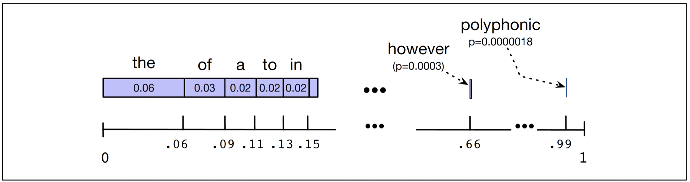
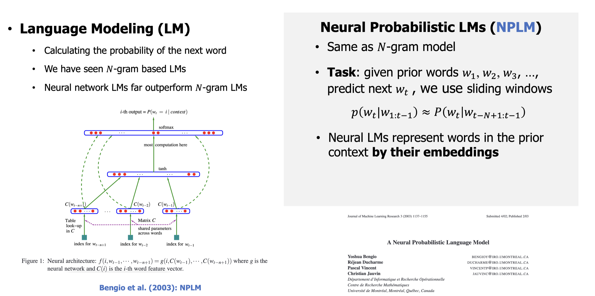
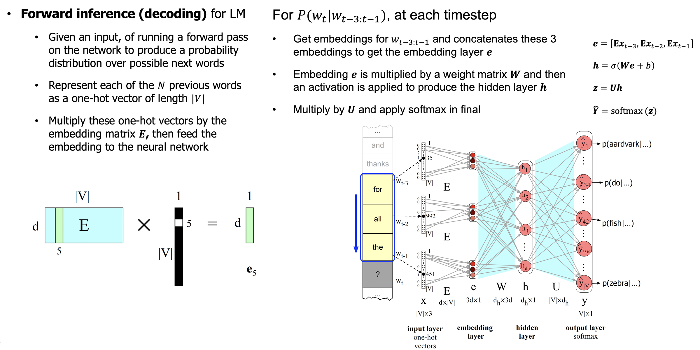
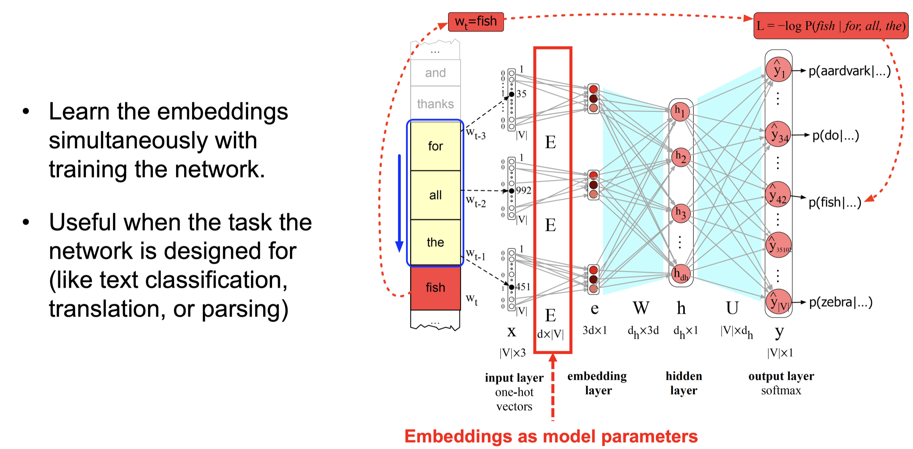
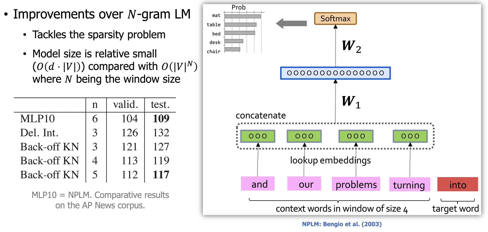

<!-- .slide: class="title-slide" id="title" -->

<p class="eyebrow">CS40008.01</p>

# N-gram 语言模型

<p class="subtitle">第 02 讲 – NLP 与大语言模型（CS40008.01）</p>

<p class="byline">Baojian Zhou<br>数据科学学院<br>复旦大学<br>2026 年 9 月 16 日</p>

Note:
改编自复旦春季课程第 02 讲，https://baojian.github.io/llm-26/slides/lecture-02-slides/。以这个问题开场：模型如何为一个句子赋予概率？三个 45 分钟的课时：第 1–2 课时讲带平滑和评估的概率 N-gram 语言模型，第 3 课时讲困惑度过滤器和神经概率语言模型。

---


<!-- .slide: class="outline-slide" id="outline-ngram" -->

## 大纲

<ul class="outline-topics">
<li aria-current="step">N-gram 语言模型与平滑</li>
<li>语言模型评估与困惑度</li>
<li>神经概率语言模型</li>
</ul>

Note:
第 1 课时：第一个主题。在每次主题转换时回到这份大纲。资料来源：春季课程第 02 讲幻灯片 2，https://baojian.github.io/llm-26/slides/lecture-02-slides/index.html#/1。

---

<!-- .slide: id="assign-probabilities" -->

## 为句子赋予概率

<div class="columns">
<div>
<p><strong>语音识别</strong><br>$P($<span class="text-good">It's hard to recognize speech</span>$)$<br>$\gt P($<span class="text-bad">It's hard to wreck a nice beach</span>$)$</p>
</div>
<div class="fragment" data-fragment-index="0">
<p><strong>拼写纠正</strong><br>$P($<span class="text-good">about fifteen minutes from</span>$)$<br>$\gt P($<span class="text-bad">about fifteen minuets from</span>$)$</p>
</div>
</div>

<blockquote class="fragment" data-fragment-index="1"><p><strong>机器翻译（MT）：</strong>“他向记者介绍了主要内容”</p></blockquote>
<ul>
<li class="fragment" data-fragment-index="2">$S_1$ = <span class="text-good">He briefed reporters on the main contents of the statement</span></li>
<li class="fragment" data-fragment-index="3">$S_2$ = He introduced reporters to the main contents of the statement</li>
<li class="fragment" data-fragment-index="4">$S_3$ = He briefed to reporters the main contents of the statement</li>
<li class="fragment" data-fragment-index="5">$S_4$ = <span class="text-bad">He to reporters introduced main content</span></li>
</ul>

<p class="fragment" data-fragment-index="6">$P($<span class="text-good">$S_1$</span>$) \gt P(S_2) \approx P(S_3) \gt P($<span class="text-bad">$S_4$</span>$)$</p>

Note:
展示顺序：进入页面时语音识别已经可见；接着展示拼写纠正，然后是机器翻译的源句、四个候选句，最后是排序。展示最后一项前先暂停，请学生判断哪个句子应得到最高概率。每项任务都需要一个偏向流畅句子的分数。语音转写听起来相似；语言模型提供偏好。拼写纠正使用完整句子“The office is about fifteen minuets from my house.”。“Minuets”是一个真实存在的词，所以仅靠词典无法发现错误；周围词语更支持“minutes”。机器翻译候选句共享同一个中文源句。这个排序只是示意，并非实测结果；完整的机器翻译系统还必须考虑源句含义。本页合并了原秋季课程幻灯片 3 和 4，并将其中的示例放在一起。资料来源：春季课程第 02 讲幻灯片 3，https://baojian.github.io/llm-26/slides/lecture-02-slides/index.html#/2。

---

<!-- .slide: id="unknown-distribution" -->

## 大语言模型逼近一个未知分布

<p><strong>真实的文本型数据</strong>（语言、代码等）在词元序列上诱导出一个分布：</p>
<p>$$\mathbf{w}_{1:n} = (w_1,\dots,w_n), \quad \mathbf{w}_{1:n} \sim p_{\text{data}}(\cdot),$$</p>
<p>其中 <span class="text-bad">$p_{\text{data}}$ 未知</span>。我们只能观察到一个语料库（样本）：</p>
<p>$$\mathcal{D}=\{\mathbf{w}^{(i)}\}_{i=1}^N,\quad \mathbf{w}^{(i)}\overset{\text{i.i.d.}}{\sim} p_{\text{data}}(\cdot).$$</p>

Note:
我们永远无法观察到全部文本的总体；语料库只是从中抽取的样本。明确保留独立同分布假设；它是一种理想化。资料来源：春季课程第 02 讲幻灯片 4，https://baojian.github.io/llm-26/slides/lecture-02-slides/index.html#/3。

---

<!-- .slide: id="model-distribution" -->

## 大语言模型逼近一个未知分布

<p>我们构建并训练一个模型分布（大语言模型）$p_\theta(\mathbf{w})$，使得</p>
<p>$$p_\theta(\mathbf{w}) \approx p_{\text{data}}(\mathbf{w}).$$</p>

<blockquote><p><strong>在 $p_\theta$ 中，</strong>看起来像真实语言的序列应当比被破坏或随机生成的序列获得<span class="text-good">更高</span>的概率：<br>$p_\theta(\text{“natural sentence”})\;\gt\;p_\theta(\text{“random sentence”}).$</p></blockquote>

Note:
这一行概括了完整的建模目标。后面的所有内容都围绕如何参数化 $p_\theta$ 以及如何拟合它展开。资料来源：春季课程第 02 讲幻灯片 4，https://baojian.github.io/llm-26/slides/lecture-02-slides/index.html#/3。

---

<!-- .slide: id="training-objective" -->

## 训练目标：使 $p_\theta \approx p_{\text{data}}$

<p>理想目标（分布匹配）是使 $p_\theta \approx p_{\text{data}}$。一种有原则的方法是寻找使 KL 散度最小的 $\theta$：</p>
<p>$$\theta^\star \in \arg\min_\theta \mathrm{KL}\big(p_{\text{data}} \,\|\, p_\theta\big).$$</p>
<p>这等价于最大化期望对数似然：</p>
<p>$$\arg\min_\theta \mathrm{KL}(p_{\text{data}}\|p_\theta) \;\Longleftrightarrow\; \arg\max_\theta \mathbb{E}_{\mathbf{w} \sim p_{\text{data}}}\big[\log p_\theta(\mathbf{w})\big].$$</p>

Note:
展开 KL 散度：$p_{\text{data}}$ 的熵不依赖于 $\theta$，所以最小化 KL 等价于最大化数据分布下的期望对数似然。资料来源：春季课程第 02 讲幻灯片 5，https://baojian.github.io/llm-26/slides/lecture-02-slides/index.html#/4。

---

<!-- .slide: id="training-objective-2" -->

## 训练目标：使 $p_\theta \approx p_{\text{data}}$

<p>由于 $p_{\text{data}}$ 未知，使用数据集 $\{\mathbf{w}^{(i)}\}_{i=1}^N$ 来近似期望：</p>
<p>$$\max_\theta \frac{1}{N}\sum_{i=1}^N \log p_\theta (\mathbf{w}^{(i)}).$$</p>
<p>令 $\mathbf{w}^{(i)} := (w_1^{(i)},\ldots,w_{n_i}^{(i)})$。语言模型分解式（模型实际学习的内容）：</p>
<p>$$p_\theta(\mathbf{w}^{(i)})=\prod_{t=1}^{n_i} p_\theta \left(w_t^{(i)} \mid w_{1:t-1}^{(i)} \right).$$</p>
<p class="caption">因此，训练教会模型像真实文本那样预测下一个词元 → 从 $p_\theta$ 采样会生成人类语言风格的序列。</p>

Note:
用经验平均代替期望。根据链式法则，这个分解是精确的；建模上的选择在于如何表示每个条件概率。资料来源：春季课程第 02 讲幻灯片 6，https://baojian.github.io/llm-26/slides/lecture-02-slides/index.html#/5。

---

<!-- .slide: id="training-samples" -->

## 多样化的训练样本

<p>$$\mathcal{D}=\left\{\mathbf{w}^{(i)}\right\}_{i=1}^{N}=$$</p>
<ul>
<li>$\mathbf{w}^{(1)}$ : It's hard to recognize speech.</li>
<li>$\mathbf{w}^{(2)}$ : <code>#include &lt;stdio.h&gt;<br>int main(void) { printf("Hello, world!\n"); }</code></li>
<li>$\mathbf{w}^{(3)}$ : 今天我们学习如何用语言模型预测下一个词。</li>
<li>$\mathbf{w}^{(4)}$ : Prove that $1+3+\cdots+(2n-1)=n^2$ for every integer $n\ge1$.</li>
<li>$\ldots,\mathbf{w}^{(i)}$ : <code>{"city": "Shanghai", "temperature_c": 22}</code></li>
</ul>
<p>任何能表示成词元序列的内容都可以成为训练样本。</p>

Note:
将这些示例依次理解为英文散文、C 源代码、中文文本、一道数学证明题和一条结构化 JSON 记录。前两个示例来自春季课程幻灯片；其余是本课程编写的示例。C 预处理器指令单独占一行。数学题可以用带 LaTeX 记号的文本存储，JSON 记录则将命名字段序列化为文本。编码后，每个样本都是一个词元序列；同样的下一词元目标适用于所有样本。其他模态也可以使用合适的编码表示为序列。编码使数据可被表示；选择有用的训练数据则是另一个决策。将 $p_\theta$ 拟合到语料库时，继续把前几页的独立同分布采样假设视为一种理想化。资料来源：春季课程第 02 讲幻灯片 7，https://baojian.github.io/llm-26/slides/lecture-02-slides/index.html#/6。

---

<!-- .slide: id="chain-rule" -->

## 计算 $P(w_{1:n})$

<ul>
<li>将句子 $\mathbf{w}=[w_1,w_2,\ldots, w_n]$ 写作 $w_{1:n}$：$P(\mathbf{w}) \equiv P(w_{1:n})$。</li>
<li>令 $X_1 = w_1, X_2 = w_2$；回顾链式法则 $P(X_1X_2)=P(X_1)\cdot P(X_2\mid X_1)$。</li>
<li>将链式法则应用于句子 $w_{1:n}$：</li>
</ul>
<p>$$P(w_{1:n})=\prod_{t=1}^{n} P\!\left(w_t \mid w_{1:t-1}\right)$$</p>
<ul>
<li>$w_{1:t-1}$ 称为 $w_t$ 的<span class="text-good">历史</span>。我们假设 $w_{1:0}=w_0=\text{BOS}$，且最后一个词元 $w_n=\text{EOS}$。</li>
<li>计算 $P(w_{1:n})$ 本质上是一个<span class="text-good">下一词预测问题</span>。</li>
</ul>

Note:
链式法则是精确的；此处还没有近似。BOS 和 EOS 使首项与末项定义明确。资料来源：春季课程第 02 讲幻灯片 8，https://baojian.github.io/llm-26/slides/lecture-02-slides/index.html#/7。

---

<!-- .slide: id="next-token-prediction" -->

## 更好的下一词元预测

<blockquote><p class="text-bad">几乎所有现代大语言模型取得成功的关键：更好的下一词元预测 $\Rightarrow$ 更好的语言建模。</p></blockquote>

<video class="animation" src="assets/predicting-next-word.mp4" poster="assets/predicting-next-word-poster.jpg" controls playsinline preload="metadata" aria-label="Interview clip in which the speaker explains that large language models learn by predicting the next word."></video>

Note:
播放这段视频（约两分半钟）或其中一部分。春季课程幻灯片打包了这段视频，但没有注明来源；参见 assets/README.md。资料来源：春季课程第 02 讲幻灯片 8，https://baojian.github.io/llm-26/slides/lecture-02-slides/index.html#/7。

---

<!-- .slide: id="ngram-model" -->

## $N$-gram 模型

<p>在“I want to improve my cooking”之后预测 <strong>skills</strong>。</p>

<table>
<thead><tr><th>模型</th><th>保留的历史</th><th>下一词元概率</th></tr></thead>
<tbody>
<tr><td><strong>一元模型</strong> ($N=1$)</td><td>无</td><td>$p_\theta(\text{skills})$</td></tr>
<tr class="fragment" data-fragment-index="0"><td><strong>二元模型</strong> ($N=2$)</td><td>cooking</td><td>$p_\theta(\text{skills}\mid\text{cooking})$</td></tr>
<tr class="fragment" data-fragment-index="1"><td><strong>三元模型</strong> ($N=3$)</td><td>my cooking</td><td>$p_\theta(\text{skills}\mid\text{my cooking})$</td></tr>
</tbody>
</table>

<div class="fragment" data-fragment-index="2">
<p><strong>马尔可夫假设：</strong>只保留前 $N-1$ 个词元。</p>
<p>$P(w_t\mid w_{1:t-1})\approx p_\theta(w_t\mid w_{t-N+1:t-1})\qquad(N\ge2)$</p>
</div>

Note:
先显示一元模型行，再依次展示二元模型、三元模型和一般的马尔可夫假设。询问学生，在预测“skills”时，每种模型会保留“I want to improve my cooking”中的多少内容：零个、一个还是两个词元。N 把被预测词元及其上下文一起计数，因此 N-gram 模型保留前 N-1 个词元。一元模型没有历史；二元模型以 w_{t-1} 为条件；三元模型以 w_{t-2:t-1} 为条件。一般而言，N-gram 模型是词元上的 (N-1) 阶马尔可夫模型；图中所示历史范围适用于 N 至少为 2 的情形，而 N=1 使用无条件分布。句子开头的短历史通过 BOS 填充处理，后文会说明。本页将原秋季课程幻灯片 11 和 12 合并为一个对照。资料来源：春季课程第 02 讲幻灯片 9，https://baojian.github.io/llm-26/slides/lecture-02-slides/index.html#/8。

---

<!-- .slide: id="build-ngram" -->

## 构建 N-gram 语言模型

<ul>
<li><strong>步骤 1</strong>：选择阶数 $N$。</li>
<li><strong>步骤 2</strong>：整理训练数据 $\mathcal{D}$ 和词表 $\mathcal{V}$。
<ul><li>步骤 2.1：收集原始数据（词元化、过滤）</li><li>步骤 2.2：词元化后构建词表 $\mathcal{V}$</li></ul></li>
<li><strong>步骤 3</strong>：估计参数 $p_\theta(w_t\mid w_{t-N+1:t-1})$。<strong>问题：我们将有多少个参数？</strong></li>
<li><strong>步骤 4</strong>：通过生成句子，或估计测试数据集中给定句子的对数概率（或困惑度）来测试模型。</li>
</ul>
<p class="caption"><span class="text-bad">白板推导：</span>估计二元模型 $p_\theta(w_t\mid w_{t-1})$（练习 E01）。</p>

Note:
展示下一页之前先在白板上完成推导：写出二元模型下语料库的似然，并在每个历史对应的概率和为一的约束下最大化它。资料来源：春季课程第 02 讲幻灯片 10，https://baojian.github.io/llm-26/slides/lecture-02-slides/index.html#/9。

---

<!-- .slide: id="bigram-parameters" -->

## 二元模型参数与最大似然估计

<p>令 $\mathcal{V}=\{v_1,v_2,\ldots,v_{|\mathcal{V}|}\}$。定义所有可能的参数 $\theta_{i,j} = p_\theta(w_t=v_i\mid w_{t-1}=v_j)$：</p>
<p>$$\boldsymbol{\theta} = \begin{bmatrix} \theta_{11} & \theta_{12} & \cdots & \theta_{1 |\mathcal{V}|}\\ \theta_{21} & \theta_{22} & \cdots & \theta_{2 |\mathcal{V}|}\\ \vdots & \vdots & \ddots & \vdots \\ \theta_{|\mathcal{V}| 1} & \theta_{|\mathcal{V}| 2} & \cdots & \theta_{|\mathcal{V}| |\mathcal{V}|} \end{bmatrix}$$</p>
<ul>
<li><strong>二元模型的最大似然估计：</strong>$p_\theta(v_i\mid v_j) = \dfrac{C(v_j\, v_i)}{C(v_j)}$，其中 $C(v_j\, v_i)$ 统计二元组 $[v_j, v_i]$ 在训练语料库中的总频次。</li>
<li><strong>潜在参数量（$N=2$）：</strong>$\mathcal{O}(|\mathcal{V}|^2)$。<strong>$N$-gram 不具备可扩展性：$\mathcal{O}(|\mathcal{V}|^N)$。</strong></li>
</ul>

Note:
$\boldsymbol{\theta}$ 的每一列都是一个条件分布，其和为一。春季课程幻灯片将最大似然估计的比值写作 $C(v_i v_j)/C(v_i)$；历史 $v_j$ 应当出现在分母中，如本页所写。资料来源：春季课程第 02 讲幻灯片 10，https://baojian.github.io/llm-26/slides/lecture-02-slides/index.html#/9。

---

<!-- .slide: class="exercise" id="exercise-01" -->

## 训练二元语言模型的玩具示例

<p class="exercise-meta">练习 E01 · 5 分钟 · 笔记本 E01</p>

<p><strong>最大似然估计</strong>（二元模型）：$p_\theta(w_i \mid w_{i-1}) = \frac{C(w_{i-1}w_i)}{\sum_{w\in \mathcal{V}} C(w_{i-1}w)} = \frac{C(w_{i-1}w_i)}{C(w_{i-1})}$，其中 $C(x)$ 表示 $x$ 在语料库中的频次。</p>
<p>训练语料库，$\mathcal{V}=\{\text{EOS, I, am, Sam, do, not, like, eggs, and, ham}\}$：</p>
<blockquote><p><span class="text-token">BOS</span> <span class="text-good">I am Sam</span> <span class="text-token">EOS</span><br><span class="text-token">BOS</span> <span class="text-good">Sam I am</span> <span class="text-token">EOS</span><br><span class="text-token">BOS</span> <span class="text-good">I do not like eggs and ham</span> <span class="text-token">EOS</span></p></blockquote>

<div class="answer fragment"><p>$p_\theta(\text{I}\mid \text{BOS})=\frac{2}{3}=0.67$, $p_\theta(\text{Sam}\mid \text{BOS})=\frac{1}{3}=0.33$, $p_\theta(\text{am}\mid \text{I})=\frac{2}{3}=0.67$, $p_\theta(\text{do}\mid \text{I})=\frac{1}{3}=0.33$, $p_\theta(\text{EOS}\mid \text{Sam})=\frac{1}{2}=0.50$, $p_\theta(\text{Sam}\mid \text{am})=\frac{1}{2}=0.50$</p></div>

Note:
请学生手算这六个估计值，然后展示答案。计数：$C(\text{BOS})=3$，$C(\text{BOS I})=2$，$C(\text{I})=3$，$C(\text{I am})=2$，$C(\text{Sam})=2$，$C(\text{Sam EOS})=1$，$C(\text{am})=2$，$C(\text{am Sam})=1$。笔记本 E01 用代码统计同一个语料库。资料来源：春季课程第 02 讲幻灯片 11，https://baojian.github.io/llm-26/slides/lecture-02-slides/index.html#/10。

---

<!-- .slide: id="restaurant-reviews" -->

## 餐厅评论的二元统计

<ul>
<li>$\mathcal{D}$：餐厅评论（例如 1000 个句子）。评论中的示例句子：
<ul><li>Wow... Loved this place ...</li><li>Not tasty and the texture was just nasty ...</li><li>The selection on the menu was great and ...</li></ul></li>
<li>添加边界词元：<span class="text-token">BOS</span> ... <span class="text-token">EOS</span></li>
<li>二元组计数 $C(w_{i-1},w_i)$；二元模型的最大似然估计 $p_\theta(w_i\mid w_{i-1})=\dfrac{C(w_{i-1},w_i)}{C(w_{i-1})}$</li>
<li>我们可以把所选词语对应的一个小型子矩阵可视化（例如 <span class="text-good">i, want, to, eat, in, this, place</span>）。</li>
</ul>

Note:
下一页的计数来自春季课程笔记本在 sentiment-labelled-sentences 数据集上的运行结果（3000 条训练数据）。资料来源：春季课程第 02 讲幻灯片 12，https://baojian.github.io/llm-26/slides/lecture-02-slides/index.html#/11。

---

<!-- .slide: id="restaurant-counts" -->

## 二元组计数（子集）

```text
split: train rows: 3000   columns: ['text']
Vocab size: 5166          Distinct bigrams: 22179

        i   want   to  eat  in  this  place
i       0     5     0    1   0     0      0
want    0     0    11    0   0     0      0
to      0     1     0   12   2     6      2
eat     0     0     0    0   2     0      0
in      0     0     3    0   0    24      2
this    1     0     4    0   2     0     73
place   2     0    10    0   3     0      0
```

Note:
行表示历史词，列表示下一个词。即使对常见词而言，大多数单元格也为零：这正是后续要通过平滑解决的稀疏性问题。资料来源：春季课程第 02 讲幻灯片 12，https://baojian.github.io/llm-26/slides/lecture-02-slides/index.html#/11。

---

<!-- .slide: id="practical-boundaries" -->

## $N$-gram 语言模型中的实际问题：句子边界

<ul>
<li>开头和结尾需要额外的上下文。</li>
<li>对于三元模型：$p_\theta(w_1\mid \text{BOS},\text{BOS})$</li>
<li>添加词元：<span class="text-token">BOS</span> … <span class="text-token">EOS</span></li>
</ul>

Note:
$N$-gram 模型需要 $N-1$ 个 BOS 词元，以便第一个词拥有完整的历史。EOS 使模型能够为停止生成赋予概率，从而让所有长度句子的概率分布之和为一。资料来源：春季课程第 02 讲幻灯片 13，https://baojian.github.io/llm-26/slides/lecture-02-slides/index.html#/12。

---

<!-- .slide: id="practical-oov" -->

## $N$-gram 语言模型中的实际问题：未知词（OOV）

<p>像 <em class="text-bad">Thisisahardtofindword</em> 这样的词只是没有出现在训练集中，却可能出现在测试集中。</p>
<ul>
<li><strong>封闭词表：</strong>测试词必须位于固定的词典中。</li>
<li><strong>开放词表：</strong>将未见词映射到伪词元 <span class="text-token">&lt;UNK&gt;</span>。</li>
<li><strong>如何训练</strong> $p_\theta(\text{UNK}\mid \cdot)$？
<ul><li><strong>预先给定词表：</strong>将训练数据中的 OOV 转换为 <span class="text-token">&lt;UNK&gt;</span>，然后计数。</li><li><strong>没有预先给定词表：</strong>用 <span class="text-token">&lt;UNK&gt;</span> 替换低频词（频次 $\lt n$）（或保留频次最高的 $|V|$ 个词）。</li></ul></li>
</ul>

Note:
联系第 01 讲：子词词元化器使词元层面的 OOV 变得少见，但词级 $N$-gram 模型仍然需要 UNK。资料来源：春季课程第 02 讲幻灯片 13，https://baojian.github.io/llm-26/slides/lecture-02-slides/index.html#/12。

---

<!-- .slide: id="smoothing" -->

## 一页讲清 N-gram 语言模型的平滑

<p><strong>问题：</strong>二元组表格中的大多数单元格都是 0，因此像 $q(\text{offer} \mid \text{denied the}) = 0$ 这样的未见 $n$-gram 会使每个包含它的句子概率都为 0。<strong>修正：</strong>把一小部分概率质量从已见事件转移给未见事件。</p>
<p><strong>加-$\delta$</strong>（$\delta=1$ 时为拉普拉斯平滑）：</p>
<p>$$P_{\text{Add}}(w_i\mid w_{i-1}) =\frac{C(w_{i-1}w_i)+\delta}{C(w_{i-1})+\delta|V|}$$</p>
<p><strong>插值</strong>（在留出数据上调节 $\lambda_i$，$\sum_i\lambda_i=1$）：</p>
<p>$$P_{\text{Int}}(w_n\mid w_{n-2}w_{n-1}) = \lambda_1 P(w_n\mid w_{n-2}w_{n-1}) + \lambda_2 P(w_n\mid w_{n-1}) + \lambda_3 P(w_n)$$</p>
<p class="caption"><strong>Kneser–Ney</strong> 根据一个词跟随过多少种不同上下文进行回退（<em>Francisco</em>：几乎只出现在 <em>San</em> 之后）；KenLM 用它训练，它也是 NPLM 表格中的基线。神经语言模型不需要计数平滑。</p>

Note:
本页取代春季课程中九页的相关章节，并放在第一部分末尾，紧接计数表和 OOV；此时屏幕上正显示那些零。下一部分的练习 E02 展示单个零会如何影响测试集。对 Berkeley Restaurant 计数应用加一平滑会转移过多概率质量：当 $|V|=1446$ 时，$C(\text{i want})$ 从 827 降到重构后的 527；因此更推荐 $\delta \lt 1$ 和插值。笔记本实践 P02（拉普拉斯表格）和 P03（留出插值）保留了完整演算示例，供感兴趣的学生使用。资料来源：春季课程第 02 讲幻灯片 20–27，https://baojian.github.io/llm-26/slides/lecture-02-slides/index.html#/19。

---

<!-- .slide: class="outline-slide" id="outline-evaluation" -->

## 大纲

<ul class="outline-topics">
<li>N-gram 语言模型与平滑</li>
<li aria-current="step">语言模型评估与困惑度</li>
<li>神经概率语言模型</li>
</ul>

Note:
资料来源：春季课程第 02 讲幻灯片 14，https://baojian.github.io/llm-26/slides/lecture-02-slides/index.html#/13。

---

<!-- .slide: id="evaluation" -->

## 构建语言模型与评估

| 训练数据 | 验证数据 | 测试数据 |
| :--- | :--- | :--- |
| 估计参数 | 调整选择 | 仅报告一次 |

<p><strong>外在评估：</strong>比较下游任务表现。</p>

<div class="columns">
<div>
<ul>
<li><a href="https://agi.safe.ai/">Humanity’s Last Exam</a><br>专家级学术问题</li>
<li><a href="https://www.tbench.ai/">Terminal-Bench</a><br>终端中的任务</li>
</ul>
</div>
<div>
<ul>
<li><a href="https://agents-last-exam.org/">Agents’ Last Exam</a><br>专业工作流</li>
<li><a href="https://arcprize.org/arc-agi/3">ARC-AGI-3</a><br>交互式推理</li>
</ul>
</div>
</div>

<p><span class="text-bad"><strong>耗时</strong></span>，难以大规模开展（可能需要数天或数周）。</p>

Note:
春季课程的幻灯片将这一划分展示为比例条（约为 70/15/15）。表格第二行概括了各部分的作用。在选择模型、提示词或智能体配置时，保持测试集不被使用。传统示例包括拼写纠错准确率和机器翻译质量。资料来源：春季课程第 02 讲幻灯片 15，https://baojian.github.io/llm-26/slides/lecture-02-slides/index.html#/14。

这些链接的基准是基于任务的评估的当前示例，并非声称它们同样成熟或衡量相同的能力。Humanity’s Last Exam (HLE) 测试跨学科的专家级学术问题，其中包括多模态问题。Agents’ Last Exam (ALE) 评估结果可验证的专业计算机工作流。Terminal-Bench 评估智能体在终端环境中的任务表现。ARC-AGI-3 测试在陌生游戏环境中的交互式推理；注意将其与早期 ARC-AGI 版本中的静态谜题区分开来。这些基准将评估动机延伸到现代语言模型和智能体；它们不是为我们的 N-gram 模型提出的实验。官方来源核查于 2026 年 9 月 16 日：https://agi.safe.ai/ 和 https://arxiv.org/abs/2501.14249；https://agents-last-exam.org/；https://www.tbench.ai/ 和 https://arxiv.org/abs/2601.11868；https://arcprize.org/arc-agi/3。

任务得分取决于模型和评估配置：工具、提示词、动作或词元预算，以及基准版本。应在明确说明的协议下比较系统；任务成功率与留出数据上的下一词元似然回答的是不同问题。耗时取决于任务数量、智能体轨迹长度、重复试验次数、环境配置及可用的并行能力。大型评估可能需要数天或数周；这并不是每个基准的固定运行时间。这引出了下一张幻灯片中成本更低、基于概率的内在评估。

---

<!-- .slide: class="exercise" id="exercise-02" -->

## 内在评估

<p class="exercise-meta">练习 E02 · 3 分钟 · Notebook E02</p>

<ul>
<li>语言模型是否更偏好<strong>好</strong>句子而非<strong>坏</strong>句子？</li>
<li>在<strong>训练数据集</strong>上训练，在未见过的<strong>测试</strong>数据上评估。绝不能将测试句子泄漏到训练中。</li>
<li>基于概率的指标：<strong>测试集上的对数似然越高 ⇒ 语言模型越好</strong>。</li>
</ul>
<p><span class="text-bad">白板：</span>提出一个合理的指标。</p>

<div class="answer fragment"><p>$$\frac{1}{|\mathcal{D}_{\text{test}}|} \sum_{\mathbf{w}\in\mathcal{D}_{\text{test}}} \log p_\theta(\mathbf{w})$$</p></div>

Note:
预期方案：总对数似然、每句平均值、每词元平均值。讨论为什么按词元归一化能让不同的测试集可以比较；这将引出困惑度。资料来源：春季课程第 02 讲幻灯片 15，https://baojian.github.io/llm-26/slides/lecture-02-slides/index.html#/14。

---

<!-- .slide: id="perplexity" -->

## 困惑度

<p><strong>定义（内在指标）</strong></p>
<ul>
<li>更好的语言模型会为未见过的测试集 $s_{1:m}$ 赋予<strong>更高的概率</strong>。</li>
<li><strong>困惑度</strong>是测试集概率的倒数，并按长度 $T=\sum_i |s_i|$ 归一化：</li>
</ul>
<p>$$\mathrm{PPL}(s_{1:m}) = P_\theta(s_{1:m})^{-1/T} = \exp\!\left(-\frac{1}{T}\log P_\theta(s_{1:m})\right)$$</p>
<p>最小化 PPL $\Longleftrightarrow$ 最大化测试集概率。</p>

Note:
它是每词元平均负对数似然的指数。使用以 2 为底的对数时，它是 $2^{\text{cross-entropy}}$。资料来源：春季课程第 02 讲幻灯片 16，https://baojian.github.io/llm-26/slides/lecture-02-slides/index.html#/15。

---

<!-- .slide: class="exercise" id="exercise-03" -->

## 困惑度：解释

<p class="exercise-meta">练习 E03 · 3 分钟 · Notebook E03</p>

<ul>
<li>困惑度 $\approx$ <strong>有效分支因子</strong>：模型认为有多少个合理的下一词元。</li>
<li>示例：随机数字 $\{0,\dots,9\}$，对每个数字均匀猜测，$P=1/10$。长度为 $t$ 的数字字符串的困惑度是多少？</li>
</ul>

<div class="answer fragment"><p>$$\mathrm{PPL}(s)=P(w_{1:t})^{-1/t} =\left(\left(\tfrac{1}{10}\right)^t\right)^{-1/t} =10$$</p>
<p>如果模型完全随机，平均需要猜测 $|\mathcal{V}|$ 次才能正确猜出下一个词。如果 $|\mathcal{V}|=1$，它一定会选对，因此 $\mathrm{PPL}(s_{1:m})=1$。</p></div>

Note:
预期答案：10，与 $t$ 无关。Notebook E03 对几个不同的长度进行了数值计算。资料来源：春季课程第 02 讲幻灯片 16，https://baojian.github.io/llm-26/slides/lecture-02-slides/index.html#/15。

---

<!-- .slide: id="lower-perplexity" -->

## 比较语言模型

<p><strong>每字节比特数：</strong> $\mathrm{BPB}=-\frac{1}{B}\sum_{d,t}\log_2 p_\theta(w_t^{(d)}\mid w_{1:t-1}^{(d)})$</p>

<p>$B$ = 测试文本的 UTF-8 字节数。<br>对每个测试文档 $d$ 中的词元位置 $t$ 求和。</p>

| 测试数据 / 指标（↓ 越低越好） | Unigram | Bigram | Trigram |
| :--- | ---: | ---: | ---: |
| WSJ：词级困惑度 | 962 | 170 | 109 |
| TinyStories：BPB | 2.07 | 1.30 | 1.12 |
| OpenWebText：BPB | 2.48 | 2.06 | 2.03 |
| 中文网页：BPB | 2.48 | 2.10 | 2.04 |

Note:
将该公式理解为以比特计的总预测损失除以被评估文本的 UTF-8 字节数。这里 d 表示测试文档，t 表示文档中被计分的词元位置；历史在文档边界处重置。每一项是模型赋予实际下一词元的概率以 2 为底的负对数，而不是对采样词元计算。对于 N-gram 模型，条件概率只使用其保留的历史。当 B = 100 字节且总损失 = 200 比特时，BPB = 200/100 = 2 比特/字节。B 是字节数而不是词元数：例如，ASCII "a" 占用一个 UTF-8 字节，而“中”占用三个。此评估器的求和包含每个文档的 EOS 预测；BOS 仅作为上下文，两个标记都不会增加文本字节数。应在评估器预处理之后统计字节，排除已移除的空白和文档分隔符；不要盲目使用原始文件大小。

与困惑度的关系：如果 T 是被计分的预测数量，ell 是它们的平均负自然对数概率，那么 BPB = (T/B) × ell/ln(2) = (T/B) × log₂(PPL)，其中 PPL = exp(ell)。两种指标必须使用相同的计分词元和边界。因此，BPB 是每字节的平均损失；它不是困惑度除以字节数，也不是分词器的压缩率。对于一个数据集，应以总损失除以总字节数；不要对各文档的 BPB 做无权平均。资料来源：Gao et al. (2020), The Pile, §3.1, https://arxiv.org/html/2101.00027#S3.SS1。所展示的求和式是该转换展开后的负对数似然形式。实现：pipeline/ngram_lm.py::bits_per_byte 和 pipeline/eval.py。

在相同测试文本上逐行比较各模型列。课程演示对每个语料库使用 24 MiB 的训练上限，与 A1 分开。

WSJ 的数据来自 Jurafsky and Martin，第 3 章。只有使用相同词表和分词方式的模型，其困惑度才可比较；因此课程在固定的留出分片上报告每字节比特数。课程中的三行数据由 scripts/lecture02_experiments.py 计算得到（在开发集上调优的插值模型、Qwen3 分词器、每个来源 24 MiB 训练上限；每个内容词元的字节数为 4.14 / 4.46 / 4.59）。当前 pipeline/eval.py 对 n-gram 评分；后续的神经模型适配器应沿用其文本、字节和 EOS 约定。这里 EOS 会计入损失和被计分词元数，但不贡献文本字节。更低的损失并不保证更高的下游准确率。不同的语料库行并不能衡量不同语言的内在难度。GPT-3 也报告困惑度：https://arxiv.org/pdf/2005.14165.pdf；排行榜：https://nlpprogress.com/english/language_modeling.html。资料来源：春季课程第 02 讲幻灯片 17，https://baojian.github.io/llm-26/slides/lecture-02-slides/index.html#/16。

---

<!-- .slide: id="sampling" -->

## 句子采样

<p><strong>一元模型情形</strong></p>
<ul>
<li>将 $[0,1]$ 划分为若干区间；每个词获得的区间大小与其频率成正比。</li>
<li>采样 $u\sim \mathrm{Unif}[0,1]$，并输出其区间包含 $u$ 的词。</li>
<li>重复以上过程，直到生成 <span class="text-good">EOS</span>。</li>
</ul>
<p><strong>二元模型的情形呢？</strong></p>

Note:
二元模型的答案：从 BOS 开始，根据前一个词对区间划分进行条件化。Notebook P01 从玩具二元模型中采样。来源：春季学期第 02 讲幻灯片第 18 页，https://baojian.github.io/llm-26/slides/lecture-02-slides/index.html#/17。

---

<!-- .slide: id="sampling-figure" -->

## $[0,1]$ 上的一元模型采样



<p class="caption">高频词占据宽区间；低频词占据靠近末端的狭小区间。</p>

Note:
图片来自 Jurafsky 和 Martin 的第 3 章（一元模型采样），春季学期幻灯片使用了该图。来源：春季学期第 02 讲幻灯片第 18 页，https://baojian.github.io/llm-26/slides/lecture-02-slides/index.html#/17。

---

<!-- .slide: id="sampling-outputs" -->

## 从已训练语言模型中采样

在《华尔街日报》语料（4000 万词）上训练：

- **1-gram:** Months the my and issue of year foreign new exchange's September were recession exchange new endorsed a acquire to six <span class="text-token">**executives**</span>
- **2-gram:** Last December through the way to preserve the <span class="text-token">**Hudson corporation**</span> ... would seem to complete the major central planners ... <span class="text-token">**M. X. corporation**</span> ...
- **3-gram:** They also point to ninety nine point <span class="text-token">**six billion dollars**</span> ... <span class="text-token">**six three percent**</span> ... <span class="text-token">**on market conditions**</span>

Note:
更高阶的模型能生成局部流畅的短语，但仍缺乏全局连贯性。样例来自 Jurafsky 和 Martin 的第 3 章。来源：春季学期第 02 讲幻灯片第 18 页，https://baojian.github.io/llm-26/slides/lecture-02-slides/index.html#/17。

---

<!-- .slide: id="ngram-filter" -->

## 2026 年流水线中的 N-gram：困惑度过滤器

<div class="plot" data-plotly="assets/lm-filter.json" role="img" aria-label="Percentages of web and TinyStories documents in common reference-model BPB bins; a dashed line marks an illustrative cutoff."></div>

<p class="caption"><strong>在维基百科模型下可预测 ≠ 普遍高质量。</strong> CCNet 提供分数和分桶；RedPajama-V2 暴露 <code>ccnet_perplexity</code>。这个使用 Qwen 分词的三元模型采用 BPB 和课程选定的阈值。</p>

Note:
第 3 时段从这里开始。这是 docs/pretraining-plan.md 中阶段 2b 的教学类比。在留出最后 5% 用于开发前，会限制完整 WikiText-103 文章的数量；assets/lecture02-results.json 记录了实际加载、筛选、训练和开发的数量。两个总体使用相同的分桶，并各自以自身的文档数作为百分比的分母。该阈值丢弃了此网页样本中分数最高的大约三分之一；它并非通用的 CCNet 策略。儿童故事可能很有用，却可能在维基百科参考模型下得到更差的分数。CCNet 第 5.2 节介绍了分桶以及保留专业内容的价值：https://arxiv.org/html/1911.00359v1。RedPajama-V2 将其分数记载为一种标注：https://huggingface.co/datasets/togethercomputer/RedPajama-Data-V2。Dolma 明确没有采用 CCNet 质量分数，而是使用 Gopher/C4 启发式规则：https://arxiv.org/html/2402.00159v1，第 3.1.2 节。图片：scripts/lecture02_experiments.py。可选的后续练习是在选择阈值前检查阈值两侧的文档。

---
<!-- .slide: id="summary" -->

## 快速总结：N-gram 语言模型

<ul>
<li><strong>思路：</strong>仅使用最后 $N-1$ 个词来近似下一词概率：$P(w_t \mid w_{1:t-1}) \approx q(w_t \mid w_{t-N+1:t-1})$</li>
<li><strong>训练：</strong>从语料库中估计计数（并对未见过的 $n$-gram 进行平滑）。</li>
<li><strong>两个主要问题</strong>
<ul><li><strong>参数爆炸：</strong>$n$-gram 的数量以 $|V|^N$ 增长（例如，$|V|=10^4 \Rightarrow$ 三元模型 $\sim 10^{12}$）。</li><li><strong>稀疏性 / 泛化能力差：</strong>许多测试集中的 $n$-gram 从未在训练中出现。</li></ul></li>
<li><strong>仍在使用：</strong>N-gram 模型为预训练数据打分并进行过滤（上一张幻灯片），也给出了缩放图上的第一个点。</li>
<li><strong>今天：</strong>第一个神经语言模型（NPLM）通过学习到的表示解决这两个问题；从第 4 周开始将介绍 RNN 和 Transformer。</li>
</ul>

Note:
来源：春季学期第 02 讲幻灯片第 28 页，https://baojian.github.io/llm-26/slides/lecture-02-slides/index.html#/27。

---

<!-- .slide: class="outline-slide" id="outline-nplm" -->

## 大纲

<ul class="outline-topics">
<li>N-gram 语言模型与平滑</li>
<li>语言模型评估与困惑度</li>
<li aria-current="step">神经概率语言模型</li>
</ul>

Note:
来源：春季学期第 02 讲幻灯片第 29 页，https://baojian.github.io/llm-26/slides/lecture-02-slides/index.html#/28。

---

<!-- .slide: id="nplm-1" -->

## 神经概率语言模型（NPLM）



<p class="caption"><a href="../../papers/2003-jmlr-bengio-neural-probabilistic-language-model.pdf" target="_blank" rel="noopener noreferrer">Bengio et al. (2003)，论文 PDF</a>：NPLM。与 $N$-gram 模型任务相同；词由嵌入表示。</p>

Note:
图片和文字来自春季学期幻灯片，保持不变。来源：春季学期第 02 讲幻灯片第 30 页，https://baojian.github.io/llm-26/slides/lecture-02-slides/index.html#/29。

---

<!-- .slide: id="nplm-2" -->

## 神经概率语言模型（NPLM）



<p class="caption">前向推理（解码）：$\mathbf{e}=[\mathbf{E}x_{t-3},\mathbf{E}x_{t-2},\mathbf{E}x_{t-1}]$，$\mathbf{h}=\sigma(\mathbf{W}\mathbf{e}+\mathbf{b})$，$\hat{\mathbf{y}}=\text{softmax}(\mathbf{U}\mathbf{h})$。</p>

Note:
示意图来自 Jurafsky 和 Martin 的早期草稿，后来收录于第 7 章；当前关于前馈语言模型的阅读材料是第 6 章。来源：春季学期第 02 讲幻灯片第 31 页，https://baojian.github.io/llm-26/slides/lecture-02-slides/index.html#/30。

---

<!-- .slide: id="nplm-3" -->

## 神经概率语言模型（NPLM）



<p class="caption">嵌入作为模型参数，通过损失 $L=-\log P(\text{fish}\mid\text{for, all, the})$ 学习。</p>

Note:
示意图来自 Jurafsky 和 Martin 的早期草稿，后来收录于第 7 章；当前关于前馈语言模型的阅读材料是第 6 章。来源：春季学期第 02 讲幻灯片第 32 页，https://baojian.github.io/llm-26/slides/lecture-02-slides/index.html#/31。

---

<!-- .slide: id="nplm-4" -->

## 神经概率语言模型（NPLM）



<p class="caption">MLP10 = NPLM。AP News 语料库上的对比结果（Bengio et al., 2003）。第 8 周将在我们的分片上重复这一比较：在同一每字节比特数坐标轴上比较 N-gram、NPLM 和 30M–350M 参数规模序列。</p>

Note:
早在 2003 年，NPLM 就已经胜过最好的平滑 $N$-gram 模型；随着 RNN 和 Transformer 的出现，差距进一步扩大。来源：春季学期第 02 讲幻灯片第 33 页，https://baojian.github.io/llm-26/slides/lecture-02-slides/index.html#/32。

---

<!-- .slide: id="self-training-loop" -->

## 微型循环

<div class="plot" data-plotly="assets/self-training-loop.json" role="img" aria-label="在六轮训练中，用数量受限的模型样本替换训练语料库时，留出集上的 BPB；悬停可查看每轮的 token 预算。"></div>

<p class="caption">每轮用 2,000 个样本替换原始语料库，每个样本最多 128 个 token。训练数据量从 6.08M token 降至最多 0.256M token。这个玩具实验同时改变了数据规模和内容；它没有测试过滤器。Notebook P04。</p>

Note:
原始 TinyStories 语料库本身就是合成的，因此“原始”并不意味着由人类编写。测得的损失变化共同反映了有限采样、语料库替换、更小的 token 预算以及截断的序列结尾。应将其视为一个说明性的替换实验，而不是证明每个自训练系统都需要评判器或过滤可以解决崩溃问题的因果证据。P04 在十二个原始句子上使用精确的平滑混合采样器和固定词表；其规模和数值与此图不同。请学生提出 token 预算相同的对照实验：对原始文本重新采样、用模型样本替换原始文本，以及保留原始数据与生成数据的混合。过滤分支需要单独评估。关于替换与累积实验，参见 Gerstgrasser et al. (2024)，https://arxiv.org/html/2404.01413v2。Shumailov et al. (2024) 研究了递归替换：https://www.nature.com/articles/s41586-024-07566-y。图：scripts/lecture02_experiments.py；悬停可显示实际训练 token 数量。

---

<!-- .slide: id="exit-questions" -->

## 离开前

<div class="columns columns-wide-left">
<div>
<h3>三个问题</h3>
<ol>
<li>为什么更大的 $N$ 可能会损害在未见文本上的表现？</li>
<li>更低的困惑度是否保证更好的任务表现？</li>
<li>嵌入如何帮助处理未见上下文？</li>
</ol>
</div>
<div>
<h3>来源与拓展</h3>
<p><a href="https://baojian.github.io/llm-26/slides/lecture-02-slides/index.html">复旦春季学期第 02 讲</a><br>原始示例和图。</p>
<p><a href="https://www.jmlr.org/papers/v3/bengio03a.html">Bengio et al. (2003)</a><br>学习共享词向量。</p>
<p><a href="../shared/notebook.html?lecture=lecture-02">Notebook P01–P04</a><br>可选的采样、平滑和自训练内容。</p>
</div>
</div>

**下一讲：** 嵌入与 PyTorch——从 token 到可训练向量和梯度。

Note:
用两分钟讨论这些不计分的问题，再用一分钟介绍阅读材料。预期答案：(1) 对固定语料库而言，更长的上下文拥有更少的观测。更多可能的 N-gram 意味着计数更稀疏，在未见文本上的估计也可能更差；增大 N 并不保证更好的泛化。平滑或插值会有所帮助，阶数应根据开发集数据选择。(2) 不能。困惑度衡量的是对评估文本的预测拟合程度；任务表现还取决于任务分布、指标和系统设置。只有在采用相同分词和评分约定时才能比较困惑度；在预处理和边界匹配的同一文本上，每字节比特数提供了跨 tokenizer 的统一单位。参见配套说明 ../../docs/lecture-02-lm-metrics.md。(3) 神经语言模型在不同上下文间共享嵌入矩阵和预测网络。相似的学习向量使一个上下文中的观测能够帮助预测相关但未见的组合。这有助于泛化，但不能保证每个未见上下文都能获得良好预测。来源：Bengio et al. (2003)，https://www.jmlr.org/papers/v3/bengio03a.html。

复旦春季学期课程提供了原始示例和图。Bengio et al. 将 N-gram 基线与学习到的表示联系起来。notebook 链接使用共享启动器并打开现有的课堂 notebook；其中可选的 P01–P04 涵盖采样、加法平滑、留出集插值，以及对用模型样本替换数据的受控解读。这些是面向所有学生的不计分拓展内容，不是额外加分作业。下一讲将遵循已发布的第 3 周计划：嵌入查找、张量形状、批处理、autograd 和输出投影。学生将追踪张量和梯度如何流经一个小型语言模型；参见 ../../index.html#schedule。

---

<!-- .slide: class="references" id="references" -->

## 语言模型工具包与阅读材料

- **阅读：** [Jurafsky and Martin, *N-gram Language Models*](https://web.stanford.edu/~jurafsky/slp3/3.pdf)<br>链式法则、MLE、困惑度、平滑、Kneser–Ney。
- **KenLM**（快速 $n$-gram 语言模型工具包）：<a href="https://kheafield.com/code/kenlm/" target="_blank" rel="noopener noreferrer">kheafield.com/code/kenlm/</a>
- **Google N-Gram Release (Aug 2006)：** <a href="https://ai.googleblog.com/2006/08/all-our-n-gram-are-belong-to-you.html" target="_blank" rel="noopener noreferrer">ai.googleblog.com/2006/08/all-our-n-gram-are-belong-to-you.html</a><br>Token：1,024,908,267,229 · 句子：95,119,665,584 · Unigram：13,588,391 · Fivegram：1,176,470,663
- **Bengio et al. (2003), A Neural Probabilistic Language Model：** <a href="https://www.jmlr.org/papers/volume3/bengio03a/bengio03a.pdf" target="_blank" rel="noopener noreferrer">jmlr.org/papers/volume3/bengio03a</a> · <a href="https://web.stanford.edu/~jurafsky/slp3/6.pdf" target="_blank" rel="noopener noreferrer">Jurafsky and Martin, §6.5</a>（前馈语言模型）
- **CCNet**（Wenzek et al., 2020），Wikipedia n-gram 过滤器：<a href="https://arxiv.org/abs/1911.00359" target="_blank" rel="noopener noreferrer">arxiv.org/abs/1911.00359</a> · **Brants et al. (2007)**，用于 MT 的 2 万亿 token 5-gram：<a href="https://aclanthology.org/D07-1090/" target="_blank" rel="noopener noreferrer">aclanthology.org/D07-1090</a>

Note:
采样幻灯片使用的快速离散采样（别名方法）：https://www.keithschwarz.com/darts-dice-coins/。春季学期幻灯片以其下一讲的阅读材料（第 4–5 章：Naive Bayes、logistic regression、embeddings）收尾。在秋季学期的教学顺序中，第 3 章是本讲的阅读材料；第 3 周继续学习嵌入。来源：春季学期第 02 讲幻灯片第 34 页，https://baojian.github.io/llm-26/slides/lecture-02-slides/index.html#/33。
