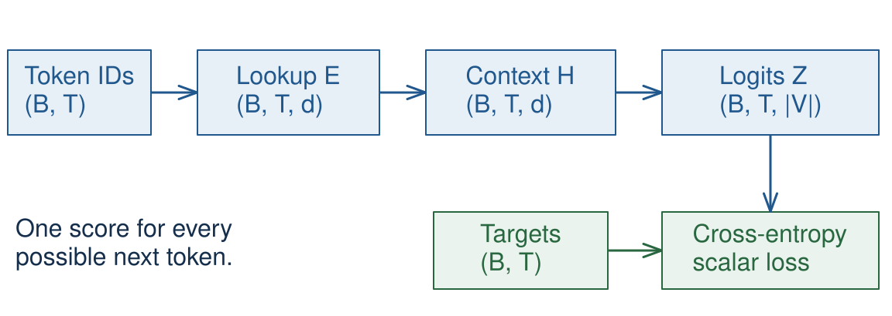
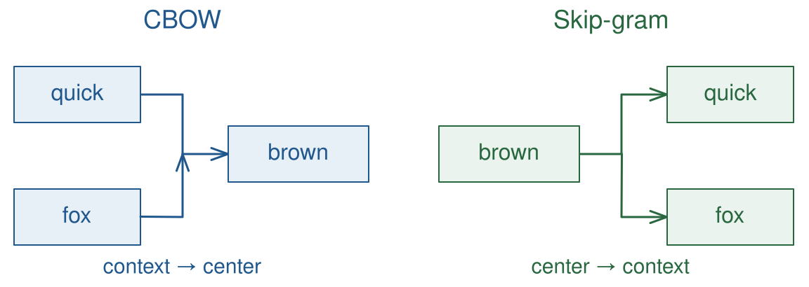
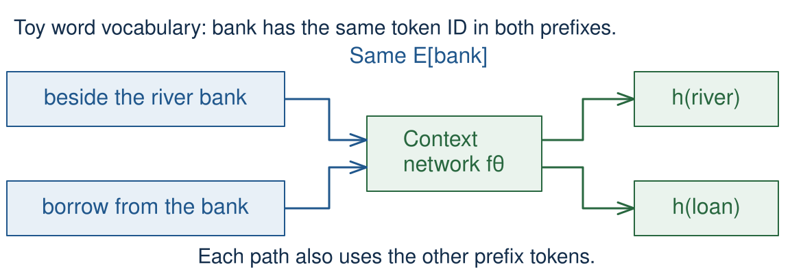
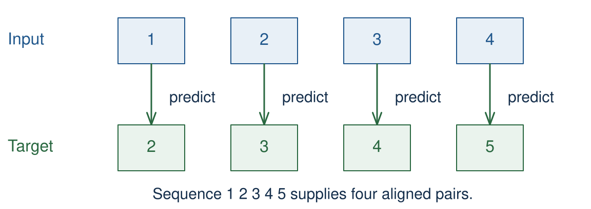
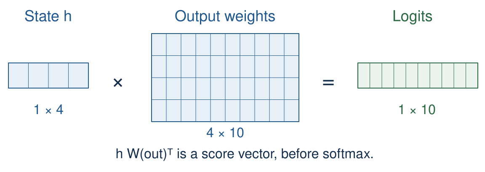
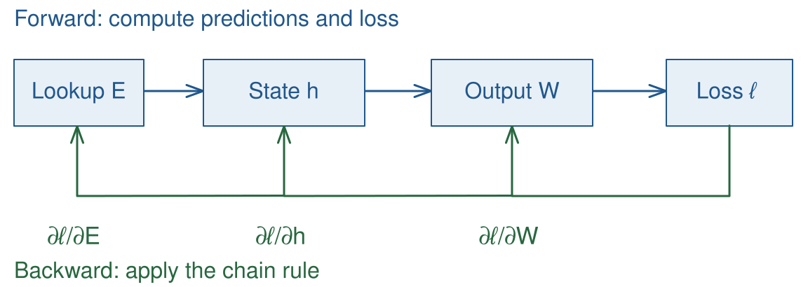
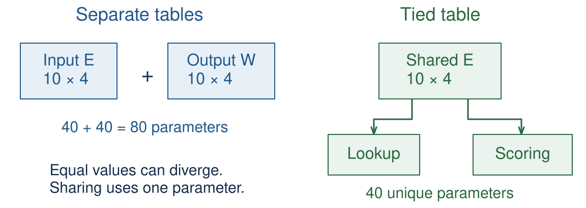

<!-- .slide: class="title-slide" id="title" -->

<p class="eyebrow">CS40008.01</p>

# 大语言模型的嵌入与 PyTorch

<p class="subtitle">第 03 讲 – NLP 与大语言模型（CS40008.01）</p>

<p class="byline">Baojian Zhou<br>数据科学学院<br>复旦大学<br>2026 年 9 月 23 日</p>

Note:
三个 45 分钟的课时，其中包括 15 分钟的小测 1。这份 60 张幻灯片的课件包含十张幻灯片的经典方法衔接，从分布假说一直讲到相似性的局限。六个练习都是不计分的实践。从上周介绍的 N-gram 语言模型开始。

---

<!-- .slide: id="learning-objectives" -->

## 学完后你将能够做什么

**离散词元如何成为可训练的表示？**

- 追踪词元 ID 如何穿过嵌入表直到得到下一词元损失。
- 运行一个训练步骤并检查其梯度。
- 解释权重共享，并估计嵌入表和 logit 的内存占用。

<p class="source">先预测，再运行 notebook。训练示例使用玩具数据；notebook 在 CPU 上离线运行。</p>

Note:
贯穿本讲的实现刻意采用一个带学习向量的二元模型。前馈上下文网络将在下周介绍。要把今天学到的机制与关于真实世界模型质量的论断区分开来。

---

<!-- .slide: id="ngram-recap" -->

## 从计数到下一词元概率

<div class="plot" id="ngram-visual" data-plotly="assets/ngram-review.json" role="img" aria-live="polite" aria-label="I 之后的玩具二元概率：am 的计数为 2、概率为 2/3；do 的计数为 1、概率为 1/3。其他输出词元的概率为零。"></div>

<form class="demo-form" id="ngram-controls" aria-label="二元模型回顾控件">
<button type="button" data-ngram-context="I" aria-label="使用上下文 I">I</button>
<button type="button" data-ngram-context="Sam" aria-label="使用上下文 Sam">Sam</button>
<button type="button" data-ngram-context="BOS" aria-label="使用上下文 BOS">BOS</button>
<button type="button" id="ngram-trace">追踪词对</button>
<button type="button" id="ngram-sample">采样下一个</button>
<button type="button" id="ngram-reset">重置回顾</button>
</form>

Note:
这里安排 3 分钟，接下来的神经方法衔接安排 1 分钟。回顾第 01 讲：这里的词元刻意保持简单；现代分词器可以把一个词切分成子词。ID 是任意的索引，而不是数值含义。在本次回顾中，按第 02 讲输出词表的顺序分配 ID 0–9：EOS, I, am, Sam, do, not, like, eggs, and, ham。BOS 是仅用于输入的边界标记，位于这十个输出词元之外。这个映射只在本次回顾中有效；后面的 notebook 使用它自己的合成 ID。

原样复用第 02 讲的练习 E01：[BOS I am Sam EOS]、[BOS Sam I am EOS]、[BOS I do not like eggs and ham EOS]。蓝色标记上下文，绿色标记紧随其后的词元。从 I 开始：先问哪个词元可以跟随，然后点“追踪词对”→“下一对”→“下一对”。这些点击只按语料库顺序遍历三个匹配的 I 上下文。计数依次为 (am:1, do:0)、(am:2, do:0)，然后是 (am:2, do:1)。归一化要除以全部三个外出计数。纵轴明确地从 Count（计数）变为 Probability（概率）；被省略的八个输出词元值都为零。这里没有平滑。没有任何词对跨越句子边界，EOS 也没有外出词对。

“采样下一个”从所显示的完整分布中抽取一次；它并不是每次都选择最高的柱，也不会继续生成整个句子。在不完整的计数追踪过程中，采样功能被禁用。切换到 Sam 以展示 EOS 和 I 各占 1/2；抽到 EOS 意味着停止。BOS 给出 I 为 2/3、Sam 为 1/3。“重置回顾”恢复完整的 I 分布。这些控件支持鼠标或键盘操作；初始的完整分布也会出现在打印版中。如果时间紧张，只展示初始图和一次采样即可。

一般任务仍然是 p(w1,...,wT) = product_t p(wt | w<t)。二元近似只保留前一个词元，其未平滑的最大似然估计为 count(context,next) / sum_v count(context,v)。避免重复平滑或困惑度的推导。语料库和估计值：[第 02 讲 E01](../lecture-02/index.html#/exercise-01)。神经方法的过渡：Bengio et al. (2003) 第 2 节，https://www.jmlr.org/papers/v3/bengio03a.html。

---

<!-- .slide: id="token-to-loss" -->

## 从词元到损失的计算



**下一词元任务不变；学习到的参数取代了计数。**

Note:
交叉熵把每个位置的 logit 与其下一词元目标进行比较。第一次讲解时顺着箭头走，E03 之后再回看。

安排 1 分钟。上周，我们通过计数来估计下一词元概率。今天，我们学习产生这些概率的参数。从词元 ID 指向可训练的嵌入、输出分数和损失；预测任务和负对数似然保持不变。本讲的 TinyLM 使用 h_t = E[w_t]，所以它仍然是一个二元模型。学习嵌入本身并不会提供更长的上下文。

B 是序列数量，T 是输入长度，d 是向量宽度。在这个简单设置中，上下文输出与嵌入宽度相同；这是一种建模选择，并不是普遍约束。每个练习之后都回看这张图。CS336 第 2 讲为形状推理提供了动机：https://github.com/stanford-cs336/lectures/blob/main/lecture_02.py。

---

<!-- .slide: class="outline-slide" id="outline-representations" -->

## 大纲

<ul class="outline-topics">
<li aria-current="step">词元表示</li>
<li>PyTorch 中的下一词元训练</li>
<li>权重共享与资源成本</li>
</ul>

Note:
暂停一下，在词元到损失的路径中定位当前的计算位置。

---

<!-- .slide: id="representation-types" -->

## “嵌入”的三层含义

| 表示 | 什么决定了这个向量？ |
| --- | --- |
| 词元嵌入 $E[w_t]$ | 词元 ID |
| 上下文状态 $h_t$ | 词元及其上下文 |
| 检索嵌入 | 为比较而编码的查询或文档 |

今天我们从**可训练的词元表**开始。

Note:
不要把输入查表与 Transformer 之后的表示、或池化后的检索向量混为一谈。检索模型在内部可以使用上下文状态。不要暗示现代语言模型已经用句子嵌入取代了词元表。

---

<!-- .slide: id="lookup-table" -->

## 嵌入就是一张查表

<svg id="lookup-visual" width="1152" height="300" viewBox="0 0 1152 300" role="img" aria-label="嵌入查表示例"></svg>

<form class="demo-form" id="lookup-controls" aria-label="选择一个词元 ID">
<button type="button" data-token-id="1">ID 1</button>
<button type="button" data-token-id="5">ID 5</button>
<button type="button" data-token-id="7">ID 7</button>
<button type="button" id="lookup-reset">重置查表</button>
</form>

<p id="lookup-status" aria-live="polite">ID 5 选中一个可训练向量；这张表与模型一起训练。</p>

Note:
先选择 ID 1，再选两次 ID 5：重复同一个 ID 必须返回相同的值。重置后回到 ID 5。这些数值是 notebook E01 的初始化值，四舍五入到两位小数；十行中只画出了四行。完整的表 E 形状为 (10,4)。one-hot 乘法等价于查表，但并不是实际实现方式。这取代了约一分钟的讲解，不增加新的计时活动。

在玩具词表中，ID 是连续的，每一行都有一个词元。真实模型的表可以分配额外的行；我们将在后面区分这些行。one-hot 乘法是一种数学等价：实现使用索引。PyTorch Embedding 文档：https://docs.pytorch.org/docs/stable/generated/torch.nn.Embedding.html。

---

<!-- .slide: id="lookup-code" -->

## PyTorch 中的查表

```python
V, d = 10, 4
E = torch.nn.Embedding(V, d)
ids = torch.tensor([[1, 5, 5],
                    [7, 1, 0]])
x = E(ids)
```

`ids` 包含整数。`E.weight` 和 `x` 包含浮点数。

重复的 ID `5` 两次选中同一个向量。

Note:
导入语句在 notebook 的设置单元中。等学生在 E01 中做出预测后再运行代码。embedding 模块是一个带参数的运算；E.weight 才是实际的矩阵。

---

<!-- .slide: class="exercise" id="exercise-01" -->

## 预测查表的形状

<p class="exercise-meta">练习 E01 · 4 分钟 · Notebook E01</p>

对于上面的代码，给出以下对象的形状：

1. `E.weight`、`ids` 和 `x`。
2. `ids` 的 one-hot 表示。

<div class="answer fragment"><p>$(10,4)$、$(2,3)$、$(2,3,4)$；one-hot：$(2,3,10)$。<br>one-hot 乘积等于查表，但多用了一个不必要的词表轴。</p></div>

Note:
同桌两人在运行 notebook 之前写下这四个形状。x 的常见错误答案是 (2,3,10,4)。用 F.one_hot(ids, V).float() @ E.weight 检验等价性。预期输出已在 tests/test_lecture_03.py 中验证。

---

<!-- .slide: id="tensor-contract" -->

## 张量不只有形状

| 对象 | 形状 | 本 notebook 中的类型 |
| --- | --- | --- |
| 词元 ID | $(B,T)$ | `torch.int64` |
| 查表权重 | $(V,d)$ | `torch.float32` |
| 查表结果 | $(B,T,d)$ | `torch.float32` |

```python
print(ids.dtype, E.weight.dtype)
print(ids.device, E.weight.device)
```

让模型参数和输入张量保持在同一设备上。

Note:
notebook 始终在 CPU 上运行。整数 ID 选择行；把 ID 转换成浮点数并不会把它们变成嵌入。后面使用 GPU 时，要把模型及其输入张量都移到所选设备上。调试损失之前，同时检查形状、dtype 和设备。CS336 第 2 讲的 tensors_basics 和 tensors_on_gpus：https://github.com/stanford-cs336/lectures/blob/main/lecture_02.py。PyTorch Embedding 接受整数索引；本 notebook 刻意使用 int64。

---

<!-- .slide: id="distributional-hypothesis" -->

## 从上下文中学习

| 玩具词 | “drink ___” | “hot ___” | “drive ___” |
| --- | ---: | ---: | ---: |
| tea | 8 | 6 | 0 |
| coffee | 7 | 5 | 0 |
| car | 0 | 0 | 9 |

相似的上下文模式为学习相似的表示提供了信号。

计数直接存储这些模式；预测则学习紧凑的向量。

Note:
十张幻灯片的经典方法衔接从这里开始；包括 E02 在内约花 25 分钟。这些是编造的计数，不是语料库测量值。分布相似性是一种有用的倾向，而不是同义关系的保证：反义词也可以共享上下文。接下来两张幻灯片原样复用这张表。详细的 TF-IDF 属于检索部分。Jurafsky 和 Martin 第 5 章：https://web.stanford.edu/~jurafsky/slp3/5.pdf。

---

<!-- .slide: id="count-to-ppmi" -->

## 计数关联，而不只是频次

<div class="plot" data-plotly="assets/counts-ppmi.json" role="img" aria-label="tea、coffee、car 与 drink、hot、drive 的编造计数及其以比特为单位的 PPMI。tea 与 drink：计数 8，PPMI 0.415 比特。"></div>

$\operatorname{PPMI}(w,c)=\max\left(0,\log_2\frac{p(w,c)}{p(w)p(c)}\right)$；tea–drink：**0.415 比特**。

Note:
两个面板都使用前面 notebook 的计数：总数 35，tea 行总计 14，drink 列总计 15。PMI(tea,drink) = log2(8×35/(14×15)) = 0.415 比特。颜色标度不同：计数为 0–9；PPMI 为 0–2 比特。比较标注的数值，而不是跨面板比较颜色。悬停可显示精确值。car–drive 单元格展示的是相对于独立性的集中程度，而不仅仅是原始频次。

经典方法衔接 2/10。分母是独立性假设下的期望。notebook 重算了这个示例，并把零计数映射为 PPMI 零；它也指出罕见事件可能给出噪声很大的关联估计。更丰富的已发布计数练习只在可选的 P01 中进行。来源：Jurafsky 和 Martin 附录 J，公式 J.3–J.6：https://web.stanford.edu/~jurafsky/slp3/J.pdf。

---

<!-- .slide: id="count-to-dense" -->

## 把计数压缩成稠密向量

| 方法 | 学习向量所用的信号 |
| --- | --- |
| 截断 SVD | 加权计数矩阵的低秩近似 |
| GloVe | 对全局对数共现计数的加权拟合 |

对于 SVD：$X\approx U_k\Sigma_kV_k^\top$；一种选择是 $E=U_k\Sigma_k$。

两者都为每个词表中的词给出一个静态向量。

**与大语言模型的联系：** 紧凑的表示；训练目标决定了它们保留什么。

Note:
经典方法衔接 3/10。Notebook 中的 X 就是前面那个 3×3 的玩具 PPMI 矩阵；k=2 给出一个 3×2 的词表。不同的加权和分解选择会产生不同的几何结构。GloVe 使用它自己带偏置的加权最小二乘目标；它并不简单等于上面写出的 SVD。现代词元表是与语言模型的上下文网络和目标联合学习的。来源：Pennington et al. (2014) 第 2–3 节，尤其是公式 8：https://aclanthology.org/D14-1162/；Bengio et al. (2003) 第 2 节：https://www.jmlr.org/papers/v3/bengio03a.html。

---

<!-- .slide: id="skipgram-pairs" -->

## word2vec：选择一个预测任务



玩具句子：“the quick brown fox jumps”。观测词对：**(brown, fox)**；采样词对：**(brown, car)**。

Note:
顺着箭头方向看。在 CBOW 中，两个上下文向量在预测中心词之前先被组合起来。这里的合并是示意性的；它并不是两个独立的 CBOW 预测。

经典方法衔接 4/10。brown 的半径为一的上下文是 quick 和 fox。CBOW 组合上下文向量来预测中心词；skip-gram 反转了预测方向。采样得到的负样本来自选定的噪声分布，并不意味着该词对不可能出现。这些窗口可以包含两侧；因果的下一词元训练使用前面的词元。来源：Mikolov et al. (2013) 第 3.1–3.2 节：https://arxiv.org/abs/1301.3781；负采样，第 2.2 节：https://papers.nips.cc/paper_files/paper/2013/file/9aa42b31882ec039965f3c4923ce901b-Paper.pdf。

---

<!-- .slide: id="skipgram-tables" -->

## 两张表承担两种角色

$$W,C\in\mathbb{R}^{\lvert V\rvert\times d}$$
$$s(w,c)=W[w]^\top C[c]$$

- $W[w]$：中心词向量。
- $C[c]$：上下文词向量。
- 点积给出一个相容度分数。

训练会同时改变两张表。

Note:
在这个简短的历史示例中保持 W/C 记号。E 和 W_out 将用来命名语言模型的输入表和输出表。我们只保留一个分数和一次更新，不展开完整的 word2vec 推导。

---

<!-- .slide: id="skipgram-objective" -->

## 负采样

对于一个正上下文 $c_+$ 和一个采样上下文 $c_-$：

$$\ell=-\log\sigma(\mathbf w^\top\mathbf c_+)
       -\log\sigma(-\mathbf w^\top\mathbf c_-)$$

sigmoid 函数 $\sigma(s)=1/(1+e^{-s})$ 为**观测词对与采样词对**打分。

它不会在词表上归一化出一个下一词元分布。这个损失不是语言模型困惑度。

Note:
用语言定义 sigmoid sigma(z)=1/(1+exp(-z))。对于 k 个负样本，就把 k 个负项求和。将该目标与后面词表上归一化的 softmax 进行对比。来源：Mikolov et al. (2013) 第 2.2 节公式 4：https://papers.nips.cc/paper_files/paper/2013/file/9aa42b31882ec039965f3c4923ce901b-Paper.pdf。

---

<!-- .slide: class="exercise" id="exercise-02" -->

## 预测一个梯度

<p class="exercise-meta">练习 E02 · 4 分钟 · Notebook E02</p>

$\mathbf w=(1,0.5)$，$\mathbf c_+=(0.5,1)$，$\mathbf c_-=(1,-1)$。

给定 $\sigma(1)=0.7311$ 和 $\sigma(0.5)=0.6225$：

$$\nabla_{\mathbf c_+}\ell=(\sigma(\mathbf w^\top\mathbf c_+)-1)\mathbf w$$

计算这个梯度。如果 $\mathbf w$ 保持固定，一个 SGD 步会增大正样本分数吗？

<div class="answer fragment"><p>$(-0.2689,-0.1345)$。会：减去这个梯度会把 $\mathbf c_+$ 朝 $\mathbf w$ 的方向移动。</p></div>

Note:
预期分数为 1.0 和 0.5；总损失为 1.2873。只要求手算正上下文的梯度。notebook 用自动微分检查全部三个梯度。当三个向量都以学习率 0.5 更新时，损失降到约 0.6509。“w 固定”这一限定使“分数增大”的表述精确无误。

---

<!-- .slide: id="autograd" -->

## 用自动微分得到同一个梯度

```python
w = torch.tensor([1., .5], requires_grad=True)
c_pos = torch.tensor([.5, 1.], requires_grad=True)
c_neg = torch.tensor([1., -1.], requires_grad=True)
loss = -F.logsigmoid(w @ c_pos)
loss = loss - F.logsigmoid(-(w @ c_neg))
loss.backward()
print(c_pos.grad)  # tensor([-0.2689, -0.1345])
```

PyTorch 通过记录下来的计算应用链式法则。

Note:
E02 之后立即做这一步。F.logsigmoid 以稳定的方式计算 log-sigmoid；不要用 log(1-sigmoid(z)) 替换它。要说明只有参与计算且需要梯度的张量才会累积 .grad，而不是程序中的每个张量都会。https://docs.pytorch.org/tutorials/beginner/basics/autogradqs_tutorial.html。

---

<!-- .slide: id="subword-heritage" -->

## fastText：在词内部共享信息

fastText 由字符 N-gram 向量和一个词特征组合出词向量。

`<cats>` 的三元组示例：`<ca`、`cat`、`ats`、`ts>`。

| 方法 | 表示单位 |
| --- | --- |
| fastText | 相互重叠的特征求和成为一个词向量 |
| 大语言模型子词分词器 | 一串词元 ID，每个都有一次查表 |

共同的经验：词边界不必定义最小的可复用单位。

Note:
经典方法衔接 9/10。边界符号标记词的边缘；这四个三元组是示意，并不是完整的特征清单。子词特征可以帮助为罕见词或未见过的词组合出向量，但由此得到的 fastText 词表示仍然与上下文无关。大语言模型分词器在上下文网络起作用之前切分序列；这是另一种构造。来源：Bojanowski et al. (2017) 第 3.2 节：https://aclanthology.org/Q17-1010/。把这一区分与第 01 讲联系起来。

---

<!-- .slide: id="similarity-limits" -->

## 邻近的向量告诉我们什么？

$$\cos(\mathbf u,\mathbf v)=
\frac{\mathbf u^\top\mathbf v}{\lVert\mathbf u\rVert \lVert\mathbf v\rVert}$$

- 近邻可以揭示从语料库中学到的模式。
- 相似的上下文可以出现在同义词、反义词或相关主题之间。
- 一次成功的类比并不是具备普遍语言理解的证据。

可选实践会训练小型向量并检查它们的近邻。

Note:
十张幻灯片的经典方法衔接在这里结束。静态方法仍是有用的基线和教学工具；下一张幻灯片将把它们的表查表与上下文状态区分开。避免罗列一堆类比基准的分数。可选语料库由模板构成，所以恢复出的分组很大程度上反映了这些模板。计算余弦时零向量需要小心处理。参见可选 notebook P02 和 classical-reading.md。

---

<!-- .slide: id="contextual-state" -->

## 同一个词元，不同的上下文



$h_t=f_\theta(E[w_1],\ldots,E[w_t])$：同一个查表可以产生不同的状态。

Note:
方框表示同一个网络、同一组参数，分别应用于每个前缀。所有前缀词元都进入每次计算，包括相同的 E[bank]。箭头表示可能出现的不同状态，并不是数值证据，也不构成保证。

使用玩具词级词表，使 bank 在两个示例中恰好是同一个 ID；真实的子词边界可能改变 ID。不同的上下文允许产生不同的状态，但对任意参数而言，数学上并不保证输出一定不同。后面的课程会展开上下文网络。第 1 课时到此结束。

---

<!-- .slide: class="outline-slide" id="outline-training" -->

## 大纲

<ul class="outline-topics">
<li>词元表示</li>
<li aria-current="step">PyTorch 中的下一词元训练</li>
<li>权重共享与资源成本</li>
</ul>

Note:
暂停一下，在词元到损失的路径中定位当前的计算位置。

---

<!-- .slide: id="shifted-sequences" -->

## 构造下一词元样本



长度为 $T+1$ 的序列提供 $T$ 个输入–目标对。每个目标都是**下一个**词元。

Note:
逐列向下指。这张图并没有把目标反馈回当前预测；目标只用于计算损失。

教师强制把观测到的词元作为输入。因果模型在计算当前预测时不得使用未来词元。这里我们使用等长的玩具序列且不做填充；掩码和打包将在后面介绍。

---

<!-- .slide: id="shift-code" -->

## 代码中对批次的移位

```python
tokens = torch.tensor([[1, 2, 3, 4, 5],
                       [5, 6, 7, 8, 9]])
inputs = tokens[:, :-1]
targets = tokens[:, 1:]
B, T = inputs.shape
```

两个切片的形状都是 $(2,4)$。

展平这些切片时使用 `reshape`：它们不一定是连续的。

Note:
notebook 在整个 E03 和 E04 中使用这个批次。ID 是十词元词表中编造的整数，不是真实分词器的输出。展示行边界如何保持独立：不存在把第一行末尾与第二行开头连接起来的训练对。

---

<!-- .slide: class="exercise" id="exercise-03" -->

## 检查目标与损失形状

<p class="exercise-meta">练习 E03 · 4 分钟 · Notebook E03</p>

对于这两个序列，$\lvert V\rvert=10$、$d=4$：

1. 写出每行的最后一个目标。
2. 给出嵌入和 logit 的形状。
3. 有多少个预测进入平均损失？

<div class="answer fragment"><p>目标：$5$ 和 $9$。形状：$(2,4,4)$ 和 $(2,4,10)$。共有 $8$ 个预测。</p></div>

Note:
同桌两人在运行前先预测。损失将接收重塑为 (8,10) 的 logit 和重塑为 (8,) 的整数目标。E03 继续完成后面的输出投影和稳定损失单元。

---

<!-- .slide: id="context-computation" -->

## 选择上下文计算方式

| 模型 | 预测所用的表示 |
| --- | --- |
| 今天的玩具二元模型 | $h_t=E[w_t]$ |
| 前馈神经语言模型 | 作用于固定嵌入窗口的网络 |
| 因果 Transformer | 使用前缀的上下文状态 |

输出层把任何合适的 $h_t$ 转换为词表分数。

Note:
Bengio et al. (2003) 第 2 节拼接一个固定窗口的嵌入，并使用非线性隐藏层：https://www.jmlr.org/papers/v3/bengio03a.html。不要在这里讲授注意力的细节。我们的玩具模型是一种学习到的低维二元参数化；它不是 Transformer，也不是对完整前缀建模的模型。

---

<!-- .slide: id="tiny-lm" -->

## 一个微型神经二元模型

```python
class TinyLM(torch.nn.Module):
    def __init__(self, V, d):
        super().__init__()
        self.embedding = torch.nn.Embedding(V, d)
        self.output = torch.nn.Linear(d, V, bias=False)

    def forward(self, ids):
        h = self.embedding(ids)
        return self.output(h)
```

notebook 使用较小的初始嵌入和一张全零的输出表。

Note:
这是未共享玩具模型完整的前向计算。Notebook 的初始化是显式的，以便进行受控的均匀损失检查。notebook 中的类还接受 E05 中引入的 share_weights 选项。不要把两张表都初始化为零：那样的话，经过这个乘积，两张表都没有学习信号。

---

<!-- .slide: id="bigram-limits" -->

## 这个玩具模型学不到什么

如果两个前缀以相同的词元 ID 结尾，`TinyLM` 会产生相同的下一词元分布。

“river **bank**”和“borrow from the **bank**”送入其预测的输入相同。

学习一张表并不会自动添加上下文。

下周我们将用一个作用于更长历史的网络取代 $h_t=E[w_t]$。

Note:
在 notebook 中展示重复出现的位置并比较它们的 logit。这一约束也限制了小批次过拟合检查：对于同一输入词元相互冲突的下一词元标签，不可能全都获得概率一。

---

<!-- .slide: id="output-projection" -->

## 词表 logit



$Z=H W_{out}^{\top}$ 把 $(B,T,d)$ 映射为 $(B,T,|V|)$，每个输出词元一个分数。

Note:
图中展开了 notebook 中的一个位置：d=4、V=10。同一个乘法在全部 B×T 个位置上重复。W_out 本身是 (10,4)；其转置是 (4,10)。

PyTorch Linear 以 (out_features,in_features) 的形式存储权重，因此在显式矩阵乘积中需要转置。这些示例全程省略偏置。模型返回的是原始分数，而不是概率。

---

<!-- .slide: id="softmax-loss" -->

## Softmax 与下一词元损失

$$p(j\mid\text{context})=\frac{e^{z_j}}{\sum_{k=1}^{\lvert V\rvert}e^{z_k}}$$
$$\ell=-\log p(y\mid\text{context})$$

交叉熵在各个输入位置上对该损失取平均。

与负采样不同，这个目标使用输出词表上的归一化分布。

Note:
这是今天所需的分类背景知识：分数、归一化分布和负对数似然。目标 y 是一个词元 ID。我们省略朴素贝叶斯和 logistic 回归的综述部分。当有额外分配的输出行时，实际实现的 softmax 维度是行数 M；后面再把 M 与分词器条目区分开。

---

<!-- .slide: id="cross-entropy-code" -->

## 交叉熵接收原始 logit

```python
logits = model(inputs)              # (B, T, V)
loss = F.cross_entropy(
    logits.reshape(-1, V),          # (B*T, V)
    targets.reshape(-1),            # (B*T,)
)
```

不要在 `cross_entropy` 之前应用 softmax。

该函数把 log-softmax 与目标词元损失结合在一起。

Note:
参考：https://docs.pytorch.org/docs/stable/generated/torch.nn.CrossEntropyLoss.html。类别维度是展平后的第二维。整数类别索引目标必须位于输出范围内。展示 notebook 与 -log_softmax(...).gather(...).mean() 的一致性。

---

<!-- .slide: id="reshape-batch" -->

## 展平位置而不混淆标签

切片 `targets = tokens[:, 1:]` 可能不是连续的。

```python
print(targets.shape, targets.is_contiguous())
flat_targets = targets.reshape(-1)
flat_logits = logits.reshape(-1, V)
print(flat_targets.shape, flat_logits.shape)
```

形状：`(8,)` 和 `(8, 10)`；两者以相同顺序展平位置。

`reshape` 在需要时可以复制存储。`view` 要求步长相容。

Note:
notebook 表明 view(-1) 在这个特定的目标切片上会失败，并验证了展平后的标签顺序。非连续张量本身并没有错；问题在于所请求的视图能否表示其布局。没有任何行边界被变成额外的预测对。来源：PyTorch 张量视图与 reshape：https://docs.pytorch.org/docs/stable/tensor_view.html 和 https://docs.pytorch.org/docs/stable/generated/torch.reshape.html。

---

<!-- .slide: id="uniform-loss" -->

## 一次受控的损失检查

把所有 logit 置零：

$$p(j)=\frac{1}{\lvert V\rvert},\qquad \ell=\log\lvert V\rvert$$

当 $\lvert V\rvert=10$ 时：损失 $=2.3026$ 奈特；困惑度 $=10$。

**恰好均匀的 logit** 给出这个基线。随机初始化可能给出不同的损失，取决于其尺度。

Note:
E03 刻意把输出表置零，所以结果在浮点舍入范围内是精确的。不要教成任意随机初始化的模型损失都必须接近 log V，也不要教成更大的损失就证明有 bug。大 logit 会使初始预测明显不均匀。

---

<!-- .slide: id="stable-loss" -->

## 数值稳定性很重要

对于一个分数为 $s$ 的负样本：

| float32 计算 | $s=1$ | $s=100$ |
| --- | ---: | ---: |
| $-\log(1-\sigma(s))$ | 1.3133 | 无穷大 |
| `-F.logsigmoid(-s)` | 1.3133 | 100.0 |

数学上等价的公式在有限精度下表现可能不同。

Note:
notebook 在 E03 中于 CPU 上复现这两行。对于分数 100，sigmoid 在 float32 中舍入为 1，导致 log(0)。负采样使用稳定的 log-sigmoid，下一词元损失使用 cross_entropy。这只是一个小型数值示例，并不是要求今天在低精度下训练。

---

<!-- .slide: id="backward-pass" -->

## 检查梯度



`loss.backward()` 累积梯度；`zero_grad()` 清除梯度。每个参数梯度都与其参数形状相同。

Note:
图中展开了 notebook 中的 backward 调用；下一张幻灯片保留完整的训练步骤。查表梯度为 (10,4)，输出梯度为 (10,4)。箭头表示依赖关系，并不保证每个梯度都非零。

预期形状为 (10,4)。当输出权重为零时，输入表在第一步收到零梯度；输出表收到非零梯度，并使输入表在后续步骤中得以学习。非零梯度取决于计算和当前参数值。自动微分文档：https://docs.pytorch.org/tutorials/beginner/basics/autogradqs_tutorial.html。

---

<!-- .slide: id="training-step" -->

## 一个训练步骤

```python
optimizer.zero_grad()
logits = model(inputs)
loss = F.cross_entropy(
    logits.reshape(-1, V), targets.reshape(-1))
loss.backward()
optimizer.step()
```

使用 SGD 时，最后一行应用 $\theta\leftarrow\theta-\eta\nabla_\theta\ell$。

Note:
优化器只选择一次，放在训练循环之外。清除梯度、计算前向传播和损失、反向传播、执行优化器步，构成了基本循环。其他优化器使用不同的更新。CS336 第 2 讲 train_loop：https://github.com/stanford-cs336/lectures/blob/main/lecture_02.py。

---

<!-- .slide: class="exercise" id="exercise-04" -->

## 在一个很小的批次上训练

<p class="exercise-meta">练习 E04 · 6 分钟 · Notebook E04</p>

在移位后的批次上训练 `TinyLM`，进行 200 次 SGD 更新。

1. 记录初始损失和最终损失。
2. 比较预测词元 ID 与目标。
3. 解释为什么拟合这个批次并不能衡量泛化能力。

<div class="answer fragment"><p>受控的初始损失为 $\log 10$。损失应当下降，且全部八个预测都应匹配。这个批次就是训练数据。</p></div>

Note:
使用未共享模型，维度 4，小的输入初始化、零输出初始化，随机种子 0，学习率 0.5。这个批次为每个观测输入词元提供一个目标，所以其标签与二元模型相容。离线测试验证预测以及低于 0.1 的最终损失；不要求跨平台得到完全相同的浮点轨迹。

---

<!-- .slide: id="training-curve" -->

## 学习这个玩具批次

<div class="plot" data-plotly="assets/tiny-lm-loss.json" role="img" aria-label="在固定的八词对玩具训练批次上，以奈特为单位的交叉熵随 SGD 更新次数的变化"></div>

<p class="caption">一次确定性的 CPU 演示。悬停查看数值；这是训练损失，不是验证表现。</p>

Note:
教学用图采样自 E04 的运行。横轴上的零表示任何更新之前；最右边的值是 200 次更新之后。来源：lecture-03-exercise.ipynb 的 E04；随机种子和优化器设置记录在该资源的出处说明中。询问学生：要衡量泛化能力还需要什么额外数据。

---

<!-- .slide: id="evaluation-step" -->

## 评估而不更新模型

留出两个玩具词对：**0 → 1** 和 **9 → 0**。

```python
val_inputs = torch.tensor([[0, 9]])
val_targets = torch.tensor([[1, 0]])
model.eval()
with torch.no_grad():
    val_loss = next_token_loss(model(val_inputs), val_targets)
model.train()
```

`eval()` 改变模块行为；`no_grad()` 关闭梯度记录。

Note:
这些是刻意选择的覆盖探查：ID 0 和 9 在 E04 训练批次中从未作为输入出现。它们被排除在全部 200 次更新之外。两个构造出的词对无法估计有代表性的语料库表现。辅助函数 next_token_loss 就是 E03 的交叉熵计算。TinyLM 没有 dropout 或批次归一化，所以 eval() 在这里不会改变其输出；这一区分在更大的模型中很重要。notebook 恢复先前的训练模式，并验证评估不会改变参数和梯度。PyTorch 评估模式：https://docs.pytorch.org/docs/stable/notes/autograd.html#locally-disabling-gradient-computation。

---

<!-- .slide: id="evaluation-coverage" -->

## 低训练损失可能留下盲点

| 检查 | 它告诉我们什么 |
| --- | --- |
| 拟合八个训练词对 | 更新循环能够学习相容的标签 |
| 探查未见过的输入 ID 0 和 9 | 它们未共享的查表行没有收到训练梯度 |
| 评估有代表性的留出文本 | 评估语言模型泛化能力所必需 |

在 Notebook E04 中读取两个损失。

两词对探查检查的是覆盖情况；它不是基准分数。

Note:
输出表在训练期间被更新，包括其对应可能输出词元的行；缺失的输入行则没有被更新。未改变的输入行仍可通过学习到的输出表产生改变了的预测。不要推断每个未见输入都必然有高损失，也不要选择这两个词对来调节训练超参数。有意义的评估需要充足的、独立留出的文本以及明确指定的采样分布。把玩具拟合演示与该论断区分开。

---

<!-- .slide: id="training-checks" -->

## 更大实验之前的检查

- 检查输入和目标是否正确移位。
- 验证形状、目标范围和有限的损失。
- 确认相关参数收到梯度并发生变化。
- 拟合一个相容的小批次，然后评估留出数据。

上下文或容量不足的模型可能无法完美拟合一个批次。

Note:
不要把零训练损失当成普遍要求。相同二元输入上相互冲突的标签就是一个简单反例。验证文本要与训练数据分开；留出困惑度参见第 02 讲。第 2 课时到此结束。

---

<!-- .slide: class="outline-slide" id="outline-resources" -->

## 大纲

<ul class="outline-topics">
<li>词元表示</li>
<li>PyTorch 中的下一词元训练</li>
<li aria-current="step">权重共享与资源成本</li>
</ul>

Note:
暂停一下，在词元到损失的路径中定位当前的计算位置。

---

<!-- .slide: id="weight-sharing" -->

## 用一张表承担两种角色



`model.output.weight = model.embedding.weight` 共享同一个参数。

Note:
左边应理解为两个独立的 Parameter 对象，即使以相同的值初始化。右边两个模块指向同一个对象；两条梯度路径都会向它贡献梯度。图中只计算输入表和输出表。

要在构造优化器之前进行绑定。只复制一次值并不是绑定，因为后续更新可能分叉。notebook 的构造函数处理这一赋值。权重共享是一种架构选择；它并不出现在每个语言模型中。Press and Wolf (2017)：https://aclanthology.org/E17-2025/。

---

<!-- .slide: class="exercise" id="exercise-05" -->

## 哪些行收到梯度？

<p class="exercise-meta">练习 E05 · 4 分钟 · Notebook E05</p>

输入 ID：`[[1, 5, 5], [7, 1, 0]]`；$\lvert V\rvert=10$。

比较一张非零的未共享输出表与一张共享表。

**输入嵌入参数**的哪些行能够收到下一词元交叉熵的梯度？

<div class="answer fragment"><p>未共享查表：只有被选中的行 $0,1,5,7$ 能够收到梯度。共享输出：每一行都可以；这个示例中全部十个梯度都非零。</p></div>

Note:
E05 把相同的非零值复制进未共享的输入表、输出表和共享表，所以两个模型以相同的 logit 开始。未共享的两张表仍是不同的 Parameter 对象。这隔离了梯度路径的变化。目标为 [[5,5,2],[1,0,3]]，仅用于说明梯度。这个批次不是 E04 的记忆批次。不涉及优化器步；权重衰减和先前的优化器状态不在该论断范围内。

---

<!-- .slide: id="tied-gradient" -->

## 输出层触及每一行

对于某个位置上的输出行 $j$：

$$\frac{\partial\ell}{\partial W_{out}[j]}=
\bigl(p(j)-\mathbf 1[j=y]\bigr)h$$

- Softmax 把目标与所有输出行进行比较。
- 绑定把这一输出贡献加到查表梯度上。
- 因此，一个未在输入中出现的词元，其共享行也可以被更新。

Note:
这里描述的是梯度路径，而不保证对任意数据和参数都有非零梯度：h 可能为零，各贡献也可能相互抵消。对于没有其他参数用途的未共享查表，只有被选中的行收到损失梯度。带权重衰减或动量的优化器仍可能在没有新的非零查表梯度时改变某一行。Press and Wolf (2017) 第 3 节讨论了绑定嵌入的更新。

---

<!-- .slide: id="table-parameters" -->

## 计算独立参数数

当有 $M$ 个已分配行、宽度为 $d$ 时：

| 输入表与输出表 | 独立参数数 |
| --- | ---: |
| 表分离，无偏置 | $2Md$ |
| 表共享，无偏置 | $Md$ |

在我们的玩具模型中，$M=\lvert V\rvert=10$、$d=4$：**80 对 40**。

Note:
计算的是独立 Parameter 对象数，而不是模块引用数。sum(p.numel() for p in model.parameters()) 会对共享表去重。引入 M 是为了真实模型配置——这些配置分配的行可能多于分词器条目。这些计数不包括所有上下文网络参数。

---

<!-- .slide: id="model-configurations" -->

## 两个 Qwen 配置

| 配置 | Qwen3-0.6B | Qwen3-8B |
| --- | ---: | ---: |
| 嵌入行数 $M$ | 151,936 | 151,936 |
| 隐藏宽度 $d$ | 1,024 | 4,096 |
| 输入/输出共享 | 是 | 否 |

读取配置中的 `vocab_size`、`hidden_size` 和 `tie_word_embeddings`。

<p class="source">来源：固定版本的 Qwen 官方配置；链接和版本号在 notebook 中。</p>

Note:
这些是挑选出的字段，不是完整的架构比较。不要从两个示例推断出关于共享的普遍规模规律。Qwen3-0.6B 版本 c1899de289a04d12100db370d81485cdf75e47ca；Qwen3-8B 版本 b968826d9c46dd6066d109eabc6255188de91218。所有来源 URL 和哈希都在 assets/model-configs.json 中；不需要权重。

---

<!-- .slide: id="vocabulary-vs-rows" -->

## 分词器条目与嵌入行

两个固定版本的 Qwen 分词器文件包含 **151,669 个不同的词元 ID**，最大 ID 为 **151,668**。

它们的配置分配 **151,936 行**。

- 统计分词器 ID 以描述分词器。
- 用已分配行 $M$ 计算模型参数。
- 合法词元 ID 必须能容纳在表内。

Note:
两个固定版本的 tokenizer.json 文件 SHA-256 均为 aeb13307a71acd8fe81861d94ad54ab689df773318809eed3cbe794b4492dae4。统计 model.vocab ID 与 added_tokens ID 的并集以避免重复计数。一般而言 ID 可能有间隙，所以仅凭条目数不能决定所需的表高：M 必须大于所支持的最大 ID。这些产物使用连续 ID。模型配置字段名为 vocab_size，但它在这里的作用是表分配。

---

<!-- .slide: class="exercise" id="exercise-06" -->

## 计算参数数与存储

<p class="exercise-meta">练习 E06 · 4 分钟 · Notebook E06</p>

$M=32{,}000$、$d=512$；无输出偏置。

1. 计算共享与不共享时的独立表参数数。
2. 求一张表在 bf16（每个值 2 字节）下的存储量。

<div class="answer fragment"><p>共享：$16,384,000$。不共享：$32,768,000$。<br>一张 bf16 表：$32,768,000$ 字节 $=31.25$ MiB。</p></div>

Note:
MiB 表示 2^20 字节。请学生通过对 model.parameters() 求和来验证玩具计数，然后把同样的算法应用到两个真实配置。这是参数存储，不是总训练内存。

---

<!-- .slide: id="model-table-costs" -->

## 两个 Qwen 表的成本

<table class="compact">
<thead><tr><th>模型</th><th>一张表</th><th>独立输入 + 输出</th><th>bf16 存储</th></tr></thead>
<tbody>
<tr><td>Qwen3-0.6B</td><td>155,582,464</td><td>155,582,464</td><td>296.75 MiB</td></tr>
<tr><td>Qwen3-8B</td><td>622,329,856</td><td>1,244,659,712</td><td>2,374 MiB</td></tr>
</tbody>
</table>

计数不包括模型的其余部分。

训练还要存储梯度、优化器状态和中间激活。

Note:
算术使用固定版本的配置，在 E06 中计算。对于 8B，两张分离的 bf16 表使用 1,244,659,712 乘以 2 字节。不能从这些数值得出关于设备总内存的论断。CS336 第 2 讲区分了参数、梯度、激活和优化器状态：https://github.com/stanford-cs336/lectures/blob/main/lecture_02.py。

---

<!-- .slide: id="training-memory" -->

## 建立训练内存账本

<svg id="memory-visual" width="1152" height="345" viewBox="0 0 1152 345" role="img" aria-label="fp32 参数、梯度和 Adam 矩的存储"></svg>

<form class="demo-form" id="memory-controls" aria-label="更改表的维度；全程 fp32">
<button type="button" id="memory-rows">行数：32,000</button>
<button type="button" id="memory-width">宽度：512</button>
<button type="button" id="memory-reset">重置内存</button>
</form>

<p class="caption">全程 fp32。激活、标量计数器、临时缓冲区和分配器开销是额外的。</p>

Note:
点击“行数”把 32,000 翻倍为 64,000，点击“宽度”把 512 翻倍为 1,024。每个维度翻倍都会使所有显示的负载翻倍；两者同时翻倍则使负载变为四倍。固定的柱标度为 0–500 MiB。重置后回到 E06 的计数和 250 MiB 的小计（62.5 参数 + 62.5 梯度 + 125 矩）。这些是挑选出的表参数，不是完整的大语言模型内存估计。在现有的资源部分内使用约一分钟；不增加额外练习。

复用 E06 的参数计数。这是一个显式的 fp32 记账示例，不是普遍的混合精度公式，也不是设备总内存估计。无动量的 SGD 没有持久的矩张量：在相同假设下参数加梯度为 125 MiB。Adam 增加一阶矩和二阶矩张量；可选变体或主副本可能改变存储。CS336 第 2 讲的 optimizer 和 tensors_memory：https://github.com/stanford-cs336/lectures/blob/main/lecture_02.py。PyTorch Adam：https://docs.pytorch.org/docs/stable/generated/torch.optim.Adam.html。

---

<!-- .slide: id="inspect-training-state" -->

## 检查实际存储的张量

Notebook E06 在一个 **80 参数** 的 fp32 模型上执行一个 Adam 步。

```python
nbytes = lambda t: t.numel() * t.element_size()
parameter_bytes = sum(nbytes(p) for p in probe.parameters())
gradient_bytes = sum(nbytes(p.grad) for p in probe.parameters())
state_bytes = sum(
    nbytes(t) for state in probe_opt.state.values()
    for t in state.values() if torch.is_tensor(t)
)
```

计算独立参数数，然后检查梯度和已初始化的优化器状态。

Note:
notebook 打印三个负载总量，并把两个 Adam 矩张量与标量步计数器分开检查。状态在第一个优化器步时创建，所以测量一个全新的优化器会漏掉这些矩。这里计算的是张量内容，而不是进程或加速器的峰值内存；PyTorch 分配器、工作区、激活和 Python 对象会带来其他成本。本演示中的所有张量都很小且留在 CPU 上。将上一张幻灯片的公式与这些测得的负载进行比较。

---

<!-- .slide: id="logit-costs" -->

## 词表也会影响激活

logit 有 $BTM$ 个值。

当 $B=2$、$T=1024$、$M=151{,}936$ 时：

一个物化的 bf16 logit 张量需要 **593.5 MiB**。

稠密输出投影约需 $2BTdM$ 次浮点运算。

权重共享节省表存储；它不会消除这些输出分数。

Note:
把一次乘法和一次加法计为两个 FLOP；忽略偏置和低阶运算。这只是前向投影，不是完整训练 FLOP。实际峰值内存取决于精度、内核以及 logit 是否被物化；交叉熵可能使用更高精度。后面的系统课程会介绍避免物化完整中间结果的方法。E06 验证字节计数。

---

<!-- .slide: id="projection-work" -->

## 既要计算存储的参数，也要计算工作量

在玩具模型中：$B=2$、$T=4$、$d=4$、$V=10$。

| 量 | 计数 |
| --- | ---: |
| 输出表参数 | $dV=40$ |
| 预测位置 | $BT=8$ |
| 前向投影 FLOP | $2BTdV=640$ |

每个位置都使用相同的权重。

即使参数数保持固定，更多词元也会增加计算量。

Note:
把每次乘法和加法各计为一个 FLOP，从而得到通常近似的 2mnk 矩阵乘法约定。这不包括 softmax、损失、反向计算和优化器更新。E06 验证该算术，不做硬件基准。嵌入查表只选择行；它不会执行用来解释其等价性的完整 one-hot 矩阵乘积。CS336 第 2 讲的 tensor_operations_flops 和 gradients_flops：https://github.com/stanford-cs336/lectures/blob/main/lecture_02.py。后面的系统课程会把运算计数与实测运行时间联系起来。

---

<!-- .slide: id="tokenizer-tradeoff" -->

## 词表大小是一种设计选择

更大的分词器词表可能为相同文本缩短词元序列。

它也会增大输入表、输出表以及输出词表轴。

把**相同文本上的词元数**、已分配行数和模型宽度放在一起比较。

更换分词器会同时影响序列成本和词表成本。

Note:
不要承诺增大词表总会缩短每个序列或总会节省计算。分词器算法、训练数据和语言都很重要。把这一权衡与第 01 讲以及分词器比较任务联系起来。把 issue 154 中完整的模型时间线作为单独文档保留。

---

<!-- .slide: id="retrieval-preview" -->

## 用于检索的文档向量

检索模型把查询或文档编码成向量，用于相似度搜索。

它的训练目标以及池化或投影决定了该向量表示什么。

Qwen3-Embedding 是一个示例；它与刚刚考察的 Qwen3 因果大语言模型属于不同的模型家族。

学习搜索和 RAG 时，我们会再回到检索嵌入。

Note:
不要暗示原始的词元表行或因果语言模型状态的任意平均会自动给出好的检索嵌入。来源：Qwen3 Embedding 技术报告，https://arxiv.org/abs/2506.05176。本讲不需要下载模型或实时检索服务。

---

<!-- .slide: id="student-contribution" -->

## 贡献一行经过验证的模型信息

两人一组在[课程模型表](https://github.com/baojian/llm-26-fall/issues/154)上完成。

- 验证一个模型的配置和分词器元数据。
- 记录嵌入行数、词元 ID、宽度和权重共享情况。
- 计算表参数；包含一列 **“Sources and Notes（来源与备注）”**。
- 请另一组检查证据和算术。

<p class="caption">可选的课程贡献。读取元数据即可；不需要模型权重。</p>

Note:
这是针对 issue 154 的协作邀请，不是新的计分作业。发布日期和上下文长度遵循 issue 的范围；当公开产物不可得时，不要为闭源模型臆测分词器细节。固定版本，并把已发布事实与推导值区分开。Notebook P03 展示了来源检查流程。

---

<!-- .slide: id="exit-questions" -->

## 离开之前

1. 为什么同一个词元可以有不同的上下文状态？
2. 是什么把一个词元 ID 批次与一个标量训练损失联系起来？
3. 为什么共享可以更新一个未在输入中出现的嵌入行？
4. 当输出词表增大时，哪些成本会增加？

**下一讲：** 在神经语言模型中使用更长的上下文。

Note:
预期回答：(1) 上下文网络，而不只是查表；(2) 查表、上下文计算、输出投影以及移位目标交叉熵；(3) 输出 softmax 梯度；(4) 在其他维度保持固定时，表参数、物化 logit 和稠密投影工作量都会增加。结束 120 分钟的教学部分，然后留出 15 分钟用于小测 1。小测内容保留在私有的教师仓库中。

---

<!-- .slide: class="references" id="reading-pytorch" -->

## 阅读：语言模型机制

- [CS336 第 2 讲](https://github.com/stanford-cs336/lectures/blob/main/lecture_02.py)：`tensors_basics`、`tensors_memory`、`gradients_basics`、`train_loop`。
- [PyTorch Embedding](https://docs.pytorch.org/docs/stable/generated/torch.nn.Embedding.html) 和 [CrossEntropyLoss](https://docs.pytorch.org/docs/stable/generated/torch.nn.CrossEntropyLoss.html)：形状与输入。
- [Bengio et al. (2003)](https://www.jmlr.org/papers/v3/bengio03a.html) 第 2 节：神经概率语言模型。

Note:
这些是本阶段最直接相关的 CS336 内容。详细的 GPU 算术强度、分布式执行和 Transformer 架构属于后面的内容。学生可以离线使用 notebook；这些阅读材料需要联网。

---

<!-- .slide: class="references" id="references" -->

## 参考文献与可选阅读

- [Mikolov et al. (2013)](https://papers.nips.cc/paper_files/paper/2013/file/9aa42b31882ec039965f3c4923ce901b-Paper.pdf) §2.2：负采样。
- [Press and Wolf (2017)](https://aclanthology.org/E17-2025/) §3：绑定嵌入。
- [Qwen3-Embedding 报告](https://arxiv.org/abs/2506.05176)：检索表示。
- [经典背景材料](classical-reading.md)：计数、静态嵌入和春季课程。

<p class="source">官方模型版本和挑选出的字段：<a href="assets/model-configs.json">配置证据</a>。</p>

Note:
Notebook P01 涵盖 PPMI；P02 训练并检查玩具 skip-gram 向量；P03 验证来源元数据。这些都是可选的、不计分的活动。完整的春季课件仍可从背景阅读材料中获取。
