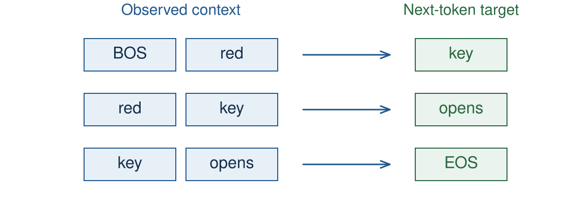
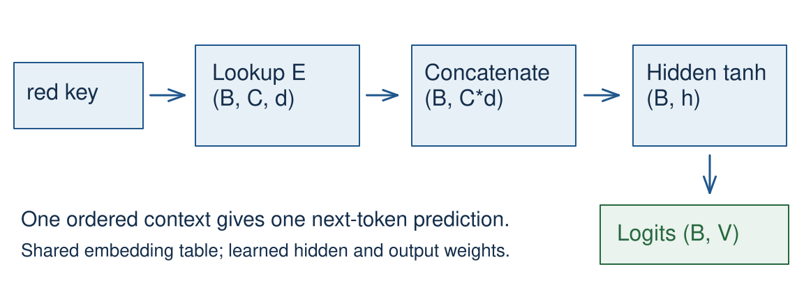
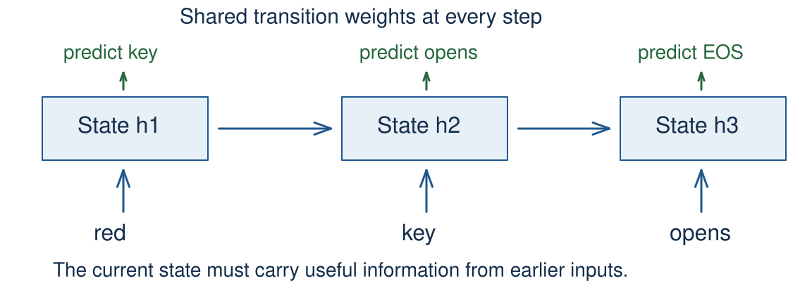
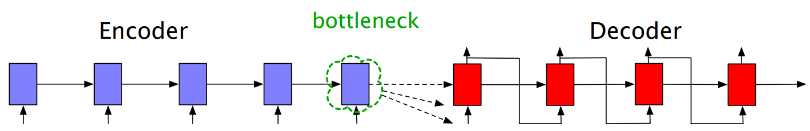
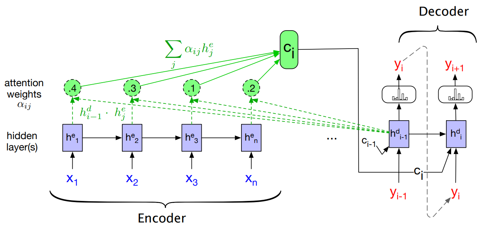

<!-- .slide: class="title-slide" id="title" -->

<p class="eyebrow">CS40008.01</p>

# 神经语言模型与循环注意力

<p class="subtitle">第 04 讲 – 自然语言处理与大语言模型</p>

<p class="byline">Baojian Zhou<br>数据科学学院<br>复旦大学<br>2026 年 9 月 30 日</p>

Note:
三个 45 分钟课时。练习本中的 E01–E05 是不计分的课堂练习，所有示例均可在 CPU 上离线运行。第一课时扩展上周的模型；第二课时介绍循环状态和门控记忆；第三课时介绍 RNN 编码器—解码器中的加性对齐。共享的练习本链接会打开个人工作副本。

---

<!-- .slide: id="learning-objectives" -->

## 学习目标

**模型如何保留并选择有用的上下文？**

- 训练固定窗口神经语言模型。
- 追踪循环状态及其梯度路径。
- 解释 LSTM 单元的更新与门控。
- 计算 RNN 解码器的加权源上下文。
- 区分源上下文与目标历史。

Note:
开头两页共安排一分钟。第一课时扩展第 03 讲的单词元模型；第二课时介绍循环记忆；第三课时介绍 RNN 编码器—解码器中的 Bahdanau 加性对齐。第 05 讲将介绍 Q/K/V 投影、缩放点积和因果自注意力。

---

<!-- .slide: id="bigram-recap" -->

## 第 03 讲的上下文限制

$$h_t=E[w_t],\qquad z_t=W_o h_t+b_o$$

$$p(w_{t+1}\mid w_t)=\operatorname{softmax}(z_t)$$

查找表和输出投影的参数通过训练学习。

**只有当前词元决定下一次预测。**

Note:
与下一页共安排两分钟。回顾第 03 讲的向量瓶颈二元模型 TinyLM。加入可训练嵌入并不能让这一计算看到更早的词。这里 t 表示当前输入词元，z_t 预测 t+1。来源：../lecture-03/teaching-plan.md 中的学习目标和贯穿示例。

---

<!-- .slide: id="same-last-token" -->

## 两个前缀，相同的最后词元

| 已观察到的前缀 | 玩具语料中的下一词元 |
| --- | --- |
| BOS **red** key | opens |
| BOS **blue** key | closes |

二元模型必须在 **key** 之后使用相同的分布。

两个词元的上下文可以区分这些前缀。

<p class="source">人为构造的文本。两种情况出现次数相同。</p>

Note:
询问模型需要哪些信息。只考虑这两个目标时，最优二元概率分别为 1/2 和 1/2，平均损失为 log(2) nats。不要声称所有自然语言续写都是确定的。这个语料是有意控制的调试示例。练习本使用两个完整句子中六组长度为 2 的上下文／目标对进行训练。

---

<!-- .slide: class="outline-slide" id="outline-feedforward" -->

## 大纲

<ul class="outline-topics">
<li aria-current="step">前馈语言模型</li>
<li>循环状态与门控记忆</li>
<li>RNN 编码器—解码器中的注意力</li>
</ul>

<p class="caption">第一课时 · 45 分钟，包含 E01 和 E02</p>

Note:
安排一分钟。每次课时转换都使用这份相同的三主题大纲。在讨论其他上下文机制之前，先追踪一次端到端计算。

---

<!-- .slide: id="toy-vocabulary" -->

## 一个小词表

| ID | 0 | 1 | 2 | 3 | 4 | 5 | 6 |
| --- | --- | --- | --- | --- | --- | --- | --- |
| 词元 | BOS | red | blue | key | opens | closes | EOS |

- ID 是任意的查找索引。
- BOS 标记开始；EOS 标记结束。
- 每个上下文预测一个后续词元。

Note:
与下一页共安排两分钟。这些 ID 只用于本讲，不是第 02 或第 03 讲的映射。虽然 BOS 从不是目标，我们的七行输出层仍包含 BOS。这里没有填充。只有观察到两个输入词元后，才开始构造每个长度为 2 的窗口。没有示例跨越句子边界或在 EOS 之后进行预测。

---

<!-- .slide: id="context-windows" -->

## 上下文窗口与目标



<p class="caption">上下文大小 C = 2。窗口每次前进一个词元。</p>

Note:
指出每个上下文之外的目标。练习本中的蓝色句子另外提供三个示例。必须先将语料划分为训练／开发文档，再提取重叠窗口。这个演示只使用一个很小的训练批次，没有留出集评估。

---

<!-- .slide: id="feedforward-path" -->

## 前馈语言模型



<p class="caption">固定窗口中的每个位置都在拼接向量中占有相应位置。</p>

Note:
与下一页共安排三分钟。保留春季第 04 讲幻灯片第 17–20 页和练习本第 3 节中的 NPLM 机制。新的 CPU 示例使用 nn.Module 和本地词表，无需 Transformers 封装或下载。这个简化的 Bengio 风格网络省略了可选的输入到输出直接连接。来源：Bengio et al. (2003)，§2，https://www.jmlr.org/papers/v3/bengio03a.html。

---

<!-- .slide: id="hidden-nonlinearity" -->

## 上下文的隐藏表示

$$x=[E[w_{t-1}];E[w_t]]$$

$$h=\tanh(W_hx+b_h),\qquad z=W_oh+b_o$$

非线性使网络能够学习相互作用。

连续的仿射层本身可以合并成一个仿射映射。

Note:
这里使用列向量记法。在 PyTorch 中，批次存储行向量，nn.Linear 将权重存为 (out_features, in_features)。x 中的分号表示拼接，而不是求和。这里延续春季幻灯片第 4–14 页对非线性和隐藏表示的解释，但不重复完整的 XOR 推导。可以使用更深的堆叠，但我们的调试示例不需要。

---

<!-- .slide: id="shape-ledger" -->

## 模型中的张量形状

| 量 | 形状 |
| --- | --- |
| 上下文 ID | $(B,C)$ |
| 嵌入查找 | $(B,C,d)$ |
| 拼接后的上下文 | $(B,Cd)$ |
| 隐藏表示 | $(B,h)$ |
| 词表 logits | $(B,\lvert V\rvert)$ |

Note:
安排两分钟。B 是上下文窗口数，不一定等于原始文档数。每一行对应一个目标。展平时保留窗口内的位置顺序。这种形状优先的推理遵循 CS336 第 2 讲的 tensor/einops 示例：https://github.com/stanford-cs336/lectures/blob/main/lecture_02.py，tensor_einops()。

---

<!-- .slide: class="exercise" id="exercise-01" -->

<p class="exercise-meta">练习 E01 · 4 分钟 · 先预测，再检查</p>

## 上下文与张量形状

对于 **BOS red key opens EOS**，列出三个窗口及其目标。

已知 $B=2$、$C=2$、$d=4$、$h=8$ 和 $|V|=7$，写出查找、拼接、隐藏层和 logits 的形状。

<div class="answer fragment">
<p>BOS red → key；red key → opens；key opens → EOS。</p>
<p>形状：(2, 2, 4)、(2, 8)、(2, 8)、(2, 7)。</p>
</div>

Note:
请学生先写出答案再揭晓。练习本中的 E01 使用六个窗口中的前两个，对应 B=2。常见错误：虽然该模型对每个完整窗口只输出一次下一词元预测，却仍在输出中保留序列长度维度。答案由练习本中的 e01_shapes 计算核对。

---

<!-- .slide: id="feedforward-code" -->

## 在 PyTorch 中实现同一过程

```python
self.embedding = nn.Embedding(V, d)
self.hidden = nn.Linear(C * d, h)
self.output = nn.Linear(h, V)

def forward(self, ids):
    x = self.embedding(ids)       # B, C, d
    x = x.flatten(start_dim=1)    # B, C*d
    h = torch.tanh(self.hidden(x))
    return self.output(h)        # B, V
```

Note:
安排两分钟。这些代码摘自练习本中的 ContextLM；初始化应放在 __init__ 中。命名维度 V、d、h 和 C 对应上一页。nn.Linear 默认包含偏置。将 logits 传给 cross_entropy 之前不要应用 softmax。嵌入参数与隐藏层／输出层权重一起训练。

---

<!-- .slide: id="next-token-loss" -->

## 每个上下文对应一个目标

$$\ell(z,y)=-z_y+\log\sum_j e^{z_j}$$

```python
logits = model(contexts)           # B, V
loss = F.cross_entropy(logits, y)  # y: B
```

均匀 logits 的平均损失为 $\log |V|$。

对于这个词表，$\log 7\approx1.9459$ nats。

Note:
安排两分钟。这是在不同上下文模型中对第 03 讲内容的快速回顾。默认归约方式是对 B 个样本求平均。七类别均匀基线包含 BOS 行。随机初始化模型的起始值不一定正好等于均匀基线。目标 ID 与输出行使用相同的词表映射。

---

<!-- .slide: id="stable-cross-entropy" -->

## 损失的数值稳定性

对于 logits $(1000,1001,999)$，目标索引为 $1$：

```python
log_z = torch.logsumexp(logits, dim=-1)
loss = log_z - logits[..., 1]
```

直接计算指数会溢出。稳定计算得到的损失为 **0.4076 nats**。

<p class="caption">在训练循环中将原始 logits 传给 cross_entropy。</p>

Note:
安排两分钟。练习本以 float64 计算两种版本，并有意显示朴素归一化因子的无穷大结果。对于一般批次，应收集每一行的目标 logit，而不是始终选择第 1 列。减去最大的 logit 既不改变 softmax 概率，也不改变最终的对数归一化损失。CS336 作业 1 要求学生实现 softmax 和交叉熵：https://github.com/stanford-cs336/assignment1-basics/blob/main/tests/adapters.py，run_softmax 和 run_cross_entropy。

---

<!-- .slide: id="training-step" -->

## 一次训练步骤

```python
optimizer.zero_grad(set_to_none=True)
logits = model(contexts)
loss = F.cross_entropy(logits, targets)
loss.backward()
optimizer.step()
history.append(loss.item())
```

梯度会持续累积，直到被清除。优化器更新参数。

Note:
安排两分钟。询问哪一行生成梯度，哪一行改变权重。全部 200 次更新期间，示意图和模型保持相同。这里的 history 记录每次更新之前的损失。练习本绘制的历史曲线则明确测量训练前及每次更新后的损失，因此横轴正确表示已完成的更新次数。CS336 第 2 讲中的 train_loop() 和 gradients_basics()：https://github.com/stanford-cs336/lectures/blob/main/lecture_02.py。

---

<!-- .slide: class="exercise" id="exercise-02" -->

<p class="exercise-meta">练习 E02 · 6 分钟 · 解释、修复、运行</p>

## 断开连接的训练损失

```python
loss = F.cross_entropy(model(contexts), y).detach()
loss.backward()
```

为什么会失败？修复循环，然后拟合六个窗口。

<div class="answer fragment">
<p>去掉 detach。在 backward 之前清除梯度，再调用 step。</p>
<p>目标：200 次更新后损失低于 0.03 nats。</p>
</div>

Note:
使用 E02 单元格。detach 会切断与可训练参数的连接；对此标量调用 backward 会报错。练习本先捕获这个预期失败，再运行修正后的循环。获得保持连接的损失后，记录 loss.item() 是安全的。使用 CPU、随机种子 7、SGD 学习率 0.5、C=2、d=4、h=8 和 V=7。六个上下文／目标对彼此兼容，因此可能拟合到接近零。

---

<!-- .slide: id="tiny-training-curve" -->

## 拟合微型批次

<div class="plot" data-plotly="assets/tiny-lm-loss.json" role="img" aria-label="Mean toy training loss falls from about 2.1729 nats to 0.0070 after 200 SGD updates. The dashed uniform-logit baseline is log 7, about 1.9459."></div>

<p class="caption">六个窗口 · CPU · SGD · 调试实验</p>

Note:
与下一页共安排两分钟。这条曲线由练习本计算得到，而不是理想化绘图。第 0 步是训练前；第 200 步是 200 次更新后。在参考 CPU 环境中，最终损失约为 0.006996。不同平台可能有微小浮点差异。仅凭低训练损失无法证明模型对新文档的表现。

---

<!-- .slide: id="context-predictions" -->

## 学到的区别

| 上下文 | 目标 | 模型预测 |
| --- | --- | --- |
| red key | opens | opens |
| blue key | closes | closes |

模型现在使用了更早的词元。

**六个训练窗口全部预测正确。**

Note:
读取练习本中全部六种情况的输出：key、opens、EOS、key、closes、EOS。询问学生为什么单词元基线不可能区分两个 key 上下文。这里可以区分，是因为拼接向量能区分 red key 和 blue key。这些是训练集预测，不是留出集准确率。

---

<!-- .slide: id="training-diagnosis" -->

## 微型批次无法拟合时

| 观察结果 | 首先检查 |
| --- | --- |
| 反向传播失败 | 损失是否断开或梯度是否被禁用 |
| 损失保持不变 | 更新、学习率、目标对齐 |
| 损失变为非有限值 | Logits、梯度、学习率 |
| 输入相同而目标冲突 | 模型可见的上下文 |

Note:
安排两分钟。这些是起始检查项，不是唯一诊断。打印几组上下文／目标对，检查梯度范数，并确认调用 step 后参数发生变化。仅有非零梯度不能证明实现正确。即使优化完美，冲突的目标也可能具有不可约的条件熵。当前长度为 2 的批次有意避免这类冲突。

---

<!-- .slide: id="fitting-and-generalization" -->

## 训练拟合与泛化

| 问题 | 证据 |
| --- | --- |
| 实现能否学习？ | 拟合一个小型且一致的训练批次 |
| 能否预测新文本？ | 在单独留出的文档上计算损失 |

在生成重叠窗口**之前**划分文档。

保持词元化器、目标对齐和损失单位一致。

Note:
利用第一课时最后几分钟讨论并赶上练习本进度。我们的六窗口实验没有留出集评估。eval() 改变 dropout 等模块的行为；no_grad() 控制是否记录梯度。两者都不会改变所评估的数据。留出集困惑度 exp(mean NLL) 只有在词元化和评分约定相同时才可比较，如第 02 讲所述。休息后从下一页大纲继续。

---

<!-- .slide: class="outline-slide" id="outline-recurrence" -->

## 大纲

<ul class="outline-topics">
<li>前馈语言模型</li>
<li aria-current="step">循环状态与门控记忆</li>
<li>RNN 编码器—解码器中的注意力</li>
</ul>

<p class="caption">第二课时 · 45 分钟，包含 E03–E04</p>

Note:
安排一分钟。先介绍循环，再引入注意力。学生将追踪状态和梯度，然后计算给定的 LSTM 单元更新。完整序列模型训练仍属选做。

---

<!-- .slide: id="context-mechanisms" -->

## 固定窗口与循环状态

| 模型 | 预测时可用的信息 |
| --- | --- |
| 二元模型 | 当前词元 |
| 固定窗口神经语言模型 | 固定数量的近期词元向量 |
| 循环语言模型 | 随前缀更新的状态 |

随着前缀增长，循环状态的宽度保持不变。

Note:
安排两分钟。再次使用 red key 与 blue key：循环状态可以将更早的颜色信息向后传递。信息可用与成功学会记忆是不同的说法。这里比较的是上下文路径，不是普适的质量排名。

---

<!-- .slide: id="recurrent-state" -->

## 循环状态



<p class="caption">每次更新使用前一个状态和当前输入。</p>

Note:
安排三分钟。沿图追踪一个序列。重复的方框使用相同参数，但产生不同状态。在相互独立的文档边界处重置状态。来源：教师的春季第 04 讲第 38–44 页，链接见 optional-reading.md。

---

<!-- .slide: id="recurrent-update" -->

## 循环更新

$$h_t=\tanh(W_xx_t+W_hh_{t-1}+b)$$

| 量 | 单个序列的形状 |
| --- | --- |
| 输入 $x_t$ | $d$ |
| 状态 $h_t$ | $m$ |
| 输入矩阵／循环矩阵 | $m\times d$ / $m\times m$ |

参数在各时间步之间共享。

Note:
安排四分钟。本页使用列向量记法。练习本提供行向量实现，并在权重相同的条件下与 torch.nn.RNN 进行比较。参数数量不会随序列长度增长。状态是激活值，而不是每一步都新增的可训练参数。

---

<!-- .slide: class="exercise" id="exercise-03" -->

<p class="exercise-meta">练习 E03 · 7 分钟 · 先追踪，再核对</p>

## 追踪记忆路径

使用**线性玩具递推** $h_t=0.5h_{t-1}+x_t$。

从 $h_0=0$ 开始，输入为 $(1,0,1)$。
求 $h_1,h_2,h_3$ 和 $\partial h_3/\partial x_1$。

如果第一个输入变成 2，会有什么变化？

<div class="answer fragment">

状态依次为 $1,0.5,1.25$。导数为 $0.25$。
将第一个输入改为 2，最终状态变为 $1.5$。

</div>

Note:
安排七分钟。这个标量递推有意省略 tanh，使记忆路径精确且易于理解。展开得到 h3 = 0.25 x1 + 0.5 x2 + x3。最后一个输入不变，但它的状态保留了更早输入的信息。在练习本中运行 recurrent-trace，比较自动求导结果和展开式。

---

<!-- .slide: id="recurrent-language-model" -->

## RNN 语言模型

$$x_t=E[w_t],\qquad z_t=Uh_t+b_o$$

位置 $t$ 的状态预测词元 $t+1$。

- 训练时提供已观察到的前缀。
- 生成时将每个选中的词元输入下一次更新。
- 状态在更新之间传递信息。

Note:
安排四分钟。回顾第 03 讲的错位损失，这次使用循环上下文函数。训练时教师强制提供已知输入；循环状态仍然依赖前一状态。解码选择留待第 06 讲。来源：Graves (2013), Generating Sequences With Recurrent Neural Networks, §2，https://arxiv.org/abs/1308.0850。

---

<!-- .slide: id="recurrent-gradients" -->

## 穿过重复更新的梯度

链式法则将状态路径上的局部导数相乘。

$$0.9^{50}\approx0.0052,\qquad 1.1^{50}\approx117.4$$

真实循环梯度涉及**雅可比矩阵的连乘**。

信号的缩小或增长可能使长距离依赖难以学习。

Note:
安排四分钟。这些标量乘积用于说明机制，不是测量得到的 RNN 梯度。激活函数的导数和循环权重都有影响。不要声称每个循环梯度都会消失或爆炸。来源：Pascanu, Mikolov, and Bengio (2013), §2，https://proceedings.mlr.press/v28/pascanu13.html。

---

<!-- .slide: id="shared-recurrent-gradient" -->

## 共享权重接收各时间步的贡献

对于 $h_t=ah_{t-1}+x_t$ 和 $h_0=0$：

$$h_3=a^2x_1+ax_2+x_3$$

$$\frac{\partial h_3}{\partial a}=2ax_1+x_2$$

使用 E03 的输入且 $a=0.5$ 时，该导数为 **1**。

Note:
安排四分钟。通过时间的反向传播对展开后的计算求导，并将贡献累积到同一个参数 a 中。区分对第一个输入的导数（0.25）和对共享权重的导数（1）。练习本会检查两者。对传递的状态调用 detach 会截断其梯度路径，即使数值保持不变。

---

<!-- .slide: id="lstm-purpose" -->

## LSTM 记忆与门控

<div class="columns">
<div>
<h3>单元记忆</h3>
<p>$c_t=f_t\odot c_{t-1}+i_t\odot\widetilde c_t$</p>
<table>
<thead><tr><th>贡献项</th><th>作用</th></tr></thead>
<tbody>
<tr><td>$f_t\odot c_{t-1}$</td><td>保留上一单元状态的一部分</td></tr>
<tr><td>$i_t\odot\widetilde c_t$</td><td>加入选定的候选信息</td></tr>
</tbody>
</table>
<p>单元状态 $c_t$ 和对外输出的状态 $h_t$ 是不同的量。</p>
</div>
<div>
<h3 id="lstm-gates">门控与输出</h3>
<p>$g_t=\sigma(W_gx_t+U_gh_{t-1}+b_g)$</p>
<p>$f_t$、$i_t$、$o_t$ 各有独立参数；其元素介于 0 和 1 之间。</p>
<p>$\widetilde c_t=\tanh(\text{learned candidate})$</p>
<p>$h_t=o_t\odot\tanh(c_t)$</p>
<p>输出门控制哪些信息传到下一次预测。</p>
</div>
</div>

Note:
安排六分钟：单元记忆三分钟，门控和输出三分钟。这是具有遗忘门的常见现代 LSTM。Hochreiter–Schmidhuber 1997 年的原始模型早于遗忘门，不要将这一后来形式原样归于原论文。当前方程遵循 torch.nn.LSTM 和教师春季课程对门控的讲解。门控有助于保留直接的状态路径，但不保证梯度稳定。

三个门有独立参数。这个记法是三个仿射映射的简写，而不是一个共享门。较小的输出门可以隐藏存储的单元信息而不将其擦除。练习本将完整单元与 torch.nn.LSTMCell 核对；E04 使用给定的门值，单独检查算术过程。

---

<!-- .slide: class="exercise" id="exercise-04" -->

<p class="exercise-meta">练习 E04 · 7 分钟 · 先计算，再核对</p>

## 门控更新与循环模型的局限

使用 $c_{t-1}=2$、$f_t=0.75$、$i_t=0.5$、
$\widetilde c_t=-0.5$ 和 $o_t=0.5$。

<div class="columns">
<div>
<h3>计算</h3>
<p>求 $c_t$ 和 $h_t$。固定这些门值时，$\partial c_t/\partial c_{t-1}$ 是多少？</p>
<div class="answer fragment" data-fragment-index="0">
<p>$c_t=1.25$<br>$h_t=0.5\tanh(1.25)\approx0.4241$。</p>
<p>单元直接路径的导数：$0.75$。</p>
</div>
</div>
<div class="fragment" data-fragment-index="1">
<h3 id="recurrent-limitations">仍然存在的局限</h3>
<ul>
<li>状态更新依赖先前状态。</li>
<li>信息必须经过多次更新而保留下来。</li>
<li>固定上下文的编码器—解码器只传递一个源摘要，这促使我们引入注意力。</li>
</ul>
</div>
</div>

Note:
安排十分钟：E04 七分钟，其余局限三分钟。学生计算后揭晓答案，再揭晓局限以衔接注意力。直接导数假设给定的门值固定。完整的循环导数还包含通过更早隐藏状态和门控计算产生的依赖。询问 f=0 与 f=1 如何改变保留项，以及 o=0 如何在不改变 c 的情况下改变输出。运行 lstm-update 和单独的完整单元比较。

固定最终向量的瓶颈属于接下来讨论的特定编码器—解码器设计，并非所有循环架构都有。LSTM 门控改善记忆传播，但不会自动使解码器能够访问每个编码器状态。参见 Bahdanau et al.，§§2–3。

---

<!-- .slide: class="outline-slide" id="outline-alignment" -->

## 大纲

<ul class="outline-topics">
<li>前馈语言模型</li>
<li>循环状态与门控记忆</li>
<li aria-current="step">RNN 编码器—解码器中的注意力</li>
</ul>

Note:
安排一分钟。注意力现在用于解决特定的循环翻译问题。本节始终使用编码器源状态和解码器状态。Transformer 自注意力将在第 05 讲展开。

---

<!-- .slide: id="encoder-decoder" -->

## 使用 RNN 进行机器翻译

**翻译：**“I am hungry”（英语）→“J’ai faim”（法语）。

**编码器：**源句子 → 固定大小的最终状态 $c=h_n^{\mathrm{enc}}$。



**解码器：**$s_t=f(s_{t-1},y_{t-1},c)$，每个目标时间步使用相同的 $c$。

源序列和目标序列的长度可以不同。

<p class="caption"><strong>瓶颈：</strong>解码器只能通过 $c$ 获取源信息。注意力使每个目标时间步都能从所有编码器状态中选择。</p>

Note:
翻译任务、编码器—解码器更新和瓶颈共安排六分钟。先确立任务，再介绍架构：读取一种语言的完整句子，生成另一种语言的翻译。英法句子只是教学示例；图中的状态数量是示意性的。Bahdanau et al. 为神经机器翻译开发了基于注意力的循环模型，并评估了英译法任务（§4）。先解释固定上下文基线，再展示注意力如何为每个目标词提供自己的源上下文。

这里 y_(t-1) 表示更新函数中的前一个目标词或其嵌入。摘要的维度固定，但它并不是独立于源句子的常数：不同源句子产生不同的 c。解码器在每一步使用同一个源摘要生成目标词；源序列与目标序列的长度可以不同。

使用教师 lecture-05-slides-transformers.pptx 第 7 页的插图。每个紫色方框表示读取一个源词元后的编码器状态；绿色圆圈标出最终状态 c。红色方框表示连续的解码器状态，循环箭头将前一个生成词元传到下一步。该图描绘固定上下文循环编码器—解码器：解码器可用的所有源信息都通过 c。源句子增长时，c 的宽度保持固定。询问解码器能直接查看哪个更早的源状态：在该模型中不能直接查看任何一个。后续页面将对保留的编码器状态使用注意力，在每个目标时间步得到依赖解码器的上下文。原始插图来自 ppt/media/image10.png，未作修改。概念来源：Bahdanau et al. §§2–3；Cho et al. (2014)，https://aclanthology.org/D14-1179/。

---

<!-- .slide: id="bahdanau-attention" -->

## 为神经翻译学习对齐

<div class="columns">
<div>
<h3>Bahdanau、Cho 和 Bengio</h3>
<p><em>Neural Machine Translation by Jointly Learning to Align and Translate</em></p>
<p>2014 年预印本；ICLR 2015。</p>
<p>对齐网络学习为每个目标词组合哪些编码器状态。</p>
<p class="source"><a href="../../papers/2015-iclr-bahdanau-neural-machine-translation-align-translate.pdf">课程 PDF：§§2–3；附录 A.1.2</a></p>
</div>
<div>
<h3 id="source-annotations">双向源状态</h3>
<p>$h_j=[\overrightarrow h_j;\overleftarrow h_j]$</p>
<p>编码器从两个方向读取源句子。</p>
<p>每个注释向量表示包含周围上下文的一个源位置。</p>
<p>翻译开始前可以看到整个源句子。</p>
</div>
</div>

Note:
安排五分钟：论文两分钟，源注释向量三分钟。将其介绍为神经机器翻译中有开创意义的加性软注意力模型，不要称它为整个神经计算领域的第一个注意力机制。论文 §6.1 讨论了 Graves 更早的手写对齐工作（2013，https://arxiv.org/abs/1308.0850）。Mnih et al. 的视觉注意力论文于 2014 年 6 月提交（https://arxiv.org/abs/1406.6247），早于 2014 年 9 月的神经机器翻译预印本。Bahdanau 模型使用门控循环单元，而不是 LSTM；前面的 LSTM 用于更一般地说明循环记忆。

区分源注释向量 h_j 和目标解码器状态 s_t。源注释向量可以包含后面源词的信息，但不会泄露未来目标词。论文中的编码器状态由双向门控 RNN 产生。来源：Bahdanau et al.，§3.2 和图 1。

---

<!-- .slide: id="additive-alignment" -->

## 从对齐分数到上下文

$$e_{t,j}=v_a^\top\tanh(W_as_{t-1}+U_ah_j)$$

<div class="columns">
<div>
<h3>对每个源位置评分</h3>
<table>
<thead><tr><th>输入</th><th>含义</th></tr></thead>
<tbody>
<tr><td>$s_{t-1}$</td><td>前一个解码器状态</td></tr>
<tr><td>$h_j$</td><td>源位置 $j$ 的注释向量</td></tr>
</tbody>
</table>
<p>$W_a$、$U_a$ 和 $v_a$ 与翻译模型一起学习。</p>
</div>
<div>
<h3 id="weighted-context">归一化并组合</h3>
<p>$\displaystyle\alpha_{t,j}=\frac{\exp(e_{t,j})}{\sum_{k=1}^{S}\exp(e_{t,k})}$</p>
<p>$\displaystyle c_t=\sum_{j=1}^{S}\alpha_{t,j}h_j$</p>
<p>每个目标时间步都得到一个源位置分布。上下文的宽度与编码器注释向量相同。</p>
</div>
</div>

Note:
安排七分钟：加性分数四分钟，归一化与上下文三分钟。这是 Bahdanau 的加性评分，不是缩放点积。W_a 和 U_a 将解码器和编码器宽度映射到共同的对齐宽度；原始宽度不必相同。最终向量 v_a 为每个源位置产生一个标量。所有源位置和目标时间步共享相同的对齐参数。来源：附录 A.1.2。

softmax 的归一化轴是源序列。这个无填充示例中的所有源位置均有效。上下文是可微的加权组合，而不是采样出的单个位置。这里 c 表示上下文、s 表示解码器状态；上一节在不同模型中用 c 表示 LSTM 单元记忆。来源：Bahdanau et al. §3.1，公式 (5)–(6)。

---

<!-- .slide: id="aligned-decoder-step" -->

## 提供给解码器的上下文向量

<p>$\alpha_{t,:}=\operatorname{softmax}(e_{t,:}),\qquad c_t=\sum_j\alpha_{t,j}h_j$</p>



<p class="caption">通用 RNN 示意图使用点积评分和自己的解码器索引。<br>本讲的加性注意力模型请使用下一页的方程。</p>

Note:
安排 1.5 分钟，与下一页共享原有三分钟的解码器更新时段。沿绿色路径追踪前一个解码器状态到对齐权重，再从源状态追踪到加权上下文。图中四个权重之和为一；它们只是示意值，不是测量得到的翻译结果。后续目标时间步可以选择相同源状态的不同组合。

来源：2026 年 10 月 10 日（上海时间）使用的教师桌面版 57 页 lecture-05-slides-transformers.pptx 快照第 2 页“Context vector c_i”。原始 PNG 直接复用 ppt/media/image1.png；较早的 83 页保存副本中，同一图像为第 8 页的 ppt/media/image11.png。原来的文字和公式截图在此以可编辑课程文本和 KaTeX 呈现。

记法：图中的 i 对应 t，h_j^e 对应编码器注释向量 h_j，h_(i-1)^d 对应前一个解码器状态 s_(t-1)。绿色虚线标签表示点积分数；上一页和练习本则使用 Bahdanau 的可学习加性评分。两者都在源位置上归一化并形成加权上下文。该图是使用单向编码器及自身解码器／输出索引的通用循环注意力示意图，并非双向 Bahdanau 模型的精确结构图。本讲解码器依赖关系和目标索引以接下来的方程为准。

---

<!-- .slide: id="decoder-update" -->

## 下一次解码器更新的上下文

$$s_{t-1},\lbrace h_j\rbrace\quad\longrightarrow\quad
\lbrace e_{t,j}\rbrace\quad\longrightarrow\quad c_t$$

$$s_t=f(s_{t-1},y_{t-1},c_t)$$

$$p(y_t\mid y_{<t},x)=g(y_{t-1},s_t,c_t)$$

翻译损失联合训练编码器、对齐网络和解码器。

Note:
在上下文插图后安排 1.5 分钟。箭头链表示依赖关系，而非额外的离散决策。在 Bahdanau 的约定中，分数在计算新状态之前使用 s_(t-1)。其他注意力架构的顺序可能不同。g 包含词表概率计算。这个目标不需要人工标注的词对齐标签。来源：Bahdanau et al.，§3.1 和附录 A.1.2。

---

<!-- .slide: class="exercise" id="exercise-05" -->

<p class="exercise-meta">练习 E05 · 7 分钟 · 先计算，再核对</p>

## 每个目标时间步都有不同的上下文

<div class="columns">
<div>
<h3 id="alignment-example">一个目标时间步</h3>
<table>
<thead><tr><th>源注释向量</th><th>分数</th></tr></thead>
<tbody>
<tr><td>$h_1=(1,2)$</td><td>$0$</td></tr>
<tr><td>$h_2=(3,0)$</td><td>$\log 3$</td></tr>
</tbody>
</table>
<p>求指数得到未归一化权重 <strong>1</strong> 和 <strong>3</strong>。</p>
<p class="caption">人为构造的向量和给定的对齐分数，便于手算。</p>
</div>
<div>
<h3>计算并比较</h3>
<p>求分数 $(0,\log 3)$ 对应的权重和上下文。在另一个目标时间步对 $(\log 3,0)$ 重复计算。</p>
<div class="answer fragment" data-fragment-index="0">
<p>第一步：权重 $(1/4,3/4)$，<br>上下文 $(2.5,0.5)$。</p>
<p>第二步：权重 $(3/4,1/4)$，<br>上下文 $(1.5,1.5)$。</p>
</div>
</div>
</div>

Note:
安排十分钟：给定分数的示例三分钟，E05 七分钟。这些分数是给定的对齐网络输出，不声称来自预训练模型或点积。区分分数计算、归一化与聚合。本练习计算上下文，并在后一个解码器时间步改变分数模式。学生算完两种情况后揭晓答案。

由于依赖解码器的分数发生变化，相同的源注释向量会产生不同的上下文。练习本先核对这些算术运算，再用明确给定的玩具矩阵实现加性评分，并检查经过权重和源状态的梯度。不训练翻译基准模型。

---

<!-- .slide: id="source-and-target-context" -->

## 源信息可见性与对齐权重

<div class="columns">
<div>
<h3>生成目标 $y_t$ 时</h3>
<table>
<thead><tr><th>信息</th><th>是否可用？</th></tr></thead>
<tbody>
<tr><td>整个源句子</td><td>是</td></tr>
<tr><td>先前生成的目标词</td><td>是</td></tr>
<tr><td>未来目标词</td><td>否</td></tr>
</tbody>
</table>
<p>源位置 $j$ 和目标时间步 $t$ 是不同序列中的索引。</p>
</div>
<div>
<h3 id="alignment-interpretation">解释权重</h3>
<p>较大的权重使该源注释向量在上下文中具有较大的系数。</p>
<p>注释向量本身已经包含上下文信息。</p>
<p>权重有助于检查对齐，但不能确定预测的唯一解释。</p>
</div>
</div>

Note:
安排七分钟：可用上下文四分钟，解释三分钟。翻译可能需要重排：即使源位置 j 大于目标索引 t，该位置仍然可用。不要在源对齐上施加基于目标索引的三角掩码。如果存在填充，需要单独排除。解码器对目标词仍是自回归的。第 05 讲将介绍对目标序列进行自注意力时的掩码。

最终贡献还取决于被加权的向量。Bahdanau et al. §5.2 和图 3 展示了学习到的对齐以及源／目标重排。解释坐标轴时，不要将注意力视为有保证的人类语言学标注或因果归因方法。

---

<!-- .slide: id="references" -->

## 回顾与后续内容

<div class="columns">
<div>
<h3 id="exit-questions">回顾</h3>
<ol>
<li>RNN 如何保留更早的上下文？</li>
<li>LSTM 的记忆和输出门控制什么？</li>
<li>为什么注意力可以在每一步选择新的上下文？</li>
</ol>
</div>
<div class="references">
<h3>阅读</h3>
<ul>
<li><a href="https://www.jmlr.org/papers/v3/bengio03a.html">Bengio et al. (2003)</a>：§2</li>
<li><a href="https://proceedings.mlr.press/v28/pascanu13.html">Pascanu et al. (2013)</a>：§2</li>
<li><a href="../../papers/2015-iclr-bahdanau-neural-machine-translation-align-translate.pdf">Bahdanau et al. (2014/2015)</a>：§§2–3</li>
<li><a href="https://arxiv.org/abs/1308.0850">Graves (2013)</a>：手写对齐</li>
<li><a href="optional-reading.md">原始课件与进一步阅读</a></li>
</ul>
</div>
</div>

<p id="continuation"><strong>第 05 讲：</strong>Q/K/V、缩放点积、因果自注意力和 Transformer 块。</p>

Note:
安排六分钟：回顾三分钟，后续内容一分钟，阅读和提问两分钟。预期回答：更早的输入影响传递的状态；单元存储信息，输出门控制对外输出；前一个解码器状态改变同一组源注释向量上的对齐分数。请学生在第三个回答中区分源序列与目标序列。

第 05 讲先简短回顾循环注意力，再介绍 Q/K/V 投影、缩放点积、因果自注意力和完整解码器块。

阅读 Bengio §2 了解神经语言模型；Pascanu §2 了解循环梯度；Bahdanau §§2–3、附录 A.1.2 和 §6.1 了解加性对齐和更早工作；Graves 介绍循环生成与手写对齐。核心练习本可在 CPU 上离线运行。历史文献描述各自的架构和实验；我们的小型算术示例是教学构造。论文日期和更早对齐工作的引用用于限定归属范围，而不是声称所有注意力都始于 2014 年。
