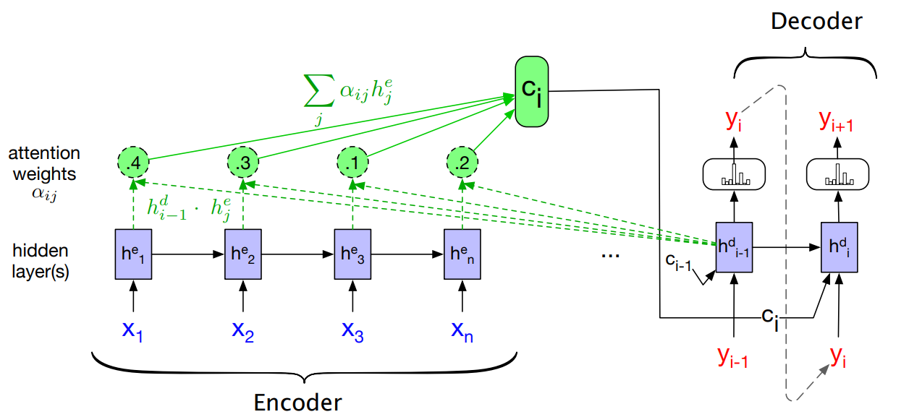
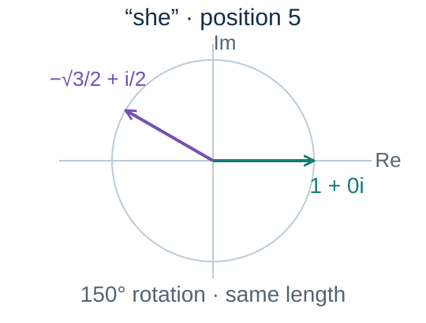
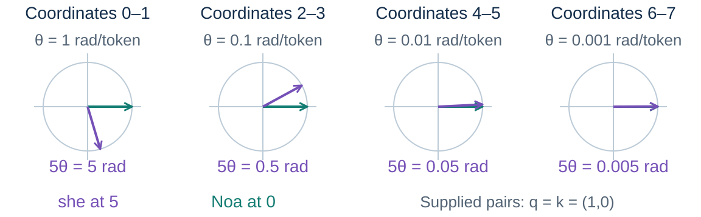
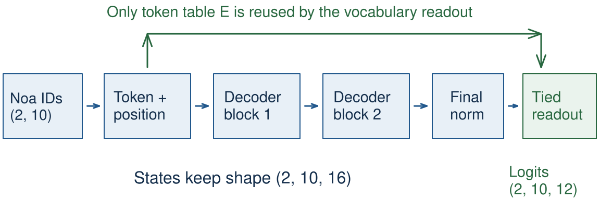
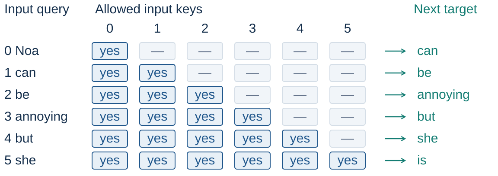

<!-- .slide: class="title-slide" id="title" -->

CS40008.01

# 注意力与 Transformer

第 05 讲 – 自然语言处理与大语言模型

Baojian Zhou 数据科学学院 复旦大学 2026 年 10 月 10 日

Note:
安排一分钟。周六补课，三个 45 分钟课时，其中 15 分钟留给小测验 2。核心练习 E01–E06 不计分。CPU 实现练习本是单独且明确标注的资源。两个练习本都使用同一个人为构造的 Noa 示例。这个 60 页的材料库包含后续实现页；课堂应按 teaching-plan.md 中的路线讲授，而不是在 120 分钟内展示每一页。小测验 2 考查此前所学内容，单独进行。时间和地点遵循学校通知。改编自教师 2025 年第 05 讲；来源映射见 teaching-plan.md。

---

<!-- .slide: id="learning-objectives" -->

## 学习目标

**注意力如何选择上下文，又如何构成 Transformer？**

- 追踪自注意力、学习到的投影和多头机制。
- 解释位置、残差、LayerNorm 和 FFN。
- 统计参数并检查因果下一词元预测。
- 结合实验设置解读原论文结果。

Note:
安排一分钟。六个核心练习使用默认练习本链接。单独的实现练习本提供完整 PyTorch 解码器、数值参考、拟合循环和因果性检查，供明确标注的实现活动及后续学习使用。练习本无需下载模型或数据集。为单独进行的小测验 2 保留 15 分钟。

---

<!-- .slide: class="outline-slide" id="outline-heads" -->

## 大纲

<ul class="outline-topics">
<li aria-current="step">自注意力与位置信息</li>
<li>多头与 Transformer 块</li>
<li>可运行模型与论文证据</li>
</ul>

第一课时 · 自注意力、正弦位置与 RoPE

Note:
安排一分钟。回顾循环对齐，然后按照整合后的 Noa 组件顺序讲解。核心练习 E01 和 E02 位于默认练习本中。排列演示链接到单独的实现练习本。

---

<!-- .slide: id="recurrent-attention-recap" -->

## 回顾循环编码器—解码器注意力

$e_{t,j}=a(s_{t-1},h_j),\quad \alpha_t=\operatorname{softmax}_{\text{all source}}(e_t),\quad c_t=\sum_j\alpha_{t,j}h_j$

图中：$h^d_{i-1}\equiv s_{t-1}$、$h^e_j\equiv h_j$；使用点积分数（第 04 讲使用加性评分）。

Note:
安排两分钟。回顾第 04 讲的编码器—解码器过程，不重新推导循环或加性对齐。Bahdanau 的对齐分数来自加性网络；源索引和目标索引属于不同序列。本讲改变评分函数并介绍自注意力。来源：Bahdanau et al. §3 和附录 A.1.2，https://arxiv.org/abs/1409.0473。

查询来自前一个解码器状态；源注释向量来自循环编码器。对所有源分数做 softmax 得到 alpha_(t,j)，每个目标时间步都可看到完整源句子。图中 i 是目标时间步索引，h^d_(i-1) 是查询状态，h^e_j 是源注释向量。追踪虚线评分连接、归一化权重、加权上下文及其与解码器的连接。提供的图片使用点积分数和示意性编码器，说明的是一般循环注意力，而不是精确的双向加性 Bahdanau 架构。图中权重是示意值。

插图：教师提供的 83 页 lecture-05-slides-transformers.pptx 第 8 页（Context vector），嵌入的 ppt/media/image11.png，未作修改。

与自注意力的衔接：循环对齐使用前一个解码器状态查询源编码器注释向量；自注意力则从同一序列的当前状态中获得查询、键和值。Bahdanau 使用可学习的加性评分，Transformer 示例使用缩放点积。两者都对分数归一化并组合源向量。后面的架构比较还会展示交叉注意力。本页整合了原来的循环注意力与自注意力表格。

---

<!-- .slide: id="context-for-text" -->

## 词元的上下文

Note:
安排 1–2 分钟。本页压缩了 2026 年 10 月 10 日（上海时间）检查的桌面版 49 页 lecture-05-slides-transformers.pptx 第 4–6 页“Get more context for text”。原页将示例归于 Rasa Algorithm Whiteboard。句子和语言学动机保留；三个揭示步骤为课程中的因果 GPT 重点重新设计。

先展示完整示例句和突出显示的“she”。询问哪个较早的词确定了它的指代对象。给学生几秒回答，预期为“Noa”。这个口头检查引入机制，不增加练习本题目。

1. 显示从“she”回指“Noa”的连接。中间的词不会阻碍有用关系。该连接表示人对句子的阅读理解，并不规定模型的注意力权重，也不声称某个注意力头一定会学到指代解释。
2. 显示因果边界。在“she”的位置，GPT 模型可以使用包含“she”在内的前缀；后面的“is a great cat”在该位置被掩码，即使训练提供完整句子也是如此。将显示的十个词视为玩具词元位置；真实词元化器可能以不同方式切分。
3. 显示上下文方程。t 是“she”的位置，v_j 是可用位置 j 的值向量，alpha_(t,j) 是其注意力权重。标准 softmax 注意力中的权重非负，并在可用位置上之和为一。模型通过训练学习评分计算，并根据当前表示计算权重；它可以组合整个可用前缀的信息，包括当前词元。

下一页保持相同前缀：位置 0–5 为 Noa、can、be、annoying、but、she。查询是位置 5 的 she，六个前缀位置全部可用。下一个目标是位置 6 的 is。起初输入向量也充当键和值；之后介绍学习到的 Q/K/V 投影。后面单头页面明确写出因果掩码，数值演示会显示未来词元 is，以检验掩码阻止访问它。

始终使用零起始位置。完整示例句是“Noa can be annoying but she is a great cat.”。教学中每个显示的词都是一个玩具词元；真实词元化器可能以不同方式切分。语言示例用于说明有用的上下文；示意向量和注意力模式均不是训练模型的测量值。

---

<!-- .slide: id="self-attention" -->

## 自注意力

Note:
机制来源：Baojian Zhou，2026 年春季 lecture-05-slides-transformers.pptx 第 24 页。原始归属：[Rasa Algorithm Whiteboard 2](https://www.youtube.com/watch?v=tIvKXrEDMhk)。主课件将其八步计算改写到共同的 Noa 示例；原始复现保留在 lecture-05-test 中。

使用空格、右方向键、Next 或点击图示来揭示下一组。左方向键和 Previous 回退一组。Reset 回到仅有标题的起始状态。

1. 选择位置 5 的 she 作为查询；展示 Noa、can、be、annoying、but、she 六个前缀嵌入。
2. 使用点积将 x_5 与每个可用的 x_j 比较，j = 0,…,5。
3. 使用 softmax 归一化这些分数。
4. 展示六个非负权重，其总和为一。
5. 在此入门计算中复用六个输入向量作为值。
6. 将每个可用向量乘以对应权重。
7. 将乘积求和，得到 she 位置的上下文。
8. 对其他查询位置重复，每次使用该位置可用的前缀。

此处尚无学习到的 Q/K/V 投影矩阵；嵌入表和上游层仍然可以训练。彩色条是示意向量，而不是测量得到的编码。紫色表示查询，蓝绿色表示权重／上下文。这个简化操作中输入与输出向量宽度相同。she 的查询可以使用所显示的全部六个词，因为它们都在其前缀中。更早查询位置必须排除后面的词；后面的缩放点积页面会明确给出因果掩码。下一词元目标是 is，它不在这六个键或值中。

这是六个位置的注意力计算中的一行。每一查询行都重新计算分数和权重。点积权重由输入表示计算得到，不是单独学习的固定参数。主图在两种查询设计模式下均使用现代 Noa 设计；归档测试课件保留历史复现。

---

<!-- .slide: id="attention-roles" -->

## 一个输入，三种角色

Note:
安排一分钟。机制改编自 2026 年 10 月 10 日（上海时间）检查的桌面版 43 页 lecture-05-slides-transformers.pptx 第 5–7 页，贯穿句替换为相同的 Noa 前缀。

1. 命名现有计算中的三种角色。对于 she 位置的输出，x_5 是查询。每个 x_j（j = 0,…,5）在行向量点积 x_5 x_j^T 中充当键，在加权和中充当值。颜色表示角色；此时尚未应用投影。由于位置从零开始，查询是显示的第六个词。在其他输出位置，应选择该位置输入作为查询，并将上下文限制在其因果前缀内。
2. 说明为这些角色分别学习表示的动机。原材料称“模型没有可训练的权重”；应限定为这个简化操作没有学习到的 Q/K/V 投影参数。嵌入和上游层已经可以训练。注意力权重根据当前输入计算，不同于学习到的投影矩阵。

下一页给出相同六行的矩阵和维度。将 attention-roles 保持在 self-attention 与 learned-projections 之间。这个衔接不增加练习本题目；E03 后面会检查头的维度。来源：教师提供的幻灯片及 [Vaswani et al., §3.2](https://arxiv.org/html/1706.03762v7#S3.S2)。

---

<!-- .slide: id="learned-projections" -->

## 学习到的查询、键和值

Note:
机制来源：Baojian Zhou，2026 年春季 lecture-05-slides-transformers.pptx 第 29 页。原始归属：[Rasa Algorithm Whiteboard 2](https://www.youtube.com/watch?v=tIvKXrEDMhk)。当前图使用 Noa、can、be、annoying、but、she，零起始顺序与前面的计算相同。

保留五个揭示步骤：

1. 查询投影：产生用于对可用上下文评分的特征。
2. 键投影：产生与查询进行比较的特征。
3. 值投影：产生传入加权和的信息。
4. 三个投影矩阵与模型联合学习。W_Q 在六个位置间共享；W_K 和 W_V 也各自在所有位置共享。这三个矩阵具有独立参数。
5. 将词元状态堆叠为 X 的行，展示 Q = X W_Q、K = X W_K、V = X W_V 及其维度。

对于这个六词元前缀，X 为 6 × d_model。W_Q 和 W_K 为 d_model × d_k；W_V 为 d_model × d_v。因此 Q 和 K 为 6 × d_k，V 为 6 × d_v，QK^T 为 6 × 6，加权输出 AV 为 6 × d_v。she 的一个查询行 q_5 宽度为 d_k，与六个键行比较。softmax 在最后一个／键轴上归一化。查询与键的宽度必须相同；值的宽度可以不同。

自注意力图统一使用行向量。后面的二维 RoPE 示例明确写出列向量旋转；其行向量实现应在右侧乘以转置旋转矩阵。这些约定描述相同的点积。n=6 是词元行数，与嵌入宽度或头数无关。彩色单元格为示意，不是训练得到的数值向量。紧凑的输出路径预览缩放与掩码；后面的单头页面会在引入多头前详细解释。下一个目标是位置 6 的 is，不是此前缀矩阵中的一行。

主课件在两种查询设计模式下都使用这个 Noa 图；未修改的测试课件保留原始比较图。Reset 重新开始当前页。维度遵循 [Vaswani et al., §§3.2.1–3.2.2](https://arxiv.org/html/1706.03762v7#S3.S2)。

---

<!-- .slide: id="gpt-architecture" -->

## GPT 风格的因果 Transformer

Note:
这是课程将要构建的因果语言模型架构。它改编自 2026 年春季源课件第 40 页的架构主题；原页展示的是 2017 年编码器—解码器 Transformer。本页的五个揭示步骤是新增的。自下而上阅读数据流：从底部两个嵌入组件到顶部最终 LayerNorm 和语言模型头。揭示顺序遵循这一计算；两条嵌入分支在加法节点汇合。

视觉参考：[Full GPT architecture](https://commons.wikimedia.org/wiki/File:Full_GPT_architecture.svg)，原作 Marxav，Mrmw 矢量化（2024），CC0 1.0。可通过工具栏打开参考图。教学图将注意力内部操作和 MLP 内部投影合并为命名模块。

架构来源：[OpenAI GPT-2 implementation](https://github.com/openai/gpt-2/blob/master/src/model.py)，函数 `attention_mask`、`block` 和 `model`。本例采用 GPT-2 风格的学习型位置嵌入，并在每个子层之前使用 LayerNorm。最后一个块之后还有最终 LayerNorm；另见 [GPT-2 report, section 2.3](https://cdn.openai.com/better-language-models/language_models_are_unsupervised_multitask_learners.pdf)。GPT 的不同变体可能使用其他位置方案和归一化层；本概览省略 dropout。

1. 将词元 ID 映射为嵌入，并加上学习到的位置嵌入。前缀包含六个玩具词元位置 0–5；输入说明用省略号缩写中间的词。真实词元化器可能以不同方式切词。这里隐藏状态形状为 6 × d_model。
2. 对每个位置归一化，计算因果多头自注意力，并将结果加回未归一化的残差流。位置 i 可关注位置 j <= i，包括自身。在 softmax 前将未来注意力 logits 设为负无穷，使其权重为零。
3. 再次归一化，在每个位置独立应用同一个 MLP，并将输出加到残差流。两次相加都保持 d_model 不变。
4. 将完整块重复 L 次。不同块具有各自的学习参数；每个块在不同词元位置间共享自己的参数。旁路箭头和加号表示残差连接。
5. 应用最终 LayerNorm、线性词表投影（语言模型头）和 softmax。生成时使用最后输入位置的分布，选择词元并追加到前缀，然后重复。“is”是 she 后面的示例性下一词元，并非实测模型预测。

每个块的输入为 H。两次更新为 U = H + CausalMHA(LN_1(H)) 和 H_next = U + MLP(LN_2(U))。训练时词表头作用于每个位置，与错位的下一词元目标并行训练；采样和追加是生成步骤。因果掩码阻止访问每个目标词元。KV 缓存可在生成时复用较早的键和值，此处省略。

接下来开始第一个组件：位置信息。此处的两条输入分支展示加性位置（GPT-2 学习这些向量）。我们先用原始 Transformer 的固定正弦编码替换学习型表，然后展示 RoPE 的另一插入点：注意力内部、查询／键投影之后。RoPE 不是加在图底部的额外向量。

---

<!-- .slide: id="position-inputs" -->

## 词元身份与位置

Note:
组件 01 · 两分钟。根据 2026 年春季源课件第 51–54 页的主题重新设计。学习目标：区分词元身份、绝对位置，以及位置方法进入计算的位置。

将 she 分别放在前缀中的实际位置 p = 5 和明确假设的位置 p = 2。这是在两种位置选择下比较同一个固定词元嵌入，并不声称 she 在贯穿句中出现两次。查找得到的嵌入相同，不同的位置向量产生不同输入。与架构页一样自下而上阅读。彩色单元格是示意，不是数值测量。相加之前将词元身份和位置保留为独立分支。位置从零开始，示例中每个显示的词对应一个玩具词元。

揭示 1：词元查找。揭示 2：位置查找／函数及相加。揭示 3：模型输入。位置向量宽度为 d_model，与词元嵌入相同。在 2017 年论文中，e_t = sqrt(d_model) E[t] 是缩放的词元嵌入，因此完整输入为 x_p = sqrt(d_model) E[t_p] + PE(p)。这里省略 dropout。相加发生在模型堆叠的输入处。

不要声称没有位置嵌入的因果 Transformer 没有任何位置信息：因果掩码本身会引入不对称性。这里的目的是介绍显式位置表示。没有任何位置机制的无掩码注意力具有置换等变性。源课件第 54 页的 NoPos 论文提供了有用的限定，而不是本节的第三种方法。

来源：[Vaswani et al., Attention Is All You Need, §§3.4–3.5](https://arxiv.org/html/1706.03762v7#S3.S5)。
限定：[Haviv et al., Transformer Language Models without Positional Encodings Still Learn Positional Information](https://arxiv.org/abs/2203.16634)。

---

<!-- .slide: id="sinusoidal-frequencies" -->

## 正弦位置编码：多个时钟

  $\omega_i=10000^{-2i/d}$
  $PE(p,2i)=\sin(p\omega_i)$
  $PE(p,2i+1)=\cos(p\omega_i)$

示例：嵌入宽度 $d=8$。第 $i$ 对坐标共享一个频率；图中展示其正弦通道。

Note:
三分钟。本页替代源课件第 51–52 页的频率图。横轴为词元位置 p；纵轴为位置编码某一坐标的值。悬停可读取数值。为便于观察，曲线使用密集采样；真实词元位置是整数。这个位置函数没有学习参数。

d 是偶数嵌入宽度 d_model 的简写。坐标对 i = 0, …, d/2 − 1 使用坐标 2i 和 2i+1。当 d = 8 时，角频率分别为每词元 1、0.1、0.01 和 0.001 弧度。图中展示正弦坐标 0、2 和 4。对应的余弦坐标频率相同，相位相差四分之一个周期。为保持图表清晰，省略维度 6 及其余弦伙伴 7。八个坐标共同构成一个位置的向量。

源课件第 53 页的二进制计数器类比用于说明结合快慢变化的动机。这些是平滑旋转而不是二进制位；不要声称是精确二进制表示。当 p = 0 时，所有正弦项为零、余弦项为一。下一页请学生计算这个向量。

来源：[Attention Is All You Need, §3.5](https://arxiv.org/html/1706.03762v7#S3.S5)。图表由 build-positions.mjs 根据公式计算，是原创图形。不要保证在未见过的位置定义了编码就一定能使训练后的模型准确外推。

---

<!-- .slide: id="sinusoidal-example" -->

## 构造一个位置向量

练习 E01 · 2 分钟 · 预测 $PE(0)$，再将 $PE(1)$ 加到嵌入上。

当 $d=4$：$\quad PE(p)=[\sin p,\cos p,\sin(p/100),\cos(p/100)]$。

<table class="position-table">
  <thead><tr><th>位置</th><th>维度 0</th><th>维度 1</th><th>维度 2</th><th>维度 3</th></tr></thead>
  <tbody>
    <tr><td>$p=0$</td><td>0</td><td>1</td><td>0</td><td>1</td></tr>
    <tr><td>$p=1$</td><td>0.841</td><td>0.540</td><td>0.010</td><td>1.000</td></tr>
  </tbody>
</table>

“can”在 $p=1$ 的玩具嵌入：$e_{t_1}=[1,0,1,0]$。

  
$x_1=e_{t_1}+PE(1)\approx[1.841,\;0.540,\;1.010,\;1.000]$

  
逐坐标相加；向量仍有四个坐标。

Note:
练习 E01。第一次揭示前暂停。学生先写出 Noa 在 p = 0 时的四个元素，再计算 can 在 p = 1 时四个坐标的和。使用弧度。第一次点击揭示 [0, 1, 0, 1]；第二次揭示相加结果。

核对值：PE(1) = [0.8414709848078965, 0.5403023058681398, 0.009999833334166664, 0.9999500004166653]。最后一项四舍五入为 1.000，并不严格等于一。两个频率分别为每词元 1 和 0.01 弧度。不要复用前一示例中 d = 8 的分母：这里选择 d = 4，使学生能计算整个向量。

e 是上一页中已经缩放的嵌入。当 d = 4 时，人为构造的原始查找 E[can] 为 [0.5, 0, 0.5, 0]。这个示例没有使用训练模型或数据集。练习本 E01 使用 Python 标准 math 库实现公式并核对数值。这是不计分的课堂练习，不是作业或评分标准。

公式来源：[Attention Is All You Need, §§3.4–3.5](https://arxiv.org/html/1706.03762v7#S3.S5)。

---

<!-- .slide: id="position-demo" data-exercise-notebook="lecture-05-exercise.ipynb" -->

## 输出是否随词元一起移动？

实现 E02 · 3 分钟 · <a href="../shared/notebook.html?lecture=lecture-05&notebook=lecture-05-exercise.ipynb" target="_blank" rel="noopener noreferrer">实现练习本</a>

<button id="position-toggle" type="button" aria-pressed="false">位置：关闭</button>
<button id="position-swap" type="button" aria-pressed="false">交换 Noa / she</button>
<button id="position-reset" type="button">重置</button>

Note:
后续活动：为预测和准备好的浏览器比较安排三分钟。当前计时路线将这个时段用于两页 RoPE 说明。本页结合了之前主课件中的 why-positions、position-demo 和 exercise-02。它不同于默认练习本中的核心 E02，后者检验 RoPE 相对偏移。

请学生交换位置 0 的 Noa 与位置 5 的 she，然后在输出上撤销置换。没有任何位置机制或掩码时，共享的自注意力投影满足 SA(PX) = P SA(X)。这是置换等变性，不是撤销置换之前张量相等。当固定正弦位置向量附着在位置槽位上时，移动词元会改变其输入与输出。

六个词向量是 I6 的各行，不是训练得到的嵌入。Q/K/V 投影为恒等映射，缩放因子为 sqrt(6)。置换是 [5,1,2,3,4,0]。没有位置时，恢复后的输出除舍入误差外一致；使用固定正弦位置时，输出改变。该六词元测试的已核对最大差异约为 0.4492044856670271。应比较实现练习本中的实际张量，而不仅是图表颜色。这里有意不使用因果掩码：固定因果掩码已经引入顺序不对称，不能满足这种任意置换恒等式。Reset 恢复 PDF 的初始状态。

实现练习本使用相同六词元测试并以数值方式核对置换。其 E02 是章节引用；完成完整实现序列时应从头到尾运行该练习本。来源：Vaswani et al. §3.5；数据和控件为原创教学示例。

---

<!-- .slide: id="rope-rotation" -->

## RoPE：旋转每对查询／键坐标

  <label for="rope-position">位置 $p$ <input id="rope-position" type="range" min="0" max="6" step="1" value="5"><output id="rope-position-value" for="rope-position">5</output></label>
  “she”从 $p=5$ 开始。保持内容不变，移动 $p$。

Note:
四分钟。RoPE 即旋转位置嵌入。源课件第 54 页提及 RoFormer；本页补充其机制。这里的公式使用列向量。q 和 k 是学习型投影之后、应用 RoPE 之前的内容向量。

为 she 的查询指定人为构造的内容坐标对 (1,0)。在实际位置 p = 5，教学频率 θ = π/6 弧度产生 150° 旋转：(−sqrt(3)/2, 1/2)。拖动位置滑块，询问如果固定内容坐标对出现在其他位置会怎样。p = 0 时不变；p = 3 时变为 (0,1)。旋转保持长度不变。Reset 回到 p = 5 的 she。这些控件单独展示位置操作，不会在编辑句子后重新计算整个模型。玩具频率为每词元 30°，不是标准首对坐标每词元 1 弧度的频率。

对于偶数宽度 d_h 的头，对每个坐标对 (2i, 2i+1) 分别应用二维旋转，θ_i = 10000^(−2i/d_h)。其他坐标配对约定也可实现相同构造。所示公式使用 RoFormer 的基准设置；具体模型的底数和缩放方式可能不同。

在每个注意力层中，将 RoPE 应用于各头的查询和键。标准构造不改变 V。RoPE 不能替代学习到的 Q/K 投影或因果掩码，也不要求在模型输入处加上位置向量。与前面的正弦相加及 GPT-2 架构的学习型表相比，它使用不同的插入点。

来源：[Su et al., RoFormer, §§3.2.1–3.2.2, equations 13–16](https://arxiv.org/html/2104.09864v5)。

接下来两页将这一旋转与 [EleutherAI's RoPE blog](https://blog.eleuther.ai/rotary-embeddings/) 中的复数解释联系起来。

---

<!-- .slide: id="rope-complex-pairs" -->

## 两个坐标，一个复数

将 $(a,b)$ 写作 $z=a+ib$。

在位置 $p$，令 $\phi=p\theta$：

$$z'=z\,e^{i\phi}$$

$$a'=a\cos\phi-b\sin\phi$$

$$b'=a\sin\phi+b\cos\phi$$

长度不变：$|z'|=|z|$。实数计算就是刚才看到的旋转。

玩具频率 $\theta=\pi/6$；she 位于 $p=5$。

阅读：<a href="https://blog.eleuther.ai/rotary-embeddings/#derivation">EleutherAI · Rotary Embeddings: A Relative Revolution</a>（2021）。

Note:
安排 1.5 分钟。i 是虚数单位，满足 i² = −1；它不是别处使用的坐标对索引。展开 (a+ib)(cosφ+i sinφ) 得到页面上的两个实数方程。复数运算是有用的描述方式；实现可以使用实数乘法和加法。

图中保留同一个人为构造的 she 查询 (1,0)、相同位置 5 和玩具频率 π/6。结果为 (−√3/2,1/2)。零角度的箭头表示该查询应用位置之前的状态，而不是第二个词元。新的练习本检查还比较了非轴对齐坐标对上的复数乘法和 rotate_pair。这里不改变模型参数或训练。

改编概念：EleutherAI，2021 年 4 月 20 日，“Intuition”和“Derivation”。示意图和数值检查由课程编写。正式来源：RoFormer §§3.2.1–3.2.2。使用已有的两次点击揭示和 Reset 控件。

---

<!-- .slide: id="rope-pair-frequencies" -->

## 一个头，多种旋转速度

$d_h=8$：四个坐标对，$\theta_j=10000^{-2j/d_h}$。

将四个坐标对的点积相加，得到一个头的原始注意力分数。

Note:
安排 1.5 分钟。一个八维头中有四个二维平面，每个平面只混合自己的两个坐标。对于基准底数 10000，频率为每词元 1、.1、.01、.001 弧度。乘以 she 的位置 5，得到 5、.5、.05、.005 弧度。位置 0 的 Noa 在每个坐标对中都没有位置旋转。重复的单位内容坐标对是为了隔离频率差异而构造的；实际投影坐标对的长度和起始角度可能不同。较慢平面中的箭头几乎重合是预期现象；第一个角度会绕圆周折返。

这里使用标准频率公式；前面的单坐标对图为简化手算有意使用 π/6。已有 E02 保留那个玩具频率；新增后续检查覆盖标准多坐标对情况及独立复数计算。

对每个坐标对，共同平移会给查询和键增加相同角度，点积不变；在内容固定时将各对贡献求和，整个头的分数也不变。重复相位模式不能保证在训练上下文之外仍有用，也不能保证分数单调下降。RoPE 不改变头宽度，标准 V 保持未旋转。

来源：EleutherAI 博客“Derivation”和“Implementation”；[RoFormer §3.2.2](https://arxiv.org/html/2104.09864v5)。图根据课程已有的 position-math.js 函数计算，并提供可编辑图形。

---

<!-- .slide: id="rope-relative-offset" -->

## RoPE：分数中的相对偏移

  <button id="rope-shift" type="button">两者都平移 +1</button>
  <button id="rope-gap" type="button">间距 +1</button>
  Next 先揭示分数，再揭示恒等式。Reset 恢复示例。

Note:
练习 E02：预测两分钟，讲解三分钟。第一次揭示前请学生预测两个点积。保持内容向量 q = k = (1, 0) 固定，回到单坐标对旋转演示中的玩具 θ = 30°。紫色表示查询，蓝绿色表示键。

初始时查询是 m = 5 的 she，键是 n = 0 的 Noa。假设共同平移 s = 3，得到 (m+s,n+s) = (8,3)。第一个圆中 q 旋转为 (−sqrt(3)/2,1/2)，k 保持 (1,0)；第二个圆中 q 为 (−1/2,−sqrt(3)/2)，k 为 (0,1)。两个原始点积均为 −sqrt(3)/2，约 −0.866。键在查询之前，因此因果掩码允许这两种相对排列。负的原始分数是有效的；后续 softmax 会产生非负权重。

第一次揭示两个分数，第二次揭示一般恒等式。对一个坐标对，q_tilde_m^T k_tilde_n = q_m^T R(mθ)^T R(nθ) k_n = q_m^T R((n−m)θ) k_n。此列向量旋转约定中的符号为 n 减 m。在贯穿示例中 n−m = −5。控件为了便于阅读显示非负间距 m−n，但公式保留有符号偏移。

“两者都平移 +1”将右侧圆的共同平移 s 增加至最多 6。“间距 +1”同时改变两个受控示例中的间隔，最大为 7。在任意共同平移下，两者分数保持相等。间距从 5 增至 6 时，两个分数从 −sqrt(3)/2 变为 −1；间距为 7 时又变为 −sqrt(3)/2。Reset 恢复贯穿前缀的间距 5 和比较平移 s = 3，再隐藏答案。固定内容向量用于隔离位置；平移和增大间距的情况是假设排列，并非原句。所示分数是缩放、掩码和 softmax 之前的原始点积。余弦不是单调的距离衰减函数。

对于多个坐标对，使用各自 θ_i 将这些恒等式求和。相对偏移结论适用于内容 q_m 和 k_n 固定时的位置操作；它并不声称提示词内容或上下文改变后整个语言模型的输出仍然不变。练习本 E02 在不同向量上检查范数保持和多坐标对恒等式。

来源：[RoFormer, §3.2, especially equation 16](https://arxiv.org/html/2104.09864v5)。

[EleutherAI's “Intuition” section](https://blog.eleuther.ai/rotary-embeddings/#intuition) 中的几何解释：点积等于两向量长度与夹角余弦的乘积。共同旋转保持三者不变。复数记法使用 Re(conj(z_q) z_k)，因此位置因子为 exp(i(n−m)θ)，与列向量约定一致。博客在另一共轭约定下也使用相反符号的偏移；应保持约定一致，而不是孤立地复制符号。

---

<!-- .slide: id="position-methods" -->

## 两种方法，两个插入点

<table class="position-compare">
  <thead><tr><th></th><th>正弦编码 · 2017</th><th>RoPE · 2021</th></tr></thead>
  <tbody>
    <tr><th>作用对象</th><td>词元嵌入</td><td>查询和键</td></tr>
    <tr><th>操作</th><td>添加位置向量</td><td>旋转坐标对</td></tr>
    <tr><th>应用位置</th><td>模型堆叠的输入处</td><td>每个注意力层内</td></tr>
  </tbody>
</table>

Note:
两分钟。回到架构概览，自下而上阅读两条简化路径。左侧路径可以使用该页已画出的位置输入分支。在 RoPE 版本中，去掉该加性位置分支，将旋转放在每个注意力头内的 Q 和 K 上；V 分支绕过旋转。投影框概括周围的归一化／注意力块；示意图不改变先前展示的 pre-LN 架构。

2017 年 Transformer 使用固定正弦位置向量。此前的 GPT-2 概览则使用学习型位置表；两者都是加性输入方案。2021 年 RoFormer 预印本引入的 RoPE 在基准形式中使用固定旋转频率。两者都保留可训练的嵌入和投影参数。d_model 控制加性编码宽度；d_h 控制每个头的 RoPE 旋转。图中展示全宽度 RoPE。

两种因果语言模型变体都需要因果掩码。任一方法本身都不能保证超出训练上下文长度时仍能准确工作。最后请学生指出对应架构中的加法节点或 Q/K 旋转节点。接下来可以详细解释缩放点积注意力及其掩码。

阅读：[Attention Is All You Need, §§3.4–3.5](https://arxiv.org/html/1706.03762v7#S3.S5) 和 [RoFormer, §§3.2.1–3.2.2](https://arxiv.org/html/2104.09864v5)。

---

<!-- .slide: class="outline-slide" id="outline-blocks" -->

## 大纲

<ul class="outline-topics">
<li>自注意力与位置信息</li>
<li aria-current="step">多头与 Transformer 块</li>
<li>可运行模型与论文证据</li>
</ul>

第二课时 · 多头、残差、归一化与 FFN

Note:
安排一分钟。将单头和多头讲解放在一起，之后完整讲解 Add & Norm 和 FFN。核心 E03–E05 位于默认练习本。后面的张量实现页保留供后续学习，不要占用小测验时间。

---

<!-- .slide: id="scaled-dot-product" -->

## 单头：缩放点积注意力

Note:
组件 02 · 三分钟。来源：教师桌面版 lecture-05-slides-transformers.pptx 第 38 页左图。本重绘图遵循其向上的计算方向。接下来几页说明多头的动机、计算过程，以及它们与源课件第 39–40 页架构的联系。

自下而上阅读箭头。Q 和 K 形成分数矩阵。除以 sqrt(d_k)，对 logits 应用掩码，沿键维度做 softmax，再乘以 V。值分支只在最后的加权和处进入。源材料的通用注意力块中掩码是可选的；我们的因果语言模型使用掩码。

四次点击依次揭示：(1) 点积与缩放，(2) 因果掩码，(3) 逐行 softmax，(4) 值的混合与输出。使用词元行时，Q 和 K 为 n × d_k，V 为 n × d_v，分数和权重为 n × n，Z 为 n × d_v。Noa 前缀中 n = 6；选定查询是零起始位置 5 的 she。对于位置 t 的查询，键 j <= t 均可用，包括查询位置自身。softmax 前将未来 logits 设为负无穷，使其权重为零。一个查询行中保留的权重之和为一。这里省略填充掩码。

等价地，Z = softmax_row(Q K^T / sqrt(d_k) + M) V，其中 j <= t 时 M[t,j] 为零，否则为负无穷。如果使用 RoPE，这里的 Q 和 K 已分别在各头内旋转，值不旋转。这与 learned-projections 页面使用的行向量记法一致。

sqrt(d_k) 因子调节点积的规模；在各坐标独立、均值为零且方差为一的假设下，点积方差为 d_k。不要将这些假设说成训练后查询／键向量的普遍属性。接下来说明使用独立投影重复这一操作的动机。

来源：[Attention Is All You Need, §3.2.1 and Figure 2](https://arxiv.org/html/1706.03762v7#S3.S2)。

---

<!-- .slide: id="attention-demo" -->

## 用数值理解因果注意力

<form class="demo-form" id="attention-controls" aria-label="Attention controls">
<button type="button" data-query="0" aria-label="Select Noa query at position 0">Noa</button>
<button type="button" data-query="5" aria-label="Select she query at position 5">she</button>
<button type="button" data-query="6" aria-label="Select is query at position 6">is</button>
<button type="button" id="attention-mask">掩码：开启</button>
<button type="button" id="attention-value">改变未来 V</button>
<button type="button" id="attention-reset">重置</button>
</form>

Note:
为准备好的数值示例安排两分钟。位置 0–5 是贯穿前缀 Noa、can、be、annoying、but、she。展示位置 6 的下一个词 is 只是为了检验因果掩码：she 不能使用其键或值。每个显示的词是一个玩具词元；所有投影向量均为人为构造。

选定查询 q_she = (sqrt(2),0)，d_k = 2。七个显示位置上的缩放分数为 (log 4,0,0,log 2,0,log 2,log 3)。对应值为 (1,0)、(0,1)、(1,1)、(2,0)、(0,2)、(1,2)、(3,1)。掩码遮住位置 6 的 is 后，权重为 (4,1,1,2,1,2,0)/11，输出为 (1,8/11)，约 (1,0.727273)。显示了未来列，但它不属于可用前缀。

没有掩码时，权重变为 (4,1,1,2,1,2,3)/14，输出为 (10/7,11/14)，约 (1.428571,0.785714)。仅将 V_is 增加 (10,10)，带掩码的 she 输出不变；无掩码输出的每个坐标增加 15/7。Reset 恢复 she 查询、掩码和值。其他查询按钮展示各自的可见性行。

无掩码 softmax 后再将未来权重置零，会使权重总和变为 11/14，并非相同的归一化计算。全被掩码的一行 softmax 无定义，因此使用错位下一词元目标时保留对角线。练习本用 float64 检查这些数值。后面的实现 E05 在所有投影之前扰动输入，并检查完整模型的输入状态梯度。

可选的一分钟外部演示：https://poloclub.github.io/transformer-explainer/。追踪一个查询经过其允许的键和值。该工具的模型和提示词不同于我们人为构造的测试。若无法访问则使用本地图表；不要延长课堂分配时间。机制来源：Vaswani et al. §§3.2.1 和 3.2.3。

---

<!-- .slide: class="exercise" id="practice-01" data-exercise-notebook="lecture-05-exercise.ipynb" -->

实现 P01 · 3 分钟 · 先计算，再核对

## 带掩码的加权和

对于 $p=5$ 的 <strong>she</strong>，另一个玩具头的缩放分数为 $(\log2,0,0,\log2,0,\log3,\log4)$。

| Noa | can | be | annoying | but | she | is |
| --- | --- | --- | --- | --- | --- | --- |
| $(1,0)$ | $(0,1)$ | $(1,1)$ | $(2,0)$ | $(0,2)$ | $(1,2)$ | $(3,1)$ |

求因果权重和输出。改变 $V_{\text{is}}$ 会改变输出吗？

权重 $(2,1,1,2,1,3,0)/10$；输出 $(1,1)$。
未来值的权重为零。

<a href="../shared/notebook.html?lecture=lecture-05&notebook=lecture-05-exercise.ipynb" target="_blank" rel="noopener noreferrer">实现练习本 · P01</a>

Note:
安排三分钟。表格复用前一演示中的人为值。本练习给出另一个玩具头的缩放分数，同时复用值行。保留位置 0–5，在归一化前将位置 6 的未来 is 分数替换为负无穷。允许位置上的指数值为 (2,1,1,2,1,3)，总和为 10。加权值之和为 (10,10)，因此上下文为 (1,1)。只改变 V_is 不会改变这一行。

先让学生计算，再揭示答案。single-head-practice 练习本单元格检查权重、输出以及未来值扰动。每个显示的词都是一个玩具词元；具体数字是给定的，而不是学习得到的。此不计分活动使用单独链接的实现练习本中的 P01。

---

<!-- .slide: id="why-multiple-heads" -->

## 为什么使用多头？

Note:
安排两分钟。改编自教师桌面版 26 页 lecture-05-slides-transformers.pptx 第 2–3 页对多头的说明。主课件使用与前面单头计算相同的 Noa 前缀。

查询保持为位置 5 的 she。六个显示位置都在其可用前缀中。可提出三个问题：哪个较早的名字表明指代对象，哪个较早的特征描述它，哪个词表示转折？Noa、annoying 和 but 是对这些关系的人类理解。

1. 揭示一个人为构造的注意力行：(0.60,0.05,0.04,0.10,0.06,0.15)，依次对应 Noa、can、be、annoying、but、she，重点是 Noa。
2. 再揭示两行：(0.10,0.06,0.08,0.58,0.10,0.08) 重点关注 annoying，(0.10,0.05,0.05,0.12,0.60,0.08) 重点关注 but。每行之和均为 1。每个头先形成单独的上下文混合，再合并输出。

这些行是人为构造的归一化示例，不是训练得到的注意力权重，也不是分配好的语法任务。模式可能重叠。一个头可以给多个词分配权重，但对这个查询仍只提供一个位置分布。多个头提供不同分布和分别投影的值。仅凭注意力权重不能确定对预测的因果解释。

每个头学习自己的 Q/K/V 投影。当 d_model 固定且 d_k = d_v = d_model/h 时，改变 h 不会成倍增加 Q/K/V 和输出投影的总参数数目。接下来的 E03 使用六个词元行检查宽度拆分。此页应与多头机制和架构说明相邻。

来源：[Attention Is All You Need, §3.2.2](https://arxiv.org/html/1706.03762v7#S3.S2)。

---

<!-- .slide: id="multi-head-attention" -->

## 多头注意力：投影、注意力、合并

Note:
四分钟，另加练习 E03 一分钟。来源：桌面 PowerPoint 第 38 页右图和第 39 页多头块。从相同输入矩阵 X 自下而上阅读。头 1、2 和 h 表示任意数量的头；省略号很重要，三个方框不意味着 h 等于三。上一页展示了可能的权重模式；本页解释产生这些模式并合并输出的学习型投影。

1. 每个头拥有自己的 W_i^Q、W_i^K 和 W_i^V。每个投影都可以使用全部 d_model 输入特征，并不是简单地将原始 X 切成固定片段。
2. H_i = Attention(X W_i^Q, X W_i^K, X W_i^V)。每个头独立形成分数矩阵并逐行归一化。在因果模型中，各头使用相同的因果可见性规则。头的模式可以不同，但不保证具有不同且可解释的专长。
3. 沿特征维度拼接 H_1, …, H_h，保持每个词元所在的行。
4. 乘以学习型输出矩阵：Y = Concat(H_1, …, H_h) W^O。W^O 混合各头特征；拼接本身不会对它们求平均。
5. 学生计算后揭示练习答案。

练习 E03：使用原始基础模型设置 d_model = 512、h = 8 和 d_k = d_v = d_model / h。询问每头宽度，预期答案为 64。再口头询问拼接宽度：8 × 64 = 512。对于六词的 Noa 前缀 n = 6，每个 H_i 为 6 × 64，拼接结果为 6 × 512，Y 为 6 × 512。每个 W_i^Q、W_i^K 和 W_i^V 为 512 × 64；W^O 为 512 × 512。整个过程中词元轴都保持六行。宽度 512 的计算用于说明原始基础模型的头拆分，与宽度 16 的小型实现练习本分开。练习本检查此示例中保持行的特征拼接。

这是键与值宽度相等的标准多头自注意力。一般输出投影的形状为 (h d_v) × d_model；其他配置不一定满足 h d_v 等于 d_model。分组查询注意力和多查询注意力是独立变体，不属于本介绍范围。

更新版 26 页桌面源课件第 7 页的可选讨论：“是否需要每个训练好的头？”Michel、Levy 和 Neubig，NeurIPS 2019，[Are Sixteen Heads Really Better than One?, §§3–5](https://papers.neurips.cc/paper_files/paper/2019/file/2c601ad9d2ff9bc8b282670cdd54f69f-Paper.pdf)。他们训练的翻译和 BERT 模型可以容忍一定的头剪枝；翻译交叉注意力更敏感。每层保留一个头的消融每次只改变一层。剪枝结果衡量训练后的依赖关系，不能确定训练时需要多少头，也不能据此将每层都减到一个头。此部分为选读。

来源：[Attention Is All You Need, §3.2.2 and Figure 2](https://arxiv.org/html/1706.03762v7#S3.S2)。

---

<!-- .slide: id="attention-in-architecture" -->

## 多头注意力用于哪里？

Note:
三分钟。来源：桌面源课件第 39–40 页的模型架构。2017 年原图被简化，以展示 Q、K、V 的来源；旁边是课程的 GPT 风格模型。每个注意力框都表示刚才详细讲解的多头注意力。两个模型均自下而上阅读。

保留更新版 26 页桌面源课件第 5 页的区别：头在一个注意力子层内并行运行，Transformer 层顺序运行。每层使用前一层的隐藏状态，并有自己的学习型投影。重复块标签表示深度，而上一页的 h 表示一层中的头数。

揭示 1：编码器自注意力。除填充掩码外，每个源位置可以读取所有源位置。Q、K、V 来自编码器当前隐藏状态。图中将重复的编码器堆叠归为一组，其最终输出提供交叉注意力的记忆。

揭示 2：原始解码器有两个注意力子层。因果自注意力读取自己的目标前缀。交叉注意力的 Q 来自该自注意力子层之后的解码器状态，K/V 来自编码器最终输出。交叉注意力的键覆盖源序列，不使用目标序列的因果三角掩码；仍可应用源填充掩码。解码器块重复 N 次。训练时，目标输入右移以预测下一目标词元。

揭示 3：我们的 GPT 风格因果解码器在单个前缀内使用注意力，没有编码器交叉注意力子层。将注意力／MLP 块重复 L 次，再应用词表头。底部的源／前缀状态已经包含嵌入阶段及适当的位置处理。

该图有意只展示注意力路径。残差相加、归一化、dropout 和嵌入内部细节被省略，仍以既有架构概览为准。2017 年论文使用 post-LayerNorm，而之前的 GPT-2 风格概览使用 pre-LayerNorm；这里的简化方框并不意味着两者归一化顺序相同。

来源：[Attention Is All You Need, §§3.1–3.2.3 and Figure 1](https://arxiv.org/html/1706.03762v7#S3.S2)。GPT 风格示例：[OpenAI GPT-2 model implementation](https://github.com/openai/gpt-2/blob/master/src/model.py)。

---

<!-- .slide: id="residual-addition" -->

## 残差相加保留一条直接路径

子层学习对当前表示的更新。

$$y=\underbrace{x}_{\text{direct path}}+\underbrace{G(x)}_{\text{learned update}}$$

<h3>前向计算</h3>

将对应坐标相加。 形状保持为 $(B,T,d)$。

若 $G(x)=0$，则 $y=x$。

<h3>反向传播</h3>

$\displaystyle \frac{\partial y}{\partial x}=I+J_G(x)$

恒等项为梯度提供一条直接路径。

在 pre-LN 模型中，更新为 $G(x)=F(\operatorname{LN}(x))$。

Note:
安排两分钟。改编自 2026 年 10 月 10 日（上海时间）检查的桌面版 25 页 lecture-05-slides-transformers.pptx 第 10 页。保留残差学习的动机，并以前向和反向计算替换论文／代码截图。

从 y = x + G(x) 的两项开始。G 表示完整的更新分支；在 pre-LN 模型中，它包含归一化及其后的注意力或 FFN。输入与更新必须具有相同形状。此操作将对应词元位置的对应特征相加，不引入可训练参数，也不拼接向量或将词元位置相加。注意力已在其分支内部混合允许的位置。

询问：如果更新为零，这次相加输出什么？预期答案是 x。然后揭示反向传播列。将张量视为向量时，J_G 是更新对 x 的雅可比矩阵。对于列梯度，grad_x L = grad_y L + J_G(x)^T grad_y L。恒等贡献绕过学习分支，但不能保证总梯度始终较大或较小：两个贡献可能相互抵消或放大。例如 G(x) = -x 会抵消恒等导数。近似恒等的解释假设更新较小，不能推广到所有训练后的块。

来源：[He et al., Deep Residual Learning for Image Recognition, §3.2](https://arxiv.org/abs/1512.03385)。预印本发表于 2015 年；会议论文为 CVPR 2016，纠正源页中的“CVPR, 2015”。Transformer 在每个注意力和 FFN 子层周围使用残差连接；参见 [Vaswani et al., §3.1](https://arxiv.org/html/1706.03762v7#S3.S1)。

---

<!-- .slide: id="layernorm-features" -->

## LayerNorm 归一化单个词元的特征

对于每个词元向量 $x\in\mathbb{R}^{d}$，分别计算其统计量。

$$\mu=\frac1d\sum_{j=1}^{d}x_j,\qquad
\sigma^2=\frac1d\sum_{j=1}^{d}(x_j-\mu)^2$$

$$\operatorname{LN}(x)_j=\gamma_j\frac{x_j-\mu}{\sqrt{\sigma^2+\epsilon}}+\beta_j$$

<ul>
<li>对于 $(B,T,d)$，归一化最后一个轴；不同词元分开处理。</li>
<li>学习型 $\gamma,\beta\in\mathbb{R}^{d}$ 在词元之间共享。</li>
<li>重新居中和缩放特征；$\epsilon$ 保证分母为正。</li>
</ul>

Note:
安排两分钟。改编自同一桌面版 25 页修订课件第 11 页。这里 d = d_model。统计量属于单个批次项和单个词元位置：每个 (b,t) 都沿 j 单独计算均值和方差。带仿射变换的 LayerNorm 模块有 2d 个参数，在所有词元位置复用。一个块中的不同归一化模块具有独立参数。

其动机是控制后续计算所见特征的偏移和尺度，同时通过学习型缩放与偏置保留灵活性。不要保证每种配置都会提高准确率、加快迭代或稳定训练。仿射变换后，输出不一定具有零均值或单位方差。变换前的方差为 sigma^2/(sigma^2+eps)，因此即使那时在 epsilon 非零的条件下也只是近似为一。

使用总体方差，即除以 d。eps = 1e-5 放在平方根内部。源材料的历史代码使用 x.std(-1)，并在标准差之后加 epsilon，不能直接作为 PyTorch LayerNorm 的精确等价实现。PyTorch 中未限定参数的 std 调用还使用样本修正。显式实现为：

    mean = x.mean(dim=-1, keepdim=True)
    var = x.var(dim=-1, correction=0, keepdim=True)
    y = gamma * (x - mean) / torch.sqrt(var + eps) + beta

LayerNorm 在训练与评估时均使用输入本身的统计量，不需要批次运行平均值。跨时间归一化会耦合词元统计量，可能让未来词元改变更早位置。顺序比较之后的练习会在两行数据上检查此区别。

来源：[Ba et al., Layer Normalization, §3](https://arxiv.org/html/1607.06450v1#S3)；[PyTorch LayerNorm implementation and documented formula](https://github.com/pytorch/pytorch/blob/v2.8.0/torch/nn/modules/normalization.py#L88)。

---

<!-- .slide: id="normalization-order" -->

## 归一化放在哪里？

令 $F$ 表示注意力或前馈网络。这里省略 dropout。

<table class="position-table">
<thead><tr><th>架构</th><th>一个子层</th></tr></thead>
<tbody>
<tr><td>原始 Transformer：post-LN</td><td>$y=\operatorname{LN}(x+F(x))$</td></tr>
<tr><td>我们的 GPT 风格模型：pre-LN</td><td>$y=x+F(\operatorname{LN}(x))$</td></tr>
</tbody>
</table>

Pre-LN 在每个子层中保持直接路径不变。

我们的模型在块堆叠后应用最终 LayerNorm。

归一化位置会改变梯度流动和训练行为。

Note:
安排两分钟。此比较解决源课件第 10–11 页的一处不一致：“Add & Norm”遵循 2017 年架构，但第 10 页代码截图在调用子层前归一化输入。应将该代码理解为 pre-LN；它与 LN(x + F(x)) 不是相同计算。

揭示解释之前，请学生追踪每个公式中未改变的 x 项。pre-LN 中，归一化位于更新分支内部。post-LN 中，归一化还作用于直接相加的结果；其完整雅可比矩阵为 J_LN(x + F(x)) (I + J_F(x))。因此上一页的恒等导数描述的是相加节点，而不是整个 post-LN 子层中保持不变的路径。我们的 pre-LN 模型在堆叠之后、词表头之前应用一次最终归一化。

原始模型在相加之前还对各子层输出应用 dropout；此处为突出顺序而省略。我们的块中两个子层使用独立的 LayerNorm 模块，与 GPT 架构概览一致。Xiong et al. 在给定假设下分析初始化和预热；其结果为本比较提供动机，但不能对所有 pre-LN 和 post-LN 模型作普适排名。架构、初始化、深度、学习率及训练设置仍然重要。

来源：[Vaswani et al., §3.1 and §5.4](https://arxiv.org/html/1706.03762v7#S3.S1)；[OpenAI GPT-2 implementation, block and model](https://github.com/openai/gpt-2/blob/master/src/model.py)；[Xiong et al., §§2–4](https://proceedings.mlr.press/v119/xiong20b.html)。

---

<!-- .slide: id="add-norm-practice" -->

## 归一化，再加上更新

练习 E04 · 2 分钟 · “she”位置的给定状态

$x=(1,3)$，$\gamma=(1,1)$，$\beta=(0,0)$，$\epsilon=10^{-5}$。

给定更新：$F(\operatorname{LN}(x))=(2,-1)$。

<ol>
<li>求 $\mu$、$\sigma^2$、$\operatorname{LN}(x)$ 和输出 $y$。</li>
<li>另一个词元能改变 $\operatorname{LN}(x)$ 吗？</li>
</ol>

$\mu=2,\;\sigma^2=1,\;\operatorname{LN}(x)\approx(-1,1)$； $y=(1,3)+(2,-1)=(3,2)$。

不能：每个词元的归一化只使用其自身特征。

Note:
练习 E04，不计分。将 x=(1,3) 视为位置 5 的 she 的人为给定状态。实际课程模型的状态更宽；两个坐标使算术过程清晰。学生在揭示答案前计算两个统计量和最终的和。精确归一化向量为 (-1,1)/sqrt(1.00001)，约 (-0.999995,0.999995)。给定更新已经是 F(LN(x)) 的结果，不要推断 F 或再次应用 F。残差项是原始 x，因此输出为 (3,2)，而不是 LN(x) + (2,-1)。

最后一个问题单独考察 LayerNorm，其统计量只属于一个词元。允许的较早词元仍可通过 F 影响该词元的注意力更新；LayerNorm 的独立性不意味着整个注意力子层的独立性。

练习本 E04 使用 Python 标准库检查数值、最后的特征轴、常数向量以及学习型缩放／偏置。它会扰动玩具 (B,T,d) 张量中的另一个词元，验证该词元的归一化向量不变。所有输入均为人为构造；不使用模型、训练运行或 GPU。公式来源：[Ba et al., §3](https://arxiv.org/html/1607.06450v1#S3)，采用 PyTorch LayerNorm 的 epsilon 和总体方差约定。

---

<!-- .slide: id="feedforward-network" -->

## 前馈网络：逐词元变换

Note:
安排三分钟。改编自 2026 年 10 月 10 日（上海时间）检查的桌面版 19 页 lecture-05-slides-transformers.pptx 第 6 页。自下而上阅读三个词元列：位置 0 的 Noa、位置 1 的 can、位置 5 的 she。它们是六词前缀中不相邻的子集；各位置应用相同参数。前缀中的其他位置也使用相同操作。

1. 使用形状为 d_model × d_ff 的 W_1 和宽度为 d_ff 的偏置 b_1 进行扩展。
2. 逐坐标应用 sigma。2017 年模型使用 ReLU，此前展示的 GPT-2 架构使用 GELU。源代码中还有 dropout；这里为突出计算而省略。
3. 使用形状为 d_ff × d_model 的 W_2 和宽度为 d_model 的偏置 b_2 投影回去。输出保留批次和词元轴：(B,T,d_model)。512 → 2048 → 512 示例属于 2017 年基础模型；扩展比例是设计选择。

与源公式一致，使用行向量。同一个 FFN 中参数跨位置共享，不同 Transformer 层的参数不同。在 pre-LN 块中，这里的 x_t 是经过 LayerNorm 的输入；残差相加仍位于 FFN 外部。给定状态可能已经包含注意力带来的上下文。对于固定输入状态，此 FFN 不会引入额外的跨词元位置通信。

来源：[Vaswani et al., §3.3](https://arxiv.org/html/1706.03762v7#S3.S3) 和 [GPT-2 implementation, mlp and block](https://github.com/openai/gpt-2/blob/master/src/model.py)。

---

<!-- .slide: id="why-ffn" -->

## FFN 为什么重要

注意力汇集上下文；FFN 从中学习非线性特征。

一个 GPT 风格块，标准多头注意力，$d_{\mathrm{ff}}=4d$。

<table class="position-table">
<thead><tr><th>模块</th><th>权重矩阵</th><th>参数数目</th></tr></thead>
<tbody>
<tr><td>注意力</td><td>$W_Q,W_K,W_V,W_O$</td><td>$4d^2$</td></tr>
<tr><td>FFN</td><td>$d\times4d$ 和 $4d\times d$</td><td>$8d^2$</td></tr>
</tbody>
</table>

FFN 占比：$\frac{8d^2}{4d^2+8d^2}=\frac23\approx67\%$。

块内矩阵参数；不含嵌入、偏置和归一化。

Note:
安排两分钟。说明注意力汇集上下文后，架构为何使用一个相当大的模块处理每个词元。W_1 构造学习到的特征组合，激活函数以非线性方式改变其响应，W_2 将所得特征组合成原始宽度的更新。更宽的隐藏空间可提供更多此类非线性特征。去掉激活函数会使两个仿射映射合并成一个仿射映射。注意力的 softmax 本身已是非线性的；不要声称没有 FFN 的 Transformer 会完全变为线性。

从矩阵形状推导所示比例。标准多头注意力有四个聚合的 d × d 投影：Q、K、V 和输出。对所有头求和不会额外产生 h 倍因子。两个矩阵的 FFN 有 d*d_ff + d_ff*d 个权重。当 d_ff = 4d 时，注意力贡献 4d^2，FFN 贡献 8d^2，因此 FFN 占这些块内矩阵参数的三分之二。d = 512 时，数量分别为 1,048,576 和 2,097,152。这些是计算值，不是训练测量结果。

这里的“容量”指参数数量，不是推理能力、存储事实、内存使用或推理时间的精确衡量。当重复块占主导时，该比例可近似整个模型中的参数占比。计入嵌入、位置表、输出头、偏置和归一化会改变占比。改变 d_ff、使用门控 FFN 或分组查询注意力、添加交叉注意力也会改变统计。特别是原始编码器—解码器的解码器有额外注意力子层；所示分母描述的是我们的 GPT 风格块。

计算遵循 [Vaswani et al., §§3.2.2–3.3](https://arxiv.org/html/1706.03762v7#S3.S2) 的形状以及 [GPT-2's block implementation](https://github.com/openai/gpt-2/blob/master/src/model.py) 中的四倍 MLP 扩展。

---

<!-- .slide: id="ffn-practice" -->

## 对一个词元应用 FFN

练习 E05 · 2 分钟 · “she”的输入 · ReLU · 零偏置

$$x=(1,-2),\qquad W_1=\begin{pmatrix}1&-1&2\\0&1&-1\end{pmatrix},\qquad W_2=\begin{pmatrix}1&0\\0&1\\1&-1\end{pmatrix}$$

<ol>
<li>计算 $xW_1$，再计算 $\operatorname{ReLU}(xW_1)W_2$。</li>
<li>改变另一个词元的 FFN 输入能改变此输出吗？</li>
</ol>

$xW_1=(1,-3,4)$；ReLU 后：$(1,0,4)$。 $\operatorname{FFN}(x)=(5,-4)$。

不能。这个 FFN 独立处理每个给定词元向量。

Note:
练习 E05，不计分。在位置 5 的 she 处使用人为给定状态 x=(1,−2)，采用前图中的行向量约定。玩具宽度为 2 → 3 → 2，说明隐藏宽度不必是模型宽度的四倍。两个偏置均为零。先将 (1,-2) 乘以 W_1 得到 (1,-3,4)，将负坐标置零，再计算 (1,0,4) W_2 = (5,-4)。这是任何残差相加之前单独的 FFN 输出。

改变另一个词元时，保持该词元的给定输入固定。FFN 不混合跨词元信息，是针对这个独立操作的结论；此前的注意力仍可改变 FFN 收到的上下文输入。

练习本 E05 验证中间和最终向量、词元隔离、非线性的作用，以及上一页的三分之二块参数比例。其小型确定性示例使用标准库，不需要训练模型。对于相反输入 (-1,2)，FFN 输出为 (0,3)；两个输出相加不等于 FFN(0)，说明了非线性。

整合第 05 讲时保持 feedforward-network、why-ffn 和 ffn-practice 相邻，并使 E05 与该课件已有的练习编号一致。公式来源：[Vaswani et al., §3.3](https://arxiv.org/html/1706.03762v7#S3.S3)。

---

<!-- .slide: id="head-shapes" -->

## 多头计算中的形状

| 量 | 形状 |
| --- | --- |
| 输入及投影后的 Q/K/V | $(B,T,d)$ |
| 拆分后的 Q/K/V | $(B,h,T,d_h)$ |
| 分数与权重 | $(B,h,T,T)$ |
| 各头输出 | $(B,h,T,d_h)$ |
| 合并并投影后的输出 | $(B,T,d)$ |

完整 Noa 句子：$B=2,\ T=10,\ d=16,\ h=4$。

Note:
后续实现讲解安排两分钟。分数张量的最后一个轴是键位置。自注意力中的查询长度和键长度恰好相同；交叉注意力中可以不同。实现批次使用 B=2、T=10、d=16、h=4、d_h=4。每个输入是追加 EOS 目标之前的完整十词 Noa 句子。前面的多头示意图使用六词前缀；这里 T=10 包含后续部分。明确标注每个轴。

---

<!-- .slide: id="split-heads" -->

## 拆分、计算注意力并合并各头

~~~python
q = q_proj(x).reshape(B, T, h, dh).transpose(1, 2)
# Apply the same split to projected K and V.
scores = q @ k.transpose(-2, -1) / math.sqrt(dh)
scores = scores.masked_fill(~allowed, -torch.inf)
weights = scores.softmax(dim=-1)
z = weights @ v
z = z.transpose(1, 2).contiguous().view(B, T, d)
out = out_proj(z)
~~~

先拆分特征，再移动头轴；合并时反向操作。

Note:
后续实现讲解安排三分钟。本页合并原来的 split-heads 和 join-heads。B 是批次大小，T 是序列长度，h 是头数，dh = d // h。投影后的 Q/K/V 从 (B,T,d) 开始，先 reshape 为 (B,T,h,dh)，再转置为 (B,h,T,dh)。直接 reshape 为 (B,h,T,dh) 通常会混淆词元与头索引，即使维度恰好匹配也是如此。

分数和权重的轴依次为（批次、头、查询位置、键位置）。下三角 (T,T) 布尔掩码 allowed 在批次和头维度上广播；True 表示允许。沿最后的键轴归一化。注意力返回 (B,h,T,dh)；转置并使用 contiguous().view 后恢复词元行，再进行输出投影。转置会改变步幅，因此这里在 view 之前使用 contiguous。PyTorch nn.Linear 存储形状为 (out_features,in_features)，而公式使用行向量矩阵。

实现练习本提供导入、设备适配掩码、投影、形状验证以及独立的逐头循环。在 E01 中比较数值和梯度。这个明确的教学实现会物化注意力矩阵，不是生产环境的融合内核。

---

<!-- .slide: class="exercise" id="exercise-01" data-exercise-notebook="lecture-05-exercise.ipynb" -->

实现 E01 · 5 分钟 · 先预测，再核对

## 追踪并验证各头

使用 $B=2,\ T=10,\ d=16,\ h=4$。

写出拆分后的 Q、分数和合并输出的形状。
然后比较批量注意力与逐头循环。

$(2,4,10,4)$；$(2,4,10,10)$；$(2,10,16)$。
标注各轴；除形状外还要核对数值和梯度。

<a href="../shared/notebook.html?lecture=lecture-05&notebook=lecture-05-exercise.ipynb" target="_blank" rel="noopener noreferrer">实现练习本 · E01</a>

Note:
后续实现活动安排五分钟。练习本 E01 以 float64 运行独立表达的逐头参考实现。学生识别每个轴并检查结果是否一致；错误 reshape 是有用的负对照。不要仅验证输出形状正确。

本活动使用单独的实现练习本 E01，而不是默认练习本链接打开的核心组件练习本。它的两个 Noa 句子使用模型部分规定的配置。

---

<!-- .slide: id="block-code" -->

## 完整的 pre-LN 块

~~~python
def forward(self, x, causal=True):
    update, _ = self.attention(self.attention_norm(x), causal)
    x = x + update
    return x + self.ffn(self.ffn_norm(x))
~~~

每个块都有自己的注意力、FFN 和归一化参数。

练习本明确实现每个组件。

Note:
安排两分钟。这是练习本 Block.forward 的 pre-LN 分支。注意力还返回权重供检查；这里用下划线丢弃。输入和输出保持形状 (B,T,d)。不同块具有不同参数；同一个块的参数应用于所有时间位置。这里不引入对位置的循环计算。

---

<!-- .slide: class="outline-slide" id="outline-working" -->

## 大纲

<ul class="outline-topics">
<li>自注意力与位置信息</li>
<li>多头与 Transformer 块</li>
<li aria-current="step">可运行模型与论文证据</li>
</ul>

实现与论文证据 · 为小测验 2 保留 15 分钟

Note:
安排 30 秒。完整材料库包括代码、参数统计、因果性、拟合和受控比较。课堂路线在原论文部分之前选择完整模型和因果性衔接；详细实现工作保留在提供的练习本中。核心 E06 统计单独的仅编码器配置，其假设不同于我们的微型解码器。

---

<!-- .slide: id="input-tokenization" -->

## 从原始文本到模型输入

Note:
三分钟。教师要求的布局：左侧组合桌面课件第 41–42 页，右侧采用第 43 页。这是第 01 讲词元化和第 03 讲嵌入查找的回顾，现在置于 Transformer 中。

左侧：原始文本切分为词元，映射为词元 ID，再用于查找可训练嵌入向量。词元可以是词、字符或子词。贯穿前缀为 Noa / can / be / annoying / but / she，玩具 ID 为 0,1,2,3,4,5。这里有意让每个显示的词对应一个玩具词元；它不是 BPE、WordPiece 或某个具名词元化器的输出。真实词元化器可能将 annoying 或任何其他词拆成多个片段。这里省略空格标记和词元化器特定的归一化。子词词表可以同时包含完整词和词的片段。2017 年风格的加性位置公式回顾源课件第 41 页的图；e 表示之前使用的缩放词元嵌入。RoPE 使用已经讨论的 Q/K 独立插入点，而非这条加性位置分支。

对源课件第 41 页的修正：输入嵌入不一定来自独立的预训练嵌入模型。Transformer 通常有与其他参数共同训练的嵌入表；预训练模型则附带已训练的表。词表学习是不同于神经嵌入权重学习的过程。图中彩色向量单元格仅为示意，不声称具体编码数值。

右侧列出源课件第 43 页的三种算法：BPE 通过反复合并相邻对构建单元；Unigram 词元化器拟合概率子词模型；WordPiece 构建子词词表并用其进行切分。这是三种替代方法，不是同一词元化器的三个阶段。不要因为页面标题为“Input (BPE)”就暗示 Unigram 和 WordPiece 是 BPE 算法。

学习器读取训练语料，产生词表及相关规则或模型参数：BPE 合并顺序、Unigram 概率或 WordPiece 词表／切分规则。切分器将拟合好的词元化器应用于新文本并返回词元 ID。复用模型所用的词元化器配置；不要为每个测试句重新拟合。

揭示 1：文本、词元、ID、嵌入。揭示 2：三种算法。揭示 3：学习器及其输出。揭示 4：切分器、新文本以及输出的使用。

来源：[Sennrich et al. (2016), §3](https://aclanthology.org/P16-1162/)、[Kudo (2018), §3.2](https://aclanthology.org/P18-1007/) 和 [Schuster & Nakajima (2012)](https://research.google/pubs/japanese-and-korean-voice-search/)。嵌入处理：[Attention Is All You Need, §3.4](https://arxiv.org/html/1706.03762v7#S3.S4)。

---

<!-- .slide: id="toy-configuration" -->

## 小到可以检查的模型

用 **is a great cat** 或 **is a great friend** 补全前缀。

| 设置 | 教学基线 |
| --- | --- |
| 数据 | 两个 Noa 句子；词表大小 12 |
| 形状 | 批次 2、长度 10、宽度 16 |
| 块 | 2 个；每个有 4 个头和宽度为 32 的 FFN |
| 位置／归一化 | 学习型绝对位置／pre-LN |
| 读出／总参数 | 权重绑定／4,608 |

ReLU、无偏置 Linear 层和 $d_{\mathrm{ff}}=2d$ 使这个微型模型区别于 GPT-2。

Note:
安排一分钟。无 dropout 或 Linear 偏置；带仿射变换的 LayerNorm epsilon 为 1e-5。参数使用种子 7 和有记录的初始化。两个句子分别是“Noa can be annoying but she is a great cat”和同一句子以 friend 结尾。各追加 EOS，不使用 BOS。词表有 12 个条目。这是便于理解的机制和调试示例；两个虚构句子不能支持泛化或基准质量的结论。

---

<!-- .slide: id="learned-positions" -->

## 学习型绝对位置

~~~python
token_table = nn.Embedding(vocab_size, d)
position_table = nn.Embedding(max_length, d)
positions = torch.arange(ids.shape[1], device=ids.device)
x = token_table(ids) + position_table(positions)
~~~

在我们的实现模型中，两个表共同学习。

位置表覆盖固定范围的位置槽位。

Note:
安排一分钟。我们的实现为十词输入使用十行位置表。超过 max_length 的序列应被拒绝，而不是静默循环使用索引。学习型位置增加 max_length*d 个参数，不需要预训练词向量模型。这解决了 2025 年幻灯片第 42 和 57 页不一致的描述。来源：Vaswani et al. (2017)，§3.5 的学习型位置比较。

---

<!-- .slide: id="block-parameters" -->

## 统计一个块的参数

使用 $d=16$、$h=4$、$d_{\mathrm{ff}}=32$。

| 组件 | 计数 | 数值 |
| --- | --- | ---: |
| Q、K、V、输出投影 | $4d^2$ | 1,024 |
| 两个 FFN 矩阵 | $2d\,d_{\mathrm{ff}}$ | 1,024 |
| 两个带仿射变换的 LayerNorm | $4d$ | 64 |
| **一个块** | | **2,112** |

这里 $d_{\mathrm{ff}}=2d$：FFN 占矩阵权重的一半。Linear 层无偏置。

Note:
安排两分钟。四个宽度为 4 的头划分每个全宽投影。4d² 中没有额外的 h 倍因子。softmax、reshape、掩码、残差相加和 ReLU 不增加可训练参数。这明确了 2025 年第 77 页缺少的约定。

前面的核心 why-ffn 页面假设 d_ff = 4d，只统计块内矩阵，因此 FFN 占比为 2/3。这里保留的微型实现使用 d_ff = 2d：注意力与 FFN 矩阵各有 1024 个参数，因此 FFN 占 2048 个矩阵权重的一半。计入 64 个归一化参数后，块内占比变为 1024/2112。带仿射变换的 LayerNorm 同时有缩放和偏置。这些示例有意使用不同宽度；三分之二不是普适的整个模型占比。

---

<!-- .slide: id="full-model" -->

## 组装语言模型

每个位置产生一个词表 logit 向量：$(B,T,12)$。

交互式模型：<a href="https://bbycroft.net/llm" target="_blank" rel="noopener noreferrer">Brendan Bycroft's LLM Visualization</a>。

Note:
课堂路线安排两分钟；可在后续实现学习中使用外部互动演示。将每个方框与练习本模块对应。重复块改变表示，但保持形状。只有词元嵌入表在读出时复用；位置表独立。这里省略源架构中的编码器和交叉注意力，因为此模型从单个前缀预测续写。

后续活动可用三分钟讲解本地图，再在准备好的 https://bbycroft.net/llm 标签页中最多花一分钟。追踪一个输入词元通过嵌入、注意力、前馈计算和输出。该可运行小模型对字母排序，有自己的维度和参数。请学生识别词元轴和特征轴，再于实现 E04 前回到我们的 12 条目词表、双块模型。来源和实现：https://github.com/bbycroft/llm-viz。如果可视化不能及时加载，就在本地图中追踪相同路径。

---

<!-- .slide: class="exercise" id="exercise-04" data-exercise-notebook="lecture-05-exercise.ipynb" -->

实现 E04 · 5 分钟 · 先预测，再核对

## 统计整个语言模型

两个块；$d=16$；词表大小 12；10 个学习型位置。

加上一个最终的带仿射变换的 LayerNorm。
将无偏置输出矩阵绑定到词元表。

$2(2112)+12(16)+10(16)+2(16)=\mathbf{4608}$。
解除读出权重绑定会增加 192 个参数。

<a href="../shared/notebook.html?lecture=lecture-05&notebook=lecture-05-exercise.ipynb" target="_blank" rel="noopener noreferrer">实现练习本 · E04</a>

Note:
后续实现活动安排五分钟。验证有 4608 个唯一可训练参数；如果输出权重不绑定则为 4800。权重绑定意味着复用同一个 Parameter 对象；不同 Parameter 具有相同初始值并不叫绑定。这是受 2025 年第 77 页参数统计概念启发的新不计分练习，不是当前私有小测验。

本活动使用单独实现练习本的 E04，而不是默认链接打开的核心组件练习本。其语料、词表、位置数和参数总数与 Noa 配置一致。

---

<!-- .slide: id="causal-visibility" -->

## 允许访问对角线

位置 $t$ 可以读取输入 $t$，同时预测目标 $t+1$。

Note:
安排一分钟。重新讨论 2025 年第 61 页的差一位歧义。对角线上的词元是已观察输入，不是下一个目标。严格下三角会使第一行全部被掩码，除非另有特殊约定。我们的下三角包含对角线，每一行至少有一个允许的键。

贯穿前缀在位置 0–5 包含 Noa、can、be、annoying、but、she。she 位置的 logit 行预测位置 6 的 is。完整模型训练使用以 cat 结尾的十词句和以 friend 结尾的第二句，各自追加 EOS。输入为每个文档前十个词元，目标为后十个。不使用 BOS、填充或跨文档窗口。教师强制同时提供观察到的词，但因果掩码仍将未来词排除在每个查询之外。

---

<!-- .slide: id="logits-and-loss" -->

## 从 logits 计算下一词元损失

~~~python
inputs = documents[:, :-1]
targets = documents[:, 1:]
logits = model(inputs)              # (2, 10, 12)
loss = F.cross_entropy(
    logits.reshape(-1, 12), targets.reshape(-1)
)
~~~

交叉熵接收原始 logits。

在 **she**（5）处预测 **is**（6）；在 **cat**（9）处预测 **EOS**（10）。

Note:
安排一分钟。对 logits 和目标以相同顺序展平批次与位置。库内部计算 log-softmax；先应用 softmax 会改变预期输入。每个输入都从 Noa 开始，每个目标序列都以 EOS 结束。不使用 BOS；此玩具批次没有被忽略的填充。每个十一词元文档的输入位置为 0–9，目标来自位置 1–10。cat 或 friend 的输出行（输入位置 9）预测 EOS（文档位置 10）。这里 EOS 是目标，因此批次只需要十个输入位置嵌入。同样的一位偏移使位置 5 的 she 对应位置 6 的 is。

---

<!-- .slide: class="exercise" id="exercise-05" data-exercise-notebook="lecture-05-exercise.ipynb" -->

实现 E05 · 3 分钟 + 后续活动 · 先预测，再核对

## 未来能改变前缀吗？

在双块模型中只改变输入位置 6（“is”）。

哪些 logits 可能改变？较早输出的损失能向哪里传递梯度？

位置 0–5、直到“she”的 logits 保持不变。
这些位置的损失对位置 6–9 的未来输入状态梯度为零。
无掩码负对照可能发生泄漏。

<a href="../shared/notebook.html?lecture=lecture-05&notebook=lecture-05-exercise.ipynb" target="_blank" rel="noopener noreferrer">实现练习本 · E05</a>

Note:
课堂安排三分钟预测并查看准备好的证据；另留三分钟用于练习本后续活动。练习本比较完整模型 logits，并使用位置 0–5、直到 she 的前缀损失。它检查位置 6–9 输入状态的梯度为零，且允许前缀上的梯度非零。未来词元替换是合法但有意不同的输入。随后检查无掩码负对照，避免一个简单的常数实现也满足这个教学目标。

本活动使用单独实现练习本 E05，而不是默认链接打开的核心组件练习本。其完整 Noa 句子批次使用上面规定的模型配置。

综合验证清单：将批量注意力与独立的逐头循环参考实现比较；在完整模型中扰动未来词元；对各位置输入状态计算前缀损失的导数。以确定性方式运行，禁用 dropout 并明确容差。嵌入表梯度不是位置泄漏测试，因为一个参数可能被多个出现位置共享。正确的单头本身不能验证完整解码器：错误的归一化轴或 reshape 可能导致泄漏。除了检查未来状态梯度为零，还要检查无掩码负对照。仅有拟合损失曲线不能证明张量计算正确或满足因果性。

---

<!-- .slide: id="irreducible-toy-loss" -->

## 此玩具批次无法达到零损失

两个句子共享 <strong>“Noa can be annoying but she is a great”</strong>。
下一词元为 <strong>cat</strong> 或 <strong>friend</strong>，出现频率相同。

$$L_{\min}=\frac{\log 2}{10}\approx0.0693
\quad\text{nats per token}$$

每个句子的另外九个目标可以一致地预测。

Note:
实现后续活动安排两分钟。每个十词句子追加 EOS，产生十个下一词元目标；两个示例共有二十个目标。直到 great 的前缀（输入位置 8）完全相同，其下一目标却分别是 cat 和 friend，出现频率相同。最优情况下这两个目标位置各贡献 log 2，其余目标损失可趋近于零。因此平均损失的下确界为 2 log(2)/20 = log(2)/10，约 0.0693147 nats/token。

在损失中保留这两个有歧义的目标位置。对于共享前缀，确定性的 top-1 选择不可能同时预测对两个句子。分别评估其他十八个目标，以及模型对 cat/friend 的均衡概率。这个下界描述的是人为构造的拟合批次，而不是留出集表现。在有限 softmax logits 下，确定性目标的损失趋近于零，而不是达到零。使用重新生成的 Noa 测试所报告的实测结果；不要复用之前词表的损失。

---

<!-- .slide: id="tiny-training-loop" -->

## 在微型批次上拟合已检查的模型

~~~python
optimizer = torch.optim.AdamW(
    model.parameters(), lr=0.02, weight_decay=0.0
)
for step in range(200):
    optimizer.zero_grad()
    logits = model(inputs)
    loss = F.cross_entropy(
        logits.flatten(0, 1), targets.flatten()
    )
    loss.backward()
    optimizer.step()
~~~

CPU、种子 7、全批次、无 dropout。这是拟合检查。

Note:
实现后续活动安排一分钟。嵌入和 Linear 权重按标准差 0.02 初始化；归一化层缩放初始为 1、偏置为 0。AdamW 使用 betas (0.9,0.999)、epsilon 1e-8 和零权重衰减。记录训练前和完成各次更新后的损失；不要将更新索引与遍历大型数据集的轮次混淆。确切运行和注意事项见 assets/README.md。

---

<!-- .slide: id="norm-comparison" -->

## 比较归一化顺序

相同初始状态与预算；只改变块内归一化顺序。一个种子、一个玩具批次。

Note:
实现后续活动安排四分钟，包括讨论比较的局限。两个变体保留相同的最终 LayerNorm、绑定读出、学习型位置表和训练配置。图由练习本重新计算，并非声称某种位置总是训练更快。0 处数值为任何更新之前；200 处为完成 200 次更新后。历史背景：Xiong et al. (2020)。实测比较是我们自己的受控玩具实验。

与此图一起保留前面的比较局限讨论。两次运行共享数据、初始化、优化器和计算预算，均保留最终 LayerNorm。即使预期更好的模型没有胜出，也要报告损失和梯度范数。一个种子、两层和两个句子不足以确定一般归一化排名或留出集表现。如果扩展实验，应一次改变一个因素，并在生成重叠窗口前划分文档。Noa 语料改变了词表、序列长度、参数量和不可约损失。使用修订后的练习本重新生成实测图，并记录命令、版本及未提交状态、配置、种子、运行时间和练习本哈希。将较早图及其来源保留在归档中，不要将旧曲线重新标为 Noa 结果。

---

<!-- .slide: id="attention-cost" -->

## 物化注意力矩阵按平方增长

$$\text{score storage}=4BhT^2\ \text{bytes in float32}$$

| 长度 $T$ | 一个矩阵，$B=2,\ h=4$ |
| --- | ---: |
| 256 | 2 MiB |
| 1,024 | 32 MiB |
| 2,048 | 128 MiB |

一层的分数或权重张量；这不是训练总内存。

生成演示：<a href="https://www.llm-visualized.com/?token=4&amp;generation=0&amp;kvCache=0" target="_blank" rel="noopener noreferrer">LLM-Visualized</a>。

Note:
实现后续活动安排两分钟。MiB 表示 2^20 字节。公式统计物化的 (B,h,T,T) 张量，不代表每种内核的实现或模型总状态。完整句子 T=10 时张量需要 3,200 字节；相同 B=2、h=4 下六词元前缀需要 1,152 字节。宽度固定时，若一次乘加计为 2 次浮点运算，QK 和 AV 合计约需 4BT²d 次浮点运算。原课件第 81–82 页概览近似方法；后续效率内容将区分算法改变与内存高效的精确注意力。训练位置可以并行，但自回归生成仍依赖此前生成的词元。

表格用一分钟，准备好的 https://www.llm-visualized.com/?token=4&generation=0&kvCache=0 标签页用一分钟。保留起始 URL 并关闭 KV 缓存。追踪一次前向传播到下一词元概率，展示下次传播如何扩展前缀。KV 缓存留待第 13 讲。该网站展示的是另一个模型，数值不会复现我们的练习本。如果无法访问，返回 causal-visibility 页面，在本地解码器图中追踪下一次预测。整个演示保持在本页两分钟内。

---

<!-- .slide: id="original-and-baseline" -->

## 区分三种配置

| 选择 | 2017 年翻译模型 | GPT-2 概览 | 微型实现 |
| --- | --- | --- | --- |
| 架构 | 编码器—解码器 | 因果解码器 | 两个解码器块 |
| 位置 | 正弦编码 | 学习型 | 学习型，十个槽位 |
| 归一化顺序 | Post-LN | Pre-LN | Pre-LN |
| FFN | ReLU，$4d$ | GELU，$4d$ | ReLU，$2d$ |
| Linear 偏置 | 有 | 有 | 无 |

微型模型是便于检查的实现，绑定权重后有 4,608 个参数。

Note:
实现后续活动安排两分钟。整合后的组件页面使用原材料中的 2017 年定义和 GPT-2 风格的因果模型概览；此表明确它们与原有微型 PyTorch 模型的关系。微型模型宽度为 16、FFN 宽度为 32，所有 nn.Linear 层均无偏置。其带仿射变换的 LayerNorm 仍学习缩放和偏置，输出复用词元嵌入 Parameter。

2017 年翻译模型包含编码器到解码器的交叉注意力、dropout 和标签平滑；微型拟合示例没有这些内容。概览为展示计算过程而省略 dropout；参考的 GPT-2 实现包含 dropout。受控 post-LN 玩具比较只改变子层归一化位置，并保留最终 LayerNorm，因此不是对 2017 年架构的完整复现。

FFN 宽度为 4d 的标准解码器块将其矩阵权重的三分之二分配给 FFN；微型模型使用 2d，因此 FFN 占块内矩阵权重的一半。嵌入、归一化、偏置和额外交叉注意力会改变整个模型中的比例。来源：Vaswani et al. §§3 和 5.4；OpenAI GPT-2 model.py；Noa 实现练习本配置。

---

<!-- .slide: id="original-transformer-paper" -->

## Attention Is All You Need · 2017

Vaswani et al.，NeurIPS。一个用于翻译、不含循环或卷积层的编码器—解码器。

<h3>原始模型</h3>
<ul>
<li>六层编码器和六层解码器。</li>
<li>自注意力、交叉注意力和逐位置 ReLU 网络。</li>
<li>Post-LN 残差块和正弦位置编码。</li>
</ul>

<h3>为什么去掉循环？</h3>
<table>
<thead><tr><th>对于 $n$ 个词元</th><th>RNN</th><th>注意力</th></tr></thead>
<tbody>
<tr><td>顺序步骤数</td><td>$O(n)$</td><td>$O(1)$</td></tr>
<tr><td>路径长度</td><td>$O(n)$</td><td>$O(1)$</td></tr>
</tbody>
</table>

训练并行，生成顺序进行。较短路径不保证梯度稳定。

Note:
安排两分钟。前面解释组件之后，本节询问哪些证据确立了架构的实用性。原论文研究序列到序列翻译；前面的 GPT 风格因果解码器是后来的改编。在原始模型中，每个解码器块还通过交叉注意力读取编码器状态。其前馈子层使用两个仿射映射，中间为 ReLU，并在每个位置独立应用。没有循环或卷积层不意味着没有前馈层。

该比较涉及一层在序列轴上的依赖关系，不保证实际运行时间恒定或优化更新次数更少。投影和前馈成本仍然存在；稠密注意力会物化二次规模的分数。教师强制在训练时同时提供目标输入词元，而自回归生成仍一次生成一个新词元。Transformer 仍可能出现梯度消失或爆炸；初始化、残差、归一化、深度和优化都重要。

来源映射：2026 年 10 月 10 日（上海时间）使用的 17 页桌面 PowerPoint 快照第 4 和 16 页。其历史引用次数截图被省略，因为那是过时的流行度统计，不是实验证据。来源：Vaswani et al. §§3–4、图 1 和表 1，https://arxiv.org/html/1706.03762v7。表 1 固定层类型与表示宽度，比较序列长度。源课件对梯度问题和训练步数的绝对说法在此替换为范围更窄、得到支持的结论。

---

<!-- .slide: id="paper-experimental-setup" -->

## 翻译数据与模型配置

<h3>WMT 2014</h3>

<strong>英语 → 德语：</strong>450 万句对；共享词表约 3.7 万个 BPE 词元。

<strong>英语 → 法语：</strong>3600 万句对；3.2 万个 wordpiece。

按相近长度分批：约 2.5 万源词元 + 2.5 万目标词元。

<h3>Base 与 big</h3>
<table>
<thead><tr><th>设置</th><th>Base</th><th>Big</th></tr></thead>
<tbody>
<tr><td>每个堆叠的层数</td><td>6</td><td>6</td></tr>
<tr><td>$d_{\mathrm{model}}$</td><td>512</td><td>1024</td></tr>
<tr><td>$d_{\mathrm{ff}}$</td><td>2048</td><td>4096</td></tr>
<tr><td>头数</td><td>8</td><td>16</td></tr>
<tr><td>Dropout</td><td>0.1</td><td>0.3*</td></tr>
</tbody>
</table>

两者均为 $d_k=d_v=64$；标签平滑 $0.1$。

8 块 P100 GPU：base，10 万步／12 小时；big，30 万步／3.5 天。*Big 英法任务使用 dropout 0.1。

Note:
安排三分钟。来源为第 5 和第 8 页。数据集、词表、批次、硬件及优化预算共同定义实验。M 指百万句对，不是词元。N 统计每个堆叠中的层数，因此 N=6 表示六层编码器和六层解码器。注意力投影将模型宽度拆为 h 个等宽头；base 和 big 的 d_model/h 均为 64。FFN 将特征扩展至模型宽度的四倍，再投影回去。表 3 报告完整 base 和 big 翻译模型分别约有 65M 和 213M 参数；下一页是不同的仅编码器练习。

后续阅读的训练细节：Adam beta1=0.9、beta2=0.98、epsilon=1e-9；4,000 步线性预热，随后按平方根倒数衰减。学习率为 d_model^(-1/2) min(step^(-1/2), step * 4000^(-3/2))。对子层输出及嵌入与位置之和应用 dropout。标签平滑使用 epsilon_ls=0.1。英法 big 运行使用 dropout 0.1，而不是一般 big 配置的 0.3。论文报告在其硬件上 base 每步约 0.4 秒、big 每步约 1 秒，不应视为学生机器上的预期性能。

来源：Vaswani et al. §§3.2–3.5 和 5、表 3，https://arxiv.org/html/1706.03762v7#S5。这些是论文中的历史实验，不是为本讲进行的实验。

---

<!-- .slide: class="exercise" id="paper-parameter-count" -->

练习 E06 · 3 分钟 · 统计编码器参数

## 仅编码器模型的参数

$N=12$, $d=768$, $h=12$, $|V|=30{,}522$；$d_k=d_v=64$, $d_{\mathrm{ff}}=4d$。

计入偏置和每层两个 LayerNorm。使用正弦位置编码，不包含预测头。

<table>
<thead><tr><th>组件</th><th>参数</th></tr></thead>
<tbody>
<tr><td>词元嵌入</td><td>$|V|d$</td></tr>
<tr><td>Q/K/V + 输出，每层</td><td>$4d^2+4d$</td></tr>
<tr><td>FFN，每层</td><td>$8d^2+5d$</td></tr>
<tr><td>两个 LayerNorm，每层</td><td>$4d$</td></tr>
</tbody>
</table>

<h3>合并各项</h3>

$P=|V|d+N(12d^2+13d)$

嵌入：<strong>23,440,896</strong> 编码器堆叠：<strong>85,054,464</strong>

总计：<strong>108,495,360 ≈ 108.50M</strong>

Note:
安排三分钟，以组件统计作为支架。源课件第 9 页规定 N=12、d=768、h=12、V=30522、dk=d/h 和 d_ff=4d。这不是论文中的六层 base 模型。原问题没有规定偏置、学习型位置、片段嵌入或输出头；精确参数统计需要这些选择。这里计入所有线性偏置、两个 LayerNorm 中学习到的 gamma/beta、一个词元嵌入表和固定正弦位置；不计嵌入归一化、片段嵌入、池化、额外最终归一化及所有预测头。不要将其称为 BERT 的精确参数量。

每个注意力层有三个 d×d 投影和一个 d×d 输出映射，各含 d 个偏置。将固定宽度拆成 h 个头，不会再次将参数量乘以 h。FFN 为 ReLU(xW1+b1)W2+b2：形状为 d×4d 和 4d×d，偏置分别为 4d 和 d。每个 LayerNorm 贡献 d 个缩放和 d 个平移参数。残差相加、softmax、dropout 和正弦位置编码不增加学习参数。

一层有 7,087,872 个参数；十二层有 85,054,464。词元表增加 23,440,896，总计 108,495,360。若省略所有线性层和 LayerNorm 偏置向量但保留 LayerNorm 缩放，数量会改变；比较答案时保持规定范围。练习本 E06 统计明确的张量形状；数值检查与独立 PyTorch 模块的参数统计比较，但不分配模型权重。

来源：教师的编码器计数练习，第 9 页；架构定义见 Vaswani et al. §§3.1–3.4。这些维度定义课堂计算，不是实测模型运行。

---

<!-- .slide: id="paper-translation-results" -->

## 翻译质量与训练成本

WMT <strong>newstest2014 测试集</strong> · BLEU，越高越好

<table>
<thead><tr><th>模型</th><th>英德</th><th>英法</th><th>英法训练 FLOPs</th></tr></thead>
<tbody>
<tr><td>ConvS2S，单模型</td><td>25.16</td><td>40.46</td><td>$1.5\times10^{20}$</td></tr>
<tr><td>ConvS2S，集成</td><td>26.36</td><td>41.29</td><td>$1.2\times10^{21}$</td></tr>
<tr><td>Transformer base</td><td>27.3</td><td>38.1</td><td>$3.3\times10^{18}$</td></tr>
<tr><td><strong>Transformer big</strong></td><td><strong>28.4</strong></td><td><strong>41.8</strong></td><td>$2.3\times10^{19}$</td></tr>
</tbody>
</table>

Big 的估计训练 FLOPs 约为单个 ConvS2S 的 <strong>1/6.5</strong>，约为其集成模型的 <strong>1/52</strong>。

表 2。训练 FLOPs 是不同系统间的估计值，不是受控的推理速度比较。

Note:
安排三分钟。来源为第 6–7 页。数值表替换两张柱状图和完整比较截图。使用论文表 2 的数值：源材料的英法图表与表 2 不完全一致，正文不同版本报告的英法分数也有差异。这里明确遵循表 2，包括 big 的 41.8 和 base 的 38.1。不要将图表或正文数值悄然混入表格。

源材料“快 50 倍”的说法混淆计算量与时间，且比较对象不明确。单个 ConvS2S 为 1.5e20 / 2.3e19 = 6.5217；集成模型为 1.2e21 / 2.3e19 = 52.1739。论文根据训练时间、GPU 数量和每块 GPU 的估计持续单精度 FLOPs 估算训练 FLOPs。这些比例不是每词元推理吞吐量，也不是匹配硬件的速度测量。base 行也说明较小模型没有在两项任务上胜过所有基线。

原表 2 还包含 ByteNet、Deep-Att + PosUnk、GNMT + RL 和 MoE；这里选出的行保留了评估源材料论断所需的单模型和集成模型比较。此前最佳英德集成模型为 26.36，big 为 28.4。BLEU 将生成的翻译与参考翻译比较；它不是困惑度，也不能把两种语言对的绝对值当成同一测试来比较。

翻译评估对 base 的最后 5 个检查点或 big 的最后 20 个检查点取平均，然后使用束宽 4 和长度惩罚 0.6。来源：Vaswani et al. §6.1 和表 2，https://arxiv.org/html/1706.03762v7#S6.S1。练习本也检查了成本数值比例。

---

<!-- .slide: id="paper-ablations" -->

## 论文中哪些选择有影响？

英德 <strong>newstest2013 开发集</strong> · 表 3

<table>
<thead><tr><th>相对 base 的变化</th><th>开发集 PPL ↓</th><th>开发集 BLEU ↑</th></tr></thead>
<tbody>
<tr><td>Base：8 个头，FFN 宽度 2048</td><td>4.92</td><td>25.8</td></tr>
<tr><td>一个头；保持总头宽度不变</td><td>5.29</td><td>24.9</td></tr>
<tr><td>FFN 宽度 4096</td><td>4.75</td><td>26.2</td></tr>
<tr><td>不使用 dropout</td><td>5.77</td><td>24.6</td></tr>
<tr><td>不使用标签平滑</td><td>4.67</td><td>25.3</td></tr>
<tr><td>学习型位置代替正弦位置</td><td>4.92</td><td>25.7</td></tr>
</tbody>
</table>

较低困惑度不一定意味着更高的翻译 BLEU。这些是在该训练设置下的结果，不是普适排名。

Note:
安排三分钟。来源第 10 页。这是开发集上的消融表，没有检查点平均；不要将其中 base 的 25.8 BLEU 与表 2 的测试集 27.3 BLEU 直接比较。PPL 按此 BPE 词表中的 wordpiece 而非词计算。每一行改变所列设置，未说明的 base 设置保持不变。更大的 FFN 同时增加参数和计算量，因此其改善不是没有成本的架构收益。

原表其他行也可供讨论：头数 4、16、32 对应 BLEU 25.5、25.8、25.4；更多头并不单调更好。将键宽降至 16 或 32 得到 25.1 或 25.4。编码器／解码器深度为 2、4、8 时得到 23.7、25.3、25.5。模型宽度 256 或 1024 得到 24.5 或 26.0。FFN 宽度 1024 得到 25.4。Dropout 0.2 得到 25.5；标签平滑 0.2 得到 25.7。Big 使用更大容量和 30 万步，因此其开发集 BLEU 26.4、PPL 4.33 不是对 10 万步 base 的单因素消融。

询问为什么去掉标签平滑会降低 PPL 却降低 BLEU。标签平滑改变目标函数和预测分布的置信程度；两种指标衡量的内容不同。这里学习型位置与正弦位置的表现几乎相同，但这不证明两者的长度外推能力相同。来源：Vaswani et al. §6.2 和表 3，https://arxiv.org/html/1706.03762v7#S6.S2。

---

<!-- .slide: id="paper-constituency-parsing" -->

## 翻译之外：成分句法分析

预测输入句子的短语结构。

<h3>结构化目标</h3>

“Noa can be annoying but she is a great cat”

“a great cat”在第二个分句中构成名词短语。

可用括号和标签序列编码这棵树。

四层 Transformer；$d=1024$。

<h3>WSJ 第 23 节 · F1 ↑</h3>
<table>
<thead><tr><th>训练设置</th><th>F1</th></tr></thead>
<tbody>
<tr><td>Transformer，仅 WSJ（约 4 万句）</td><td>91.3</td></tr>
<tr><td>Transformer，半监督（约 1700 万句）</td><td>92.7</td></tr>
<tr><td>Dyer et al.，仅 WSJ 的判别式模型</td><td>91.7</td></tr>
</tbody>
</table>

表 4。展示向结构化预测迁移的证据；各行训练数据和建模假设不同。

Note:
安排两分钟。源课件第 11–12 页使用附着关系示例说明短语结构。主课件改为复用 Noa 句子：识别名词短语“a great cat”以及由 but 连接的分句。这个人为示例不是模型预测、WSJ 例句或报告的测试案例。历史训练数据与评估结果仍采用论文数值。成分句法 F1 将带标签的片段与参考句法树比较，不像 BLEU 那样比较 n-gram 重叠。输出序列可使用括号和标签将树序列化。

论文在约 4 万个 WSJ 训练句子上训练了宽度为 1024 的四层模型，也在约 1700 万句子的半监督设置下训练。两种设置分别使用 16K 和 32K 词表。开发选择使用 WSJ 第 22 节；表中报告第 23 节。句法分析使用束宽 21、长度惩罚 0.3，并使用较长的最大输出长度以容纳树。这些是为不同任务作出的适配，不是未经训练就对预训练翻译模型直接评估。

原表其余结果提供背景：早期仅 WSJ 的判别式系统报告 88.3、90.4、90.4、91.7；半监督系统报告 91.3、91.3、92.1、92.1；Transformer 在两种设置下为 91.3 或 92.7。多任务 Luong et al. 报告 93.0，生成式 Dyer et al. 报告 93.3。因此实验说明更广泛的适用性，而非 Transformer 在所有句法设置中都获胜。来源：Vaswani et al. §6.3 和表 4，https://arxiv.org/html/1706.03762v7#S6.S3。

---

<!-- .slide: id="paper-efficient-attention" -->

## 后续研究：长序列成本

稠密注意力每个头有 $n\times n$ 个分数。这些论文发表于 <strong>2020 年</strong>。

<table>
<thead><tr><th>方法</th><th>主要思路</th><th>序列长度成本</th></tr></thead>
<tbody>
<tr><td>稠密注意力</td><td>每个查询与每个键比较</td><td>$O(n^2)$</td></tr>
<tr><td><a href="https://arxiv.org/abs/2001.04451">Reformer</a></td><td>将相似向量哈希到桶中；在桶内做注意力</td><td>$O(n\log n)$</td></tr>
<tr><td><a href="https://arxiv.org/abs/2006.04768">Linformer</a></td><td>沿序列维度将键和值投影到秩 $k$</td><td>$O(nk)$</td></tr>
</tbody>
</table>

Reformer 还使用可逆残差层，减少跨层深度保存的激活值。

固定宽度和方法设置；固定 $k$ 时 Linformer 关于 $n$ 为线性。这些方法改变了注意力计算。

Note:
安排两分钟。来源第 13–14 页。区分 2017 年架构的长序列局限与后续对策。固定特征宽度时，物化稠密分数的存储量随 n 二次增长；注意力乘法成本还包含特征宽度因子。Reformer 使用局部敏感哈希、排序和分桶／分块注意力，避免计算每一对。复杂度结论假设特定的桶和哈希设置；哈希是对全对注意力的近似，不保证保留每一对相关位置。其可逆残差层通过重建中间状态减少层深带来的激活存储；这不意味着所有训练内存都与深度无关。

Linformer 将 K 和 V 的序列维度从 n 投影至 k，每个查询关注 k 个投影位置。固定特征宽度时，计算和分数存储为 O(nk)；固定 k 时关于 n 线性。低秩近似可能改变模型输出；两篇论文都不是任意稠密注意力的精确实现，也不提供无条件的速度保证。源材料比较表还列出固定宽度时 O(n sqrt(n)) 的稀疏注意力和 O(n) 的循环；这里三行聚焦两篇具名后续论文。

来源：Kitaev、Kaiser 和 Levskaya，Reformer（ICLR 2020）§§2–3，https://arxiv.org/abs/2001.04451；Wang et al.，Linformer（2020）§3，https://arxiv.org/abs/2006.04768。这是独立论文，不是 Attention Is All You Need 的章节。

---

<!-- .slide: id="recap" -->

## 检查你对 Transformer 的理解

1. 哪些操作在词元位置之间交换信息？
2. 为什么因果注意力可以读取对角线输入？
3. 在哪些参数统计假设下 FFN 占三分之二？

**结合计算过程与证据一起阅读。**

Note:
安排一分钟。预期回答：注意力在允许的位置之间交换信息；当前输入预测下一个目标；三分之二统计的是 d_ff = 4d 的标准解码器块矩阵权重。逐位置 FFN 和逐特征 LayerNorm 本身不会混合词元位置。微型实现使用 d_ff = 2d，因此比例不同。请学生说明任何数值或质量论断背后的配置。本回顾不计分，也不暴露当前小测验问题。

---

<!-- .slide: id="next-steps" -->

## 第 06 讲之前

- 完成核心 E01–E06；使用实现练习本进行完整模型检查。
- A2 与项目候选题计划于今天发布。
- A2 截止于 10 月 31 日；项目提案截止于 10 月 21 日。

**10 月 14 日：**预训练与解码实践。

提交截止时间为上海时间 23:59。请遵循课程公告和 eLearning。

Note:
安排一分钟。这些是课件编写时公布的课程日期，本页不引入新的发布时间或截止日期。小测验 2 占用 15 分钟，通过私有教师流程考查此前内容。学生须遵循已发布的作业／项目公告。后续第 06 讲讨论优化器计划、检查点／恢复行为和解码。参考：../../docs/schedule.md 和 ../../index.html。

---

<!-- .slide: class="references" id="implementation-readings" -->

## 实现与进一步阅读

- [核心组件练习本 · E01–E06](../shared/notebook.html?lecture=lecture-05&notebook=practice.ipynb)
- [PyTorch 实现练习本 · P01 和 E01–E05](../shared/notebook.html?lecture=lecture-05&notebook=lecture-05-exercise.ipynb)
- [Xiong et al., LayerNorm in Transformers](https://proceedings.mlr.press/v119/xiong20b.html)：pre-LN 和 post-LN。
- [Bahdanau et al.](https://arxiv.org/abs/1409.0473) 和 [Luong et al.](https://aclanthology.org/D15-1166/)：学习型对齐。
- [Devlin et al., BERT](https://aclanthology.org/N19-1423/)：§3.1，掩码预测。
- [EleutherAI: Rotary Embeddings](https://blog.eleuther.ai/rotary-embeddings/)：几何直觉与实现。
- [进一步阅读与互动演示](optional-reading.md)

Note:
后续阅读。默认练习本链接打开核心组件练习。实现链接打开单独的工作副本，其中包含六词前缀和完整 Noa 句子训练配置。应从头运行该练习本以完成完整依赖链。E 编号属于所指明的练习本；实现 E05 链接不指核心 E05。

课程幻灯片在本地和课程网站均可访问。共享启动器在本地课程服务器上打开 JupyterLab，在公开网站则提供配置说明；已有个人工作会保留。源图、历史材料和报告数值应根据其引用版本核对，不应从截图直接复制。下一页是最后一页，以论文结论和一手参考资料收尾。

---

<!-- .slide: id="references" -->

## 我们应记住什么？

<h3>结合设计解读证据</h3>
<ul>
<li>架构、数据和训练预算共同决定结果。</li>
<li>区分测试结果与开发集消融。</li>
<li>在目标实现和任务中比较改动。</li>
</ul>

Narang et al.（EMNLP 2021）发现，在其共同评估中，大多数测试过的改动没有带来有意义的性能提升。

<h3>阅读</h3>
<ul>
<li><a href="https://arxiv.org/html/1706.03762v7">Attention Is All You Need</a>：§§3–6</li>
<li><a href="https://arxiv.org/abs/2001.04451">Reformer</a>；<a href="https://arxiv.org/abs/2006.04768">Linformer</a></li>
<li><a href="https://aclanthology.org/2021.emnlp-main.465/">Do Transformer Modifications Transfer?</a></li>
<li><a href="http://nlp.seas.harvard.edu/annotated-transformer/">The Annotated Transformer</a>：代码讲解</li>
</ul>

Note:
安排两分钟。来源第 15 和 17 页，以及本节开头已讨论的限定后的 RNN 比较。Narang et al. 在共同实验设置中研究跨实现与应用的多种改动。结论仅限于这些比较，并不意味着后续改进都无效。确实能够迁移的改进通常相对较小，或是在同一代码库中开发的；这说明应进行受控复现和重新评估，而不是采纳每个提议的改动。源课件的大型结果截图可在链接论文中查看；应按任务和指标阅读，不把它当作普适排行榜。

请学生说明论断背后的比较：哪个测试集的 BLEU、哪种数据条件下的 F1、训练 FLOPs 还是推理速度、固定计算量还是更大模型？论文的关键贡献结合了并行序列处理、以注意力为核心的编码器—解码器，以及翻译和句法分析证据。后来的长上下文方法及改动迁移研究检验不同问题。

一手来源：Narang et al., Do Transformer Modifications Transfer Across Implementations and Applications?, EMNLP 2021，https://aclanthology.org/2021.emnlp-main.465/。较早来源章节和确切表格已在前面页面的备注中引用。

源课件第 17 页的选读资源，供自主学习：Harvard 的 Annotated Transformer（http://nlp.seas.harvard.edu/annotated-transformer/）；Jay Alammar 的 Illustrated Transformer（https://jalammar.github.io/illustrated-transformer/）与循环翻译可视化（https://jalammar.github.io/visualizing-neural-machine-translation-mechanics-of-seq2seq-models-with-attention/）；Rasa 关于自注意力（https://www.youtube.com/watch?v=yGTUuEx3GkA）、Q/K/V（https://www.youtube.com/watch?v=tIvKXrEDMhk）、多头（https://www.youtube.com/watch?v=23XUv0T9L5c）和架构（https://www.youtube.com/watch?v=EXNBy8G43MM）的视频。源课件中的其他历史链接：https://cs.uwaterloo.ca/~ppoupart/teaching/cs480-spring19/schedule.html、https://primo.ai/index.php?title=Attention、https://ai.googleblog.com/2017/08/transformer-novel-neural-network.html、https://koaning.io/、https://colah.github.io/posts/2015-08-Understanding-LSTMs/ 和 https://people.cs.umass.edu/~miyyer/cs685_f22/slides/04-attention.pdf。这些是补充解释，不是报告数值结果的来源。旧的“下一讲：LLMs and Benchmarks”页脚已省略，因为当前课程顺序接下来是预训练和解码。
