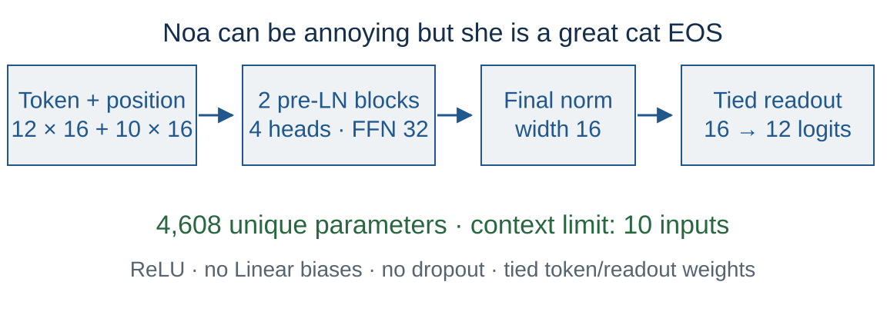
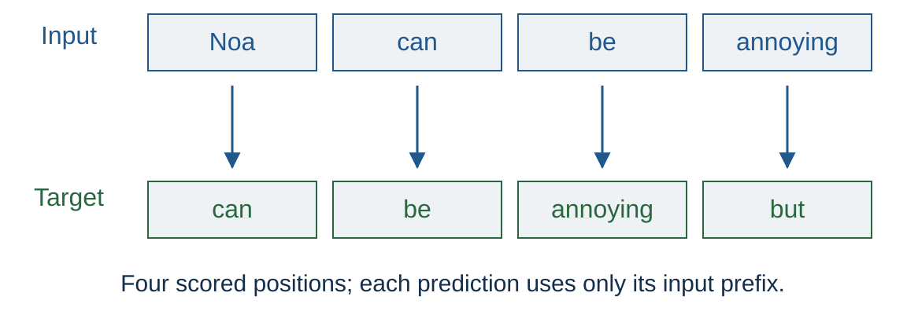
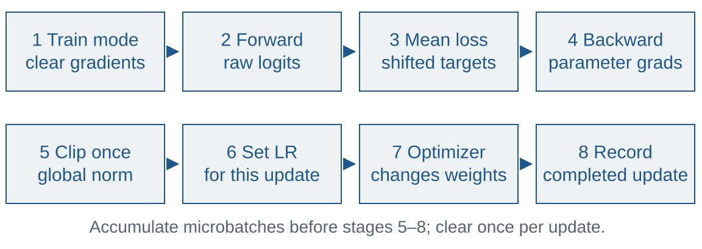
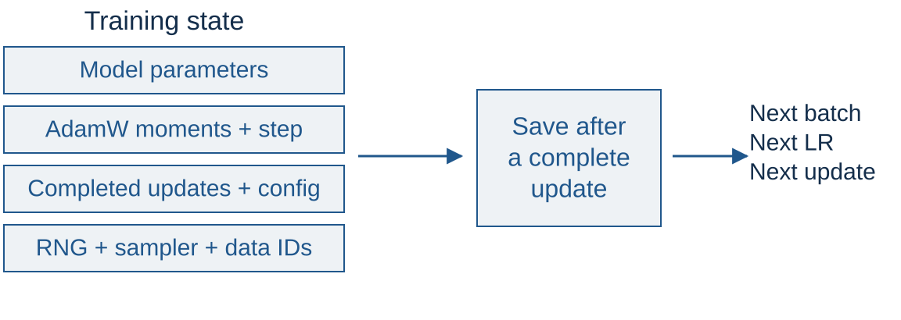
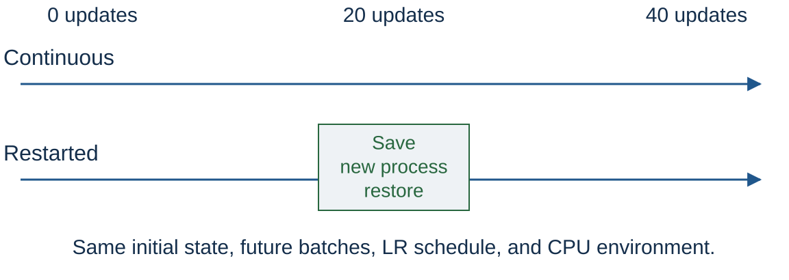
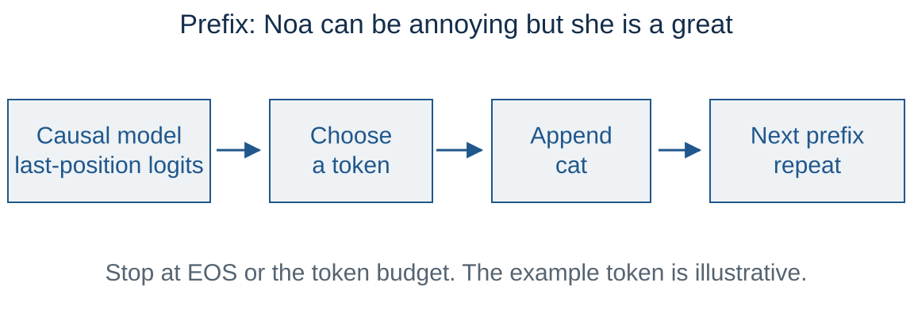
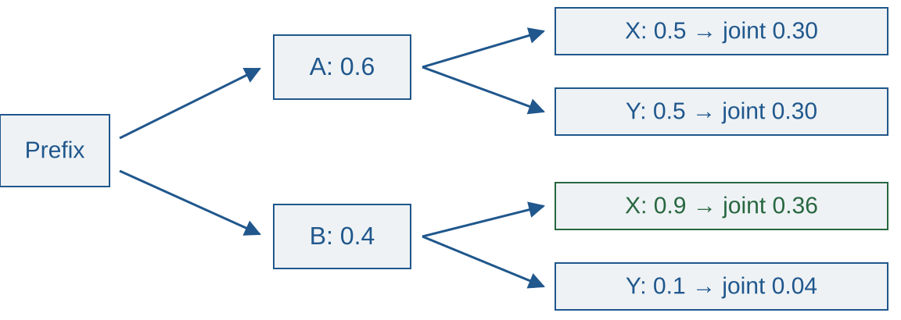

<!-- .slide: class="title-slide" id="title" -->

<p class="eyebrow">CS40008.01</p>

# 预训练与解码实践

<p class="subtitle">第 06 讲 – 自然语言处理与大语言模型</p>

<p class="byline">Baojian Zhou<br>数据科学学院<br>复旦大学<br>2026 年 10 月 14 日</p>

Note:
第一课时的六分钟开场组（第 1–6 页）。三个 45 分钟课时，包括六个不计分练习；今天没有小测验。学生将追踪一次优化器更新，解读损失和梯度记录，重启一次运行，并比较解码策略。默认练习本链接打开唯一的配套 practice.ipynb；E01–E06 与课件顺序一致。所有必做示例均可使用提供的玩具数据在 CPU 上运行。52 页课件库中有五页可选附录（第 47–51 页）；结束检查后跳转至参考资料。改编自教师 2026 年 4 月 16 日的 GPT 课件，源文件 SHA 和页面映射见 teaching-plan.md。所有学生的练习要求相同。

---

<!-- .slide: id="learning-objectives" -->

## 学习目标

**什么证据表明训练运行正常？**

- 构造错位批次并追踪一次优化器更新。
- 解读损失曲线、学习率和梯度范数。
- 检查重启后的运行能否重现后续更新。
- 比较贪心、温度和 top-p 解码。

Note:
在六分钟开场组中安排 30 秒。沿用第 05 讲的学习目标布局：中心问题在四个具体目标之前。默认练习本中的 E01–E06 按顺序检查这些目标。所有练习均不计分，并使用提供的 CPU 示例。

---

<!-- .slide: class="outline-slide" id="outline-training" -->

## 大纲

<ul class="outline-topics">
<li aria-current="step">批次与优化器更新</li>
<li>训练证据与检查点</li>
<li>生成与解码</li>
</ul>

<p class="caption">第一课时 · 错位目标、AdamW 和梯度累积</p>

Note:
在六分钟开场组中安排 30 秒。每个课时边界复用这份大纲，只突出当前主题。E01 构造批次；E02 统计词元和优化器更新次数。

---

<!-- .slide: id="pretraining-and-use" -->

## 参数何时改变？

| 活动 | 模型接收 | 更新参数？ |
| --- | --- | --- |
| 预训练 | 语料示例与目标 | 是 |
| 微调 | 任务或指令示例 | 是 |
| 上下文学习 | 提示词中的示例 | 否 |

**今天：**训练小型因果语言模型，保存模型，并用它生成文本。

Note:
继续开场组。询问学生梯度计算发生在哪里。普通的上下文推理中，示例会影响激活值和预测，权重保持不变。预训练与微调可以共享下一词元目标，但数据与目的不同。简要回顾 GPT 历史：GPT-1 研究生成式预训练后接监督微调；GPT-2 研究通过语言模型提示完成任务；GPT-3 强调少样本上下文学习评估。这是历史背景，不是当前模型的排名。来源：春季幻灯片第 11–18 和 43–63 页。GPT-1 §§3.1–3.2：https://cdn.openai.com/research-covers/language-unsupervised/language_understanding_paper.pdf。GPT-3 §2.1：https://arxiv.org/abs/2005.14165。阅读材料见可选历史页。

---

<!-- .slide: id="noa-model" -->

## 继续使用 Noa 解码器



<p class="caption">与第 05 讲相同的教学架构；显示的每个单词都是一个玩具词元。</p>

Note:
回顾上一讲，但不重新推导注意力。词表 ID 0–11 分别为 Noa、can、be、annoying、but、she、is、a、great、cat、friend、EOS。输入最多十个位置。宽度为 16，四个头各宽 4，两个 pre-LN 块，ReLU FFN 宽度为 32，带仿射变换的 LayerNorm epsilon 为 1e-5，另有最终 LayerNorm；Linear 不带偏置，也没有 dropout。两个块共贡献 4224 个参数；词元嵌入 192、位置嵌入 160、最终归一化 32，总计 4608。输出复用词元嵌入的 Parameter。这个小型架构有意区别于 GPT-2 的 GELU 和四倍宽 FFN。来源：../lecture-05/teaching-plan.md 及其中 decoder-model 练习本单元格。该示意图为本讲新绘制。

---

<!-- .slide: id="train-and-generate" -->

## 相同模型，不同循环

| 训练 | 生成 |
| --- | --- |
| 已观察序列提供目标 | 生成的词元扩展前缀 |
| 一次前向计算对多个位置评分 | 使用最后位置的 logits |
| 反向传播并更新权重 | 选择词元；权重保持不变 |

两者都遵循因果规则：位置 $t$ 可以看到截至 $t$ 的输入。

Note:
结束六分钟开场组。训练并行计算多个条件预测，但这些预测在统计上并非相互独立。每个目标都紧随对应的输入位置。教师强制提供已观察到的较早词元；生成使用此前选出的词元。仅有正确的因果掩码并不会自动产生错位目标。来源：春季幻灯片第 11–12、20–24 页；GPT-2 报告 §2.1，https://cdn.openai.com/better-language-models/language_models_are_unsupervised_multitask_learners.pdf。获得检查点后将重新讨论生成循环。

---

<!-- .slide: id="shifted-batches" -->

## 哪个词元是目标？



<p class="caption">一个 $(B,T+1)$ 窗口生成形状为 $(B,T)$ 的输入和目标数组。</p>

Note:
第 7–8 页共七分钟：约三分钟讲解，四分钟完成 E01。箭头表示预测目标，不是注意力边。位置 3 的输入 annoying 可以使用 Noa、can、be 和 annoying，不能使用其目标 but。该图以第 05 讲 Noa 约定重新绘制春季第 12 页的机制。我们用五个词元对四次转移评分。EOS 作为目标出现时是普通的评分词元。在这个玩具演示中，窗口保持在文档内部；A2 发布协议规定了自己的数据流约定。

---

<!-- .slide: class="exercise" id="exercise-01" -->

<p class="exercise-meta">练习 E01 · 4 分钟 · 练习本 E01</p>

## 构造批次

```python
windows = [[0, 1, 2, 3, 4],
           [4, 5, 6, 7, 8]]
```

每个目标都参与评分。写出输入数组、目标数组以及损失项数量。

<div class="answer fragment">
<p>输入：<code>[[0,1,2,3], [4,5,6,7]]</code><br>目标：<code>[[1,2,3,4], [5,6,7,8]]</code></p>
<p>$B=2$、$T=4$：预测 <strong>八个</strong>词元。</p>
</div>

Note:
预期回答为两个数组和八个位置。常见错误：两次使用相同数组；每个窗口计算五次预测；乘以词表大小。每行的最后一个目标在该行中没有自己的输入列。窗口只是 Noa 词表中的片段，而非新数据集。学生完成预测后，练习本展示词表 ID 和切片操作。在可执行代码中展平切片数组时要检查张量是否连续。本练习不计分。

---

<!-- .slide: id="mean-token-loss" -->

## 对预测词元求平均

$$L=-\frac{1}{BT}\sum_{b=1}^{B}\sum_{t=1}^{T}
\log p_\theta(y_{b,t}\mid x_{b,1:t})$$

- 将**原始 logits** 传给交叉熵。
- 对参与评分的目标位置的损失求平均。
- 报告约定：这里使用**每词元 nats**。

<p class="caption">此批次没有填充。若忽略部分目标，应除以实际评分数量。</p>

Note:
第 9–11 页共七分钟。为便于阅读，这个方程中的 t 从 1 开始；代码中的数组索引仍从 0 开始。PyTorch cross_entropy 执行 log-softmax 和目标查找；先应用 softmax 会改变计算。词表大小决定 logits 轴，而不是参与平均的观测数量。本页假设所有 B×T 目标均有效。不同词元化方式或评分位置会改变数值的含义。这里回顾第 03 讲的原始 logits 损失和第 05 讲的错位目标。公式和玩具批次由课程编写。

---

<!-- .slide: id="one-update" -->

## 追踪一次优化器更新



<p class="caption">梯度计算完成后，优化器才改变参数。</p>

Note:
先从左到右看第一行，再看第二行。清除梯度可防止意外累积。调用 optimizer.step 之前为本次更新选择学习率；该步骤成功后记录已完成的更新次数。提供的 CPU float32 玩具示例没有梯度缩放器；若使用缩放器，裁剪前需要先取消缩放，见可选附录。简短训练工具专为本次不计分课程提供，使用自己的数据和接口。来源：PyTorch AdamW API，https://docs.pytorch.org/docs/2.14/generated/torch.optim.AdamW.html；裁剪 API，https://docs.pytorch.org/docs/2.14/generated/torch.nn.utils.clip_grad_norm_.html。

---

<!-- .slide: id="update-checks" -->

## 计算是否到达参数？

```python
loss.backward()
print(torch.isfinite(loss).item())
print(model.token_embedding.weight.grad.norm())
before = model.token_embedding.weight.detach().clone()
optimizer.step()
print((model.token_embedding.weight - before).abs().max())
```

`model.eval()` 改变模块行为；`no_grad()` 禁用梯度记录。

Note:
结束七分钟教学组。这些检查只提供局部证据，不能完整证明训练正确。只能在 backward 后检查梯度；如果某些参数未被使用，没有梯度也可能是正常的。仅有非零参数变化可能包含优化器的权重衰减。不要在 backward 前对损失调用 detach。eval() 对 dropout 或批归一化有影响；这个 Noa 模型两者都没有，但可复用代码仍应正确处理 train/eval 行为。提供的辅助函数检查有限损失，并在梯度范数非有限时抛出异常。模型状态和优化器状态是不同对象。

---

<!-- .slide: id="adamw-state" -->

## 为什么优化器会记住历史？

$$m_t=\beta_1m_{t-1}+(1-\beta_1)g_t$$

$$v_t=\beta_2v_{t-1}+(1-\beta_2)g_t^2$$

| 状态 | 作用 |
| --- | --- |
| $m_t$ | 平滑后的梯度方向 |
| $v_t$ | 平滑后的梯度平方尺度 |

Note:
第 12–13 页共十分钟。这些是逐元素递推关系；这里 t 统计优化器更新次数。完整更新使用偏差修正后的动量和 epsilon，可在可选页 adamw-equations 中查看。与不带动量的普通 SGD 不同，AdamW 的下一次更新既依赖当前梯度，也依赖历史。这说明后面为什么要保存优化器状态。可以口头使用标量序列 +1、+1、-1：当 beta1=0.9 且 m 初始为零时，m 依次为 0.1、0.19、0.071，最后的平滑方向仍为正。这些是教学数值，不是运行中测得的梯度。来源：https://docs.pytorch.org/docs/2.14/generated/torch.optim.AdamW.html 和 Loshchilov & Hutter，https://arxiv.org/abs/1711.05101。

---

<!-- .slide: id="weight-decay" -->

## 将权重衰减与自适应更新分开

$$\theta_t=(1-\eta_t\lambda)\theta_{t-1}
-\eta_t\frac{\widehat m_t}{\sqrt{\widehat v_t}+\epsilon}$$

| 运行 | 权重衰减设置 |
| --- | --- |
| 今天的 Noa 实验 | 所有参数的 $\lambda=0$ |
| 使用衰减的实验 | 记录哪些参数接受衰减 |

<p class="caption">对于 Adam，在损失中加入 L2 项一般会产生不同的更新。</p>

Note:
结束十分钟的优化器教学组。这里两项使用相同学习率。解耦的权重衰减不会通过正则化梯度进入动量估计。玩具示例使用零衰减，以保留第 05 讲的拟合测试设置并单独考察检查点行为；调用 AdamW 不意味着衰减系数非零。真实运行需要明确规定偏置、归一化参数和嵌入的策略。绑定权重是同一个 Parameter，不得重复加入。不要将某种参数分组约定说成普遍最优。来源：Loshchilov & Hutter §2，https://arxiv.org/abs/1711.05101；PyTorch AdamW 算法。

---

<!-- .slide: id="accumulation" -->

## 一次更新前处理多少词元？

$$\text{tokens per update}=B\times T\times K$$

```python
optimizer.zero_grad(set_to_none=True)
for microbatch in two_equal_microbatches:
    loss = mean_loss(microbatch)
    (loss / 2).backward()
clip_grad_norm_(model.parameters(), max_norm=1.0)
optimizer.step()
```

<p class="caption">单进程；$K=2$ 个等大小微批次；每个位置都参与评分。</p>

Note:
第 14–15 页共九分钟，其中 E02 占四分钟。这是示意伪代码：mean_loss 和微批次集合表示提供的数据操作。独立测试将累积梯度与全批次线性模型进行比较。只有当各微批次参与评分的词元数相同、其均值权重相等时，除以 K 才正确；数量不同时应按实际目标数加权。所有微批次完成后再裁剪，每次优化器更新只推进一次学习率计划。中间调用 backward 不会改变优化器状态。特定协议下，分布式进程数会带来另一个因子；这超出今天的单进程计算范围。

---

<!-- .slide: class="exercise" id="exercise-02" -->

<p class="exercise-meta">练习 E02 · 4 分钟 · 练习本 E02</p>

## 统计词元与更新次数

微批次大小 $B=4$，长度 $T=8$，累积次数 $K=2$。

单进程完成 **32 次优化器更新**，没有填充。

1. 一次更新有多少词元参与？
2. 总共处理多少微批次和词元？

<div class="answer fragment">
<p>$4\times8\times2=64$ 词元／更新。<br>$32\times2=64$ 个微批次；$32\times64=2{,}048$ 个词元。</p>
</div>

Note:
检查每个乘积的单位。微批次不等同于优化器更新；重复采样也不意味着这些是 2048 个不重复的语料词元。轮次数需要定义如何遍历数据；后面的随机文档玩具示例使用更新次数和处理过的词元数描述。所有学生完成相同的不计分计算。练习本 E02 重复计算并核对全批次与累积梯度。

---

<!-- .slide: id="run-record" -->

## 让运行可检查

| 记录 | 示例或单位 |
| --- | --- |
| 配置与输入 | 代码版本、数据／词元化器哈希、随机种子 |
| 已完成的工作 | 优化器更新次数、处理的词元数 |
| 优化信号 | 学习率、每词元 nats 损失、裁剪前范数 |
| 成本 | 经过的秒数、进程峰值内存 |

**将设置与测量结果保存在一起。**

Note:
第一课时最后六分钟，包括提问和转换缓冲。在 assets/evidence-summary.json 中展示简明记录，无需读完全部内容。重启实验使用固定长度文档，而开发集实验从不同长度的文档中均匀采样：应报告其实际词元数。说明计时是否包含导入、检查点 I/O 和子进程启动。如果没有批次大小、上下文、设备和测量边界，单个吞吐量数字很难解释。课程预训练 issue #272 和 #279 将这一记录习惯扩展到更大实验。本页后休息。

---

<!-- .slide: class="outline-slide" id="outline-evidence" -->

## 大纲

<ul class="outline-topics">
<li>批次与优化器更新</li>
<li aria-current="step">训练证据与检查点</li>
<li>生成与解码</li>
</ul>

<p class="caption">第二课时 · 学习率计划、裁剪、验证与重启</p>

Note:
第二课时七分钟开场组中安排 30 秒。E03 检查学习率端点和裁剪；E04 比较连续运行、新进程重启和重置优化器的对照。大纲的主题顺序与第一、第三课时相同。

---

<!-- .slide: id="lr-schedule" -->

## 在训练中改变步长

<div class="plot" data-plotly="assets/learning-rate.json" role="img" aria-label="Forty-update learning-rate schedule: four linear warmup updates followed by cosine decay from 0.02 to 0.002."></div>

<p class="caption">重启演示：40 次更新、4 次预热更新、最大值 0.02、最小值 0.002。</p>

Note:
第二课时开场七分钟介绍第 17–19 页的大纲和学习率计划。线性预热提高初期步长，余弦衰减在后期平滑减小步长。这些是实验设置，并不保证优化稳定。图根据给定计划计算，而非拟合观测曲线。重启应从下一个计划位置继续。仔细看横轴：它是将使用该学习率的更新的零起始索引。当前 A2 约定：https://github.com/baojian/llm-26-fall/blob/main/assignments/a2-build-a-small-lm/README.md#3-part-2--what-evidence-shows-training-works-30-points。

---

<!-- .slide: id="schedule-indexing" -->

## 每次更新使用哪个学习率？

$$\eta_s=\eta_{\max}\frac{s+1}{w}\quad(s<w)$$

$$q=\frac{s-w+1}{N-w},\qquad
\eta_s=\eta_{\min}+\frac{\eta_{\max}-\eta_{\min}}{2}(1+\cos\pi q)$$

| 更新索引 | 含义 |
| --- | --- |
| $w-1$ | 预热最大值 |
| $N-1$ | 最后一次更新，最小学习率 |

Note:
结束七分钟开场组。余弦公式适用于 s>=w；这里要求 0<w<N。此约定有意在最后一次实际更新时达到最小值，其他库对端点的定义可能不同。保存已完成的更新次数，因此完成 k 步后的检查点下一次使用 eta_k。旧版春季动态学习率脚本的端点约定不同，不能未经修改直接用于此协议。下一个练习使用更小的数字。先让学生代入 s=N-1，再进行算术计算。

---

<!-- .slide: id="gradient-clipping" -->

## 限制一个全局梯度范数

$$r=\sqrt{\sum_j\|g_j\|_2^2},\qquad
g_j\leftarrow g_j\min\left(1,\frac{c}{r}\right)$$

- 将所有参数的梯度合并为一个范数。
- 记录裁剪**之前**的 $r$。
- 在 backward 后、优化器更新前裁剪。

<p class="caption">此理想公式假设 $r>0$。数值实现会处理零值并使用 epsilon。</p>

Note:
三分钟。裁剪会同时缩放所有参与的梯度，保持其相对方向；它不是分别裁剪各坐标，也不直接限制 AdamW 参数更新的范数，因为后者还取决于动量和衰减。PyTorch clip_grad_norm_ 返回裁剪前的总范数。我们的辅助函数启用了 error_if_nonfinite。裁剪不能修复错误损失或泄漏的目标。API 来源：https://docs.pytorch.org/docs/2.14/generated/torch.nn.utils.clip_grad_norm_.html。若梯度经过缩放，应先取消缩放；见可选页 precision-preview。

---

<!-- .slide: class="exercise" id="exercise-03" -->

<p class="exercise-meta">练习 E03 · 5 分钟 · 练习本 E03</p>

## 学习率与裁剪

$N=8$、$w=2$、$\eta_{\max}=0.001$、$\eta_{\min}=0.0001$。

求零起始更新索引 **0、1、7** 对应的学习率。

然后将梯度 $(3,4)$ 的全局范数裁剪到 **1**。

<div class="answer fragment">
<p>学习率：<strong>0.0005、0.001、0.0001</strong>。<br>原始范数 $5$；裁剪后向量 $(0.6,0.8)$。</p>
</div>

Note:
预期算术结果遵循前面的公式。裁剪答案使用不含数值 epsilon 的理想公式。常见错误：预热从零而不是 eta_max/w 开始；余弦最小值晚一次更新才达到；将每个坐标分别裁剪到 1。练习本单元格计算学习率计划并以数值方式比较裁剪后的范数。此练习不计分。独立测试还检查完整下降段、无效边界，以及训练工具是否在修改梯度前报告范数。

---

<!-- .slide: id="tiny-fit" -->

## 先拟合一个已知的微型问题

<div class="plot" data-plotly="assets/tiny-fit.json" role="img" aria-label="Measured mean NLL of the two-document Noa fitting run over 200 updates, compared with the analytic floor log(2)/10."></div>

<p class="caption">实测最终 NLL：0.069822。双文档的下界为 $\ln(2)/10\approx0.069315$。</p>

Note:
第 22–24 页共七分钟。这里重现第 05 讲的 pre-LN 拟合测试：两个文档只在 great 之后的 cat/friend 不同。二十个目标中两个有歧义，贡献 2 ln(2)/20；其余确定性目标的损失可以趋近于零。下界是下确界，不保证有限权重即可达到。CPU float32、种子 7、B=2、T=10、200 次全批次更新、AdamW 学习率 .02、betas .9/.999、epsilon 1e-8、零衰减、无裁剪、无学习率计划、无 dropout。共处理 4000 个目标词元。这些设置有意区别于 40 次更新的重启实验。这里没有开发集。A2 的微型测试有不同的下界。来源：assets/README.md 和 evidence-summary.json。纵轴采用对数刻度，包含每次记录的更新。

---

<!-- .slide: id="held-out-data" -->

## 评估未见过的文档

| 玩具划分 | 文档数 | 每次评估的目标词元数 |
| --- | ---: | ---: |
| 训练集 | 16 | 82 |
| 开发集 | 8 | 48 |

在创建窗口**之前**划分文档。冻结词元化器和划分。

使用评估模式并禁用梯度记录；之后恢复训练模式。

Note:
这是教师另行编写的玩具语料，使用相同的 12 词元词表和上下文限制。两个划分中的完整文档字符串不重复，但词和部分前缀有意重叠：文档不重复并不意味着没有共同语言。每个文档完整使用，包含 EOS，不含 BOS、填充或跨文档窗口。训练每次更新均匀采样一个文档，因此随机目标对文档等权；报告的完整划分评估对目标词元等权。模型和优化设置记录在来源说明中。结论只适用于这些模板，不能证明一般语言能力。本页介绍划分纪律；更广泛的数据污染留待第 08 讲。

---

<!-- .slide: id="validation-loss" -->

## 对每个评分词元等权

| 评估块 | 目标数 | 平均 NLL |
| --- | ---: | ---: |
| A | 8 | 1.0 |
| B | 2 | 3.0 |

$$L_{\mathrm{dev}}=\frac{8(1)+2(3)}{10}=1.4,\qquad
\mathrm{PPL}=e^{L_{\mathrm{dev}}}$$

<p class="caption">只有词元化和目标评分约定相兼容时才比较困惑度。</p>

Note:
结束七分钟的拟合／评估教学组。这两块是手算示例，不是 Noa 运行的测量值。将 1 和 3 等权平均会得到 2，使较小块的权重过高。应累加词元损失并除以实际评分总数。自然对数得到 exp(NLL)；使用以 2 为底的对数时，对交叉熵取 2 的幂。较低的留出集损失意味着在该特定评估分布上得分更好，并不能证明所有下游任务的准确率都更高。来源：春季第 74 页和第 02 讲的困惑度定义。口头揭示方程之前请学生预测 1.4；不增加新的练习本编号。

---

<!-- .slide: id="training-curves" -->

## 一起解读训练和开发曲线

<div class="plot" data-plotly="assets/development-loss.json" role="img" aria-label="Measured token-weighted training and development NLL on the separate 16-document and 8-document toy splits over 200 updates."></div>

<p class="caption">200 次更新时：训练 0.5153、开发 1.4027 nats/token。每 10 次更新评估完整划分。</p>

Note:
第 25–26 页共六分钟。这些是测量值，不是示意性的过拟合曲线。文档均匀采样、B=1、长度可变；这次固定种子运行的 200 次更新处理 1021 个词元。使用相同小型架构，AdamW 最大学习率 .02、20 次预热更新、最小比例 .1、裁剪 1、零衰减、采样器种子 17。图展示完整记录区间，包括波动。每个检查点的两条曲线都是词元加权的完整划分评估，而不是平滑后的微批次训练损失。配套练习本将损失、学习率和裁剪前范数放在对齐的更新轴上。独立梯度范数图链接见选读。训练／开发差距提示我们检查拟合与分布，但本身不能确定唯一原因。

---

<!-- .slide: id="diagnostic-controls" -->

## 选择下一项检查

| 观察结果 | 有用的检查 |
| --- | --- |
| 微型测试无法拟合 | 检查目标、掩码、梯度和更新 |
| 损失变为非有限值 | 检查第一个异常批次、学习率和范数 |
| 开发集得分好得不合理 | 审核划分 ID 和预处理 |
| 训练改善而开发恶化 | 重复固定评估；比较检查点 |

Note:
结束六分钟的曲线解读教学组。每一行都给出检查，而非单凭曲线确立的诊断。比较运行时一次只改变一个因素。降低学习率可能有助于缓解不稳定，但不能修复目标泄漏。在假设问题来自梯度之前，先检查最早出现的非有限值。这个玩具示例中的重复完整划分评估应具有确定性，评估不应从训练采样器取样。练习本为 E05 提供三个标明为示意的案例；讨论时保留该标签。接下来介绍如何通过检查点恢复使比较更可信。

---

<!-- .slide: id="checkpoint-state" -->

## 重启后必须保留什么？



<p class="caption">权重支持预测；继续同一次运行还需要其训练状态。</p>

Note:
第 27–29 页共七分钟。实验记录模型权重、优化器动量和计数器、已完成更新数和词元数、配置、数据／词表哈希、Python 和 CPU torch 随机数状态，以及专用采样器的随机数状态。我们的玩具模型没有 dropout，但随机文档采样使随机数状态恢复的效果可观察。此 CPU 协议没有使用加速器随机数状态；扩展到 GPU 时必须保存实际使用的状态。序列化检查点在一次完整更新后写入，不包含部分累积梯度。PyTorch 通用检查点教程：https://docs.pytorch.org/tutorials/beginner/saving_loading_models.html#saving-loading-a-general-checkpoint-for-inference-and-or-resuming-training。随机数状态和数据身份检查是课程额外规定。

---

<!-- .slide: id="restart-order" -->

## 恢复下一次更新

1. 构造兼容的模型和优化器对象。
2. 验证配置、数据身份和软件／设备假设。
3. 加载模型、优化器和已完成更新次数。
4. **在抽取下一批数据之前**恢复随机数状态。
5. 使用下一次更新的学习率并继续。

<p class="caption">完成 20 次更新后的检查点从零起始更新索引 20 恢复。</p>

Note:
构造函数可能消耗随机数，因此在构造和加载后、继续运行之前立即恢复随机数状态。采样器拥有自己的 torch.Generator 和状态。我们的检查点身份验证包括 torch 版本、CPU float32、两个线程、模型标识、配置以及数据／词表哈希。安全加载状态字典使用 weights_only=True。本教程是同环境下的续训测试，不承诺跨设备、PyTorch 版本或数据顺序变化时逐位相等。代码会在应用模型状态前拒绝不兼容的身份。教学实现独立于计分的 A2 接口。

---

<!-- .slide: id="resume-comparison" -->

## 比较连续运行与恢复运行



<p class="caption">对照：恢复权重、批次顺序和学习率计划，但重置 AdamW 状态。</p>

Note:
结束七分钟的检查点讲解。两条路径使用相同初始化及种子为 17 的专用采样器。批次大小 1、十个评分位置、40 次更新、400 个目标词元；模型种子 7。最大学习率 .02、预热 4、最小比例 .1、裁剪 1、衰减为零。每个片段均在新的操作系统进程中运行。比较批次 ID、学习率、后续损失及所有最终状态字典张量。仅恢复权重的对照保留未来批次、已完成更新数和学习率计划，从而单独考察优化器历史；它不会重置整个实验。由于改变后的优化器尚未执行更新，第一次前向损失仍可能一致。

---

<!-- .slide: class="exercise" id="exercise-04" -->

<p class="exercise-meta">练习 E04 · 6 分钟 · 练习本 E04</p>

## 检查重启结果

```python
from resume_demo import run_comparison
report = run_comparison()
report["comparisons"]
```

哪些字段必须一致？预测仅重置 AdamW 历史会发生什么。

<div class="answer fragment">
<p>检查后续批次、学习率、损失和最终参数。<br>下一次更新产生差异之前，第一次前向损失可以一致。</p>
</div>

Note:
练习本设置会导入 assets 目录，因此所示命令可以在那里运行。学生只需检查检查点系统，不必实现它。运行器创建本地临时文件、启动四个子进程、比较结果并删除自己的临时目录。如果安装或进程启动会占用活动时间，可使用提供的预计算摘要。两种比较的批次和学习率都应相同。完整恢复可重现轨迹；重置优化器状态会改变下一次更新，因此要检查第二次前向损失和最终参数，而不只看立即得到的第一次前向损失。独立测试运行相同对照。运行时间和测量边界见 assets/README.md；不同平台耗时不同。

---

<!-- .slide: id="resume-evidence" -->

## 一致性证明了什么？

| 与连续运行比较 | 完整重启 | 重置 AdamW |
| --- | ---: | ---: |
| 后续批次与学习率 | 相同 | 相同 |
| 第一次前向损失差异 | 0 | 0 |
| 第二次前向损失差异 | 0 | 0.02846 |
| 最大最终参数差异 | 0 | 0.12780 |

<p class="caption">实测 CPU float32 运行；参数绝对容差 $10^{-7}$，相对容差为零。</p>

Note:
第二课时最后四分钟，包括提问和转换缓冲。完整重启在所测试环境中精确一致。对照组的第一次损失相同，是因为两个模型从相同的已恢复权重开始；AdamW 历史在执行下一次更新时才产生影响。这里报告的是存储参数张量中的最大绝对差异，不是损失差异。检查了所有后续批次和学习率，而不只是第一次。报告为零并不证明跨硬件相等。来源和版本见 assets/evidence-summary.json。询问还有哪些设置会使所称的一致性失效，例如数据改变、模型不同或计划索引发生变化。本页后休息。

---

<!-- .slide: class="outline-slide" id="outline-decoding" -->

## 大纲

<ul class="outline-topics">
<li>批次与优化器更新</li>
<li>训练证据与检查点</li>
<li aria-current="step">生成与解码</li>
</ul>

<p class="caption">第三课时 · 诊断、贪心选择与采样</p>

Note:
在 E05 前做简短过渡。大纲和 E05 讲评共用一分钟，给练习保留五分钟。随后冻结模型并改变解码策略。互动演示之前用 E06 检查 top-p。

---

<!-- .slide: class="exercise" id="exercise-05" -->

<p class="exercise-meta">练习 E05 · 5 分钟 · 练习本 E05</p>

## 诊断证据

<p class="caption">示意性诊断案例</p>

| 记录 | 观察结果 |
| --- | --- |
| A | 训练损失下降；固定开发集损失上升 |
| B | 梯度范数出现尖峰，随后损失变为非有限值 |
| C | 开发损失极小；训练／开发文档 ID 重叠 |

分别提出**一个假设和一项后续检查**。

Note:
这个五分钟回顾练习紧接大纲。大纲与下一页讲评共用一分钟。A：可能是过拟合或训练／开发数据不匹配；重复固定评估并检查示例和检查点。B：可能是优化或数值不稳定；检查第一个异常批次、学习率和范数，再测试受控的较低学习率运行。C：重叠 ID 直接提示泄漏；先审核划分并重建不重叠评估，再声称具有泛化能力。其他有充分依据的假设也可接受。练习本绘制带标签的示意性 A/B 曲线，标记非有限点而不是用零代替，并列出 C 的重叠 ID。这些曲线是人为构造的教学数据。详细答案位于练习本问题之后。

---

<!-- .slide: id="evidence-limits" -->

## 区分三类证据

| 证据 | 支持什么结论 |
| --- | --- |
| 已知微型测试能够拟合 | 有用的实现合理性检查 |
| 留出集 NLL 改善 | 在该评估集上预测更好 |
| 受控生成 | 在给定设置下观察到的行为 |

仅有低训练损失不能证明后两项。

Note:
在开场六分钟内简短讲评。这些都不是完整保证：拟合测试可能漏掉错误，留出集覆盖可能有限，少量样本也可能缺乏代表性。证据应与论断相称。现在冻结一个检查点，只改变解码策略。同一个模型无需额外训练也能生成不同序列。这连接第二、第三课时，不引入新模型或数据集。

---

<!-- .slide: id="generation-loop" -->

## 追加一个选中的词元



<p class="caption">使用最后一个输入位置的 logits；模型权重保持不变。</p>

Note:
第 35–37 页共八分钟。前缀有九个词，以 great 结尾。在拟合测试中，下一个词元可以是 cat 或 friend；图中的 cat 是示意示例。所有较早上下文都是已观察或先前生成的内容。每次迭代按规定策略在必要时裁剪、从零开始分配学习到的位置、取得最后位置的 logits、选择并追加一个词元，然后检查停止条件。CPU 练习本在拟合模型上运行这个循环。KV 缓存留待第 13 讲。机制来源：春季第 20–24 页。

---

<!-- .slide: id="greedy" -->

## 选择概率最大的词元

| 词元 | A | B | C | D |
| --- | ---: | ---: | ---: | ---: |
| 概率 | 0.4 | 0.3 | 0.2 | 0.1 |

$$\text{greedy token}=\arg\max_i z_i=A$$

使用固定的平局规则：选择词元 ID 最小者。

<p class="caption">贪心选择最大值；采样从概率分布中抽取。</p>

Note:
logits 的最大值索引与 softmax 概率的最大值索引一致。这个玩具示例没有平局，但确定性实现应规定平局规则。纠正春季第 21 页的措辞：它将方法称为贪心，却描述了随机抽取。贪心没有采样随机性，但模型执行仍需指定评估环境。最大化下一词元概率是局部决策。下一页给出完整的两步反例，说明它不保证全局序列概率最大。

---

<!-- .slide: id="greedy-sequence" -->

## 局部选择可能错过最佳序列



<p class="caption">恰好生成两个词元：贪心得到 0.30；B→X 序列的概率为 0.36。</p>

Note:
结束八分钟的贪心教学组。第一个词元之后的分支标签是条件概率，因此完整路径上的概率要相乘。每个分支分布之和为一，四条路径的联合概率之和也为一。贪心在第一步选择 A，因为 .6>.4。A 之后两个并列续写的联合概率均为 .30；B 后接 X 的概率为 .36。示例讨论固定长度下的序列概率，没有 EOS；文本质量是另一个标准。这是新计算的例子，灵感来自春季第 24 页的搜索树教学方法。可选 beam-search 页面讨论保留多个部分序列，并不声称存在普适的质量保证。

---

<!-- .slide: id="temperature" -->

## 改变分布的集中程度

<div class="plot" data-plotly="assets/temperature.json" role="img" aria-label="Toy token probabilities at temperatures 0.5, 1, and 2 using fixed logits log(0.4,0.3,0.2,0.1)."></div>

<p class="caption">$p_i=\operatorname{softmax}(z/\tau)_i$，其中 $\tau>0$。正温度保持最大值索引不变。</p>

Note:
第 38–39 页共五分钟。较小的正 tau 使概率质量更集中，较大的 tau 使其更分散。图中的柱形通过将 [.4,.3,.2,.1] 的自然对数作为固定 logits 计算得到；没有为此图训练模型。温度改变采样概率，但不改变哪个有限 logit 最大。贪心是单独实现的：不要试图通过除以零得到贪心。当 tau 趋近零时极限仍可能有并列最大值，而我们的贪心规则选择最小 ID。比较温度时保持 logits 固定。

---

<!-- .slide: id="top-k-and-top-p" -->

## 固定候选数量，或保留概率质量

| 排序后的分布 | Top-k，$k=2$ | Top-p，$p=0.6$ |
| --- | --- | --- |
| $(0.80,0.10,0.06,0.04)$ | 前两个词元 | 第一个词元 |
| $(0.40,0.30,0.20,0.10)$ | 前两个词元 | 前两个词元 |

Top-p 根据当前分布自适应调整候选数量。

Note:
结束五分钟的温度／过滤教学组。Top-k 保留固定数量；top-p 保留达到指定累积概率的最短排序前缀。解释保留的概率之前，两者都需要重新归一化。先应用温度，使阈值作用于实际采样的分布。这些是便于手算比较的人为归一化示例。这里只将 top-k 作为对春季课件的衔接；学生在 A2 中实现发布的 top-p 协议。来源：春季第 32–39 页；Holtzman et al.，核采样，https://arxiv.org/abs/1904.09751。

---

<!-- .slide: id="nucleus-sampling" -->

## 保留达到 p 的最短前缀

| 词元 | 概率 | 累积概率质量 |
| --- | ---: | ---: |
| A | 0.40 | 0.40 |
| B | 0.30 | **0.70** |
| C | 0.20 | 0.90 |
| D | 0.10 | 1.00 |

当 $p=0.6$ 时，包含跨越阈值的词元 **B**。

Note:
第 40–41 页共八分钟，其中 E06 占五分钟。按概率递减排序，平局时词元 ID 较小者在前。找到第一个累积概率至少为 p 的项；包含该项及其之前的所有项，并重新归一化原始概率。当 p=1 时保留所有词元。对温度调整后的概率应用阈值。常见错误是删除跨越阈值的词元，这里将只保留 A，使实际保留质量为 .4，无法达到 .6。在累积值恰好等于阈值（如 .5 和 p=.5）时，第一个达到阈值的前缀即可。这些语义与当前公开 A2 讲义一致。来源：Holtzman et al. 及发布的课程约定。

---

<!-- .slide: class="exercise" id="exercise-06" -->

<p class="exercise-meta">练习 E06 · 5 分钟 · 练习本 E06</p>

## 计算核集合

温度调整后的概率为 $(0.4,0.3,0.2,0.1)$，使用 top-p $=0.6$。

1. 保留哪些词元？
2. 重新归一化后的概率是多少？
3. 贪心会选择哪个词元？

<div class="answer fragment">
<p>保留 A 和 B；保留的概率质量为 $0.7$。<br>新分布：$(4/7,3/7,0,0)$。贪心选择 A。</p>
</div>

Note:
分母是保留的概率质量 .7，而不是阈值 .6。采样现在可以选择 A 或 B；按照给定规则，贪心确定性地选择 A。练习本检查跨越阈值词元的包含、精确平局、p=1、很小的正 p 以及无效温度。答案不计分。准备好接下来的互动演示，让学生无需等待训练即可检验预测。

---

<!-- .slide: id="sampling-demo" -->

## 改变一个采样设置

<div id="sampling-plot" class="plot" data-plotly="assets/sampling.json" role="img" aria-label="Interactive toy probability comparison before and after temperature and top-p filtering."></div>

<div class="demo-form">
<button id="temperature-button" type="button">τ = 1</button>
<button id="nucleus-button" type="button">p = 0.6</button>
<button id="draw-button" type="button">抽取词元</button>
<button id="reset-button" type="button">重置种子 29</button>
</div>

<p id="sampling-status" class="caption" aria-live="polite">玩具 logits 固定；保留 A 和 B。重置可重现浏览器中的抽取序列。</p>

Note:
第 42–43 页共七分钟。初始状态为 tau=1、p=.6、seed29。点击温度依次切换 1、.7、1.5；top-p 依次切换 .6、.9、1。控件在保持 logits 固定的同时重新计算分布。抽取词元会推进一个带种子的浏览器小型生成器；重置恢复全部设置和种子。这个概率机制使用四个人为词元 logits，不同于 PyTorch 模型及其随机数生成器；不要把浏览器抽取的词元与 torch.multinomial 当作相同算法来比较。准备好的 Noa 生成结果见 generation-comparison。打印版包含初始概率图和静态解释。算法来源：Holtzman et al.，https://arxiv.org/abs/1904.09751。不加载外部运行资源。

---

<!-- .slide: id="generation-stopping" -->

## 停止生成并管理上下文

| 事件 | 玩具模型的策略 |
| --- | --- |
| 生成 EOS | 返回该词元并以 `eos` 停止 |
| 用完词元预算 | 以 `length` 停止 |
| 前缀超过十个词元 | 保留最后十个；位置从零重新开始 |
| 生成结束 | 恢复调用方的 train/eval 模式 |

Note:
结束七分钟的演示组。这个学习位置的裁剪／重置规则是明确约定的，与公开 A2 上下文策略一致；它并非所有语言模型推理系统的通用描述。预算为零时，不返回新词元，停止原因为 length。练习本测试 EOS、零／完整预算、裁剪提示词、确定性贪心平局和模式恢复。判断重复时应记录停止原因：预算截断的样本不同于生成 EOS 后结束的样本。采样使用提供的 CPU torch.Generator。内存复用和 KV 缓存实现留待第 13 讲。

---

<!-- .slide: id="generation-comparison" -->

## 相同检查点，不同策略

前缀：**Noa can be annoying but she is a great**

| 策略 | 新词元 | 停止原因 |
| --- | --- | --- |
| 贪心 | friend EOS | eos |
| $\tau=0.7$, $p=0.9$ | cat EOS | eos |
| $\tau=1$, $p=1$ | cat EOS | eos |

<p class="caption">实测的 200 次更新拟合检查点；采样种子 29；预算为 12 个新词元。</p>

Note:
第 44–45 页共六分钟。这些字符串是实际记录的 CPU 生成结果，包括 EOS 标记。检查点来自双文档全批次拟合实验，不是独立的开发集实验。模型学到了几乎等概率的 cat/friend 分支，因此确定性最大值选择可能取决于微小差异。所示两种设置下采样种子 29 均选中 cat；不同策略不必在每次抽样中都产生不同文本。两个词元的续写不足以证明重复性、长文本连贯性或真实语言质量。记录检查点身份、提示词、种子和预算。目的在于受控比较，而不是声称某种策略最好。来源：assets/evidence-summary.json。

---

<!-- .slide: id="a2-connection" -->

## 在 A2 中应用这些检查

| 今天的证据 | A2 对应部分 |
| --- | --- |
| 错位、更新、学习率和裁剪 | 第 2 部分：训练 |
| 重启比较 | 第 2 部分：检查点证据 |
| 固定检查点解码 | 第 3 部分：生成 |

**A2：**10 月 31 日 23:59 · 通过 eLearning 私下提交。

<p class="caption">下一讲：第 07 讲缩放规律。项目提案：10 月 21 日 23:59。所有时间均为上海时间。</p>

Note:
结束六分钟的交接教学组。请学生查看已发布的 A2 README，了解确切接口、预算、微型拟合测试、数据约定和提交要求。本讲提供不计分的玩具演示，不能替代作业要求的运行。特别是本讲的 Noa 下界 ln2/10 和双文档数据不是 A2 的拟合测试。第 08 讲支持 A2 第 4 部分的去重研究。所有学生有相同的必做工作和评分标准。公开作业材料包含讲义、起始代码、数据和公开测试；提交通过 eLearning 私下完成。当前日期：https://baojian.github.io/llm-26-fall/#schedule 和 ../../assignments/a2-build-a-small-lm/README.md。

---

<!-- .slide: id="exit-check" -->

## 其他人能否复现你的结论？

- 展示批次及其错位目标。
- 说明损失、学习率、范数和处理的词元数。
- 展示重启比较及其对照。
- 说明检查点、提示词、解码策略、种子和停止规则。

[打开练习本](../shared/notebook.html?lecture=lecture-06&notebook=practice.ipynb) · [前往阅读材料](#/references)

Note:
第三课时最后五分钟包括结束检查、参考资料、提问和缓冲。请学生说出在增加训练预算之前会收集的一项证据。不要求新增书面提交。第 47–51 页为选读；计时课堂可通过阅读链接跳过它们。六项核心练习本活动课后仍可使用。建议的时间分配总计 135 分钟，但实际学生讨论和完成时间仍需课堂演练；CPU 演示本身已经计时。

---

<!-- .slide: id="gpt-history" -->

## 选读 · 从 GPT-1 到 GPT-3

| 历史报告 | 语言模型使用方式的重点 |
| --- | --- |
| GPT-1 · 2018 | 预训练后进行监督微调 |
| GPT-2 · 2019 | 通过语言模型提示表现任务能力 |
| GPT-3 · 2020 | 上下文中的少样本示例 |

第 4 页的区别是**使用过程中权重是否改变**。

Note:
计时路线之外的可选附录。本页压缩了春季第 43–63 页。避免把模型规模、数据集、评估协议和基准分数混成一个排名。相关一手资料：GPT-1 §§3.1–3.2，https://cdn.openai.com/research-covers/language-unsupervised/language_understanding_paper.pdf；GPT-2 §§2–3，https://cdn.openai.com/better-language-models/language_models_are_unsupervised_multitask_learners.pdf；GPT-3 §2.1，https://arxiv.org/abs/2005.14165。这些是历史描述，不代表当前最先进水平。数据集清单移至第 08 讲；规模和计算量移至第 07 讲。

---

<!-- .slide: id="beam-search" -->

## 选读 · 保留多个部分序列

在两步搜索树中，宽度为二的束搜索保留 **A** 和 **B**。

第二步对四条完整路径排序：

$$P(BX)=0.36> P(AX)=P(AY)=0.30>P(BY)=0.04$$

说明束宽、序列分数、长度规则和停止规则。

Note:
可选附录。在这个明确固定长度的微型示例中，束搜索保留两个可能的第一步，可以找到最佳完整序列。更宽的束通常仍是一种启发式方法；长度归一化和停止规则会改变排名。删除春季第 25 页中未加限定的“总比贪心更好”的保证。序列似然与主观生成质量仍是不同概念。春季第 25–31 页提供背景；Holtzman et al. 在明确的开放式生成设置下实证比较解码行为，https://arxiv.org/abs/1904.09751。不要将该经验结论推广到所有任务。

---

<!-- .slide: id="adamw-equations" -->

## 选读 · 一次标量 AdamW 更新

$$\widehat m_t=\frac{m_t}{1-\beta_1^t},\qquad
\widehat v_t=\frac{v_t}{1-\beta_2^t}$$

第一次更新时，$m_0=v_0=0$、$g=0.5$：$\widehat m_1=0.5$、$\widehat v_1=0.25$。

对于 $\theta_0=1$、$\eta=0.1$、$\lambda=0.01$，忽略 $\epsilon$：

$$\theta_1=(1-0.1\times0.01)\times1-0.1\frac{0.5}{0.5}=0.899$$

Note:
可选附录。这是带偏差修正、梯度非零的第一步，不是普通 SGD。对严格介于零和一之间的任意 beta1、beta2，修正后的第一步动量都有这些值。正 epsilon 会使自适应减量的绝对值略小。独立练习本在此手算例中使用 epsilon=0，将标量结果与 PyTorch AdamW 核对。实际 Noa 运行使用 epsilon=1e-8 和零衰减。来源：PyTorch AdamW 算法，https://docs.pytorch.org/docs/2.14/generated/torch.optim.AdamW.html；Loshchilov & Hutter，https://arxiv.org/abs/1711.05101。

---

<!-- .slide: id="precision-preview" -->

## 选读 · 如果梯度经过缩放

```python
scaler.scale(loss).backward()
scaler.unscale_(optimizer)
clip_grad_norm_(model.parameters(), 1.0)
scaler.step(optimizer)
scaler.update()
```

将梯度范数与裁剪阈值比较之前，先取消缩放。

<p class="caption">今天测量的实验使用 CPU float32，没有梯度缩放器。</p>

Note:
可选预览。此代码片段假设混合精度前向／损失和缩放器已正确配置，并不是完整的混合精度训练脚本。每次优化器更新只取消一次缩放，且应在所有累积的 backward 调用之后进行。有些精度配置不需要梯度缩放器。完整重启必须保存实际训练协议使用的任何缩放器状态。来源：PyTorch AMP 示例中的 Gradient clipping 和 Gradient accumulation，https://docs.pytorch.org/docs/2.14/notes/amp_examples.html#gradient-clipping。精度和吞吐量比较留待后续训练系统内容。

---

<!-- .slide: id="pretraining-next" -->

## 选读 · 联系课程预训练计划

1. 建立正确且可复现的小规模基线。
2. 在明确协议下测量吞吐量和内存。
3. 在相同预算下比较受控变化。
4. 大规模启动之前，在留出运行上检验缩放预测。

[基线与性能分析 · #272](https://github.com/baojian/llm-26-fall/issues/272)<br>
[验证规模阶梯 · #279](https://github.com/baojian/llm-26-fall/issues/279)

Note:
计时路线之外的可选附录。这些是课程未来研究计划，不是规模阶梯已经建立的实测结论。微型拟合成功是调试所需的证据，但不能预测旗舰模型质量。提出更大规模工作时，应说明每块 GPU 的显存及所有运行的 GPU 小时总数。本讲不需要分配 GPU。第 07 讲将介绍缩放规律的假设和实验设计。这里保留与春季缩放规律页面的联系，但不挤占训练与解码课程。

---

<!-- .slide: class="references" id="references" -->

## 阅读与复现

- [AdamW：Loshchilov & Hutter](https://arxiv.org/abs/1711.05101) · §2
- [核采样：Holtzman et al.](https://arxiv.org/abs/1904.09751) · 解码方法
- [PyTorch：通用检查点](https://docs.pytorch.org/tutorials/beginner/saving_loading_models.html#saving-loading-a-general-checkpoint-for-inference-and-or-resuming-training)
- [练习本](../shared/notebook.html?lecture=lecture-06&notebook=practice.ipynb) · [选读与来源](optional-reading.md)

<p class="source">改编自 Baojian Zhou 的 2026 年春季 GPT 课程；本课件附有源映射与图片来源说明。</p>

Note:
最后的参考资料页。正常路线在 exit-check 后返回此处；附录可用于提问或后续学习。选读页面链接了 GPT 历史报告、裁剪和 AMP API、相关课程工作、来源审计及可复现命令。春季课件的致谢包括 Jacob Devlin、Anoop Sarkar、Stanford CS224n 和 Jurafsky & Martin；新绘制的示意图和实测 CPU 曲线在 assets/README.md 中标明。论文经验性结论应使用原始一手资料，并保留其设置和日期。不对学生规定参考文献数量。
