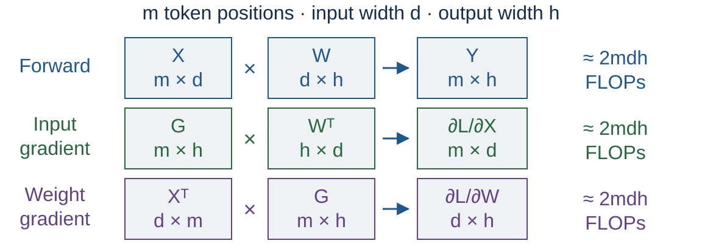
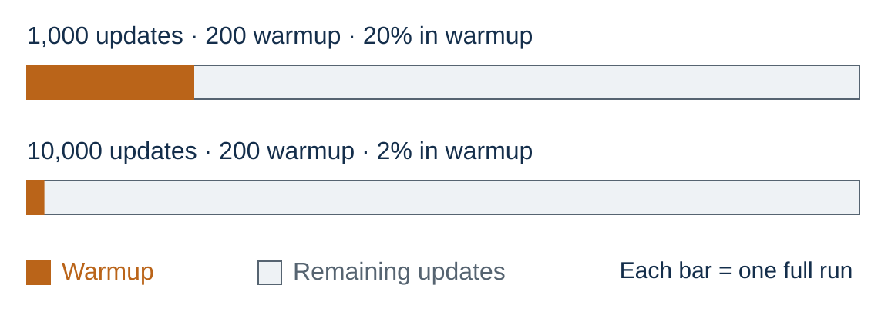
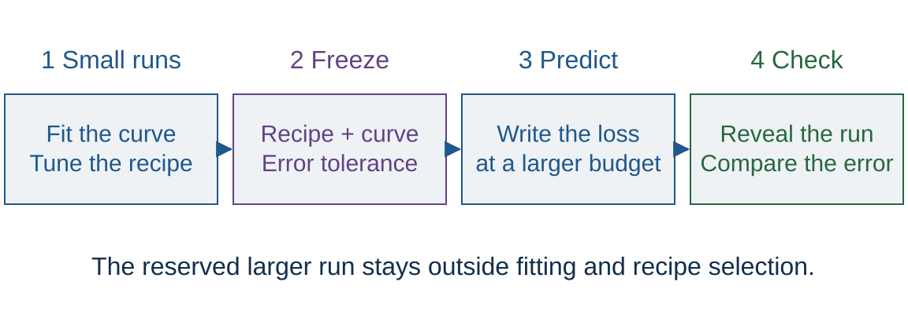

<!-- .slide: class="title-slide" id="title" -->

CS40008.01

# 计算预算与缩放规律

第 07 讲 – 自然语言处理与大语言模型

Baojian Zhou 数据科学学院 复旦大学 2026 年 10 月 21 日

Note:
在原定的 15 分钟小测验 3 时段（13:30–13:45）显示封面。题目和答案是单独的私有材料。本课件只包含不计分的课堂练习。收卷后，第一部分讲到 14:15；第二部分为 14:25–15:10。第 8 节课（15:25–16:10）留给 Zou Jiaxuan 的嘉宾讲座。嘉宾欢迎页是等待页面，不替代他的演讲。

---

<!-- .slide: id="today" -->

## 今天的课程

| 时间 | 内容 |
| --- | --- |
| 13:30–14:15 | 小测验 3，接着讲计算预算 |
| 14:25–15:10 | 缩放规律与预测 |
| 15:25–16:10 | Zou Jiaxuan：科学研究中的规模阶梯 |

下周：数据准备与质量。所有时间均为上海时间。

Note:
小测验后于 13:45 开始。第 2–3 页共安排两分钟。解释与第 08 讲的主题互换，保留两次课间休息。项目提案截止于今晚 10 月 21 日 23:59；A2 仍于 10 月 31 日 23:59 截止，通过 eLearning 提交。不要让 notebook 配置延误占用嘉宾时段。来源：../../docs/schedule.md。

---

<!-- .slide: id="learning-objectives" -->

## 学习目标

**小规模运行如何指导更大的训练预算？**

- 估算训练计算量和持久内存。
- 在成本相同时比较模型规模与训练词元数。
- 解读幂律拟合，并检查外推结果。
- 在投入更多资源前设计受控实验。

Note:
这些目标建立在第 05 讲的参数计数和第 06 讲的训练记录之上。示例特意使用合成数据，因此无需训练模型即可复现代数计算、拟合和失败的外推；它不能作为实际模型系列的证据。四个不计分练习对所有学生的要求相同。

---

<!-- .slide: id="run-record" -->

## 一次运行对应一个数据点

| 记录 | 含义 |
| --- | --- |
| $N$ | 声明的模型参数数量 |
| $D$ | 处理过的训练词元数 |
| $C$ | 估算或测量的训练浮点运算次数（FLOPs） |
| $L$ | 在固定评估语料库上的损失 |

记录中还应包含词元化器、数据划分、架构和训练方案。

Note:
安排两分钟。回顾第 06 讲：损失值只有结合运行配置和评估约定才有意义。这里所有处理过的词元都参与评分，L 是留出集上的词元加权负对数似然，单位为 nats/token。在真实日志中，区分已处理词元、参与评分的词元、不同词元、填充和重复出现。用于拟合规律的参数计数与用于计算量统计的执行操作计数不必采用相同约定。来源：Kaplan et al. §2，https://arxiv.org/abs/2001.08361；Hoffmann et al. §3 和附录 F，https://arxiv.org/html/2203.15556v1。

---

<!-- .slide: id="training-flops" -->

## 系数 6 从何而来？

$G=\partial L/\partial Y$。三次稠密矩阵乘法：约 $6m(dh)$ FLOPs。整个训练过程：$C\approx 6ND$。

Note:
安排三分钟。回顾第 03 讲的反向传播和第 05 讲的矩阵维度。将批次和序列展平为 m 个词元位置；这一层有 dh 个权重。乘法和加法计为两次运算，因此三个矩阵乘积各需约 2mdh 次浮点运算。G 是传入的梯度，而不是另一个可学习矩阵。当这些运算占主导时，对所有稠密层和处理过的 D 个词元求和得到 6ND。这一近似忽略偏置和逐元素计算。词元查找不会对所有嵌入权重做乘法；绑定权重的输出头仍需做词表投影。注意力与检查点重算会增加计算量。说明 N 的计数约定。这不是精确的运行时间或硬件成本模型。来源：Kaplan et al. 附录 A；Hoffmann et al. 附录 F；Porian et al. §3.1，https://arxiv.org/html/2406.19146v4。课程原创可编辑示意图。

---

<!-- .slide: class="exercise" id="exercise-01" -->

练习 E01 · 4 分钟 · 练习本 E01

## 哪次运行的成本更高？

| 运行 | 参数 $N$ | 训练词元 $D$ |
| --- | ---: | ---: |
| A | 5000 万 | 40 亿 |
| B | 2 亿 | 10 亿 |

分别估算 $6ND$。相同的 FLOPs 是否意味着相同的内存或损失？

两者都是 $1.2\times10^{18}$ FLOPs。内存和损失可能不同。

Note:
四分钟包括讲评。预期回答：6 × 50e6 × 4e9 = 6 × 200e6 × 1e9 = 1.2e18。B 的参数数目为四倍，但处理的词元数只有四分之一。学生不应仅凭计算量判定优劣。常见错误：将十亿算作 10^6，或用优化器更新次数替代 D。练习本会在下一页明确的假设下计算这两个估算值和持久模型状态的字节数。

---

<!-- .slide: id="memory" -->

## 持久训练状态

**教学假设：**参数、梯度和 Adam 动量均为 FP32。

| 状态 | 字节数 |
| --- | ---: |
| 参数和梯度 | $8N$ |
| 两个 Adam 动量数组 | $8N$ |
| 持久数组总计 | $16N$ |

50M：0.8 GB；200M：3.2 GB。GB 采用十进制；不含激活值和临时缓冲区。

Note:
安排两分钟。计算包含优化器状态初始化后四个每元素 4 字节的数组。实际峰值内存还包括保存的激活值、logits、临时工作空间、分配器影响及框架的管理开销。精度选择、主权重、优化器实现和分片方式都会改变计算结果。相同 FLOPs 不能保证两次运行都能放入内存。更长的上下文可能显著增加注意力计算量和激活内存。这是在明确假设下的算术计算，不是 GPU 测量或内存分配保证。联系学生在第 06 讲检查过的模型状态。

---

<!-- .slide: id="wall-clock" -->

## FLOPs 与实际耗时

$$t \approx \frac{C}{\text{effective FLOPs per second}}$$

对于 $1.2\times10^{18}$ FLOPs 的示例：

- 假设一块加速器的**持续吞吐量为 100 TFLOP/s**。
- 估计计算时间：**12,000 秒 ≈ 3.33 小时**。
- 评估、检查点和数据等待还会增加耗时。

吞吐量仅为示例假设，应在目标硬件上测量实际模型。

Note:
安排两分钟。这不是任何 GPU 的规格。有效吞吐量只包含所测工作时段内的利用率，因此要避免重复计入相同开销。多设备时使用测得的总吞吐量，并统计所有设备及尝试的 GPU 小时总数。较小的模型可能有更低的硬件利用率。FLOPs 最优和实际耗时最优的选择可能不同。练习本只使用算术运算，今天无需 GPU。

---

<!-- .slide: id="equal-compute" -->

## 相同计算量，不同分配

合成示例：$D=C/(6N)$。最优分配位于测试范围内部。

Note:
安排三分钟。讨论曲线前先读坐标轴：横轴是以百万计的参数数目，采用对数刻度；纵轴是合成的评估负对数似然，单位为 nats/token。增大 N 会迫使 D 减小。小模型受容量项影响，而此截面中的较大模型接受的训练更少。这些点由 L = 1.5 + 0.8 / sqrt(N/1e8) + 0.8 / sqrt(D/2e9) 生成，不来自论文或实际训练任务。U 形实验设计借鉴 Hoffmann et al. §3.2。在这个人为构造的损失面上，最小值对应 100M 参数和 2B 词元。

---

<!-- .slide: id="loss-surface" -->

## 权衡的一个模型

$$L(N,D)=E+\frac{A}{N^\alpha}+\frac{B}{D^\beta}$$

| 项 | 含义 |
| --- | --- |
| $E$ | 该设置下拟合出的损失下界 |
| $A/N^\alpha$ | 模型规模的贡献 |
| $B/D^\beta$ | 训练词元数的贡献 |

Hoffmann et al. (2022)，§3.3。在指定范围内拟合的经验模型。

Note:
安排三分钟。E、A、B、alpha 和 beta 是拟合值，不是普适常数。在玩具示例中，使用无量纲的 n=N/1e8 和 d=D/2e9，并取 E=1.5、A=B=0.8、alpha=beta=0.5。单位会影响系数。数据重复、架构改变、优化器质量以及领域变化都可能使模型失效。拟合结果不能证明其极限 E 是语言的真实熵。来源：https://arxiv.org/html/2203.15556v1#S3.SS3。

---

<!-- .slide: id="power-law" -->

## 解读幂律

$$L(C)-E=K(C/C_0)^{-\gamma}$$
$$\log(L-E)=\log K-\gamma\log(C/C_0)$$

- 相同的计算量倍数对应相同的**超额损失**比例。
- 双对数图上的斜率为 $-\gamma$。
- 未知的损失下界会使拟合更困难。

参考预算：$C_0=1.2\times10^{18}$ FLOPs。

Note:
安排两分钟。前沿指在给定协议下每个计算量水平能达到的最佳分配，而不是每次任意训练运行。对玩具损失面求最小值，在 C0=1.2e18 时得到 K=1.6、gamma=0.25。计算量增至四倍时，超额损失乘以 4^-0.25 ≈ 0.7071。由于存在 E，总损失不会按同一比例缩小。即使外推失败，有限区间内也可能呈现直线。Kaplan et al. §§1–3 提供经验幂律的研究动机：https://arxiv.org/abs/2001.08361。

---

<!-- .slide: id="historical-evidence" -->

## Chinchilla 带来了什么变化？

| 研究 | $N_{\mathrm{opt}}$ 随计算量变化 | $D_{\mathrm{opt}}$ 随计算量变化 |
| --- | --- | --- |
| Kaplan et al. (2020) | $\propto C^{0.73}$ | $\propto C^{0.27}$ |
| Hoffmann et al. (2022)，IsoFLOP 拟合 | $\propto C^{0.49}$ | $\propto C^{0.51}$ |

较晚的估计将每次预算增量中更大的比例分配给训练词元。

不同实验协议下的历史估计；Hoffmann et al.，表 2。

Note:
安排一分钟。只介绍回答分配问题所需的历史比较。Hoffmann et al. 用 1.4T 词元训练了 70B 的 Chinchilla，与 Gopher 的 280B 参数和 300B 词元相比，在近似相同的训练预算下取得了更好的表现。不要将表格描述为两个相互竞争的普遍真理。他们的三种拟合方法得到的指数略有不同；表格明确采用 IsoFLOP 方法。来源：https://arxiv.org/html/2203.15556v1#S3.SS4 和表 1；Kaplan et al.，https://arxiv.org/abs/2001.08361。

---

<!-- .slide: id="chinchilla-case" -->

## 更小的模型，更多的训练词元

| 报告的模型 | 参数 | 训练词元 |
| --- | ---: | ---: |
| Gopher | 280B | 300B |
| Chinchilla | 70B | 1.4T |

在相近的训练预算下，Chinchilla 在论文评估的任务中表现更好。

<a href="https://arxiv.org/html/2203.15556v1#S4">Hoffmann et al. (2022)</a>，表 1 和 §4。这里是论文报告的模型，与我们的合成示例无关。

Note:
安排一分钟。询问参数数量下降时哪项数值增加了。论文报告训练预算相同。将取整后的参数和词元数量代入 6ND 得到 5.04e23 和 5.88e23 FLOPs，因此不要声称按此近似计算两者完全相等；附录 F 解释了详细的 FLOP 统计。这个比较为研究分配提供动机，但没有将分配作为唯一变化变量；论文还记载了训练方案的变化。不要将其系数套用于我们构造的损失面。

---

<!-- .slide: id="protocol-matters" -->

## 训练协议会影响拟合结果

Porian et al. 重新研究了 Kaplan 与 Chinchilla 结果的差异：

- 纳入最后一层词表投影的计算量。
- 考虑预热持续时间。
- 在不同规模下调节优化器设置。

Porian et al. (2024)，§§3–4。这些修正使他们的结果接近 Chinchilla 缩放规律。

Note:
安排两分钟，然后在 14:15 休息。曲线可能部分反映训练过程，而非模型的内在局限。该论文发现，恢复这一分配规律并不依赖精心设计的学习率衰减，因此不要声称仅靠余弦调度解释了此前的分歧。来源：https://arxiv.org/html/2406.19146v4。第二课时介绍学生可以带入嘉宾讲座的基本推断问题。

---

<!-- .slide: class="outline-slide" id="outline-prediction" -->

## 缩放规律与预测

<ul class="outline-topics">
<li>计算预算</li>
<li aria-current="step">分配与外推</li>
<li>Jiaxuan Zou 的科学规模阶梯</li>
</ul>

第二课时 · 14:25–15:10

Note:
安排一分钟。重新展示分配曲线，询问需要什么证据才能将其最小值推广到更大的预算。区分预测与保证。浏览器和练习本使用相同的合成示例。

---

<!-- .slide: id="optimal-allocation" -->

## 固定预算下的分配

将 $D=C/(6N)$ 代入损失模型。

$$L(N)=E+A N^{-\alpha}+B(6N/C)^\beta$$

在最小值处：

$$\alpha A N^{-\alpha}=\beta B D^{-\beta}$$
$$N_{\mathrm{opt}}\propto C^{\beta/(\alpha+\beta)},\qquad
D_{\mathrm{opt}}\propto C^{\alpha/(\alpha+\beta)}$$

Note:
安排三分钟。对 log N 求导：-alpha A N^-alpha + beta B(6N/C)^beta = 0。当系数和指数均为正时，这是唯一的最小值。常数取决于单位和拟合系数。只有 alpha=beta 时，超额损失的两项贡献才相等。指数相等时，N 和 D 都按 sqrt(C) 增长。来源：Hoffmann et al. §3.3，公式 4，https://arxiv.org/html/2203.15556v1#S3.SS3。这不意味着真实拟合必须满足 alpha=beta。

---

<!-- .slide: class="exercise" id="exercise-02" -->

练习 E02 · 4 分钟 · 练习本 E02

## 四倍训练预算

我们的玩具模型中 $\alpha=\beta=0.5$。

在 $C_0$ 下，其最优值为 **100M 参数、2B 词元**。

在 $4C_0$ 下它预测的分配是什么？
如果把全部增量都用于参数，会怎么样？

均衡分配：<strong>200M，4B</strong>。只增加参数：<strong>400M，2B</strong>，玩具损失更高。

Note:
四分钟包括讲评。sqrt(4)=2，因此两个维度各增至两倍。均衡分配的损失为 1.5+1.6/sqrt(2)=2.63137085；另一方案为 1.5+0.8/2+0.8=2.7。按近似公式两者均使用 4.8e18 FLOPs。练习本将解析最优值与对数间隔网格搜索进行比较，同时检查更大和更小的预算。指数相等只在这个模型内产生固定的 D/N。

---

<!-- .slide: id="budget-demo" -->

## 调整预算

<button type="button" id="budget-button">预算：1×</button> <button type="button" id="reset-button">重置</button>

合成最优值：100M 参数、2B 词元；损失 3.100。

Note:
安排两分钟。依次切换 1×、4×、16×。最小值分别移至 100M、200M、400M 参数，对应 2B、4B、8B 训练词元。重置会恢复初始状态。曲线是解析示例，可离线使用。读取状态行中的总预算；横轴单位是百万参数。PDF 使用初始状态。演示一轮后停止，为推断和嘉宾留出时间。

---

<!-- .slide: id="experiment-grid" -->

## 实验必须区分变量

两个坐标轴均采用对数刻度。交叉设置区分模型规模与词元数的影响。

Note:
安排两分钟。这是建议的实验设计图，并非已完成的训练。3×3 拟合网格使用 N=25M、50M、100M 和 D=0.5B、1B、2B；示例性的大规模验证点为 N=200M、D=4B。两个维度均发生变化，可以计算每个候选方案的成本。3×3 网格并非足以识别全部五个非线性系数或估计不确定性的一般方案。本课只在已给定下界的情况下拟合一维合成前沿。设计思路与 Hoffmann et al. §3 有关；嘉宾文章讨论更广泛的规模阶梯选择。

---

<!-- .slide: id="recipe-and-frontier" -->

## 我们要预测什么？

| 目标 | 实验 |
| --- | --- |
| 预测选定的训练方案 | 应用其声明的缩放规则 |
| 估计最佳分配 | 比较经过充分调优的候选方案 |

已测试运行中的最低损失构成**测得的包络线**。
尚未测试的选择可能进一步改善它。

Note:
安排一分钟。这个简短区分为 Jiaxuan 的文章 §2.1 做准备：https://jiaxuanzou0714.github.io/blog/2026/how-to-build-scientific-scaling-ladder/。调优质量和预测质量回答不同问题。对优化不足的小模型拟合所得的曲线可能误导计算资源分配决策。固定方案即使不是最佳方案，仍可能值得预测。将调参运行、重复种子和验证运行计入实验预算。不要复述或抢先讲完嘉宾的完整方法。

---

<!-- .slide: id="warmup-confound" -->

## 固定预热可能改变比较结果

玩具算术示例。相同的预热步数可能对应不同的训练阶段占比。

Note:
安排一分钟。回顾第 06 讲中的学习率计划端点。如果批量大小变化，更新步数占比和词元数占比也可能不同。本页不规定普适的预热比例，而是展示需要控制或有意研究的潜在混杂因素。Porian et al. §3.2 讨论了预热对计算最优估计的影响：https://arxiv.org/html/2406.19146v4。muP 等超参数迁移是有价值的选读，但并不保证所有超参数都能跨深度、数据或训练时长变化迁移。

---

<!-- .slide: id="evaluation-contract" -->

## 可比较的测量

- 相同的留出文本和领域权重。
- 相同的词元化方式与评分位置。
- 相同的损失聚合方式和报告单位。
- 记录精度、学习率计划和随机种子。

改变数据混合也会改变其训练损失分布。

第 08 讲将详细讨论过滤、重复和数据污染。

Note:
安排两分钟。针对固定的外部语料库评估不同的训练数据混合。更换词元化器后，每词元损失的单位也随之变化；第 02 讲的每字节比特数提供了同一文本上的比较方式。在适当情况下配对种子，但仍要量化独立运行之间的差异。验证分为两个不同层次：留出文本衡量单次运行的泛化，而留出规模检验跨运行的拟合预测。若要将后者作为最终检查，它必须排除在方案选择和拟合之外。

---

<!-- .slide: id="freeze-before-validation" -->

## 大规模运行前冻结预测

如果这次运行改变了方案或拟合结果，应再留出一次运行进行新的检验。

Note:
安排两分钟。这是小预算图之后练习 E03 的工作流程。询问在查看留出行之前必须写下什么：拟合系数、评估约定、目标预算、预测值和接受规则。每次运行中的留出文本划分与跨运行的留出规模回答不同问题。最终的大规模条件既不能参与方案选择，也不能参与曲线拟合。练习本使用给定的下界和预先声明的容差。下一次独立检验也需要计算预算。课程原创示意图；更广泛的验证讨论见 Jiaxuan Zou 的文章 §§8 和 10：https://jiaxuanzou0714.github.io/blog/2026/how-to-build-scientific-scaling-ladder/。

---

<!-- .slide: id="fit-data" -->

## 拟合小规模合成前沿

两个坐标轴均采用对数刻度。已知下界 $E=1.5$；每个预算有三个合成重复样本。

Note:
安排两分钟。横轴 C/C0 的值为 0.25、1、4、16。数据生成器采用 L=1.5+1.6(C/C0)^-0.25，并添加 -0.01、0、+0.01 的重复偏移。图中展示拟合范围内的均值和生成曲线。这些是人为构造的重复样本，不是测得的随机种子结果或真实噪声估计。先计算每个预算的平均 L，再用 log(C/C0) 拟合 log(mean L-E)。给定 E 使其成为容易理解的线性拟合；在研究中 E 通常未知，需要联合拟合或敏感性分析。

---

<!-- .slide: class="exercise" id="exercise-03" -->

练习 E03 · 7 分钟 · 练习本 E03

## 查看大规模运行前先做预测

1. 用 $E=1.5$ 拟合给定的四个预算均值。
2. 预测 $C/C_0=64$ 时的损失。
3. 查看合成留出结果并比较。

本练习预先规定的容差为 **0.05 nats/token**。

拟合：$K=1.6$，$\gamma=0.25$。预测：$2.066$。留出值：$2.226$。误差：$0.160$。

Note:
七分钟包括运行练习本和讨论。拟合仅使用标为 fit 的行。留出均值有意增加了 0.16 的偏移，重复样本偏移仍相同。绝对残差 0.16 超过示例容差 0.05，因此即使小预算均值拟合完全准确，该预测仍未通过这次检验。这不是置信区间或普适阈值。必须在查看留出结果之前确定容差；事后更改会使练习失效。学生不运行代码也可以计算比例。不要用留出数据拟合后又声称用其完成验证。

---

<!-- .slide: id="holdout-result" -->

## 平滑的拟合也可能无法预测更大规模

合成失败案例。虚线：外推；红点：留出的大预算结果。

Note:
安排两分钟。这里纵轴是线性刻度的总负对数似然，而非对数超额损失；明确指出这一变化。较大规模点未参与拟合或方案选择。检验失败需要诊断和新证据。若用它修改曲线或选择方案，它就成为开发数据，必须另留一个点用于独立的最终检验。人为加入的偏移不能确定任何物理原因。

---

<!-- .slide: id="diagnose-failure" -->

## 诊断预测失败

| 可能的问题 | 下一步证据 |
| --- | --- |
| 优化过程随规模变化 | 损失曲线、学习率扫描、稳定性日志 |
| 数据或统计口径变化 | 审核语料、词元和 FLOP |
| 曲线形式不适用于该范围 | 中间规模和其他拟合形式 |
| 运行间差异有影响 | 独立重复和配对差异 |

Note:
安排两分钟。这些是相互竞争的假设，单靠合成示例无法从中做出选择。检查测量后重新拟合。报告预测残差和结果对拟合选择的敏感性，并将不确定性传递到决策中，例如选择训练哪个 N。残差小并不能证明分配最优，拟合范围内的高 R 平方也不能证明外推有效。这是课程编写的实验推理；Jiaxuan 的文章 §§8 和 10 扩展了实际验证流程。

---

<!-- .slide: id="scope-of-law" -->

## 目标决定最优值

| 额外约束 | 会发生什么变化 |
| --- | --- |
| 不重复数据有限 | 更多词元可能意味着重复使用数据 |
| 推理需求大 | 训练和服务成本都要考虑 |
| 稀疏专家 | 总参数量与活跃参数量不同 |

“每个参数 20 个词元”是与特定训练设置相关的起始启发式规则。

Note:
安排两分钟。不要将玩具系数直接用于这些情形。Muennighoff et al. 研究了数据受限训练中的重复数据，https://arxiv.org/abs/2305.16264。Sardana et al. 将推理需求纳入成本目标，https://arxiv.org/abs/2401.00448。对于稀疏专家，估算实际算子与通信成本需要更多细节，不能仅用单一概括性数字替代 N。Chinchilla 启发式规则来自特定拟合设置及参数计数约定。这是术语上的衔接；完整的 MoE 优化不属于今天的核心内容。

---

<!-- .slide: id="loss-and-capability" -->

## 较低的损失与实际能力

留出集负对数似然衡量平均预测质量。

任务成功率还取决于：

- 任务测试的样本与领域。
- 提示词、解码和评分方式。
- 评分能否区分小模型。

损失预测需要针对预期用途单独检验。

Note:
安排两分钟。平均负对数似然改善时，准确率可能仍处于随机水平或已经饱和。代理指标必须针对目标比较进行验证，不能假定它在更大规模下仍保持模型排名。任务特定的评估设计留给第 09 讲和嘉宾的示例。关于预训练损失降低与下游评估之间较窄的经验联系，见 Hoffmann et al. §4.2，https://arxiv.org/html/2203.15556v1。这不意味着达到某个损失阈值就能保证特定能力。

---

<!-- .slide: class="exercise" id="exercise-04" -->

练习 E04 · 3 分钟 · 练习本 E04

## 一份小实验提案

你有预算进行 **12 次运行**。

说明比较对象、固定评估集和运行次数分配。
包括重复运行和一个更大规模的验证条件。

什么结果会让你推迟大型运行？

Note:
三分钟包括讲评。一种可接受的预测比较使用两种候选方案、两个较小拟合规模和两个随机种子：2×2×2=8 次运行。另为更大规模保留两种方案 × 两个种子，共 4 次运行。12 个运行名额并不意味着 FLOP 成本相等，因此在认定预算足够之前要计算每一行的成本。两个拟合规模只是有限的课堂设计，不足以稳健拟合五参数损失面或可靠估计不确定性。预期回答需说明冻结的数据和词元化器、损失约定、候选方案的变化、计算量维度及预先声明的决策阈值。在证据不足时拒绝自信地宣布优胜者也是可接受的。

---

<!-- .slide: id="questions-for-guest" -->

## 向 Jiaxuan 提问

- 哪些小规模实验最有信息量？
- 超参数迁移何时会失效？
- 如何留出预算来检验外推？
- 什么证据会让你停止计划中的大型运行？

<a href="https://jiaxuanzou0714.github.io/blog/2026/how-to-build-scientific-scaling-ladder/">How to Build a Scientific Scaling Ladder</a>

Note:
第 31–32 页共安排三分钟，在 15:10 前结束。请每名学生选择一个问题带入嘉宾讲座。这些是教师提出的讨论问题，不是已与演讲者约定的议程。链接文章是课前阅读，也是教师确定的讲座依据。不要将玩具示例或教学阈值归因于 Jiaxuan。

---

<!-- .slide: id="coursework" -->

## 将这些方法用于项目

有用的实验应说明：

- 它将帮助做出什么决策。
- 比较对象与对照。
- 计算量估算与较小的备选方案。
- 什么证据会改变结论。

提案：10 月 21 日 23:59。A2：10 月 31 日 23:59。通过 eLearning 私下提交。

Note:
在 15:10 前结束。这一页将课程与现有项目提案联系起来，不增加任何提交物或评分标准。完整项目范围和要求仍以公开项目说明为准。在 15 分钟的休息时间展示嘉宾欢迎页，让嘉宾掌控最后一个课时。如果进度落后，缩短第 27–29 页，并将 E04 改为口头讨论。保留嘉宾开始时间。

---

<!-- .slide: class="section-slide" id="guest-welcome" -->

## 如何构建科学的规模阶梯

**Jiaxuan Zou**

西安交通大学 
字节跳动 Seed 预训练团队研究实习生

嘉宾讲座 · 10 月 21 日 · 15:25–16:10

<a href="https://jiaxuanzou0714.github.io/">演讲者网站</a> · <a href="https://jiaxuanzou0714.github.io/blog/2026/how-to-build-scientific-scaling-ladder/">讲座阅读材料</a>

Note:
建议的介绍，计入嘉宾的 45 分钟时段：Jiaxuan 是西安交通大学数学与统计专业的本科生，也是字节跳动 Seed 预训练团队的研究实习生。他的兴趣包括优化、深度学习理论和缩放规律。今天他将根据这里链接的文章讨论如何构建科学的规模阶梯。介绍前应向演讲者核实最新单位信息。网站核查日期为 2026 年 10 月 20 日：https://jiaxuanzou0714.github.io/。建议时间分配，可依演讲者意愿调整：介绍 2 分钟、讲座 33 分钟、提问 10 分钟。这里不包含也不承诺提供嘉宾幻灯片或录音。

---

<!-- .slide: class="references" id="references" -->

## 阅读材料

- [Kaplan et al. (2020)](https://arxiv.org/abs/2001.08361)，§§2–3 和附录 A。
- [Hoffmann et al. (2022)](https://arxiv.org/html/2203.15556v1)，§3 和附录 F。
- [Porian et al. (2024)](https://arxiv.org/html/2406.19146v4)，§§3–4。
- [Jiaxuan Zou：科学的规模阶梯](https://jiaxuanzou0714.github.io/blog/2026/how-to-build-scientific-scaling-ladder/)，§§1–3 和 10。

配套练习本不计分，可使用 Python 标准库离线运行。

Note:
本地阅读指南 optional-reading.md 为这些资料提供简短的阅读路径和问题。其他选读：Yang et al., Tensor Programs V，https://arxiv.org/abs/2203.03466，介绍 muP 与超参数迁移；Muennighoff et al.，https://arxiv.org/abs/2305.16264，介绍重复数据；Sardana et al.，https://arxiv.org/abs/2401.00448，介绍考虑推理成本的分配。在核心材料之后阅读这些内容。不新增固定参考文献数量或额外作业。本课件中的所有数值曲线均为课程编写的合成示例，不是论文报告的研究测量值。
